# Russian OCR Benchmark

Бенчмарк OCR для современного и исторического русского текста. Версия **v2**.

Инструкция по полному воспроизведению окружений, загрузке моделей и датасетов, запуску задач и пересборке таблиц: [REPRODUCING.md](REPRODUCING.md).

Известные проблемы моделей, ограничения и рабочие обходные пути: [KNOWN_ISSUES.md](KNOWN_ISSUES.md).

Протестировано **70 модели/конфигурации** на **15 наборах данных** в четырёх задачах: детекция слов, детекция строк, распознавание слов и распознавание строк.

## Модели

| Модель | Источник | Лицензия |
| --- | --- | --- |
| `dbnet_khmer_word` | [source](https://huggingface.co/Darayut/dbnet-khmer) | MIT |
| `east_50_yenisei_gov_reports_g1` | [source](https://github.com/konstantinkozhin/manuscript-ocr) | MIT |
| `east_50_g1` | [source](https://github.com/konstantinkozhin/manuscript-ocr) | MIT |
| `yolo26s_obb_text_g1` | [source](https://github.com/konstantinkozhin/manuscript-ocr) | AGPL-3.0 |
| `yolo26x_obb_text_g1` | [source](https://github.com/konstantinkozhin/manuscript-ocr) | AGPL-3.0 |
| `yolo11n_text` | [source](https://huggingface.co/RoyRud1902/yolo11n-text) | Apache-2.0 |
| `yolo11x_dialectic` | [source](https://huggingface.co/Daniil-Domino/yolo11x-dialectic) | AGPL-3.0 |
| `craft_easyocr` | [source](https://github.com/JaidedAI/EasyOCR) | Apache-2.0 |
| `paddleocr_v6_medium_word` | [source](https://www.paddleocr.ai/latest/en/version3.x/algorithm/PP-OCRv6/PP-OCRv6.html) | Apache-2.0 |
| `doctr_db_resnet50` | [source](https://github.com/mindee/doctr) | Apache-2.0 |
| `openocr_repvit_db` | [source](https://github.com/Topdu/OpenOCR) | Apache-2.0 |
| `nemotron_ocr_v2_multilingual_line` | [source](https://huggingface.co/nvidia/nemotron-ocr-v2) | NVIDIA Open Model License / Apache-2.0 |
| `ndlocr_lite_deimv2_line` | [source](https://github.com/ndl-lab/ndlocr-lite) | CC-BY-4.0 / DINOv3 |
| `regnetx_8gf_polyline_baseline_stage0_line` | [source](https://huggingface.co/johnlockejrr/regnetx-8gf-polyline-baseline-stage0) | Apache-2.0 |
| `arjuna_ocr_kn_en_line` | [source](https://huggingface.co/anandkaman/arjuna-ocr-kn-en) | Apache-2.0 |
| `ppocrv6_manga_det_v02_line` | [source](https://huggingface.co/Kellenok/PP-OCRv6_manga) | Apache-2.0 |
| `paddleocr_v6_medium_line` | [source](https://www.paddleocr.ai/latest/en/version3.x/algorithm/PP-OCRv6/PP-OCRv6.html) | Apache-2.0 |
| `paddleocr_v6_small_line` | [source](https://www.paddleocr.ai/latest/en/version3.x/module_usage/text_detection.html) | Apache-2.0 |
| `paddleocr_v6_tiny_line` | [source](https://www.paddleocr.ai/latest/en/version3.x/module_usage/text_detection.html) | Apache-2.0 |
| `paddleocr_v5_mobile_line` | [source](https://www.paddleocr.ai/latest/en/version3.x/module_usage/text_detection.html) | Apache-2.0 |
| `paddleocr_v5_server_line` | [source](https://www.paddleocr.ai/latest/en/version3.x/module_usage/text_detection.html) | Apache-2.0 |
| `rfdetr_textline_textregion_2xl` | [source](https://huggingface.co/Kansallisarkisto/rfdetr-textline-textregion-detection-2xl) | Apache-2.0 |
| `rfdetr_textline_textregion_seg_preview` | [source](https://huggingface.co/Kansallisarkisto/rfdetr_textline_textregion_detection_model) | Apache-2.0 |
| `court_records_textline_yolov8x_seg` | [source](https://huggingface.co/Kansallisarkisto/court-records-textline-detection) | AGPL-3.0 |
| `yolov8m_historical_line_segmenter` | [source](https://huggingface.co/abhishekjha1008/yolov8m-historical-line-segmenter) | AGPL-3.0 |
| `lamop_yolo26n_textline_seg` | [source](https://huggingface.co/LaMOP/Yolo-Seg-TextRegion-TextLine-Manuscript) | CC0-1.0 |
| `lamop_yolo26x_textline_seg` | [source](https://huggingface.co/LaMOP/Yolo-Seg-TextRegion-TextLine-Manuscript) | CC0-1.0 |
| `mask2former_line_v0_prev` | [source](https://github.com/konstantinkozhin/manuscript-ocr) | CC-BY-NC-3.0 |
| `doc_ufcn_generic_historical_line` | [source](https://huggingface.co/Teklia/doc-ufcn-generic-historical-line) | MIT |
| `doc_ufcn_generic_historical_line_x3_y8` | [source](https://huggingface.co/Teklia/doc-ufcn-generic-historical-line) | MIT |
| `surya_text_line_detection` | [source](https://github.com/datalab-to/surya) | Apache-2.0 |
| `kraken_blla_default` | [source](https://github.com/mittagessen/kraken) | Apache-2.0 |
| `pero_layout_general` | [source](https://github.com/DCGM/pero-ocr) | BSD-3-Clause |
| `riksarkivet_rtmdet_lines` | [source](https://huggingface.co/Riksarkivet/rtmdet_lines) | MIT |
| `trba_lite_g1` | [source](https://github.com/konstantinkozhin/manuscript-ocr) | MIT |
| `trba_base_g1` | [source](https://github.com/konstantinkozhin/manuscript-ocr) | MIT |
| `cyrillic_g1` | [source](https://github.com/JaidedAI/EasyOCR) | Apache-2.0 |
| `cyrillic_g2` | [source](https://github.com/JaidedAI/EasyOCR) | Apache-2.0 |
| `paddleocr_cyrillic_v5_mobile` | [source](https://huggingface.co/PaddlePaddle/cyrillic_PP-OCRv5_mobile_rec) | Apache-2.0 |
| `paddleocr_eslav_v5_mobile` | [source](https://huggingface.co/PaddlePaddle/eslav_PP-OCRv5_mobile_rec) | Apache-2.0 |
| `paddleocr_v6_medium_ru` | [source](https://huggingface.co/vladlinv/PP-OCRv6_medium_rec_ru) | Apache-2.0 |
| `paddleocr_v6_tiny_ru` | [source](https://huggingface.co/vladlinv/PP-OCRv6_tiny_rec_ru) | Apache-2.0 |
| `trocr_ru_1700s` | [source](https://huggingface.co/taiga75/ru-trocr-1700s) | MIT |
| `trocr_prereform_orthography` | [source](https://huggingface.co/Serovvans/trocr-prereform-orthography) | OpenRAIL |
| `trocr_russian_18th_century_printed` | [source](https://huggingface.co/dsmchr/trocr_russian_18th_century_printed) | CC-BY-NC-4.0 |
| `trocr_handwritten_cyrillic` | [source](https://huggingface.co/cyrillic-trocr/trocr-handwritten-cyrillic) | MIT |
| `trocr_church_slavonic_handwritten` | [source](https://huggingface.co/cyrillic-trocr/trocr-church-slavonic-handwritten) | Apache-2.0 |
| `trocr_dialectic_stackmix` | [source](https://huggingface.co/Daniil-Domino/trocr-base-ru-dialectic-stackmix) | Apache-2.0 |
| `trocr_dialectic` | [source](https://huggingface.co/Daniil-Domino/trocr-base-ru-dialectic) | Apache-2.0 |
| `trocr_base_ru` | [source](https://huggingface.co/raxtemur/trocr-base-ru) | Apache-2.0 |
| `trocr_base_handwritten_ru` | [source](https://huggingface.co/kazars24/trocr-base-handwritten-ru) | Не указана |
| `parseq_s_rukopys` | [source](https://huggingface.co/Hukyl/parseq-s-rukopys) | CC-BY-SA-4.0 |
| `parseq_b_rukopys` | [source](https://huggingface.co/Hukyl/parseq-b-rukopys) | CC-BY-SA-4.0 |
| `trocr_rukopys` | [source](https://huggingface.co/Hukyl/trocr-rukopys) | CC-BY-SA-4.0 |
| `trocr_large_rukopys_hw` | [source](https://huggingface.co/Hukyl/trocr-large-rukopys-hw) | Apache-2.0 |
| `cyrillic_htr_model` | [source](https://huggingface.co/Kansallisarkisto/cyrillic-htr-model) | Apache-2.0 |
| `cyrillic_large_handwritten` | [source](https://huggingface.co/Kansallisarkisto/cyrillic-large-handwritten) | Apache-2.0 |
| `crnn_ctc_church_slavonic` | [source](https://huggingface.co/achimrabus/crnn-ctc-church-slavonic) | Apache-2.0 |
| `crnn_ctc_prosta_mova` | [source](https://huggingface.co/achimrabus/crnn-ctc-prosta-mova) | Apache-2.0 |
| `doctr_parseq_russian_onnx` | [source](https://huggingface.co/graycat660/doctr-parseq-russian-onnx) | Apache-2.0 |
| `doctr_crnn_vgg16_bn_russian_onnx` | [source](https://huggingface.co/graycat660/doctr-crnn-vgg16-bn-russian-onnx) | Apache-2.0 |
| `party_european_languages` | [source](https://zenodo.org/records/15764161) | Не указана |
| `party_multilingual_base` | [source](https://zenodo.org/records/20642057) | Apache-2.0 |
| `turkicocr_svtrv2_b` | [source](https://huggingface.co/alenisaw/turkicocr-svtrv2-b) | Apache-2.0 |
| `kraken_ppocrv6_medium` | [source](https://zenodo.org/records/21788410) | Apache-2.0 |
| `kraken_old_cyrillic_uncial` | [source](https://zenodo.org/records/7755483) | CC-BY-2.0 |
| `kraken_ppocrv6_small` | [source](https://zenodo.org/records/21788405) | Apache-2.0 |
| `kraken_ppocrv6_tiny` | [source](https://zenodo.org/records/21788403) | Apache-2.0 |
| `tesseract_rus_best` | [source](https://github.com/tesseract-ocr/tessdata_best/blob/main/rus.traineddata) | Apache-2.0 |
| `tesseract_cyrillic_best` | [source](https://github.com/tesseract-ocr/tessdata_best/blob/main/script/Cyrillic.traineddata) | Apache-2.0 |

Лицензии взяты из карточек моделей или исходных репозиториев.

## Датасеты

| Датасет | Источник | Лицензия | Использованное подмножество | Объём в бенчмарке |
| --- | --- | --- | --- | --- |
| `russian_old_orthography` | [source](https://huggingface.co/datasets/nevmenandr/russian-old-orthography-ocr) | MIT | А. В. Зражевская — «Женщина — поэт и автор»; все 39 страниц книги | детекция слов/строк — 39 страниц; распознавание — 8 489 слов и 1 406 строк |
| `YeniseiGovReports-TD` | [source](https://huggingface.co/datasets/anna4uonline/YeniseiGovReports-TD) | MIT | test | 270 изображений (детекция слов) |
| `school_notebooks_RU` | [source](https://huggingface.co/datasets/ai-forever/school_notebooks_RU) | MIT | validation | 150 страниц; 27 893 слова; 6 453 строки |
| `handwritten_essay` | [source](https://huggingface.co/datasets/sherstpasha/handwritten_essay) | CC-BY-NC-3.0 | валидационная часть из каталога `train/` | 28 страниц; 5 146 слов; 676 строк |
| `ICDAR2015` | [source](https://rrc.cvc.uab.es/?ch=4) | Условия ICDAR/RRC | test | 200 изображений (детекция слов) |
| `TotalText` | [source](https://github.com/cs-chan/Total-Text-Dataset) | BSD-3-Clause | test | 300 изображений (детекция слов) |
| `gota_hovratt_seg` | [source](https://huggingface.co/datasets/Riksarkivet/gota_hovratt_seg) | Не указана | все доступные пары изображение + PAGE XML | 51 изображение (детекция строк) |
| `svea_hovratt_seg` | [source](https://huggingface.co/datasets/Riksarkivet/svea_hovratt_seg) | Не указана | первые 100 PAGE XML в лексикографическом порядке | 100 изображений (детекция строк) |
| `bergskollegium_relationer_och_skrivelser_seg` | [source](https://huggingface.co/datasets/Riksarkivet/bergskollegium_relationer_och_skrivelser_seg) | Не указана | первые 100 PAGE XML в лексикографическом порядке | 100 изображений (детекция строк) |
| `YeniseiGovReports-HWR` | [source](https://huggingface.co/datasets/sherstpasha/YeniseiGovReports-HWR) | MIT | val | 22 400 слов |
| `YeniseiGovReports-PRT` | [source](https://huggingface.co/datasets/sherstpasha/YeniseiGovReports-PRT) | MIT | val | 15 394 слова |
| `cyrillic_handwriting` | [source](https://www.kaggle.com/datasets/constantinwerner/cyrillic-handwriting-dataset) | CC0-1.0 | test | 1 544 слова |
| `DonkeySmallOCR-Numbers-Printed-15random` | [source](https://huggingface.co/datasets/sherstpasha/DonkeySmallOCR-Numbers-Printed-15random) | Не указана | val | 1 500 слов |
| `ru-ocr-benchmark-hard` | [source](https://huggingface.co/datasets/vladlinv/ru-ocr-benchmark-hard) | Не указана | crops/test | 3 182 строки |
| `rus_xviii_printed_geography` | [source](https://huggingface.co/datasets/dsmchr/rus_xviii_printed_geography) | CC-BY-4.0 | train (весь набор) | 3 214 строк |

Лицензии взяты из карточек датасетов или исходных репозиториев.

## Результаты детекции слов

Метрики в ячейке: `F1@0.5 / F1@0.5:0.95 / Dice F1 / Polygon H-mean@0.5`; для всех метрик больше — лучше.

| Model | Origin | Mean F1@0.5 | Mean F1@0.5:0.95 | Mean Dice F1 | Mean Polygon H-mean@0.5 | [russian_old_orthography](https://huggingface.co/datasets/nevmenandr/russian-old-orthography-ocr) | [YeniseiGovReports-TD](https://huggingface.co/datasets/anna4uonline/YeniseiGovReports-TD) | [school_notebooks_RU](https://huggingface.co/datasets/ai-forever/school_notebooks_RU) | [handwritten_essay](https://huggingface.co/datasets/sherstpasha/handwritten_essay) | [ICDAR2015](https://rrc.cvc.uab.es/?ch=4) | [TotalText](https://github.com/cs-chan/Total-Text-Dataset) | Mean GPU FPS |
| --- | --- | --- | --- | --- | --- | --- | --- | --- | --- | --- | --- | --- |
| yolo26x_obb_text_g1 | [source](https://github.com/konstantinkozhin/manuscript-ocr) | ${\color[RGB]{79,138,91}\mathbf{0.85}}$ | ${\color[RGB]{79,138,91}\mathbf{0.62}}$ | ${\color[RGB]{79,138,91}\mathbf{0.79}}$ | ${\color[RGB]{79,138,91}\mathbf{0.75}}$ | ${\color[RGB]{79,138,91}0.93}$ / ${\color[RGB]{80,138,91}0.69}$ / ${\color[RGB]{80,138,91}0.88}$ / ${\color[RGB]{79,138,91}\mathbf{0.93}}$ | ${\color[RGB]{81,137,91}0.90}$ / ${\color[RGB]{79,138,91}\mathbf{0.72}}$ / ${\color[RGB]{79,138,91}0.92}$ / ${\color[RGB]{81,137,91}0.90}$ \* | ${\color[RGB]{79,138,91}\mathbf{0.97}}$ / ${\color[RGB]{80,138,91}0.80}$ / ${\color[RGB]{83,137,90}0.79}$ / ${\color[RGB]{90,135,89}0.80}$ \* | ${\color[RGB]{85,136,90}0.89}$ / ${\color[RGB]{88,136,90}0.62}$ / ${\color[RGB]{82,137,91}0.92}$ / ${\color[RGB]{85,136,90}0.90}$ | ${\color[RGB]{79,138,91}\mathbf{0.65}}$ / ${\color[RGB]{79,138,91}\mathbf{0.43}}$ / ${\color[RGB]{79,138,91}\mathbf{0.66}}$ / ${\color[RGB]{79,138,91}\mathbf{0.50}}$ | ${\color[RGB]{79,138,91}\mathbf{0.74}}$ / ${\color[RGB]{86,136,90}0.46}$ / ${\color[RGB]{116,128,85}0.54}$ / ${\color[RGB]{98,133,88}0.46}$ | ${\color[RGB]{175,95,91}7.57}$ |
| yolo26s_obb_text_g1 | [source](https://github.com/konstantinkozhin/manuscript-ocr) | ${\color[RGB]{81,137,91}0.84}$ | ${\color[RGB]{81,138,91}0.61}$ | ${\color[RGB]{82,137,91}0.78}$ | ${\color[RGB]{81,137,91}0.74}$ | ${\color[RGB]{79,138,91}\mathbf{0.93}}$ / ${\color[RGB]{79,138,91}\mathbf{0.69}}$ / ${\color[RGB]{79,138,91}\mathbf{0.88}}$ / ${\color[RGB]{79,138,91}0.93}$ | ${\color[RGB]{82,137,91}0.90}$ / ${\color[RGB]{79,138,91}0.72}$ / ${\color[RGB]{79,138,91}\mathbf{0.92}}$ / ${\color[RGB]{82,137,91}0.90}$ \* | ${\color[RGB]{79,138,91}0.97}$ / ${\color[RGB]{79,138,91}\mathbf{0.80}}$ / ${\color[RGB]{86,136,90}0.79}$ / ${\color[RGB]{91,135,89}0.79}$ \* | ${\color[RGB]{82,137,90}0.91}$ / ${\color[RGB]{84,137,90}0.64}$ / ${\color[RGB]{81,138,91}0.92}$ / ${\color[RGB]{82,137,91}0.91}$ | ${\color[RGB]{90,135,89}0.59}$ / ${\color[RGB]{94,134,89}0.37}$ / ${\color[RGB]{88,135,90}0.63}$ / ${\color[RGB]{92,134,89}0.45}$ | ${\color[RGB]{83,137,90}0.72}$ / ${\color[RGB]{92,134,89}0.43}$ / ${\color[RGB]{119,127,85}0.53}$ / ${\color[RGB]{102,132,87}0.44}$ | ${\color[RGB]{168,100,89}10.85}$ |
| east_50_g1 | [source](https://github.com/konstantinkozhin/manuscript-ocr) | ${\color[RGB]{94,134,89}0.76}$ | ${\color[RGB]{109,130,86}0.48}$ | ${\color[RGB]{94,134,89}0.76}$ | ${\color[RGB]{84,137,90}0.73}$ | ${\color[RGB]{81,137,91}0.92}$ / ${\color[RGB]{98,133,88}0.58}$ / ${\color[RGB]{101,132,88}0.85}$ / ${\color[RGB]{81,137,91}0.92}$ | ${\color[RGB]{81,138,91}0.90}$ / ${\color[RGB]{99,133,88}0.61}$ / ${\color[RGB]{97,133,88}0.88}$ / ${\color[RGB]{81,138,91}0.91}$ \* | ${\color[RGB]{87,136,90}0.92}$ / ${\color[RGB]{114,129,86}0.58}$ / ${\color[RGB]{102,132,88}0.77}$ / ${\color[RGB]{95,134,89}0.77}$ | ${\color[RGB]{79,138,91}0.93}$ / ${\color[RGB]{81,137,91}0.65}$ / ${\color[RGB]{83,137,90}0.91}$ / ${\color[RGB]{79,138,91}0.93}$ | ${\color[RGB]{100,132,88}0.54}$ / ${\color[RGB]{121,127,85}0.28}$ / ${\color[RGB]{95,134,89}0.60}$ / ${\color[RGB]{91,135,89}0.45}$ \* | ${\color[RGB]{140,120,83}0.37}$ / ${\color[RGB]{154,110,86}0.16}$ / ${\color[RGB]{112,129,86}0.55}$ / ${\color[RGB]{117,128,85}0.38}$ | ${\color[RGB]{174,95,91}7.86}$ |
| yolo11n_text | [source](https://huggingface.co/RoyRud1902/yolo11n-text) | ${\color[RGB]{98,133,88}0.74}$ | ${\color[RGB]{108,130,87}0.48}$ | ${\color[RGB]{90,135,89}0.77}$ | ${\color[RGB]{91,135,89}0.69}$ | ${\color[RGB]{83,137,90}0.90}$ / ${\color[RGB]{106,131,87}0.54}$ / ${\color[RGB]{109,130,86}0.83}$ / ${\color[RGB]{83,137,90}0.90}$ | ${\color[RGB]{113,129,86}0.70}$ / ${\color[RGB]{134,123,83}0.41}$ / ${\color[RGB]{139,121,82}0.78}$ / ${\color[RGB]{113,129,86}0.71}$ | ${\color[RGB]{107,130,87}0.77}$ / ${\color[RGB]{133,123,83}0.45}$ / ${\color[RGB]{87,136,90}0.79}$ / ${\color[RGB]{110,129,86}0.66}$ | ${\color[RGB]{92,134,89}0.85}$ / ${\color[RGB]{79,138,91}\mathbf{0.66}}$ / ${\color[RGB]{79,138,91}\mathbf{0.93}}$ / ${\color[RGB]{92,135,89}0.85}$ | ${\color[RGB]{102,132,87}0.53}$ / ${\color[RGB]{105,131,87}0.34}$ / ${\color[RGB]{88,136,90}0.63}$ / ${\color[RGB]{89,135,90}0.46}$ | ${\color[RGB]{86,136,90}0.70}$ / ${\color[RGB]{79,138,91}\mathbf{0.48}}$ / ${\color[RGB]{79,138,91}\mathbf{0.64}}$ / ${\color[RGB]{79,138,91}\mathbf{0.55}}$ | ${\color[RGB]{79,138,91}\mathbf{45.48}}$ |
| east_50_yenisei_gov_reports_g1 | [source](https://github.com/konstantinkozhin/manuscript-ocr) | ${\color[RGB]{102,132,87}0.72}$ | ${\color[RGB]{117,128,85}0.44}$ | ${\color[RGB]{109,130,86}0.73}$ | ${\color[RGB]{85,136,90}0.72}$ | ${\color[RGB]{80,138,91}0.93}$ / ${\color[RGB]{83,137,90}0.67}$ / ${\color[RGB]{88,136,90}0.87}$ / ${\color[RGB]{80,138,91}0.93}$ | ${\color[RGB]{79,138,91}\mathbf{0.91}}$ / ${\color[RGB]{96,133,88}0.63}$ / ${\color[RGB]{94,134,89}0.89}$ / ${\color[RGB]{79,138,91}\mathbf{0.92}}$ \* | ${\color[RGB]{88,135,90}0.90}$ / ${\color[RGB]{131,124,83}0.47}$ / ${\color[RGB]{79,138,91}0.80}$ / ${\color[RGB]{79,138,91}\mathbf{0.87}}$ | ${\color[RGB]{79,138,91}\mathbf{0.93}}$ / ${\color[RGB]{86,136,90}0.63}$ / ${\color[RGB]{85,137,90}0.90}$ / ${\color[RGB]{79,138,91}\mathbf{0.93}}$ | ${\color[RGB]{128,125,84}0.39}$ / ${\color[RGB]{151,113,85}0.16}$ / ${\color[RGB]{136,123,82}0.46}$ / ${\color[RGB]{108,130,87}0.38}$ | ${\color[RGB]{155,109,86}0.25}$ / ${\color[RGB]{168,100,89}0.09}$ / ${\color[RGB]{140,121,82}0.48}$ / ${\color[RGB]{140,121,82}0.28}$ | ${\color[RGB]{176,94,91}7.29}$ |
| doctr_db_resnet50 | [source](https://github.com/mindee/doctr) | ${\color[RGB]{117,128,85}0.64}$ | ${\color[RGB]{141,120,83}0.32}$ | ${\color[RGB]{136,123,82}0.69}$ | ${\color[RGB]{118,127,85}0.56}$ | ${\color[RGB]{85,136,90}0.88}$ / ${\color[RGB]{115,128,85}0.48}$ / ${\color[RGB]{118,127,85}0.82}$ / ${\color[RGB]{84,137,90}0.90}$ | ${\color[RGB]{120,127,85}0.66}$ / ${\color[RGB]{148,114,85}0.30}$ / ${\color[RGB]{149,114,85}0.74}$ / ${\color[RGB]{119,127,85}0.67}$ | ${\color[RGB]{124,126,84}0.65}$ / ${\color[RGB]{149,114,85}0.32}$ / ${\color[RGB]{146,116,84}0.69}$ / ${\color[RGB]{148,114,85}0.38}$ | ${\color[RGB]{108,130,87}0.75}$ / ${\color[RGB]{143,118,83}0.33}$ / ${\color[RGB]{95,134,89}0.85}$ / ${\color[RGB]{108,130,87}0.75}$ | ${\color[RGB]{122,126,84}0.42}$ / ${\color[RGB]{137,122,82}0.23}$ / ${\color[RGB]{112,129,86}0.55}$ / ${\color[RGB]{123,126,84}0.33}$ | ${\color[RGB]{126,125,84}0.46}$ / ${\color[RGB]{139,121,82}0.25}$ / ${\color[RGB]{143,118,83}0.46}$ / ${\color[RGB]{130,124,83}0.33}$ | ${\color[RGB]{179,92,92}5.64}$ |
| craft_easyocr | [source](https://github.com/JaidedAI/EasyOCR) | ${\color[RGB]{120,127,85}0.62}$ | ${\color[RGB]{140,120,83}0.32}$ | ${\color[RGB]{110,130,86}0.73}$ | ${\color[RGB]{127,125,84}0.51}$ | ${\color[RGB]{107,130,87}0.72}$ / ${\color[RGB]{140,121,82}0.33}$ / ${\color[RGB]{146,116,84}0.77}$ / ${\color[RGB]{107,131,87}0.72}$ | ${\color[RGB]{126,125,84}0.62}$ / ${\color[RGB]{147,116,84}0.32}$ / ${\color[RGB]{126,125,84}0.81}$ / ${\color[RGB]{126,125,84}0.63}$ | ${\color[RGB]{130,124,83}0.61}$ / ${\color[RGB]{147,116,84}0.34}$ / ${\color[RGB]{116,128,85}0.74}$ / ${\color[RGB]{142,119,83}0.44}$ | ${\color[RGB]{110,130,86}0.74}$ / ${\color[RGB]{122,126,84}0.45}$ / ${\color[RGB]{86,136,90}0.90}$ / ${\color[RGB]{110,130,86}0.74}$ | ${\color[RGB]{125,125,84}0.40}$ / ${\color[RGB]{141,120,83}0.21}$ / ${\color[RGB]{88,136,90}0.63}$ / ${\color[RGB]{140,121,82}0.25}$ | ${\color[RGB]{102,132,88}0.61}$ / ${\color[RGB]{128,125,83}0.29}$ / ${\color[RGB]{114,128,86}0.55}$ / ${\color[RGB]{137,122,82}0.30}$ | ${\color[RGB]{175,95,91}7.55}$ |
| yolo11x_dialectic | [source](https://huggingface.co/Daniil-Domino/yolo11x-dialectic) | ${\color[RGB]{139,121,82}0.51}$ | ${\color[RGB]{143,118,83}0.31}$ | ${\color[RGB]{163,104,88}0.62}$ | ${\color[RGB]{134,123,83}0.48}$ | ${\color[RGB]{96,133,88}0.80}$ / ${\color[RGB]{127,125,84}0.41}$ / ${\color[RGB]{134,123,83}0.79}$ / ${\color[RGB]{95,134,89}0.81}$ | ${\color[RGB]{151,113,85}0.43}$ / ${\color[RGB]{158,107,87}0.23}$ / ${\color[RGB]{179,92,92}0.64}$ / ${\color[RGB]{151,113,85}0.44}$ | ${\color[RGB]{109,130,86}0.76}$ / ${\color[RGB]{131,124,83}0.47}$ / ${\color[RGB]{97,133,88}0.77}$ / ${\color[RGB]{114,128,86}0.64}$ | ${\color[RGB]{108,130,87}0.75}$ / ${\color[RGB]{102,132,88}0.55}$ / ${\color[RGB]{87,136,90}0.89}$ / ${\color[RGB]{108,130,87}0.75}$ | ${\color[RGB]{170,99,90}0.10}$ / ${\color[RGB]{172,97,90}0.05}$ / ${\color[RGB]{173,96,91}0.29}$ / ${\color[RGB]{171,98,90}0.07}$ | ${\color[RGB]{158,107,87}0.22}$ / ${\color[RGB]{161,105,88}0.13}$ / ${\color[RGB]{179,92,92}0.33}$ / ${\color[RGB]{157,108,87}0.17}$ | ${\color[RGB]{101,132,88}38.14}$ |
| dbnet_khmer_word | [source](https://huggingface.co/Darayut/dbnet-khmer) | ${\color[RGB]{151,112,85}0.41}$ | ${\color[RGB]{154,110,86}0.23}$ | ${\color[RGB]{156,109,86}0.64}$ | ${\color[RGB]{145,117,84}0.41}$ | ${\color[RGB]{84,137,90}0.89}$ / ${\color[RGB]{101,132,88}0.56}$ / ${\color[RGB]{104,131,87}0.84}$ / ${\color[RGB]{84,137,90}0.90}$ | ${\color[RGB]{141,120,83}0.52}$ / ${\color[RGB]{151,112,85}0.28}$ / ${\color[RGB]{168,100,89}0.68}$ / ${\color[RGB]{142,119,83}0.52}$ | ${\color[RGB]{141,120,83}0.53}$ / ${\color[RGB]{156,109,86}0.26}$ / ${\color[RGB]{79,138,91}\mathbf{0.80}}$ / ${\color[RGB]{130,124,83}0.53}$ | ${\color[RGB]{148,115,84}0.47}$ / ${\color[RGB]{154,111,86}0.25}$ / ${\color[RGB]{116,128,85}0.74}$ / ${\color[RGB]{150,113,85}0.45}$ | ${\color[RGB]{179,92,92}0.03}$ / ${\color[RGB]{179,92,92}0.01}$ / ${\color[RGB]{179,92,92}0.26}$ / ${\color[RGB]{179,92,92}0.02}$ | ${\color[RGB]{179,92,92}0.05}$ / ${\color[RGB]{179,92,92}0.02}$ / ${\color[RGB]{128,125,84}0.51}$ / ${\color[RGB]{179,92,92}0.04}$ | ${\color[RGB]{175,95,91}7.41}$ |
| openocr_repvit_db | [source](https://github.com/Topdu/OpenOCR) | ${\color[RGB]{168,100,89}0.28}$ | ${\color[RGB]{168,100,89}0.14}$ | ${\color[RGB]{179,92,92}0.58}$ | ${\color[RGB]{170,98,90}0.24}$ | ${\color[RGB]{174,96,91}0.08}$ / ${\color[RGB]{176,94,91}0.03}$ / ${\color[RGB]{179,92,92}0.69}$ / ${\color[RGB]{173,96,91}0.08}$ | ${\color[RGB]{168,100,89}0.28}$ / ${\color[RGB]{172,97,90}0.12}$ / ${\color[RGB]{171,98,90}0.66}$ / ${\color[RGB]{169,100,89}0.28}$ | ${\color[RGB]{154,110,86}0.40}$ / ${\color[RGB]{165,102,89}0.17}$ / ${\color[RGB]{145,117,84}0.69}$ / ${\color[RGB]{152,112,85}0.34}$ | ${\color[RGB]{179,92,92}0.18}$ / ${\color[RGB]{177,93,92}0.08}$ / ${\color[RGB]{179,92,92}0.30}$ / ${\color[RGB]{179,92,92}0.18}$ | ${\color[RGB]{148,115,84}0.26}$ / ${\color[RGB]{153,111,86}0.14}$ / ${\color[RGB]{101,132,88}0.58}$ / ${\color[RGB]{150,113,85}0.19}$ | ${\color[RGB]{121,127,85}0.50}$ / ${\color[RGB]{133,123,83}0.27}$ / ${\color[RGB]{118,127,85}0.53}$ / ${\color[RGB]{129,125,83}0.33}$ | ${\color[RGB]{141,120,83}24.13}$ |
| paddleocr_v6_medium_word | [source](https://www.paddleocr.ai/latest/en/version3.x/algorithm/PP-OCRv6/PP-OCRv6.html) | ${\color[RGB]{179,92,92}0.19}$ | ${\color[RGB]{179,92,92}0.06}$ | ${\color[RGB]{163,104,88}0.62}$ | ${\color[RGB]{179,92,92}0.17}$ | ${\color[RGB]{179,92,92}0.02}$ / ${\color[RGB]{179,92,92}0.01}$ / ${\color[RGB]{167,101,89}0.72}$ / ${\color[RGB]{179,92,92}0.02}$ | ${\color[RGB]{179,92,92}0.18}$ / ${\color[RGB]{179,92,92}0.06}$ / ${\color[RGB]{175,95,91}0.65}$ / ${\color[RGB]{179,92,92}0.19}$ | ${\color[RGB]{179,92,92}0.14}$ / ${\color[RGB]{179,92,92}0.04}$ / ${\color[RGB]{179,92,92}0.62}$ / ${\color[RGB]{179,92,92}0.09}$ | ${\color[RGB]{172,97,90}0.24}$ / ${\color[RGB]{179,92,92}0.07}$ / ${\color[RGB]{107,130,87}0.78}$ / ${\color[RGB]{172,97,90}0.24}$ | ${\color[RGB]{152,112,85}0.23}$ / ${\color[RGB]{167,101,89}0.07}$ / ${\color[RGB]{124,126,84}0.51}$ / ${\color[RGB]{146,116,84}0.22}$ | ${\color[RGB]{146,116,84}0.33}$ / ${\color[RGB]{162,105,88}0.12}$ / ${\color[RGB]{151,113,85}0.43}$ / ${\color[RGB]{140,121,82}0.28}$ | ${\color[RGB]{171,98,90}9.59}$ |

### Примеры предсказаний

Зелёным показана эталонная разметка, красным — предсказания модели.

| Модель | [**Russian Old Orthography OCR**](https://huggingface.co/datasets/nevmenandr/russian-old-orthography-ocr) `page_007.jpg` | [**Handwritten Essay**](https://huggingface.co/datasets/sherstpasha/handwritten_essay) `test_10_0.png` | [**Total-Text**](https://github.com/cs-chan/Total-Text-Dataset) `img632.jpg` |
| --- | --- | --- | --- |
| **yolo26x_obb_text_g1** | 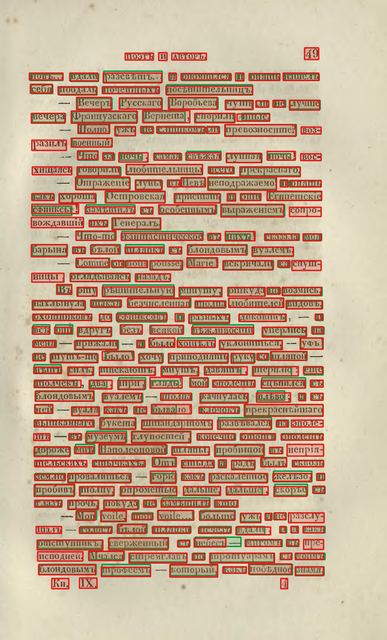 | 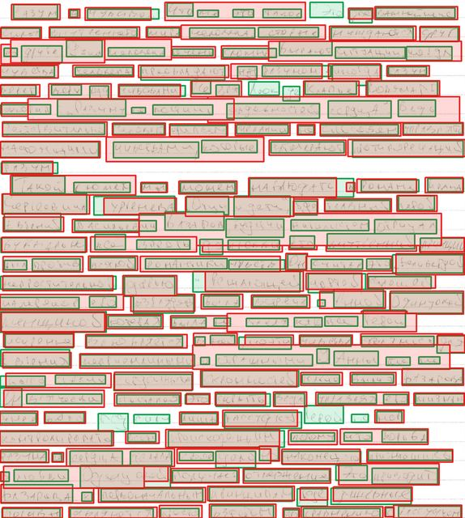 | 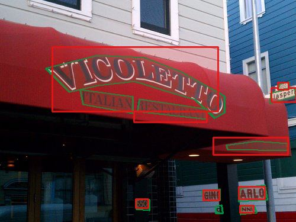 |
| **yolo26s_obb_text_g1** | 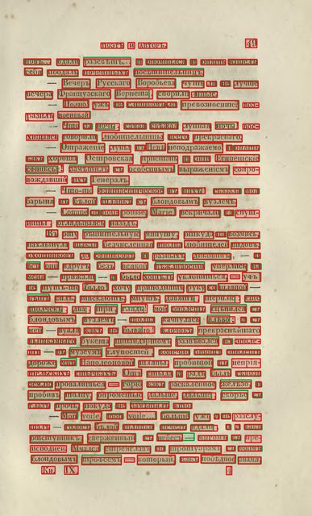 | 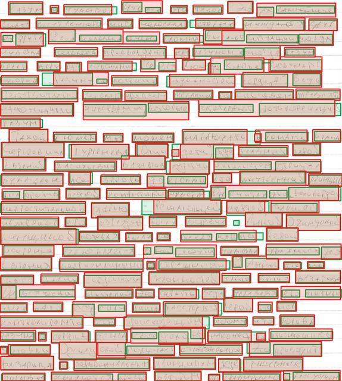 | 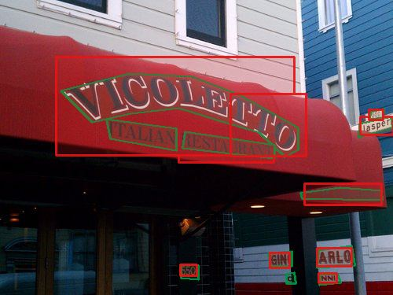 |
| **east_50_g1** | 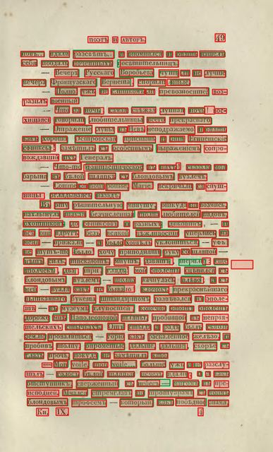 | 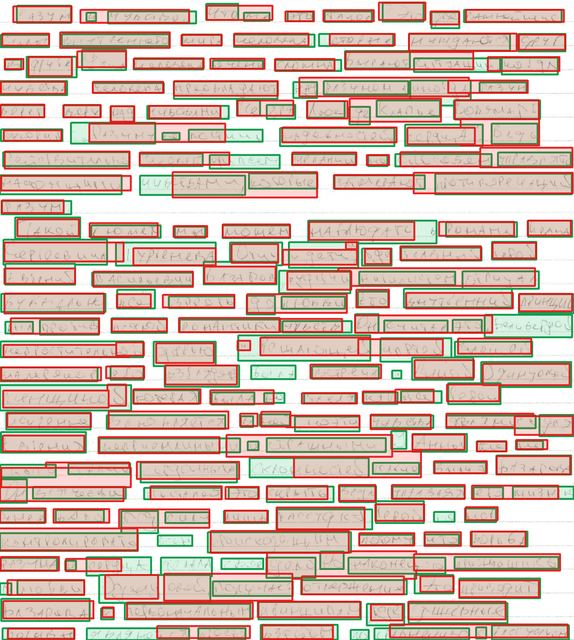 |  |
| **yolo11n_text** | 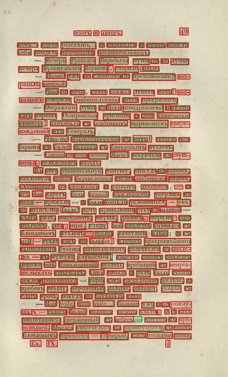 | 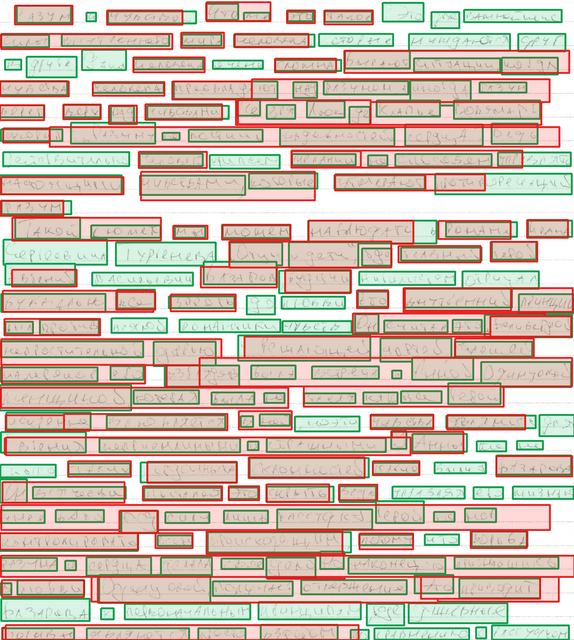 | 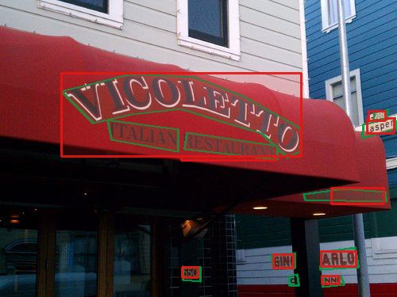 |
| **east_50_yenisei_gov_reports_g1** | 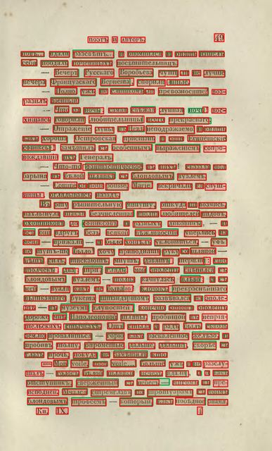 | 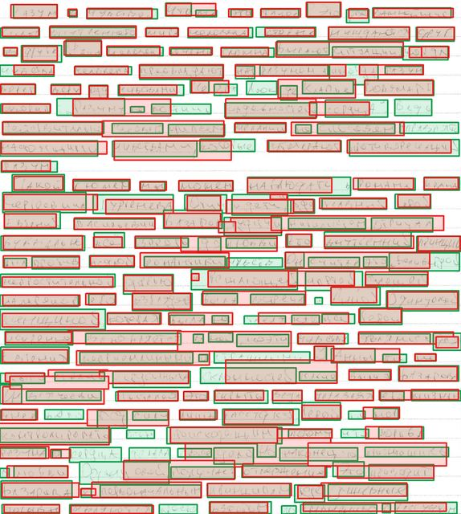 | 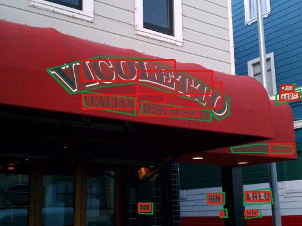 |
| **doctr_db_resnet50** | 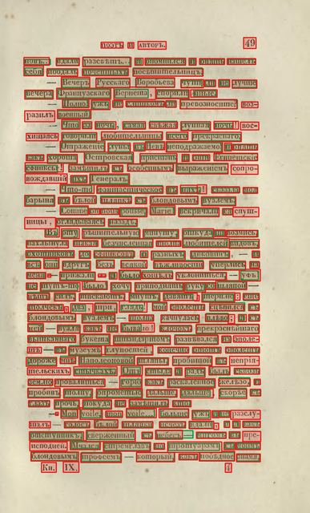 | 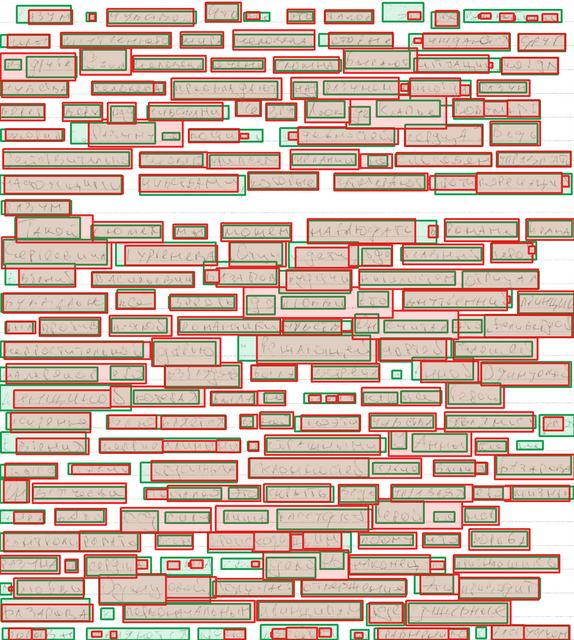 | 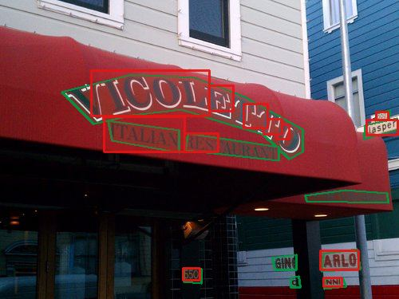 |
| **craft_easyocr** | 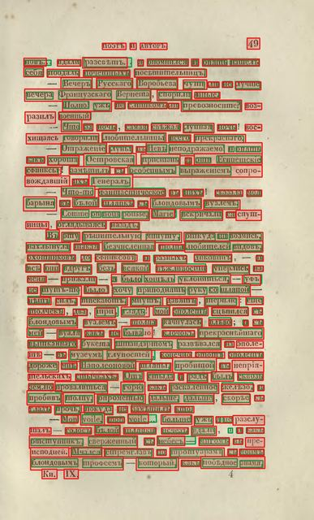 | 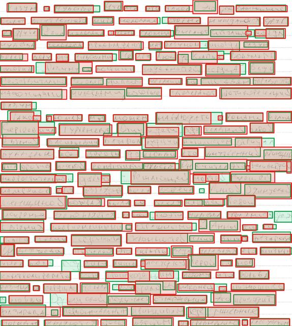 | 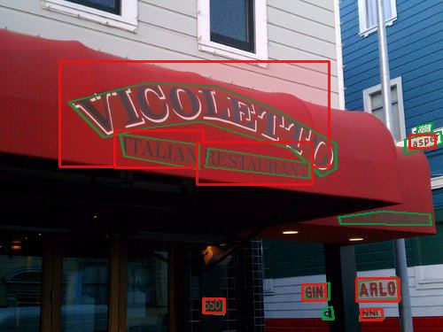 |
| **yolo11x_dialectic** | 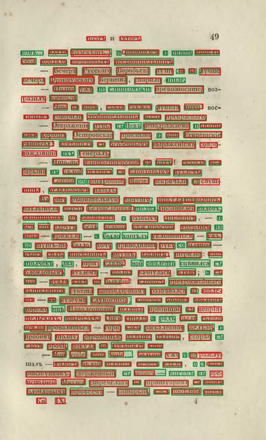 | 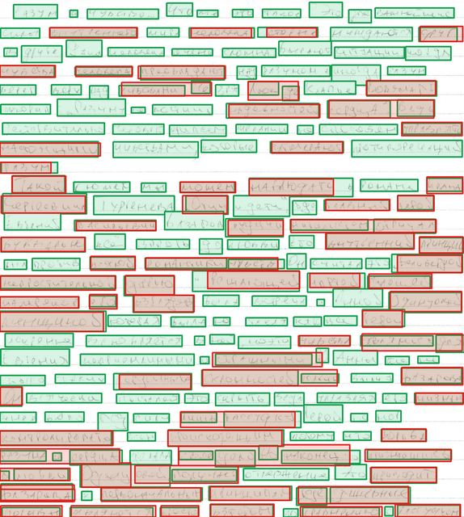 | 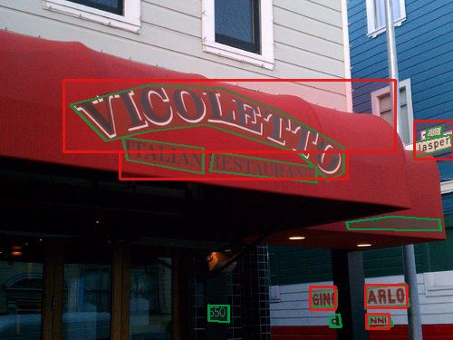 |
| **dbnet_khmer_word** | 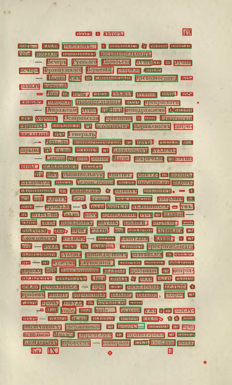 | 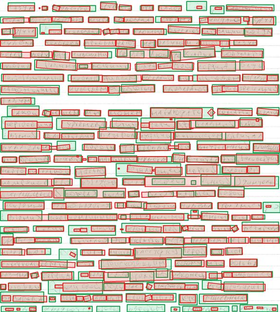 |  |
| **openocr_repvit_db** | 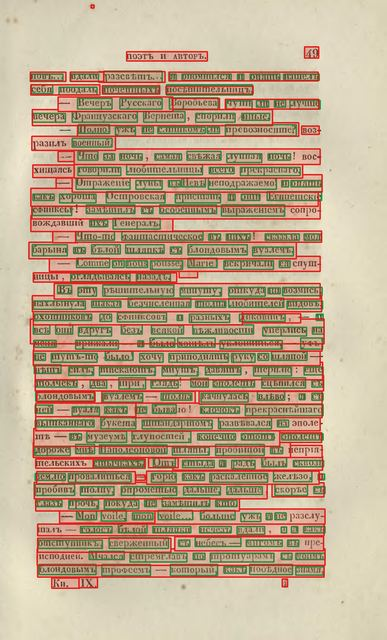 | 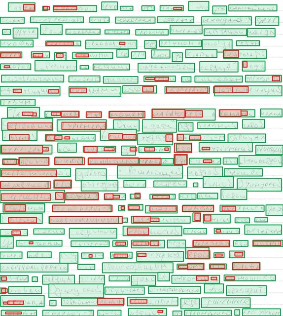 | 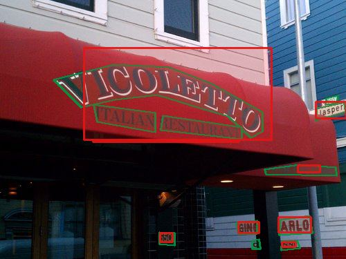 |
| **paddleocr_v6_medium_word** | 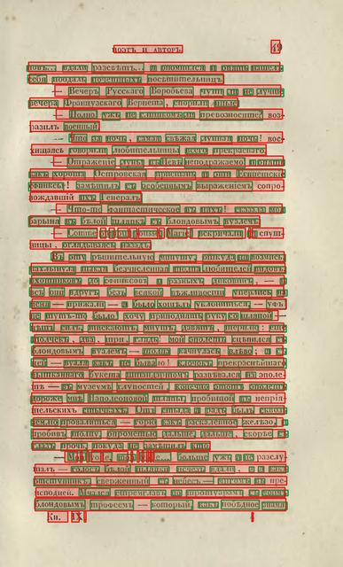 | 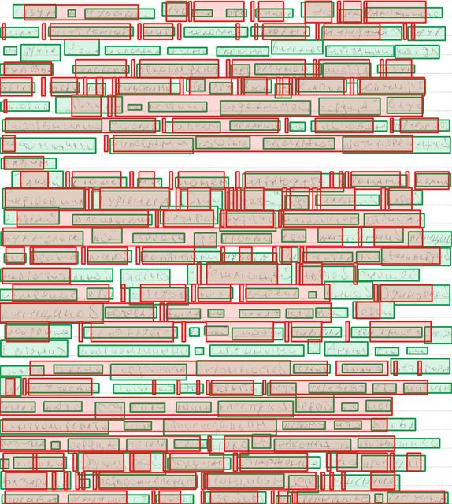 |  |

## Результаты детекции строк

Метрики в ячейке: `F1@0.5 / F1@0.5:0.95 / Dice F1 / Polygon H-mean@0.5`; для всех метрик больше — лучше.

| Model | Origin | Mean F1@0.5 | Mean F1@0.5:0.95 | Mean Dice F1 | Mean Polygon H-mean@0.5 | [russian_old_orthography](https://huggingface.co/datasets/nevmenandr/russian-old-orthography-ocr) | [handwritten_essay](https://huggingface.co/datasets/sherstpasha/handwritten_essay) | [school_notebooks_ru](https://huggingface.co/datasets/ai-forever/school_notebooks_RU) | [gota_hovratt_seg](https://huggingface.co/datasets/Riksarkivet/gota_hovratt_seg) | [svea_hovratt_seg](https://huggingface.co/datasets/Riksarkivet/svea_hovratt_seg) | [bergskollegium_relationer_och_skrivelser_seg](https://huggingface.co/datasets/Riksarkivet/bergskollegium_relationer_och_skrivelser_seg) | Mean GPU FPS |
| --- | --- | --- | --- | --- | --- | --- | --- | --- | --- | --- | --- | --- |
| rfdetr_textline_textregion_seg_preview | [source](https://huggingface.co/Kansallisarkisto/rfdetr_textline_textregion_detection_model) | ${\color[RGB]{80,138,91}0.96}$ | ${\color[RGB]{84,137,90}0.69}$ | ${\color[RGB]{81,137,91}0.91}$ | ${\color[RGB]{96,133,88}0.83}$ | ${\color[RGB]{84,137,90}0.96}$ / ${\color[RGB]{125,125,84}0.56}$ / ${\color[RGB]{102,132,87}0.90}$ / ${\color[RGB]{82,137,91}0.97}$ | ${\color[RGB]{84,137,90}0.96}$ / ${\color[RGB]{106,131,87}0.70}$ / ${\color[RGB]{89,135,89}0.94}$ / ${\color[RGB]{83,137,90}0.96}$ | ${\color[RGB]{86,136,90}0.88}$ / ${\color[RGB]{108,130,87}0.57}$ / ${\color[RGB]{85,136,90}0.92}$ / ${\color[RGB]{90,135,89}0.85}$ | ${\color[RGB]{80,138,91}0.97}$ / ${\color[RGB]{87,136,90}0.79}$ / ${\color[RGB]{79,138,91}0.91}$ / ${\color[RGB]{114,129,86}0.69}$ | ${\color[RGB]{80,138,91}0.98}$ / ${\color[RGB]{86,136,90}0.78}$ / ${\color[RGB]{79,138,91}0.89}$ / ${\color[RGB]{108,130,87}0.72}$ | ${\color[RGB]{79,138,91}0.98}$ / ${\color[RGB]{93,134,89}0.73}$ / ${\color[RGB]{79,138,91}\mathbf{0.90}}$ / ${\color[RGB]{102,132,87}0.80}$ | ${\color[RGB]{149,114,85}8.50}$ |
| rfdetr_textline_textregion_2xl | [source](https://huggingface.co/Kansallisarkisto/rfdetr-textline-textregion-detection-2xl) | ${\color[RGB]{79,138,91}\mathbf{0.96}}$ | ${\color[RGB]{79,138,91}\mathbf{0.71}}$ | ${\color[RGB]{82,137,91}0.91}$ | ${\color[RGB]{98,133,88}0.82}$ | ${\color[RGB]{94,134,89}0.95}$ / ${\color[RGB]{143,118,83}0.45}$ / ${\color[RGB]{110,130,86}0.89}$ / ${\color[RGB]{86,136,90}0.95}$ | ${\color[RGB]{81,137,91}0.98}$ / ${\color[RGB]{97,133,88}0.77}$ / ${\color[RGB]{86,136,90}0.95}$ / ${\color[RGB]{81,137,91}0.98}$ | ${\color[RGB]{83,137,90}0.90}$ / ${\color[RGB]{101,132,88}0.62}$ / ${\color[RGB]{87,136,90}0.91}$ / ${\color[RGB]{94,134,89}0.83}$ | ${\color[RGB]{79,138,91}\mathbf{0.98}}$ / ${\color[RGB]{79,138,91}\mathbf{0.85}}$ / ${\color[RGB]{79,138,91}0.91}$ / ${\color[RGB]{119,127,85}0.64}$ | ${\color[RGB]{79,138,91}\mathbf{0.99}}$ / ${\color[RGB]{79,138,91}\mathbf{0.83}}$ / ${\color[RGB]{79,138,91}\mathbf{0.89}}$ / ${\color[RGB]{103,132,87}0.76}$ | ${\color[RGB]{79,138,91}\mathbf{0.98}}$ / ${\color[RGB]{88,136,90}0.77}$ / ${\color[RGB]{80,138,91}0.89}$ / ${\color[RGB]{105,131,87}0.77}$ | ${\color[RGB]{149,114,85}8.43}$ |
| arjuna_ocr_kn_en_line | [source](https://huggingface.co/anandkaman/arjuna-ocr-kn-en) | ${\color[RGB]{87,136,90}0.91}$ | ${\color[RGB]{101,132,88}0.60}$ | ${\color[RGB]{79,138,91}\mathbf{0.92}}$ | ${\color[RGB]{85,136,90}0.90}$ | ${\color[RGB]{83,137,90}0.97}$ / ${\color[RGB]{116,128,85}0.61}$ / ${\color[RGB]{92,135,89}0.92}$ / ${\color[RGB]{81,138,91}0.97}$ | ${\color[RGB]{81,138,91}0.99}$ / ${\color[RGB]{95,134,89}0.78}$ / ${\color[RGB]{81,137,91}0.97}$ / ${\color[RGB]{81,138,91}0.99}$ | ${\color[RGB]{91,135,89}0.85}$ / ${\color[RGB]{106,131,87}0.59}$ / ${\color[RGB]{83,137,90}0.94}$ / ${\color[RGB]{93,134,89}0.83}$ | ${\color[RGB]{82,137,91}0.95}$ / ${\color[RGB]{109,130,86}0.63}$ / ${\color[RGB]{79,138,91}\mathbf{0.91}}$ / ${\color[RGB]{82,137,91}0.94}$ | ${\color[RGB]{98,133,88}0.84}$ / ${\color[RGB]{123,126,84}0.53}$ / ${\color[RGB]{79,138,91}0.89}$ / ${\color[RGB]{96,133,88}0.81}$ | ${\color[RGB]{90,135,89}0.89}$ / ${\color[RGB]{130,124,83}0.47}$ / ${\color[RGB]{79,138,91}0.90}$ / ${\color[RGB]{90,135,89}0.89}$ | ${\color[RGB]{144,118,83}9.81}$ |
| mask2former_line_v0_prev | [source](https://github.com/konstantinkozhin/manuscript-ocr) | ${\color[RGB]{85,136,90}0.92}$ | ${\color[RGB]{87,136,90}0.67}$ | ${\color[RGB]{81,137,91}0.91}$ | ${\color[RGB]{92,134,89}0.86}$ | ${\color[RGB]{121,127,85}0.90}$ / ${\color[RGB]{107,130,87}0.66}$ / ${\color[RGB]{148,115,84}0.81}$ / ${\color[RGB]{101,132,88}0.90}$ | ${\color[RGB]{79,138,91}\mathbf{1.00}}$ / ${\color[RGB]{79,138,91}\mathbf{0.90}}$ / ${\color[RGB]{79,138,91}\mathbf{0.98}}$ / ${\color[RGB]{79,138,91}\mathbf{1.00}}$ \* | ${\color[RGB]{79,138,91}\mathbf{0.93}}$ / ${\color[RGB]{79,138,91}\mathbf{0.75}}$ / ${\color[RGB]{79,138,91}\mathbf{0.97}}$ / ${\color[RGB]{79,138,91}\mathbf{0.94}}$ \* | ${\color[RGB]{86,136,90}0.92}$ / ${\color[RGB]{111,129,86}0.62}$ / ${\color[RGB]{80,138,91}0.90}$ / ${\color[RGB]{94,134,89}0.84}$ | ${\color[RGB]{94,134,89}0.87}$ / ${\color[RGB]{120,127,85}0.55}$ / ${\color[RGB]{79,138,91}0.89}$ / ${\color[RGB]{91,135,89}0.85}$ | ${\color[RGB]{89,135,90}0.90}$ / ${\color[RGB]{117,128,85}0.56}$ / ${\color[RGB]{79,138,91}0.90}$ / ${\color[RGB]{126,125,84}0.62}$ | ${\color[RGB]{178,93,92}0.40}$ |
| lamop_yolo26n_textline_seg | [source](https://huggingface.co/LaMOP/Yolo-Seg-TextRegion-TextLine-Manuscript) | ${\color[RGB]{83,137,90}0.94}$ | ${\color[RGB]{125,125,84}0.47}$ | ${\color[RGB]{84,137,90}0.89}$ | ${\color[RGB]{79,138,91}\mathbf{0.94}}$ | ${\color[RGB]{83,137,90}0.97}$ / ${\color[RGB]{115,128,85}0.62}$ / ${\color[RGB]{101,132,88}0.90}$ / ${\color[RGB]{79,138,91}\mathbf{0.97}}$ | ${\color[RGB]{80,138,91}0.99}$ / ${\color[RGB]{116,128,85}0.62}$ / ${\color[RGB]{92,134,89}0.92}$ / ${\color[RGB]{82,137,91}0.98}$ | ${\color[RGB]{90,135,89}0.86}$ / ${\color[RGB]{122,126,84}0.49}$ / ${\color[RGB]{89,135,89}0.89}$ / ${\color[RGB]{91,135,89}0.85}$ | ${\color[RGB]{81,137,91}0.96}$ / ${\color[RGB]{144,118,83}0.37}$ / ${\color[RGB]{84,137,90}0.87}$ / ${\color[RGB]{80,138,91}0.96}$ | ${\color[RGB]{90,135,89}0.90}$ / ${\color[RGB]{139,121,82}0.41}$ / ${\color[RGB]{81,137,91}0.87}$ / ${\color[RGB]{84,137,90}0.91}$ | ${\color[RGB]{82,137,91}0.96}$ / ${\color[RGB]{147,115,84}0.33}$ / ${\color[RGB]{81,137,91}0.88}$ / ${\color[RGB]{80,138,91}0.97}$ | ${\color[RGB]{154,110,86}7.14}$ |
| lamop_yolo26x_textline_seg | [source](https://huggingface.co/LaMOP/Yolo-Seg-TextRegion-TextLine-Manuscript) | ${\color[RGB]{84,137,90}0.93}$ | ${\color[RGB]{124,126,84}0.48}$ | ${\color[RGB]{84,137,90}0.89}$ | ${\color[RGB]{80,138,91}0.94}$ | ${\color[RGB]{79,138,91}\mathbf{0.97}}$ / ${\color[RGB]{100,132,88}0.70}$ / ${\color[RGB]{93,134,89}0.92}$ / ${\color[RGB]{79,138,91}0.97}$ | ${\color[RGB]{79,138,91}1.00}$ / ${\color[RGB]{114,129,86}0.64}$ / ${\color[RGB]{92,134,89}0.92}$ / ${\color[RGB]{80,138,91}0.99}$ | ${\color[RGB]{97,133,88}0.80}$ / ${\color[RGB]{121,127,85}0.50}$ / ${\color[RGB]{89,135,90}0.90}$ / ${\color[RGB]{98,133,88}0.80}$ | ${\color[RGB]{80,138,91}0.97}$ / ${\color[RGB]{142,119,83}0.39}$ / ${\color[RGB]{83,137,90}0.88}$ / ${\color[RGB]{79,138,91}\mathbf{0.96}}$ | ${\color[RGB]{90,135,89}0.90}$ / ${\color[RGB]{143,119,83}0.37}$ / ${\color[RGB]{82,137,91}0.87}$ / ${\color[RGB]{83,137,90}0.91}$ | ${\color[RGB]{83,137,90}0.95}$ / ${\color[RGB]{151,113,85}0.29}$ / ${\color[RGB]{83,137,90}0.87}$ / ${\color[RGB]{79,138,91}0.98}$ | ${\color[RGB]{156,109,86}6.49}$ |
| court_records_textline_yolov8x_seg | [source](https://huggingface.co/Kansallisarkisto/court-records-textline-detection) | ${\color[RGB]{92,135,89}0.88}$ | ${\color[RGB]{101,132,88}0.60}$ | ${\color[RGB]{84,137,90}0.89}$ | ${\color[RGB]{90,135,89}0.87}$ | ${\color[RGB]{153,111,86}0.83}$ / ${\color[RGB]{148,115,84}0.42}$ / ${\color[RGB]{122,126,84}0.86}$ / ${\color[RGB]{121,127,85}0.83}$ | ${\color[RGB]{110,129,86}0.76}$ / ${\color[RGB]{130,124,83}0.52}$ / ${\color[RGB]{94,134,89}0.91}$ / ${\color[RGB]{111,129,86}0.73}$ | ${\color[RGB]{91,135,89}0.85}$ / ${\color[RGB]{103,131,87}0.61}$ / ${\color[RGB]{87,136,90}0.91}$ / ${\color[RGB]{94,134,89}0.83}$ | ${\color[RGB]{80,138,91}0.97}$ / ${\color[RGB]{101,132,88}0.69}$ / ${\color[RGB]{81,138,91}0.90}$ / ${\color[RGB]{79,138,91}0.96}$ | ${\color[RGB]{85,136,90}0.95}$ / ${\color[RGB]{101,132,88}0.67}$ / ${\color[RGB]{80,138,91}0.88}$ / ${\color[RGB]{79,138,91}0.94}$ | ${\color[RGB]{84,137,90}0.94}$ / ${\color[RGB]{99,133,88}0.69}$ / ${\color[RGB]{79,138,91}0.90}$ / ${\color[RGB]{83,137,90}0.94}$ | ${\color[RGB]{157,108,87}6.28}$ |
| kraken_blla_default | [source](https://github.com/mittagessen/kraken) | ${\color[RGB]{86,136,90}0.92}$ | ${\color[RGB]{120,127,85}0.50}$ | ${\color[RGB]{87,136,90}0.87}$ | ${\color[RGB]{83,137,90}0.92}$ | ${\color[RGB]{101,132,88}0.93}$ / ${\color[RGB]{146,116,84}0.43}$ / ${\color[RGB]{101,132,88}0.90}$ / ${\color[RGB]{83,137,90}0.96}$ | ${\color[RGB]{86,136,90}0.95}$ / ${\color[RGB]{114,129,86}0.64}$ / ${\color[RGB]{103,131,87}0.87}$ / ${\color[RGB]{88,136,90}0.93}$ | ${\color[RGB]{97,133,88}0.80}$ / ${\color[RGB]{122,126,84}0.49}$ / ${\color[RGB]{93,134,89}0.86}$ / ${\color[RGB]{100,132,88}0.78}$ | ${\color[RGB]{83,137,90}0.94}$ / ${\color[RGB]{131,124,83}0.48}$ / ${\color[RGB]{85,136,90}0.86}$ / ${\color[RGB]{82,137,91}0.94}$ | ${\color[RGB]{88,136,90}0.92}$ / ${\color[RGB]{128,125,83}0.49}$ / ${\color[RGB]{82,137,91}0.87}$ / ${\color[RGB]{82,137,91}0.92}$ | ${\color[RGB]{80,138,91}0.97}$ / ${\color[RGB]{131,124,83}0.46}$ / ${\color[RGB]{82,137,90}0.87}$ / ${\color[RGB]{79,138,91}\mathbf{0.98}}$ | ${\color[RGB]{179,92,92}0.12}$ |
| paddleocr_v6_medium_line | [source](https://www.paddleocr.ai/latest/en/version3.x/algorithm/PP-OCRv6/PP-OCRv6.html) | ${\color[RGB]{92,134,89}0.88}$ | ${\color[RGB]{108,130,87}0.56}$ | ${\color[RGB]{86,136,90}0.88}$ | ${\color[RGB]{92,135,89}0.86}$ | ${\color[RGB]{81,138,91}0.97}$ / ${\color[RGB]{108,130,87}0.66}$ / ${\color[RGB]{103,131,87}0.90}$ / ${\color[RGB]{80,138,91}0.97}$ | ${\color[RGB]{103,131,87}0.81}$ / ${\color[RGB]{129,125,83}0.53}$ / ${\color[RGB]{85,136,90}0.95}$ / ${\color[RGB]{101,132,88}0.82}$ | ${\color[RGB]{95,134,89}0.82}$ / ${\color[RGB]{115,128,86}0.54}$ / ${\color[RGB]{94,134,89}0.86}$ / ${\color[RGB]{97,133,88}0.81}$ | ${\color[RGB]{89,135,89}0.89}$ / ${\color[RGB]{117,128,85}0.58}$ / ${\color[RGB]{85,136,90}0.87}$ / ${\color[RGB]{90,135,89}0.88}$ | ${\color[RGB]{93,134,89}0.88}$ / ${\color[RGB]{123,126,84}0.53}$ / ${\color[RGB]{82,137,90}0.87}$ / ${\color[RGB]{92,134,89}0.84}$ | ${\color[RGB]{90,135,89}0.90}$ / ${\color[RGB]{120,127,85}0.54}$ / ${\color[RGB]{85,136,90}0.85}$ / ${\color[RGB]{96,133,88}0.84}$ | ${\color[RGB]{166,101,89}3.69}$ |
| yolov8m_historical_line_segmenter | [source](https://huggingface.co/abhishekjha1008/yolov8m-historical-line-segmenter) | ${\color[RGB]{89,135,89}0.90}$ | ${\color[RGB]{97,133,88}0.62}$ | ${\color[RGB]{84,137,90}0.89}$ | ${\color[RGB]{114,128,86}0.72}$ | ${\color[RGB]{170,98,90}0.78}$ / ${\color[RGB]{179,92,92}0.17}$ / ${\color[RGB]{133,123,83}0.84}$ / ${\color[RGB]{128,125,84}0.81}$ | ${\color[RGB]{97,133,88}0.86}$ / ${\color[RGB]{123,126,84}0.57}$ / ${\color[RGB]{87,136,90}0.95}$ / ${\color[RGB]{92,134,89}0.89}$ | ${\color[RGB]{88,135,90}0.87}$ / ${\color[RGB]{107,130,87}0.58}$ / ${\color[RGB]{87,136,90}0.91}$ / ${\color[RGB]{97,133,88}0.80}$ | ${\color[RGB]{81,138,91}0.96}$ / ${\color[RGB]{85,136,90}0.81}$ / ${\color[RGB]{80,138,91}0.90}$ / ${\color[RGB]{123,126,84}0.62}$ | ${\color[RGB]{85,136,90}0.94}$ / ${\color[RGB]{89,135,89}0.76}$ / ${\color[RGB]{81,137,91}0.87}$ / ${\color[RGB]{114,129,86}0.68}$ | ${\color[RGB]{80,138,91}0.97}$ / ${\color[RGB]{79,138,91}\mathbf{0.83}}$ / ${\color[RGB]{80,138,91}0.89}$ / ${\color[RGB]{136,123,82}0.54}$ | ${\color[RGB]{79,138,91}\mathbf{22.90}}$ |
| paddleocr_v6_small_line | [source](https://www.paddleocr.ai/latest/en/version3.x/module_usage/text_detection.html) | ${\color[RGB]{97,133,88}0.85}$ | ${\color[RGB]{113,129,86}0.53}$ | ${\color[RGB]{88,136,90}0.87}$ | ${\color[RGB]{96,134,88}0.84}$ | ${\color[RGB]{81,137,91}0.97}$ / ${\color[RGB]{114,128,86}0.62}$ / ${\color[RGB]{101,132,88}0.90}$ / ${\color[RGB]{81,138,91}0.97}$ | ${\color[RGB]{105,131,87}0.80}$ / ${\color[RGB]{127,125,84}0.54}$ / ${\color[RGB]{87,136,90}0.94}$ / ${\color[RGB]{103,131,87}0.80}$ | ${\color[RGB]{100,132,88}0.78}$ / ${\color[RGB]{118,127,85}0.52}$ / ${\color[RGB]{94,134,89}0.86}$ / ${\color[RGB]{101,132,88}0.78}$ | ${\color[RGB]{96,134,88}0.84}$ / ${\color[RGB]{126,125,84}0.51}$ / ${\color[RGB]{85,136,90}0.86}$ / ${\color[RGB]{94,134,89}0.84}$ | ${\color[RGB]{95,134,89}0.86}$ / ${\color[RGB]{122,126,84}0.53}$ / ${\color[RGB]{84,137,90}0.86}$ / ${\color[RGB]{94,134,89}0.83}$ | ${\color[RGB]{98,133,88}0.83}$ / ${\color[RGB]{128,125,84}0.49}$ / ${\color[RGB]{91,135,89}0.81}$ / ${\color[RGB]{101,132,88}0.81}$ | ${\color[RGB]{164,103,88}4.38}$ |
| nemotron_ocr_v2_multilingual_line | [source](https://huggingface.co/nvidia/nemotron-ocr-v2) | ${\color[RGB]{99,133,88}0.84}$ | ${\color[RGB]{103,131,87}0.59}$ | ${\color[RGB]{89,135,89}0.86}$ | ${\color[RGB]{109,130,86}0.75}$ | ${\color[RGB]{86,136,90}0.96}$ / ${\color[RGB]{79,138,91}\mathbf{0.81}}$ / ${\color[RGB]{79,138,91}\mathbf{0.94}}$ / ${\color[RGB]{83,137,90}0.96}$ | ${\color[RGB]{86,136,90}0.94}$ / ${\color[RGB]{107,130,87}0.69}$ / ${\color[RGB]{86,136,90}0.95}$ / ${\color[RGB]{85,136,90}0.95}$ | ${\color[RGB]{92,134,89}0.84}$ / ${\color[RGB]{119,127,85}0.51}$ / ${\color[RGB]{88,136,90}0.90}$ / ${\color[RGB]{91,135,89}0.85}$ | ${\color[RGB]{104,131,87}0.77}$ / ${\color[RGB]{127,125,84}0.51}$ / ${\color[RGB]{93,134,89}0.81}$ / ${\color[RGB]{119,127,85}0.65}$ | ${\color[RGB]{120,127,85}0.66}$ / ${\color[RGB]{141,120,83}0.39}$ / ${\color[RGB]{97,133,88}0.76}$ / ${\color[RGB]{126,125,84}0.59}$ | ${\color[RGB]{97,133,88}0.84}$ / ${\color[RGB]{109,130,86}0.62}$ / ${\color[RGB]{88,135,90}0.83}$ / ${\color[RGB]{138,122,82}0.52}$ | ${\color[RGB]{149,114,85}8.46}$ |
| riksarkivet_rtmdet_lines | [source](https://huggingface.co/Riksarkivet/rtmdet_lines) | ${\color[RGB]{101,132,88}0.82}$ | ${\color[RGB]{126,125,84}0.47}$ | ${\color[RGB]{97,133,88}0.82}$ | ${\color[RGB]{94,134,89}0.85}$ | ${\color[RGB]{179,92,92}0.76}$ / ${\color[RGB]{126,125,84}0.56}$ / ${\color[RGB]{173,96,91}0.74}$ / ${\color[RGB]{140,121,82}0.76}$ | ${\color[RGB]{96,133,88}0.87}$ / ${\color[RGB]{132,124,83}0.50}$ / ${\color[RGB]{105,131,87}0.86}$ / ${\color[RGB]{96,134,88}0.86}$ | ${\color[RGB]{96,133,88}0.81}$ / ${\color[RGB]{124,126,84}0.48}$ / ${\color[RGB]{96,133,88}0.84}$ / ${\color[RGB]{99,133,88}0.79}$ | ${\color[RGB]{101,132,88}0.80}$ / ${\color[RGB]{146,116,84}0.34}$ / ${\color[RGB]{92,135,89}0.81}$ / ${\color[RGB]{86,136,90}0.90}$ | ${\color[RGB]{111,129,86}0.73}$ / ${\color[RGB]{149,114,85}0.31}$ / ${\color[RGB]{95,134,89}0.77}$ / ${\color[RGB]{95,134,88}0.82}$ | ${\color[RGB]{82,137,91}0.96}$ / ${\color[RGB]{107,130,87}0.63}$ / ${\color[RGB]{79,138,91}0.90}$ / ${\color[RGB]{81,137,91}0.96}$ | ${\color[RGB]{171,98,90}2.22}$ |
| paddleocr_v6_tiny_line | [source](https://www.paddleocr.ai/latest/en/version3.x/module_usage/text_detection.html) | ${\color[RGB]{110,129,86}0.76}$ | ${\color[RGB]{121,127,85}0.50}$ | ${\color[RGB]{99,133,88}0.81}$ | ${\color[RGB]{111,129,86}0.74}$ | ${\color[RGB]{177,93,92}0.77}$ / ${\color[RGB]{140,120,83}0.48}$ / ${\color[RGB]{95,134,89}0.91}$ / ${\color[RGB]{139,121,82}0.77}$ | ${\color[RGB]{90,135,89}0.91}$ / ${\color[RGB]{109,130,86}0.68}$ / ${\color[RGB]{92,134,89}0.92}$ / ${\color[RGB]{89,135,89}0.91}$ | ${\color[RGB]{102,132,87}0.77}$ / ${\color[RGB]{121,126,85}0.50}$ / ${\color[RGB]{99,133,88}0.82}$ / ${\color[RGB]{102,132,87}0.77}$ | ${\color[RGB]{95,134,89}0.85}$ / ${\color[RGB]{120,127,85}0.56}$ / ${\color[RGB]{90,135,89}0.82}$ / ${\color[RGB]{95,134,89}0.83}$ | ${\color[RGB]{102,132,88}0.81}$ / ${\color[RGB]{124,126,84}0.51}$ / ${\color[RGB]{90,135,89}0.81}$ / ${\color[RGB]{105,131,87}0.75}$ | ${\color[RGB]{142,119,83}0.46}$ / ${\color[RGB]{154,111,86}0.26}$ / ${\color[RGB]{124,126,84}0.56}$ / ${\color[RGB]{146,116,84}0.43}$ | ${\color[RGB]{163,104,88}4.52}$ |
| surya_text_line_detection | [source](https://github.com/datalab-to/surya) | ${\color[RGB]{112,129,86}0.75}$ | ${\color[RGB]{145,117,84}0.35}$ | ${\color[RGB]{86,136,90}0.88}$ | ${\color[RGB]{109,130,86}0.75}$ | ${\color[RGB]{113,129,86}0.91}$ / ${\color[RGB]{134,123,83}0.52}$ / ${\color[RGB]{115,128,86}0.88}$ / ${\color[RGB]{96,133,88}0.92}$ | ${\color[RGB]{86,136,90}0.95}$ / ${\color[RGB]{128,125,84}0.53}$ / ${\color[RGB]{93,134,89}0.92}$ / ${\color[RGB]{86,136,90}0.94}$ | ${\color[RGB]{109,130,86}0.72}$ / ${\color[RGB]{140,121,82}0.38}$ / ${\color[RGB]{89,135,89}0.89}$ / ${\color[RGB]{110,130,86}0.71}$ | ${\color[RGB]{105,131,87}0.76}$ / ${\color[RGB]{150,113,85}0.31}$ / ${\color[RGB]{83,137,90}0.88}$ / ${\color[RGB]{106,131,87}0.75}$ | ${\color[RGB]{151,112,85}0.36}$ / ${\color[RGB]{167,101,89}0.13}$ / ${\color[RGB]{84,137,90}0.85}$ / ${\color[RGB]{148,114,85}0.38}$ | ${\color[RGB]{102,132,87}0.80}$ / ${\color[RGB]{155,110,86}0.25}$ / ${\color[RGB]{82,137,91}0.87}$ / ${\color[RGB]{102,132,88}0.80}$ | ${\color[RGB]{169,100,89}2.99}$ |
| regnetx_8gf_polyline_baseline_stage0_line | [source](https://huggingface.co/johnlockejrr/regnetx-8gf-polyline-baseline-stage0) | ${\color[RGB]{98,133,88}0.84}$ | ${\color[RGB]{138,122,82}0.41}$ | ${\color[RGB]{103,131,87}0.79}$ | ${\color[RGB]{99,133,88}0.81}$ | ${\color[RGB]{125,126,84}0.89}$ / ${\color[RGB]{143,118,83}0.45}$ / ${\color[RGB]{123,126,84}0.86}$ / ${\color[RGB]{95,134,89}0.92}$ | ${\color[RGB]{138,122,82}0.54}$ / ${\color[RGB]{153,111,86}0.30}$ / ${\color[RGB]{150,113,85}0.63}$ / ${\color[RGB]{142,119,83}0.46}$ | ${\color[RGB]{101,132,88}0.77}$ / ${\color[RGB]{130,124,83}0.44}$ / ${\color[RGB]{109,130,86}0.75}$ / ${\color[RGB]{109,130,86}0.72}$ | ${\color[RGB]{85,136,90}0.93}$ / ${\color[RGB]{139,121,82}0.41}$ / ${\color[RGB]{92,134,89}0.81}$ / ${\color[RGB]{88,136,90}0.89}$ | ${\color[RGB]{84,137,90}0.95}$ / ${\color[RGB]{134,123,83}0.45}$ / ${\color[RGB]{87,136,90}0.83}$ / ${\color[RGB]{79,138,91}\mathbf{0.94}}$ | ${\color[RGB]{83,137,90}0.95}$ / ${\color[RGB]{141,120,83}0.38}$ / ${\color[RGB]{88,136,90}0.83}$ / ${\color[RGB]{81,137,91}0.96}$ | ${\color[RGB]{178,92,92}0.27}$ |
| pero_layout_general | [source](https://github.com/DCGM/pero-ocr) | ${\color[RGB]{113,129,86}0.74}$ | ${\color[RGB]{143,118,83}0.37}$ | ${\color[RGB]{91,135,89}0.85}$ | ${\color[RGB]{111,129,86}0.74}$ | ${\color[RGB]{82,137,91}0.97}$ / ${\color[RGB]{105,131,87}0.67}$ / ${\color[RGB]{102,132,88}0.90}$ / ${\color[RGB]{81,138,91}0.97}$ | ${\color[RGB]{109,130,86}0.77}$ / ${\color[RGB]{153,111,86}0.30}$ / ${\color[RGB]{112,129,86}0.83}$ / ${\color[RGB]{107,130,87}0.76}$ | ${\color[RGB]{130,124,83}0.56}$ / ${\color[RGB]{153,111,86}0.27}$ / ${\color[RGB]{98,133,88}0.83}$ / ${\color[RGB]{133,123,83}0.54}$ | ${\color[RGB]{101,132,88}0.79}$ / ${\color[RGB]{144,117,84}0.36}$ / ${\color[RGB]{85,136,90}0.87}$ / ${\color[RGB]{97,133,88}0.82}$ | ${\color[RGB]{132,124,83}0.56}$ / ${\color[RGB]{160,106,87}0.20}$ / ${\color[RGB]{92,135,89}0.80}$ / ${\color[RGB]{126,125,84}0.59}$ | ${\color[RGB]{101,132,88}0.80}$ / ${\color[RGB]{138,122,82}0.41}$ / ${\color[RGB]{81,137,91}0.88}$ / ${\color[RGB]{104,131,87}0.78}$ | ${\color[RGB]{161,105,88}5.19}$ |
| paddleocr_v5_server_line | [source](https://www.paddleocr.ai/latest/en/version3.x/module_usage/text_detection.html) | ${\color[RGB]{109,130,86}0.77}$ | ${\color[RGB]{128,125,84}0.46}$ | ${\color[RGB]{102,132,88}0.79}$ | ${\color[RGB]{113,129,86}0.73}$ | ${\color[RGB]{84,137,90}0.96}$ / ${\color[RGB]{125,126,84}0.57}$ / ${\color[RGB]{111,129,86}0.89}$ / ${\color[RGB]{82,137,91}0.97}$ | ${\color[RGB]{112,129,86}0.74}$ / ${\color[RGB]{138,122,82}0.46}$ / ${\color[RGB]{94,134,89}0.91}$ / ${\color[RGB]{110,130,86}0.74}$ | ${\color[RGB]{98,133,88}0.80}$ / ${\color[RGB]{118,127,85}0.52}$ / ${\color[RGB]{91,135,89}0.88}$ / ${\color[RGB]{99,133,88}0.79}$ | ${\color[RGB]{103,132,87}0.78}$ / ${\color[RGB]{128,125,83}0.50}$ / ${\color[RGB]{95,134,89}0.79}$ / ${\color[RGB]{106,131,87}0.75}$ | ${\color[RGB]{111,129,86}0.73}$ / ${\color[RGB]{139,121,82}0.41}$ / ${\color[RGB]{109,130,86}0.67}$ / ${\color[RGB]{113,129,86}0.68}$ | ${\color[RGB]{126,125,84}0.60}$ / ${\color[RGB]{148,115,84}0.32}$ / ${\color[RGB]{115,128,86}0.63}$ / ${\color[RGB]{147,116,84}0.42}$ | ${\color[RGB]{168,100,89}3.16}$ |
| ppocrv6_manga_det_v02_line | [source](https://huggingface.co/Kellenok/PP-OCRv6_manga) | ${\color[RGB]{123,126,84}0.68}$ | ${\color[RGB]{154,110,86}0.29}$ | ${\color[RGB]{93,134,89}0.84}$ | ${\color[RGB]{113,129,86}0.73}$ | ${\color[RGB]{93,134,89}0.95}$ / ${\color[RGB]{132,124,83}0.53}$ / ${\color[RGB]{143,118,83}0.82}$ / ${\color[RGB]{87,136,90}0.95}$ | ${\color[RGB]{112,129,86}0.74}$ / ${\color[RGB]{150,113,85}0.33}$ / ${\color[RGB]{105,131,87}0.86}$ / ${\color[RGB]{108,130,87}0.75}$ | ${\color[RGB]{129,124,83}0.57}$ / ${\color[RGB]{156,109,86}0.24}$ / ${\color[RGB]{99,132,88}0.82}$ / ${\color[RGB]{126,125,84}0.59}$ | ${\color[RGB]{126,125,84}0.60}$ / ${\color[RGB]{157,108,87}0.23}$ / ${\color[RGB]{87,136,90}0.85}$ / ${\color[RGB]{117,128,85}0.67}$ | ${\color[RGB]{125,126,84}0.62}$ / ${\color[RGB]{158,107,87}0.22}$ / ${\color[RGB]{85,136,90}0.84}$ / ${\color[RGB]{106,131,87}0.73}$ | ${\color[RGB]{129,124,83}0.58}$ / ${\color[RGB]{162,105,88}0.18}$ / ${\color[RGB]{85,136,90}0.86}$ / ${\color[RGB]{116,128,85}0.69}$ | ${\color[RGB]{126,125,84}13.75}$ |
| paddleocr_v5_mobile_line | [source](https://www.paddleocr.ai/latest/en/version3.x/module_usage/text_detection.html) | ${\color[RGB]{119,127,85}0.70}$ | ${\color[RGB]{133,123,83}0.43}$ | ${\color[RGB]{102,132,87}0.79}$ | ${\color[RGB]{122,126,85}0.67}$ | ${\color[RGB]{91,135,89}0.95}$ / ${\color[RGB]{134,123,83}0.52}$ / ${\color[RGB]{101,132,88}0.90}$ / ${\color[RGB]{83,137,90}0.96}$ | ${\color[RGB]{117,128,85}0.71}$ / ${\color[RGB]{136,122,82}0.47}$ / ${\color[RGB]{102,132,88}0.88}$ / ${\color[RGB]{115,128,86}0.70}$ | ${\color[RGB]{110,129,86}0.71}$ / ${\color[RGB]{129,124,83}0.45}$ / ${\color[RGB]{103,131,87}0.79}$ / ${\color[RGB]{112,129,86}0.70}$ | ${\color[RGB]{125,125,84}0.60}$ / ${\color[RGB]{141,120,83}0.39}$ / ${\color[RGB]{110,130,86}0.68}$ / ${\color[RGB]{127,125,84}0.58}$ | ${\color[RGB]{128,125,83}0.59}$ / ${\color[RGB]{144,118,83}0.36}$ / ${\color[RGB]{102,132,87}0.72}$ / ${\color[RGB]{132,124,83}0.53}$ | ${\color[RGB]{118,127,85}0.67}$ / ${\color[RGB]{138,122,82}0.41}$ / ${\color[RGB]{97,133,88}0.77}$ / ${\color[RGB]{131,124,83}0.58}$ | ${\color[RGB]{162,104,88}4.78}$ |
| doc_ufcn_generic_historical_line_x3_y8 | [source](https://huggingface.co/Teklia/doc-ufcn-generic-historical-line) | ${\color[RGB]{153,111,86}0.44}$ | ${\color[RGB]{174,96,91}0.14}$ | ${\color[RGB]{110,130,86}0.75}$ | ${\color[RGB]{140,120,83}0.55}$ | ${\color[RGB]{147,115,84}0.84}$ / ${\color[RGB]{157,108,87}0.34}$ / ${\color[RGB]{105,131,87}0.90}$ / ${\color[RGB]{104,131,87}0.89}$ \* | ${\color[RGB]{159,106,87}0.31}$ / ${\color[RGB]{172,97,90}0.10}$ / ${\color[RGB]{134,123,83}0.73}$ / ${\color[RGB]{166,101,89}0.16}$ | ${\color[RGB]{125,126,84}0.60}$ / ${\color[RGB]{159,107,87}0.21}$ / ${\color[RGB]{110,130,86}0.74}$ / ${\color[RGB]{140,120,83}0.48}$ \* | ${\color[RGB]{147,116,84}0.40}$ / ${\color[RGB]{171,98,90}0.09}$ / ${\color[RGB]{104,131,87}0.72}$ / ${\color[RGB]{115,128,86}0.68}$ | ${\color[RGB]{165,103,88}0.20}$ / ${\color[RGB]{176,94,91}0.04}$ / ${\color[RGB]{114,129,86}0.64}$ / ${\color[RGB]{155,110,86}0.30}$ | ${\color[RGB]{159,107,87}0.27}$ / ${\color[RGB]{175,95,91}0.05}$ / ${\color[RGB]{99,133,88}0.75}$ / ${\color[RGB]{103,132,87}0.79}$ | ${\color[RGB]{164,103,88}4.29}$ |
| doc_ufcn_generic_historical_line | [source](https://huggingface.co/Teklia/doc-ufcn-generic-historical-line) | ${\color[RGB]{171,98,90}0.27}$ | ${\color[RGB]{179,92,92}0.10}$ | ${\color[RGB]{136,123,82}0.60}$ | ${\color[RGB]{178,93,92}0.22}$ | ${\color[RGB]{146,116,84}0.85}$ / ${\color[RGB]{148,115,84}0.42}$ / ${\color[RGB]{179,92,92}0.72}$ / ${\color[RGB]{179,92,92}0.57}$ | ${\color[RGB]{178,92,92}0.10}$ / ${\color[RGB]{179,92,92}0.02}$ / ${\color[RGB]{172,97,90}0.49}$ / ${\color[RGB]{179,92,92}0.01}$ | ${\color[RGB]{154,110,86}0.33}$ / ${\color[RGB]{173,97,90}0.09}$ / ${\color[RGB]{132,124,83}0.58}$ / ${\color[RGB]{177,94,91}0.10}$ | ${\color[RGB]{164,103,88}0.19}$ / ${\color[RGB]{176,95,91}0.04}$ / ${\color[RGB]{117,128,85}0.62}$ / ${\color[RGB]{164,103,88}0.20}$ | ${\color[RGB]{175,95,91}0.08}$ / ${\color[RGB]{179,92,92}0.01}$ / ${\color[RGB]{128,125,84}0.54}$ / ${\color[RGB]{178,93,92}0.05}$ | ${\color[RGB]{175,95,91}0.08}$ / ${\color[RGB]{178,92,92}0.01}$ / ${\color[RGB]{110,129,86}0.66}$ / ${\color[RGB]{153,111,86}0.36}$ | ${\color[RGB]{163,104,88}4.68}$ |
| ndlocr_lite_deimv2_line | [source](https://github.com/ndl-lab/ndlocr-lite) | ${\color[RGB]{179,92,92}0.20}$ | ${\color[RGB]{174,96,91}0.14}$ | ${\color[RGB]{179,92,92}0.26}$ | ${\color[RGB]{179,92,92}0.21}$ | ${\color[RGB]{103,131,87}0.93}$ / ${\color[RGB]{91,135,89}0.75}$ / ${\color[RGB]{84,137,90}0.94}$ / ${\color[RGB]{92,134,89}0.93}$ | ${\color[RGB]{179,92,92}0.09}$ / ${\color[RGB]{179,92,92}0.03}$ / ${\color[RGB]{179,92,92}0.44}$ / ${\color[RGB]{171,98,90}0.10}$ | ${\color[RGB]{179,92,92}0.08}$ / ${\color[RGB]{179,92,92}0.04}$ / ${\color[RGB]{179,92,92}0.11}$ / ${\color[RGB]{179,92,92}0.08}$ | ${\color[RGB]{179,92,92}0.02}$ / ${\color[RGB]{179,92,92}0.01}$ / ${\color[RGB]{179,92,92}0.03}$ / ${\color[RGB]{179,92,92}0.03}$ | ${\color[RGB]{179,92,92}0.03}$ / ${\color[RGB]{179,92,92}0.01}$ / ${\color[RGB]{179,92,92}0.04}$ / ${\color[RGB]{179,92,92}0.04}$ | ${\color[RGB]{179,92,92}0.03}$ / ${\color[RGB]{179,92,92}0.01}$ / ${\color[RGB]{179,92,92}0.02}$ / ${\color[RGB]{179,92,92}0.07}$ | ${\color[RGB]{151,112,85}7.84}$ |

### Примеры предсказаний

Зелёным показана эталонная разметка, красным — предсказания модели.

| Модель | [**Russian Old Orthography OCR**](https://huggingface.co/datasets/nevmenandr/russian-old-orthography-ocr) `page_007.jpg` | [**School Notebooks RU**](https://huggingface.co/datasets/ai-forever/school_notebooks_RU) `2647.jpg` | [**Göta Hovrätt Segmentation**](https://huggingface.co/datasets/Riksarkivet/gota_hovratt_seg) `image_00026.jpg` |
| --- | --- | --- | --- |
| **rfdetr_textline_textregion_seg_preview** | 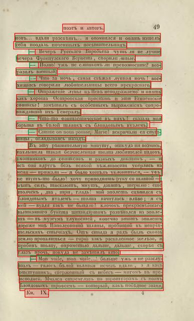 | 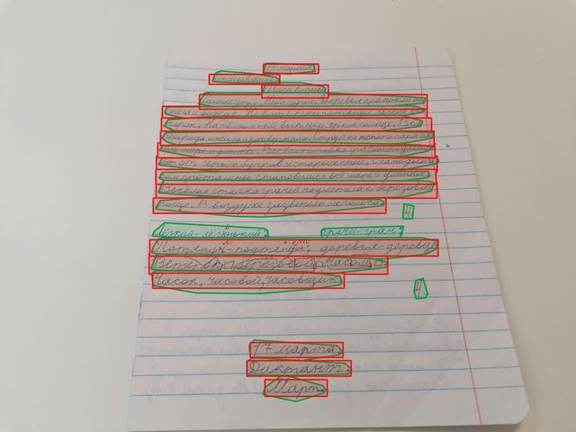 |  |
| **rfdetr_textline_textregion_2xl** | 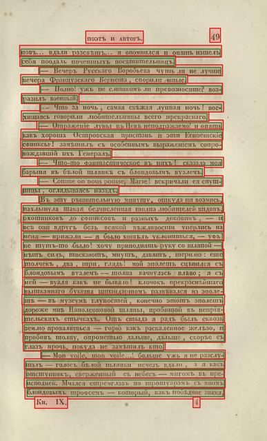 |  | 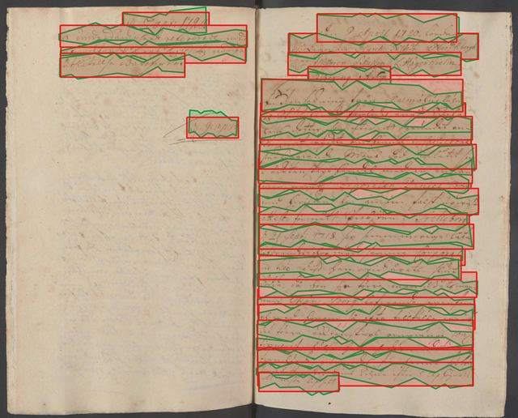 |
| **arjuna_ocr_kn_en_line** | 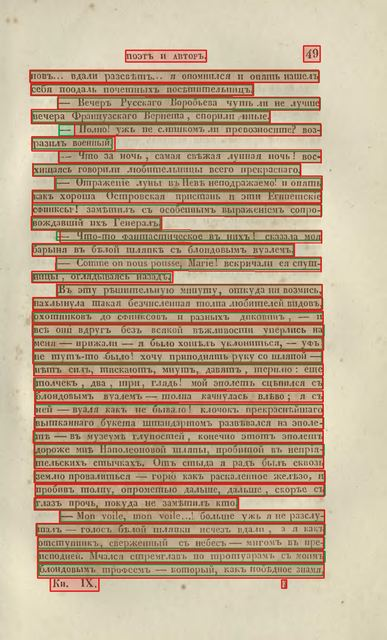 | 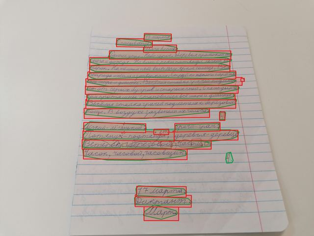 | 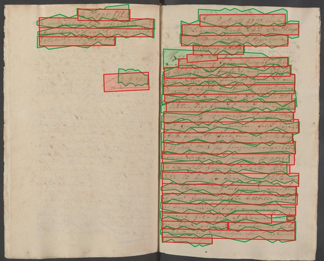 |
| **mask2former_line_v0_prev** | 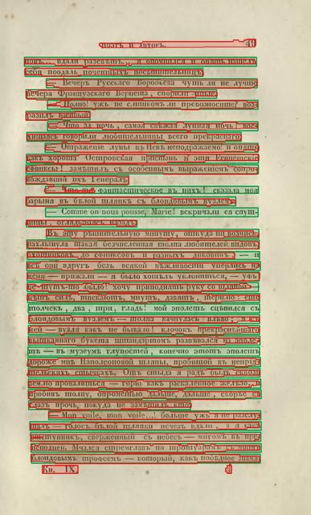 | 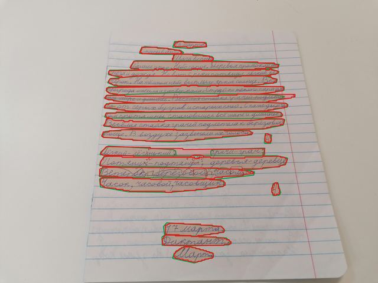 | 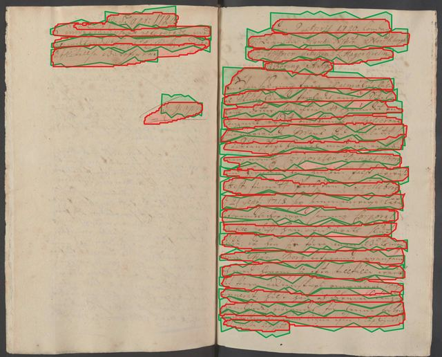 |
| **lamop_yolo26n_textline_seg** | 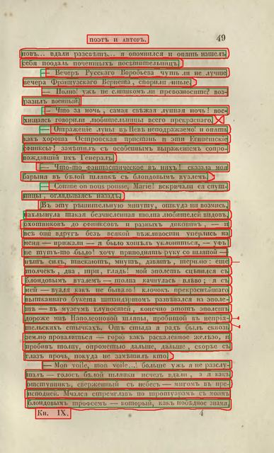 | 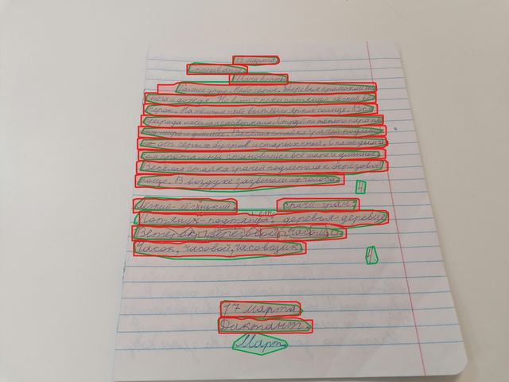 | 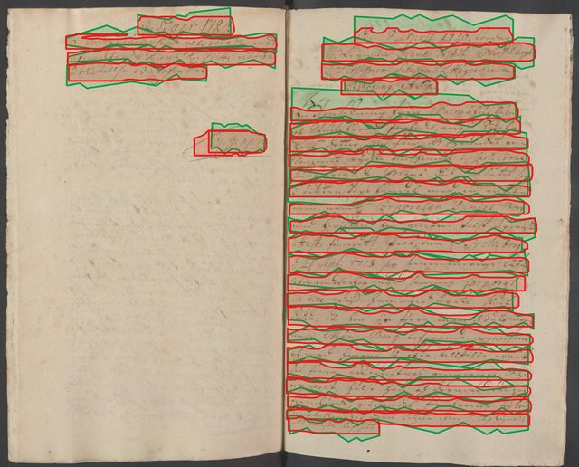 |
| **lamop_yolo26x_textline_seg** | 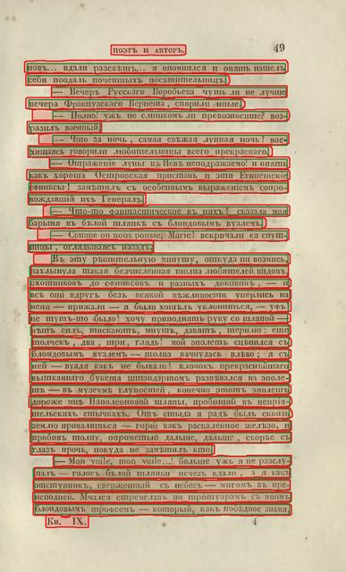 |  | 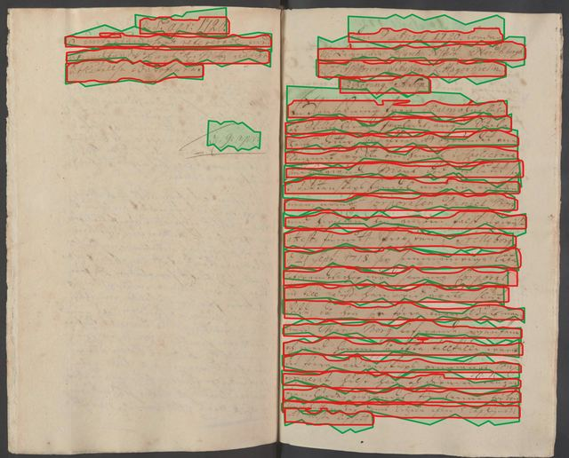 |
| **court_records_textline_yolov8x_seg** | 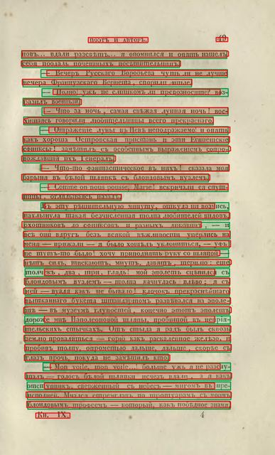 |  | 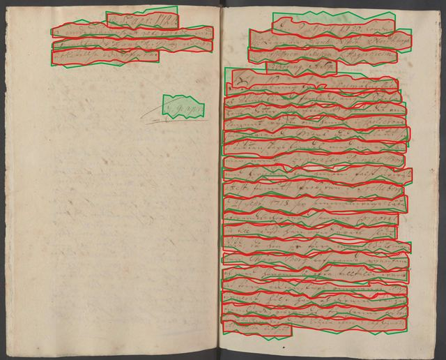 |
| **kraken_blla_default** | 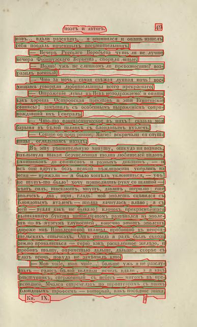 | 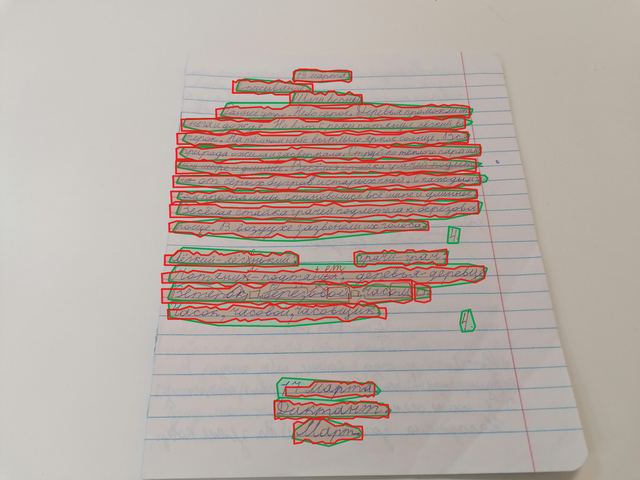 | 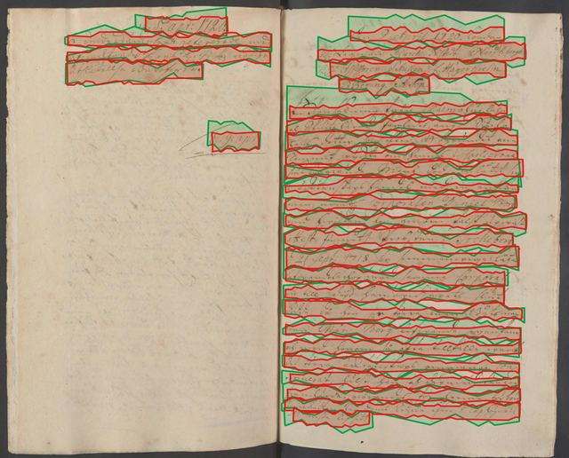 |
| **paddleocr_v6_medium_line** |  |  |  |
| **yolov8m_historical_line_segmenter** |  |  |  |
| **paddleocr_v6_small_line** |  |  |  |
| **nemotron_ocr_v2_multilingual_line** |  |  |  |
| **riksarkivet_rtmdet_lines** |  |  |  |
| **paddleocr_v6_tiny_line** |  |  |  |
| **surya_text_line_detection** |  |  |  |
| **regnetx_8gf_polyline_baseline_stage0_line** |  |  |  |
| **pero_layout_general** |  |  |  |
| **paddleocr_v5_server_line** |  |  |  |
| **ppocrv6_manga_det_v02_line** |  |  |  |
| **paddleocr_v5_mobile_line** |  |  |  |
| **doc_ufcn_generic_historical_line_x3_y8** |  |  |  |
| **doc_ufcn_generic_historical_line** |  |  |  |
| **ndlocr_lite_deimv2_line** |  |  |  |

## Результаты распознавания слов

Метрики в ячейке: `Character Similarity / Exact Match / CER / WER`; для первых двух больше — лучше, для CER и WER меньше — лучше.

| Model | Origin | Mean Character Similarity | Mean Exact Match | Mean CER | Mean WER | [russian_old_orthography](https://huggingface.co/datasets/nevmenandr/russian-old-orthography-ocr) | [school_notebooks_ru](https://huggingface.co/datasets/ai-forever/school_notebooks_RU) | [handwritten_essay](https://huggingface.co/datasets/sherstpasha/handwritten_essay) | [yenisei_gov_reports_hwr](https://huggingface.co/datasets/sherstpasha/YeniseiGovReports-HWR) | [yenisei_gov_reports_prt](https://huggingface.co/datasets/sherstpasha/YeniseiGovReports-PRT) | [cyrillic_handwriting](https://www.kaggle.com/datasets/constantinwerner/cyrillic-handwriting-dataset) | [donkeysmall_printed_15random](https://huggingface.co/datasets/sherstpasha/DonkeySmallOCR-Numbers-Printed-15random) | Mean words/s |
| --- | --- | --- | --- | --- | --- | --- | --- | --- | --- | --- | --- | --- | --- |
| trba_base_g1 | [source](https://github.com/konstantinkozhin/manuscript-ocr) | ${\color[RGB]{79,138,91}\mathbf{0.94}}$ | ${\color[RGB]{79,138,91}\mathbf{0.76}}$ | ${\color[RGB]{79,138,91}\mathbf{0.06}}$ | ${\color[RGB]{79,138,91}\mathbf{0.25}}$ | ${\color[RGB]{79,138,91}\mathbf{0.94}}$ / ${\color[RGB]{80,138,91}0.78}$ / ${\color[RGB]{79,138,91}\mathbf{0.06}}$ / ${\color[RGB]{79,138,91}0.23}$ | ${\color[RGB]{79,138,91}0.94}$ / ${\color[RGB]{85,136,90}0.80}$ / ${\color[RGB]{79,138,91}\mathbf{0.05}}$ / ${\color[RGB]{79,138,91}0.21}$ \* | ${\color[RGB]{81,138,91}0.88}$ / ${\color[RGB]{96,133,88}0.62}$ / ${\color[RGB]{80,138,91}0.12}$ / ${\color[RGB]{80,138,91}0.40}$ | ${\color[RGB]{79,138,91}\mathbf{0.97}}$ / ${\color[RGB]{79,138,91}\mathbf{0.91}}$ / ${\color[RGB]{79,138,91}\mathbf{0.03}}$ / ${\color[RGB]{79,138,91}\mathbf{0.10}}$ \* | ${\color[RGB]{79,138,91}\mathbf{0.99}}$ / ${\color[RGB]{79,138,91}\mathbf{0.96}}$ / ${\color[RGB]{79,138,91}\mathbf{0.01}}$ / ${\color[RGB]{79,138,91}\mathbf{0.04}}$ \* | ${\color[RGB]{84,137,90}0.94}$ / ${\color[RGB]{101,132,88}0.68}$ / ${\color[RGB]{80,138,91}0.06}$ / ${\color[RGB]{80,138,91}0.29}$ \* | ${\color[RGB]{89,135,89}0.90}$ / ${\color[RGB]{119,127,85}0.59}$ / ${\color[RGB]{81,137,91}0.11}$ / ${\color[RGB]{81,137,91}0.45}$ | ${\color[RGB]{101,132,88}680.50}$ |
| trba_lite_g1 | [source](https://github.com/konstantinkozhin/manuscript-ocr) | ${\color[RGB]{80,138,91}0.93}$ | ${\color[RGB]{81,137,91}0.75}$ | ${\color[RGB]{79,138,91}0.07}$ | ${\color[RGB]{79,138,91}0.26}$ | ${\color[RGB]{80,138,91}0.93}$ / ${\color[RGB]{85,136,90}0.75}$ / ${\color[RGB]{79,138,91}0.07}$ / ${\color[RGB]{80,138,91}0.25}$ | ${\color[RGB]{79,138,91}\mathbf{0.94}}$ / ${\color[RGB]{85,136,90}0.80}$ / ${\color[RGB]{79,138,91}0.05}$ / ${\color[RGB]{79,138,91}0.21}$ \* | ${\color[RGB]{81,137,91}0.87}$ / ${\color[RGB]{94,134,89}0.62}$ / ${\color[RGB]{80,138,91}0.13}$ / ${\color[RGB]{80,138,91}0.39}$ | ${\color[RGB]{80,138,91}0.96}$ / ${\color[RGB]{83,137,90}0.88}$ / ${\color[RGB]{79,138,91}0.04}$ / ${\color[RGB]{79,138,91}0.13}$ \* | ${\color[RGB]{80,138,91}0.98}$ / ${\color[RGB]{81,137,91}0.95}$ / ${\color[RGB]{79,138,91}0.02}$ / ${\color[RGB]{79,138,91}0.06}$ \* | ${\color[RGB]{84,137,90}0.94}$ / ${\color[RGB]{101,132,88}0.68}$ / ${\color[RGB]{80,138,91}0.07}$ / ${\color[RGB]{80,138,91}0.30}$ \* | ${\color[RGB]{91,135,89}0.88}$ / ${\color[RGB]{123,126,84}0.56}$ / ${\color[RGB]{81,137,91}0.13}$ / ${\color[RGB]{81,137,91}0.47}$ | ${\color[RGB]{156,109,86}237.86}$ |
| trocr_ru_1700s | [source](https://huggingface.co/taiga75/ru-trocr-1700s) | ${\color[RGB]{87,136,90}0.88}$ | ${\color[RGB]{93,134,89}0.68}$ | ${\color[RGB]{80,138,91}0.10}$ | ${\color[RGB]{80,138,91}0.35}$ | ${\color[RGB]{83,137,90}0.91}$ / ${\color[RGB]{79,138,91}\mathbf{0.79}}$ / ${\color[RGB]{79,138,91}0.06}$ / ${\color[RGB]{79,138,91}\mathbf{0.22}}$ | ${\color[RGB]{86,136,90}0.88}$ / ${\color[RGB]{96,133,88}0.72}$ / ${\color[RGB]{79,138,91}0.09}$ / ${\color[RGB]{80,138,91}0.31}$ | ${\color[RGB]{81,138,91}0.88}$ / ${\color[RGB]{86,136,90}0.68}$ / ${\color[RGB]{79,138,91}0.11}$ / ${\color[RGB]{80,138,91}0.36}$ | ${\color[RGB]{104,131,87}0.77}$ / ${\color[RGB]{133,123,83}0.49}$ / ${\color[RGB]{82,137,91}0.21}$ / ${\color[RGB]{84,137,90}0.55}$ | ${\color[RGB]{93,134,89}0.89}$ / ${\color[RGB]{98,133,88}0.81}$ / ${\color[RGB]{81,137,91}0.09}$ / ${\color[RGB]{81,137,91}0.22}$ | ${\color[RGB]{85,136,90}0.93}$ / ${\color[RGB]{107,130,87}0.64}$ / ${\color[RGB]{80,138,91}0.08}$ / ${\color[RGB]{80,138,91}0.33}$ | ${\color[RGB]{87,136,90}0.91}$ / ${\color[RGB]{117,128,85}0.61}$ / ${\color[RGB]{80,138,91}0.09}$ / ${\color[RGB]{81,137,91}0.45}$ | ${\color[RGB]{177,93,92}25.21}$ |
| trocr_large_rukopys_hw | [source](https://huggingface.co/Hukyl/trocr-large-rukopys-hw) | ${\color[RGB]{88,135,90}0.87}$ | ${\color[RGB]{99,133,88}0.63}$ | ${\color[RGB]{80,138,91}0.13}$ | ${\color[RGB]{81,137,91}0.44}$ | ${\color[RGB]{100,132,88}0.78}$ / ${\color[RGB]{124,126,84}0.49}$ / ${\color[RGB]{81,137,91}0.18}$ / ${\color[RGB]{89,135,90}0.56}$ | ${\color[RGB]{83,137,90}0.91}$ / ${\color[RGB]{92,134,89}0.75}$ / ${\color[RGB]{79,138,91}0.08}$ / ${\color[RGB]{80,138,91}0.28}$ | ${\color[RGB]{80,138,91}0.88}$ / ${\color[RGB]{88,136,90}0.66}$ / ${\color[RGB]{79,138,91}0.11}$ / ${\color[RGB]{80,138,91}0.38}$ | ${\color[RGB]{102,132,88}0.79}$ / ${\color[RGB]{136,123,82}0.47}$ / ${\color[RGB]{83,137,90}0.25}$ / ${\color[RGB]{84,137,90}0.57}$ | ${\color[RGB]{103,132,87}0.82}$ / ${\color[RGB]{129,124,83}0.56}$ / ${\color[RGB]{83,137,90}0.17}$ / ${\color[RGB]{86,136,90}0.53}$ | ${\color[RGB]{79,138,91}\mathbf{0.98}}$ / ${\color[RGB]{79,138,91}\mathbf{0.84}}$ / ${\color[RGB]{79,138,91}\mathbf{0.03}}$ / ${\color[RGB]{79,138,91}\mathbf{0.15}}$ \* | ${\color[RGB]{85,136,90}0.93}$ / ${\color[RGB]{108,130,87}0.67}$ / ${\color[RGB]{80,138,91}0.08}$ / ${\color[RGB]{82,137,91}0.60}$ | ${\color[RGB]{179,92,92}7.96}$ |
| paddleocr_v6_medium_ru | [source](https://huggingface.co/vladlinv/PP-OCRv6_medium_rec_ru) | ${\color[RGB]{92,135,89}0.84}$ | ${\color[RGB]{114,128,86}0.54}$ | ${\color[RGB]{81,138,91}0.14}$ | ${\color[RGB]{81,137,91}0.46}$ | ${\color[RGB]{88,135,90}0.87}$ / ${\color[RGB]{121,127,85}0.51}$ / ${\color[RGB]{80,138,91}0.13}$ / ${\color[RGB]{87,136,90}0.50}$ | ${\color[RGB]{95,134,89}0.82}$ / ${\color[RGB]{122,126,84}0.54}$ / ${\color[RGB]{80,138,91}0.14}$ / ${\color[RGB]{81,137,91}0.47}$ | ${\color[RGB]{95,134,89}0.77}$ / ${\color[RGB]{131,124,83}0.40}$ / ${\color[RGB]{82,137,91}0.20}$ / ${\color[RGB]{83,137,90}0.61}$ | ${\color[RGB]{118,128,85}0.66}$ / ${\color[RGB]{157,108,87}0.24}$ / ${\color[RGB]{84,137,90}0.34}$ / ${\color[RGB]{86,136,90}0.78}$ | ${\color[RGB]{88,136,90}0.92}$ / ${\color[RGB]{111,129,86}0.71}$ / ${\color[RGB]{81,138,91}0.08}$ / ${\color[RGB]{82,137,90}0.30}$ | ${\color[RGB]{89,135,89}0.90}$ / ${\color[RGB]{131,124,83}0.47}$ / ${\color[RGB]{80,138,91}0.10}$ / ${\color[RGB]{81,137,91}0.47}$ | ${\color[RGB]{79,138,91}0.98}$ / ${\color[RGB]{79,138,91}\mathbf{0.89}}$ / ${\color[RGB]{79,138,91}0.02}$ / ${\color[RGB]{79,138,91}\mathbf{0.12}}$ | ${\color[RGB]{141,120,83}390.92}$ |
| kraken_ppocrv6_medium | [source](https://zenodo.org/records/21788410) | ${\color[RGB]{96,133,88}0.81}$ | ${\color[RGB]{114,129,86}0.54}$ | ${\color[RGB]{81,137,91}0.16}$ | ${\color[RGB]{81,137,91}0.47}$ | ${\color[RGB]{101,132,88}0.78}$ / ${\color[RGB]{111,129,86}0.57}$ / ${\color[RGB]{81,138,91}0.14}$ / ${\color[RGB]{85,136,90}0.43}$ | ${\color[RGB]{97,133,88}0.80}$ / ${\color[RGB]{121,127,85}0.54}$ / ${\color[RGB]{80,138,91}0.15}$ / ${\color[RGB]{81,137,91}0.47}$ | ${\color[RGB]{96,133,88}0.76}$ / ${\color[RGB]{127,125,84}0.42}$ / ${\color[RGB]{82,137,91}0.21}$ / ${\color[RGB]{83,137,90}0.59}$ | ${\color[RGB]{101,132,88}0.79}$ / ${\color[RGB]{131,124,83}0.51}$ / ${\color[RGB]{82,137,91}0.19}$ / ${\color[RGB]{83,137,90}0.52}$ | ${\color[RGB]{106,131,87}0.80}$ / ${\color[RGB]{120,127,85}0.63}$ / ${\color[RGB]{83,137,90}0.17}$ / ${\color[RGB]{84,137,90}0.38}$ | ${\color[RGB]{96,133,88}0.84}$ / ${\color[RGB]{146,116,84}0.34}$ / ${\color[RGB]{81,137,91}0.15}$ / ${\color[RGB]{82,137,91}0.57}$ | ${\color[RGB]{84,137,90}0.93}$ / ${\color[RGB]{97,133,88}0.76}$ / ${\color[RGB]{80,138,91}0.07}$ / ${\color[RGB]{80,138,91}0.32}$ | ${\color[RGB]{165,102,89}149.99}$ |
| cyrillic_large_handwritten | [source](https://huggingface.co/Kansallisarkisto/cyrillic-large-handwritten) | ${\color[RGB]{95,134,89}0.82}$ | ${\color[RGB]{110,130,86}0.56}$ | ${\color[RGB]{82,137,91}0.21}$ | ${\color[RGB]{81,137,91}0.48}$ | ${\color[RGB]{88,135,90}0.87}$ / ${\color[RGB]{105,131,87}0.62}$ / ${\color[RGB]{80,138,91}0.12}$ / ${\color[RGB]{84,137,90}0.40}$ | ${\color[RGB]{101,132,88}0.77}$ / ${\color[RGB]{127,125,84}0.50}$ / ${\color[RGB]{82,137,91}0.27}$ / ${\color[RGB]{82,137,91}0.56}$ | ${\color[RGB]{111,129,86}0.65}$ / ${\color[RGB]{142,119,83}0.33}$ / ${\color[RGB]{88,136,90}0.45}$ / ${\color[RGB]{85,136,90}0.75}$ | ${\color[RGB]{99,133,88}0.81}$ / ${\color[RGB]{126,125,84}0.55}$ / ${\color[RGB]{83,137,90}0.24}$ / ${\color[RGB]{83,137,90}0.49}$ | ${\color[RGB]{95,134,89}0.87}$ / ${\color[RGB]{114,129,86}0.68}$ / ${\color[RGB]{84,137,90}0.20}$ / ${\color[RGB]{83,137,90}0.37}$ | ${\color[RGB]{97,133,88}0.83}$ / ${\color[RGB]{133,123,83}0.46}$ / ${\color[RGB]{81,137,91}0.18}$ / ${\color[RGB]{82,137,91}0.51}$ | ${\color[RGB]{80,138,91}0.96}$ / ${\color[RGB]{89,135,89}0.81}$ / ${\color[RGB]{79,138,91}0.04}$ / ${\color[RGB]{80,138,91}0.26}$ | ${\color[RGB]{179,92,92}8.30}$ |
| trocr_dialectic_stackmix | [source](https://huggingface.co/Daniil-Domino/trocr-base-ru-dialectic-stackmix) | ${\color[RGB]{97,133,88}0.81}$ | ${\color[RGB]{114,129,86}0.54}$ | ${\color[RGB]{81,137,91}0.17}$ | ${\color[RGB]{81,137,91}0.48}$ | ${\color[RGB]{115,128,85}0.66}$ / ${\color[RGB]{148,115,84}0.31}$ / ${\color[RGB]{83,137,90}0.26}$ / ${\color[RGB]{92,134,89}0.70}$ | ${\color[RGB]{86,136,90}0.89}$ / ${\color[RGB]{94,134,89}0.73}$ / ${\color[RGB]{79,138,91}0.08}$ / ${\color[RGB]{80,138,91}0.29}$ | ${\color[RGB]{79,138,91}\mathbf{0.89}}$ / ${\color[RGB]{79,138,91}\mathbf{0.72}}$ / ${\color[RGB]{79,138,91}\mathbf{0.09}}$ / ${\color[RGB]{79,138,91}\mathbf{0.30}}$ | ${\color[RGB]{111,129,86}0.71}$ / ${\color[RGB]{144,117,84}0.38}$ / ${\color[RGB]{83,137,90}0.27}$ / ${\color[RGB]{85,136,90}0.66}$ | ${\color[RGB]{125,126,84}0.66}$ / ${\color[RGB]{151,112,85}0.34}$ / ${\color[RGB]{87,136,90}0.31}$ / ${\color[RGB]{88,136,90}0.70}$ | ${\color[RGB]{83,137,90}0.94}$ / ${\color[RGB]{99,133,88}0.70}$ / ${\color[RGB]{80,138,91}0.06}$ / ${\color[RGB]{80,138,91}0.28}$ | ${\color[RGB]{88,136,90}0.91}$ / ${\color[RGB]{117,128,85}0.60}$ / ${\color[RGB]{81,138,91}0.11}$ / ${\color[RGB]{81,137,91}0.44}$ | ${\color[RGB]{177,94,91}26.89}$ |
| trocr_dialectic | [source](https://huggingface.co/Daniil-Domino/trocr-base-ru-dialectic) | ${\color[RGB]{100,132,88}0.79}$ | ${\color[RGB]{121,127,85}0.49}$ | ${\color[RGB]{82,137,91}0.20}$ | ${\color[RGB]{82,137,91}0.52}$ | ${\color[RGB]{124,126,84}0.59}$ / ${\color[RGB]{162,104,88}0.17}$ / ${\color[RGB]{84,137,90}0.36}$ / ${\color[RGB]{96,133,88}0.84}$ | ${\color[RGB]{86,136,90}0.89}$ / ${\color[RGB]{95,134,89}0.73}$ / ${\color[RGB]{79,138,91}0.09}$ / ${\color[RGB]{80,138,91}0.29}$ | ${\color[RGB]{80,138,91}0.88}$ / ${\color[RGB]{83,137,90}0.69}$ / ${\color[RGB]{79,138,91}0.10}$ / ${\color[RGB]{79,138,91}0.33}$ | ${\color[RGB]{111,129,86}0.71}$ / ${\color[RGB]{145,117,84}0.37}$ / ${\color[RGB]{83,137,90}0.29}$ / ${\color[RGB]{85,136,90}0.66}$ | ${\color[RGB]{129,125,83}0.64}$ / ${\color[RGB]{157,108,87}0.27}$ / ${\color[RGB]{89,135,90}0.36}$ / ${\color[RGB]{89,135,90}0.76}$ | ${\color[RGB]{84,137,90}0.93}$ / ${\color[RGB]{104,131,87}0.66}$ / ${\color[RGB]{80,138,91}0.07}$ / ${\color[RGB]{80,138,91}0.31}$ | ${\color[RGB]{90,135,89}0.89}$ / ${\color[RGB]{122,126,84}0.56}$ / ${\color[RGB]{81,137,91}0.13}$ / ${\color[RGB]{81,137,91}0.46}$ | ${\color[RGB]{177,93,92}24.22}$ |
| trocr_base_ru | [source](https://huggingface.co/raxtemur/trocr-base-ru) | ${\color[RGB]{100,132,88}0.79}$ | ${\color[RGB]{120,127,85}0.50}$ | ${\color[RGB]{82,137,91}0.21}$ | ${\color[RGB]{83,137,90}0.60}$ | ${\color[RGB]{119,127,85}0.63}$ / ${\color[RGB]{151,112,85}0.27}$ / ${\color[RGB]{84,137,90}0.33}$ / ${\color[RGB]{98,133,88}0.90}$ | ${\color[RGB]{89,135,89}0.86}$ / ${\color[RGB]{103,132,87}0.67}$ / ${\color[RGB]{80,138,91}0.11}$ / ${\color[RGB]{80,138,91}0.37}$ | ${\color[RGB]{86,136,90}0.83}$ / ${\color[RGB]{95,134,89}0.62}$ / ${\color[RGB]{81,138,91}0.15}$ / ${\color[RGB]{81,137,91}0.46}$ | ${\color[RGB]{109,130,86}0.73}$ / ${\color[RGB]{142,119,83}0.41}$ / ${\color[RGB]{83,137,90}0.28}$ / ${\color[RGB]{85,136,90}0.67}$ | ${\color[RGB]{130,124,83}0.63}$ / ${\color[RGB]{156,109,86}0.28}$ / ${\color[RGB]{89,135,89}0.39}$ / ${\color[RGB]{91,135,89}0.95}$ | ${\color[RGB]{86,136,90}0.92}$ / ${\color[RGB]{108,130,87}0.63}$ / ${\color[RGB]{80,138,91}0.08}$ / ${\color[RGB]{80,138,91}0.34}$ | ${\color[RGB]{87,136,90}0.91}$ / ${\color[RGB]{115,128,86}0.62}$ / ${\color[RGB]{81,138,91}0.10}$ / ${\color[RGB]{81,137,91}0.50}$ | ${\color[RGB]{177,94,91}26.00}$ |
| kraken_ppocrv6_small | [source](https://zenodo.org/records/21788405) | ${\color[RGB]{102,132,88}0.78}$ | ${\color[RGB]{125,126,84}0.47}$ | ${\color[RGB]{82,137,91}0.19}$ | ${\color[RGB]{82,137,91}0.54}$ | ${\color[RGB]{102,132,87}0.76}$ / ${\color[RGB]{121,127,85}0.51}$ / ${\color[RGB]{81,137,91}0.17}$ / ${\color[RGB]{87,136,90}0.50}$ | ${\color[RGB]{103,132,87}0.76}$ / ${\color[RGB]{131,124,83}0.47}$ / ${\color[RGB]{81,138,91}0.18}$ / ${\color[RGB]{82,137,91}0.54}$ | ${\color[RGB]{106,131,87}0.68}$ / ${\color[RGB]{143,118,83}0.31}$ / ${\color[RGB]{83,137,90}0.26}$ / ${\color[RGB]{84,137,90}0.70}$ | ${\color[RGB]{110,130,86}0.72}$ / ${\color[RGB]{143,118,83}0.39}$ / ${\color[RGB]{83,137,90}0.26}$ / ${\color[RGB]{84,137,90}0.63}$ | ${\color[RGB]{108,130,87}0.78}$ / ${\color[RGB]{126,125,84}0.58}$ / ${\color[RGB]{84,137,90}0.19}$ / ${\color[RGB]{84,137,90}0.44}$ | ${\color[RGB]{100,132,88}0.81}$ / ${\color[RGB]{152,112,85}0.28}$ / ${\color[RGB]{81,137,91}0.18}$ / ${\color[RGB]{82,137,90}0.64}$ | ${\color[RGB]{86,136,90}0.92}$ / ${\color[RGB]{101,132,88}0.73}$ / ${\color[RGB]{80,138,91}0.08}$ / ${\color[RGB]{80,138,91}0.34}$ | ${\color[RGB]{155,109,86}246.18}$ |
| trocr_base_handwritten_ru | [source](https://huggingface.co/kazars24/trocr-base-handwritten-ru) | ${\color[RGB]{105,131,87}0.75}$ | ${\color[RGB]{138,122,82}0.38}$ | ${\color[RGB]{83,137,90}0.24}$ | ${\color[RGB]{83,137,90}0.63}$ | ${\color[RGB]{119,127,85}0.63}$ / ${\color[RGB]{159,107,87}0.20}$ / ${\color[RGB]{84,137,90}0.31}$ / ${\color[RGB]{95,134,88}0.81}$ | ${\color[RGB]{90,135,89}0.86}$ / ${\color[RGB]{107,130,87}0.64}$ / ${\color[RGB]{80,138,91}0.12}$ / ${\color[RGB]{80,138,91}0.38}$ | ${\color[RGB]{86,136,90}0.84}$ / ${\color[RGB]{109,130,86}0.53}$ / ${\color[RGB]{81,138,91}0.16}$ / ${\color[RGB]{81,137,91}0.49}$ | ${\color[RGB]{119,127,85}0.65}$ / ${\color[RGB]{157,108,87}0.25}$ / ${\color[RGB]{84,137,90}0.34}$ / ${\color[RGB]{86,136,90}0.77}$ | ${\color[RGB]{124,126,84}0.67}$ / ${\color[RGB]{157,108,87}0.27}$ / ${\color[RGB]{86,136,90}0.29}$ / ${\color[RGB]{88,135,90}0.75}$ | ${\color[RGB]{89,135,90}0.90}$ / ${\color[RGB]{123,126,84}0.53}$ / ${\color[RGB]{80,138,91}0.11}$ / ${\color[RGB]{81,137,91}0.43}$ | ${\color[RGB]{112,129,86}0.72}$ / ${\color[RGB]{154,110,86}0.27}$ / ${\color[RGB]{85,136,90}0.32}$ / ${\color[RGB]{83,137,90}0.75}$ | ${\color[RGB]{178,92,92}10.55}$ |
| cyrillic_htr_model | [source](https://huggingface.co/Kansallisarkisto/cyrillic-htr-model) | ${\color[RGB]{106,131,87}0.74}$ | ${\color[RGB]{140,121,82}0.37}$ | ${\color[RGB]{82,137,90}0.22}$ | ${\color[RGB]{83,137,90}0.69}$ | ${\color[RGB]{102,132,87}0.76}$ / ${\color[RGB]{132,124,83}0.43}$ / ${\color[RGB]{81,137,91}0.18}$ / ${\color[RGB]{89,135,89}0.58}$ | ${\color[RGB]{109,130,86}0.71}$ / ${\color[RGB]{144,118,83}0.36}$ / ${\color[RGB]{81,137,91}0.23}$ / ${\color[RGB]{83,137,90}0.66}$ | ${\color[RGB]{124,126,84}0.55}$ / ${\color[RGB]{161,105,88}0.15}$ / ${\color[RGB]{87,136,90}0.39}$ / ${\color[RGB]{87,136,90}0.89}$ | ${\color[RGB]{103,131,87}0.77}$ / ${\color[RGB]{134,123,83}0.48}$ / ${\color[RGB]{82,137,91}0.20}$ / ${\color[RGB]{83,137,90}0.53}$ | ${\color[RGB]{108,130,87}0.79}$ / ${\color[RGB]{133,123,83}0.53}$ / ${\color[RGB]{83,137,90}0.16}$ / ${\color[RGB]{85,136,90}0.50}$ | ${\color[RGB]{108,130,87}0.75}$ / ${\color[RGB]{161,105,88}0.19}$ / ${\color[RGB]{82,137,90}0.25}$ / ${\color[RGB]{83,137,90}0.78}$ | ${\color[RGB]{94,134,89}0.86}$ / ${\color[RGB]{140,121,82}0.42}$ / ${\color[RGB]{82,137,91}0.16}$ / ${\color[RGB]{84,137,90}0.88}$ | ${\color[RGB]{179,92,92}8.75}$ |
| trocr_handwritten_cyrillic | [source](https://huggingface.co/cyrillic-trocr/trocr-handwritten-cyrillic) | ${\color[RGB]{108,130,87}0.73}$ | ${\color[RGB]{137,122,82}0.39}$ | ${\color[RGB]{85,136,90}0.34}$ | ${\color[RGB]{84,137,90}0.76}$ | ${\color[RGB]{96,133,88}0.81}$ / ${\color[RGB]{122,126,84}0.50}$ / ${\color[RGB]{81,137,91}0.16}$ / ${\color[RGB]{88,136,90}0.53}$ | ${\color[RGB]{98,133,88}0.79}$ / ${\color[RGB]{129,124,83}0.48}$ / ${\color[RGB]{81,138,91}0.18}$ / ${\color[RGB]{82,137,91}0.54}$ | ${\color[RGB]{104,131,87}0.70}$ / ${\color[RGB]{139,121,82}0.35}$ / ${\color[RGB]{85,136,90}0.34}$ / ${\color[RGB]{85,136,90}0.75}$ | ${\color[RGB]{118,127,85}0.65}$ / ${\color[RGB]{149,114,85}0.33}$ / ${\color[RGB]{91,135,89}0.71}$ / ${\color[RGB]{89,135,89}1.11}$ | ${\color[RGB]{115,128,86}0.74}$ / ${\color[RGB]{139,121,82}0.48}$ / ${\color[RGB]{86,136,90}0.28}$ / ${\color[RGB]{87,136,90}0.65}$ | ${\color[RGB]{98,133,88}0.82}$ / ${\color[RGB]{145,117,84}0.35}$ / ${\color[RGB]{82,137,91}0.20}$ / ${\color[RGB]{82,137,91}0.62}$ | ${\color[RGB]{128,125,84}0.59}$ / ${\color[RGB]{159,106,87}0.21}$ / ${\color[RGB]{89,135,89}0.49}$ / ${\color[RGB]{86,136,90}1.14}$ | ${\color[RGB]{179,92,92}8.52}$ |
| paddleocr_v6_tiny_ru | [source](https://huggingface.co/vladlinv/PP-OCRv6_tiny_rec_ru) | ${\color[RGB]{116,128,85}0.67}$ | ${\color[RGB]{146,116,84}0.31}$ | ${\color[RGB]{84,137,90}0.31}$ | ${\color[RGB]{84,137,90}0.71}$ | ${\color[RGB]{98,133,88}0.79}$ / ${\color[RGB]{140,120,83}0.37}$ / ${\color[RGB]{81,137,91}0.19}$ / ${\color[RGB]{91,135,89}0.63}$ | ${\color[RGB]{131,124,83}0.53}$ / ${\color[RGB]{166,101,89}0.13}$ / ${\color[RGB]{84,137,90}0.42}$ / ${\color[RGB]{84,137,90}0.89}$ | ${\color[RGB]{137,122,82}0.45}$ / ${\color[RGB]{171,98,90}0.07}$ / ${\color[RGB]{90,135,89}0.50}$ / ${\color[RGB]{88,136,90}0.99}$ | ${\color[RGB]{145,117,84}0.41}$ / ${\color[RGB]{170,98,90}0.09}$ / ${\color[RGB]{89,135,89}0.60}$ / ${\color[RGB]{87,136,90}0.93}$ | ${\color[RGB]{97,133,88}0.86}$ / ${\color[RGB]{124,126,84}0.60}$ / ${\color[RGB]{82,137,91}0.12}$ / ${\color[RGB]{84,137,90}0.44}$ | ${\color[RGB]{115,128,85}0.69}$ / ${\color[RGB]{169,99,90}0.10}$ / ${\color[RGB]{83,137,90}0.30}$ / ${\color[RGB]{84,137,90}0.84}$ | ${\color[RGB]{82,137,91}0.95}$ / ${\color[RGB]{93,134,89}0.78}$ / ${\color[RGB]{80,138,91}0.05}$ / ${\color[RGB]{80,138,91}0.24}$ | ${\color[RGB]{79,138,91}\mathbf{834.56}}$ |
| trocr_rukopys | [source](https://huggingface.co/Hukyl/trocr-rukopys) | ${\color[RGB]{110,130,86}0.72}$ | ${\color[RGB]{147,115,84}0.30}$ | ${\color[RGB]{84,137,90}0.31}$ | ${\color[RGB]{85,136,90}0.85}$ | ${\color[RGB]{113,129,86}0.67}$ / ${\color[RGB]{154,111,86}0.25}$ / ${\color[RGB]{83,137,90}0.29}$ / ${\color[RGB]{95,134,89}0.80}$ | ${\color[RGB]{96,133,88}0.81}$ / ${\color[RGB]{128,125,83}0.49}$ / ${\color[RGB]{81,138,91}0.18}$ / ${\color[RGB]{82,137,91}0.54}$ | ${\color[RGB]{104,131,87}0.70}$ / ${\color[RGB]{144,118,83}0.31}$ / ${\color[RGB]{84,137,90}0.29}$ / ${\color[RGB]{85,136,90}0.75}$ | ${\color[RGB]{121,126,85}0.62}$ / ${\color[RGB]{157,108,87}0.25}$ / ${\color[RGB]{87,136,90}0.50}$ / ${\color[RGB]{87,136,90}0.87}$ | ${\color[RGB]{112,129,86}0.75}$ / ${\color[RGB]{148,115,84}0.38}$ / ${\color[RGB]{86,136,90}0.26}$ / ${\color[RGB]{88,136,90}0.73}$ | ${\color[RGB]{104,131,87}0.78}$ / ${\color[RGB]{156,109,86}0.23}$ / ${\color[RGB]{82,137,91}0.23}$ / ${\color[RGB]{83,137,90}0.72}$ | ${\color[RGB]{116,128,85}0.68}$ / ${\color[RGB]{161,105,88}0.19}$ / ${\color[RGB]{87,136,90}0.39}$ / ${\color[RGB]{88,135,90}1.56}$ | ${\color[RGB]{179,92,92}8.56}$ |
| doctr_parseq_russian_onnx | [source](https://huggingface.co/graycat660/doctr-parseq-russian-onnx) | ${\color[RGB]{131,124,83}0.57}$ | ${\color[RGB]{143,118,83}0.34}$ | ${\color[RGB]{88,136,90}0.48}$ | ${\color[RGB]{83,137,90}0.67}$ | ${\color[RGB]{88,136,90}0.87}$ / ${\color[RGB]{106,131,87}0.61}$ / ${\color[RGB]{80,138,91}0.11}$ / ${\color[RGB]{84,137,90}0.39}$ | ${\color[RGB]{152,112,85}0.32}$ / ${\color[RGB]{173,97,90}0.07}$ / ${\color[RGB]{88,135,90}0.74}$ / ${\color[RGB]{85,136,90}0.93}$ | ${\color[RGB]{156,109,86}0.25}$ / ${\color[RGB]{176,94,91}0.03}$ / ${\color[RGB]{98,133,88}0.83}$ / ${\color[RGB]{88,136,90}0.97}$ | ${\color[RGB]{154,111,86}0.30}$ / ${\color[RGB]{173,96,91}0.07}$ / ${\color[RGB]{93,134,89}0.84}$ / ${\color[RGB]{87,136,90}0.94}$ | ${\color[RGB]{93,134,89}0.89}$ / ${\color[RGB]{108,130,87}0.74}$ / ${\color[RGB]{81,137,91}0.10}$ / ${\color[RGB]{82,137,91}0.28}$ | ${\color[RGB]{150,113,85}0.38}$ / ${\color[RGB]{175,95,91}0.04}$ / ${\color[RGB]{89,135,89}0.69}$ / ${\color[RGB]{85,136,90}0.96}$ | ${\color[RGB]{83,137,90}0.94}$ / ${\color[RGB]{90,135,89}0.81}$ / ${\color[RGB]{80,138,91}0.06}$ / ${\color[RGB]{79,138,91}0.19}$ | ${\color[RGB]{171,98,90}85.05}$ |
| kraken_ppocrv6_tiny | [source](https://zenodo.org/records/21788403) | ${\color[RGB]{120,127,85}0.64}$ | ${\color[RGB]{148,115,84}0.29}$ | ${\color[RGB]{85,136,90}0.32}$ | ${\color[RGB]{84,137,90}0.73}$ | ${\color[RGB]{129,125,83}0.56}$ / ${\color[RGB]{158,108,87}0.21}$ / ${\color[RGB]{84,137,90}0.34}$ / ${\color[RGB]{95,134,89}0.79}$ | ${\color[RGB]{118,127,85}0.63}$ / ${\color[RGB]{152,112,85}0.28}$ / ${\color[RGB]{82,137,91}0.29}$ / ${\color[RGB]{83,137,90}0.74}$ | ${\color[RGB]{133,123,83}0.49}$ / ${\color[RGB]{164,103,88}0.13}$ / ${\color[RGB]{89,135,90}0.46}$ / ${\color[RGB]{87,136,90}0.89}$ | ${\color[RGB]{126,125,84}0.59}$ / ${\color[RGB]{154,110,86}0.28}$ / ${\color[RGB]{86,136,90}0.41}$ / ${\color[RGB]{85,136,90}0.74}$ | ${\color[RGB]{124,126,84}0.67}$ / ${\color[RGB]{145,117,84}0.41}$ / ${\color[RGB]{87,136,90}0.29}$ / ${\color[RGB]{87,136,90}0.62}$ | ${\color[RGB]{116,128,85}0.69}$ / ${\color[RGB]{166,101,89}0.13}$ / ${\color[RGB]{83,137,90}0.30}$ / ${\color[RGB]{84,137,90}0.82}$ | ${\color[RGB]{93,134,89}0.87}$ / ${\color[RGB]{118,128,85}0.60}$ / ${\color[RGB]{82,137,91}0.14}$ / ${\color[RGB]{81,137,91}0.49}$ | ${\color[RGB]{150,114,85}302.87}$ |
| doctr_crnn_vgg16_bn_russian_onnx | [source](https://huggingface.co/graycat660/doctr-crnn-vgg16-bn-russian-onnx) | ${\color[RGB]{131,124,83}0.57}$ | ${\color[RGB]{146,116,84}0.31}$ | ${\color[RGB]{88,136,90}0.49}$ | ${\color[RGB]{84,137,90}0.69}$ | ${\color[RGB]{88,136,90}0.87}$ / ${\color[RGB]{113,129,86}0.56}$ / ${\color[RGB]{80,138,91}0.13}$ / ${\color[RGB]{85,136,90}0.44}$ | ${\color[RGB]{151,113,85}0.33}$ / ${\color[RGB]{174,96,91}0.06}$ / ${\color[RGB]{89,135,90}0.75}$ / ${\color[RGB]{85,136,90}0.94}$ | ${\color[RGB]{153,111,86}0.28}$ / ${\color[RGB]{176,94,91}0.02}$ / ${\color[RGB]{98,133,88}0.81}$ / ${\color[RGB]{88,136,90}0.98}$ | ${\color[RGB]{155,110,86}0.29}$ / ${\color[RGB]{175,95,91}0.04}$ / ${\color[RGB]{93,134,89}0.83}$ / ${\color[RGB]{88,136,90}0.96}$ | ${\color[RGB]{96,133,88}0.87}$ / ${\color[RGB]{115,128,86}0.68}$ / ${\color[RGB]{82,137,91}0.12}$ / ${\color[RGB]{83,137,90}0.34}$ | ${\color[RGB]{149,114,85}0.39}$ / ${\color[RGB]{176,94,91}0.03}$ / ${\color[RGB]{89,135,89}0.69}$ / ${\color[RGB]{85,136,90}0.98}$ | ${\color[RGB]{84,137,90}0.94}$ / ${\color[RGB]{93,134,89}0.78}$ / ${\color[RGB]{80,138,91}0.07}$ / ${\color[RGB]{80,138,91}0.22}$ | ${\color[RGB]{150,113,85}301.72}$ |
| paddleocr_cyrillic_v5_mobile | [source](https://huggingface.co/PaddlePaddle/cyrillic_PP-OCRv5_mobile_rec) | ${\color[RGB]{145,117,84}0.44}$ | ${\color[RGB]{149,114,85}0.28}$ | ${\color[RGB]{90,135,89}0.56}$ | ${\color[RGB]{84,137,90}0.73}$ | ${\color[RGB]{112,129,86}0.69}$ / ${\color[RGB]{145,117,84}0.33}$ / ${\color[RGB]{82,137,91}0.21}$ / ${\color[RGB]{92,135,89}0.67}$ | ${\color[RGB]{172,97,90}0.09}$ / ${\color[RGB]{177,93,92}0.02}$ / ${\color[RGB]{91,135,89}0.92}$ / ${\color[RGB]{85,136,90}0.98}$ | ${\color[RGB]{174,95,91}0.05}$ / ${\color[RGB]{178,92,92}0.01}$ / ${\color[RGB]{101,132,88}0.96}$ / ${\color[RGB]{88,135,90}1.01}$ | ${\color[RGB]{159,107,87}0.24}$ / ${\color[RGB]{169,99,90}0.11}$ / ${\color[RGB]{93,134,89}0.86}$ / ${\color[RGB]{87,136,90}0.92}$ | ${\color[RGB]{103,131,87}0.82}$ / ${\color[RGB]{125,126,84}0.60}$ / ${\color[RGB]{83,137,90}0.15}$ / ${\color[RGB]{84,137,90}0.45}$ | ${\color[RGB]{163,103,88}0.23}$ / ${\color[RGB]{175,95,91}0.04}$ / ${\color[RGB]{90,135,89}0.76}$ / ${\color[RGB]{85,136,90}0.95}$ | ${\color[RGB]{79,138,91}\mathbf{0.98}}$ / ${\color[RGB]{79,138,91}0.89}$ / ${\color[RGB]{79,138,91}\mathbf{0.02}}$ / ${\color[RGB]{79,138,91}0.14}$ | ${\color[RGB]{114,128,86}585.65}$ |
| turkicocr_svtrv2_b | [source](https://huggingface.co/alenisaw/turkicocr-svtrv2-b) | ${\color[RGB]{129,124,83}0.58}$ | ${\color[RGB]{159,106,87}0.19}$ | ${\color[RGB]{87,136,90}0.44}$ | ${\color[RGB]{86,136,90}0.96}$ | ${\color[RGB]{111,129,86}0.69}$ / ${\color[RGB]{157,108,87}0.21}$ / ${\color[RGB]{83,137,90}0.27}$ / ${\color[RGB]{97,133,88}0.86}$ | ${\color[RGB]{143,118,83}0.42}$ / ${\color[RGB]{175,95,91}0.04}$ / ${\color[RGB]{86,136,90}0.59}$ / ${\color[RGB]{86,136,90}1.08}$ | ${\color[RGB]{146,116,84}0.36}$ / ${\color[RGB]{177,94,91}0.02}$ / ${\color[RGB]{94,134,89}0.68}$ / ${\color[RGB]{91,135,89}1.20}$ | ${\color[RGB]{147,116,84}0.39}$ / ${\color[RGB]{172,97,90}0.08}$ / ${\color[RGB]{91,135,89}0.69}$ / ${\color[RGB]{89,135,89}1.08}$ | ${\color[RGB]{113,129,86}0.75}$ / ${\color[RGB]{151,112,85}0.34}$ / ${\color[RGB]{85,136,90}0.21}$ / ${\color[RGB]{88,135,90}0.75}$ | ${\color[RGB]{139,121,82}0.51}$ / ${\color[RGB]{176,94,91}0.03}$ / ${\color[RGB]{87,136,90}0.54}$ / ${\color[RGB]{86,136,90}1.10}$ | ${\color[RGB]{85,136,90}0.93}$ / ${\color[RGB]{118,127,85}0.59}$ / ${\color[RGB]{80,138,91}0.07}$ / ${\color[RGB]{82,137,90}0.64}$ | ${\color[RGB]{131,124,83}471.16}$ |
| trocr_russian_18th_century_printed | [source](https://huggingface.co/dsmchr/trocr_russian_18th_century_printed) | ${\color[RGB]{138,122,82}0.52}$ | ${\color[RGB]{157,108,87}0.21}$ | ${\color[RGB]{89,135,89}0.54}$ | ${\color[RGB]{85,136,90}0.83}$ | ${\color[RGB]{85,136,90}0.90}$ / ${\color[RGB]{98,133,88}0.66}$ / ${\color[RGB]{80,138,91}0.10}$ / ${\color[RGB]{83,137,90}0.34}$ | ${\color[RGB]{146,116,84}0.38}$ / ${\color[RGB]{172,97,90}0.07}$ / ${\color[RGB]{87,136,90}0.67}$ / ${\color[RGB]{85,136,90}0.95}$ | ${\color[RGB]{149,114,85}0.33}$ / ${\color[RGB]{174,95,91}0.04}$ / ${\color[RGB]{95,134,89}0.71}$ / ${\color[RGB]{88,135,90}1.01}$ | ${\color[RGB]{152,111,86}0.32}$ / ${\color[RGB]{172,97,90}0.08}$ / ${\color[RGB]{94,134,89}0.89}$ / ${\color[RGB]{88,136,90}0.96}$ | ${\color[RGB]{105,131,87}0.81}$ / ${\color[RGB]{138,122,82}0.49}$ / ${\color[RGB]{85,136,90}0.22}$ / ${\color[RGB]{86,136,90}0.54}$ | ${\color[RGB]{149,114,85}0.39}$ / ${\color[RGB]{178,93,92}0.01}$ / ${\color[RGB]{89,135,90}0.64}$ / ${\color[RGB]{85,136,90}1.02}$ | ${\color[RGB]{137,122,82}0.51}$ / ${\color[RGB]{168,100,89}0.12}$ / ${\color[RGB]{90,135,89}0.54}$ / ${\color[RGB]{85,137,90}0.98}$ | ${\color[RGB]{179,92,92}9.00}$ |
| parseq_s_rukopys | [source](https://huggingface.co/Hukyl/parseq-s-rukopys) | ${\color[RGB]{114,129,86}0.69}$ | ${\color[RGB]{132,124,83}0.43}$ | ${\color[RGB]{106,131,87}1.30}$ | ${\color[RGB]{89,135,89}1.28}$ | ${\color[RGB]{160,106,87}0.24}$ / ${\color[RGB]{177,94,91}0.03}$ / ${\color[RGB]{159,107,87}4.89}$ / ${\color[RGB]{151,112,85}3.03}$ | ${\color[RGB]{81,137,91}0.92}$ / ${\color[RGB]{83,137,90}0.81}$ / ${\color[RGB]{79,138,91}0.07}$ / ${\color[RGB]{79,138,91}0.22}$ \* | ${\color[RGB]{96,133,88}0.76}$ / ${\color[RGB]{115,128,86}0.50}$ / ${\color[RGB]{87,136,90}0.41}$ / ${\color[RGB]{86,136,90}0.82}$ | ${\color[RGB]{119,127,85}0.65}$ / ${\color[RGB]{149,114,85}0.33}$ / ${\color[RGB]{96,133,88}1.01}$ / ${\color[RGB]{93,134,89}1.50}$ | ${\color[RGB]{147,115,84}0.48}$ / ${\color[RGB]{164,103,88}0.19}$ / ${\color[RGB]{141,120,83}2.36}$ / ${\color[RGB]{106,131,87}2.06}$ | ${\color[RGB]{87,136,90}0.92}$ / ${\color[RGB]{112,129,86}0.61}$ / ${\color[RGB]{80,138,91}0.11}$ / ${\color[RGB]{81,138,91}0.37}$ \* | ${\color[RGB]{95,134,89}0.85}$ / ${\color[RGB]{130,124,83}0.51}$ / ${\color[RGB]{83,137,90}0.22}$ / ${\color[RGB]{84,137,90}0.93}$ | ${\color[RGB]{171,98,90}87.55}$ |
| paddleocr_eslav_v5_mobile | [source](https://huggingface.co/PaddlePaddle/eslav_PP-OCRv5_mobile_rec) | ${\color[RGB]{147,115,84}0.42}$ | ${\color[RGB]{151,112,85}0.26}$ | ${\color[RGB]{90,135,89}0.57}$ | ${\color[RGB]{84,137,90}0.75}$ | ${\color[RGB]{120,127,85}0.62}$ / ${\color[RGB]{152,112,85}0.26}$ / ${\color[RGB]{83,137,90}0.26}$ / ${\color[RGB]{94,134,89}0.74}$ | ${\color[RGB]{173,97,90}0.08}$ / ${\color[RGB]{177,93,92}0.02}$ / ${\color[RGB]{91,135,89}0.92}$ / ${\color[RGB]{85,136,90}0.98}$ | ${\color[RGB]{175,95,91}0.05}$ / ${\color[RGB]{179,92,92}0.00}$ / ${\color[RGB]{101,132,88}0.96}$ / ${\color[RGB]{88,135,90}1.01}$ | ${\color[RGB]{159,107,87}0.24}$ / ${\color[RGB]{168,100,89}0.12}$ / ${\color[RGB]{93,134,89}0.86}$ / ${\color[RGB]{87,136,90}0.90}$ | ${\color[RGB]{111,129,86}0.76}$ / ${\color[RGB]{133,123,83}0.53}$ / ${\color[RGB]{84,137,90}0.19}$ / ${\color[RGB]{85,136,90}0.48}$ | ${\color[RGB]{164,103,88}0.23}$ / ${\color[RGB]{176,94,91}0.03}$ / ${\color[RGB]{90,135,89}0.76}$ / ${\color[RGB]{85,136,90}0.96}$ | ${\color[RGB]{80,138,91}0.97}$ / ${\color[RGB]{81,138,91}0.88}$ / ${\color[RGB]{79,138,91}0.03}$ / ${\color[RGB]{79,138,91}0.14}$ | ${\color[RGB]{98,133,88}699.55}$ |
| parseq_b_rukopys | [source](https://huggingface.co/Hukyl/parseq-b-rukopys) | ${\color[RGB]{117,128,85}0.66}$ | ${\color[RGB]{132,124,83}0.42}$ | ${\color[RGB]{108,130,87}1.42}$ | ${\color[RGB]{91,135,89}1.43}$ | ${\color[RGB]{169,99,90}0.14}$ / ${\color[RGB]{179,92,92}0.01}$ / ${\color[RGB]{179,92,92}6.44}$ / ${\color[RGB]{179,92,92}4.46}$ | ${\color[RGB]{80,138,91}0.93}$ / ${\color[RGB]{79,138,91}\mathbf{0.84}}$ / ${\color[RGB]{79,138,91}0.05}$ / ${\color[RGB]{79,138,91}\mathbf{0.19}}$ \* | ${\color[RGB]{94,134,89}0.77}$ / ${\color[RGB]{112,129,86}0.52}$ / ${\color[RGB]{85,136,90}0.33}$ / ${\color[RGB]{84,137,90}0.69}$ | ${\color[RGB]{123,126,84}0.61}$ / ${\color[RGB]{153,111,86}0.29}$ / ${\color[RGB]{92,134,89}0.77}$ / ${\color[RGB]{90,135,89}1.23}$ | ${\color[RGB]{150,113,85}0.45}$ / ${\color[RGB]{165,103,88}0.18}$ / ${\color[RGB]{132,124,83}1.97}$ / ${\color[RGB]{105,131,87}2.00}$ | ${\color[RGB]{84,137,90}0.94}$ / ${\color[RGB]{97,133,88}0.71}$ / ${\color[RGB]{80,138,91}0.07}$ / ${\color[RGB]{80,138,91}0.26}$ \* | ${\color[RGB]{101,132,88}0.80}$ / ${\color[RGB]{140,120,83}0.42}$ / ${\color[RGB]{85,136,90}0.31}$ / ${\color[RGB]{86,136,90}1.17}$ | ${\color[RGB]{175,95,91}47.76}$ |
| cyrillic_g2 | [source](https://github.com/JaidedAI/EasyOCR) | ${\color[RGB]{147,116,84}0.43}$ | ${\color[RGB]{156,109,86}0.22}$ | ${\color[RGB]{92,135,89}0.64}$ | ${\color[RGB]{88,136,90}1.14}$ | ${\color[RGB]{104,131,87}0.75}$ / ${\color[RGB]{147,115,84}0.31}$ / ${\color[RGB]{82,137,91}0.23}$ / ${\color[RGB]{94,134,89}0.75}$ | ${\color[RGB]{171,98,90}0.10}$ / ${\color[RGB]{177,93,92}0.02}$ / ${\color[RGB]{91,135,89}0.97}$ / ${\color[RGB]{88,136,90}1.39}$ | ${\color[RGB]{172,97,90}0.08}$ / ${\color[RGB]{179,92,92}0.00}$ / ${\color[RGB]{104,131,87}1.05}$ / ${\color[RGB]{99,133,88}1.78}$ | ${\color[RGB]{166,102,89}0.16}$ / ${\color[RGB]{175,95,91}0.05}$ / ${\color[RGB]{97,133,88}1.08}$ / ${\color[RGB]{93,134,89}1.52}$ | ${\color[RGB]{107,130,87}0.79}$ / ${\color[RGB]{133,123,83}0.53}$ / ${\color[RGB]{84,137,90}0.20}$ / ${\color[RGB]{87,136,90}0.61}$ | ${\color[RGB]{166,102,89}0.21}$ / ${\color[RGB]{178,93,92}0.01}$ / ${\color[RGB]{92,135,89}0.85}$ / ${\color[RGB]{88,136,90}1.43}$ | ${\color[RGB]{89,135,89}0.90}$ / ${\color[RGB]{114,129,86}0.63}$ / ${\color[RGB]{81,138,91}0.11}$ / ${\color[RGB]{82,137,91}0.51}$ | ${\color[RGB]{169,100,89}109.64}$ |
| cyrillic_g1 | [source](https://github.com/JaidedAI/EasyOCR) | ${\color[RGB]{148,115,84}0.42}$ | ${\color[RGB]{162,105,88}0.16}$ | ${\color[RGB]{91,135,89}0.62}$ | ${\color[RGB]{86,136,90}0.97}$ | ${\color[RGB]{133,123,83}0.52}$ / ${\color[RGB]{168,100,89}0.11}$ / ${\color[RGB]{87,136,90}0.49}$ / ${\color[RGB]{101,132,88}1.00}$ | ${\color[RGB]{164,103,88}0.19}$ / ${\color[RGB]{177,93,92}0.02}$ / ${\color[RGB]{90,135,89}0.85}$ / ${\color[RGB]{86,136,90}1.13}$ | ${\color[RGB]{168,100,89}0.12}$ / ${\color[RGB]{178,92,92}0.00}$ / ${\color[RGB]{103,132,87}1.02}$ / ${\color[RGB]{90,135,89}1.16}$ | ${\color[RGB]{163,104,88}0.20}$ / ${\color[RGB]{177,94,91}0.03}$ / ${\color[RGB]{93,134,89}0.86}$ / ${\color[RGB]{89,135,89}1.09}$ | ${\color[RGB]{124,126,84}0.67}$ / ${\color[RGB]{152,112,85}0.33}$ / ${\color[RGB]{87,136,90}0.31}$ / ${\color[RGB]{90,135,89}0.85}$ | ${\color[RGB]{156,109,86}0.32}$ / ${\color[RGB]{178,93,92}0.01}$ / ${\color[RGB]{90,135,89}0.71}$ / ${\color[RGB]{86,136,90}1.14}$ | ${\color[RGB]{89,135,90}0.90}$ / ${\color[RGB]{112,129,86}0.64}$ / ${\color[RGB]{81,137,91}0.11}$ / ${\color[RGB]{81,137,91}0.43}$ | ${\color[RGB]{173,96,91}63.93}$ |
| trocr_prereform_orthography | [source](https://huggingface.co/Serovvans/trocr-prereform-orthography) | ${\color[RGB]{154,110,86}0.35}$ | ${\color[RGB]{164,103,88}0.14}$ | ${\color[RGB]{94,134,89}0.76}$ | ${\color[RGB]{87,136,90}1.07}$ | ${\color[RGB]{101,132,88}0.77}$ / ${\color[RGB]{127,125,84}0.47}$ / ${\color[RGB]{81,138,91}0.16}$ / ${\color[RGB]{88,136,90}0.54}$ | ${\color[RGB]{165,103,88}0.17}$ / ${\color[RGB]{179,92,92}0.00}$ / ${\color[RGB]{94,134,89}1.14}$ / ${\color[RGB]{88,136,90}1.34}$ | ${\color[RGB]{166,102,89}0.15}$ / ${\color[RGB]{179,92,92}0.00}$ / ${\color[RGB]{102,132,87}0.98}$ / ${\color[RGB]{93,134,89}1.34}$ | ${\color[RGB]{165,102,89}0.17}$ / ${\color[RGB]{179,92,92}0.00}$ / ${\color[RGB]{100,132,88}1.22}$ / ${\color[RGB]{92,134,89}1.42}$ | ${\color[RGB]{135,123,82}0.59}$ / ${\color[RGB]{146,116,84}0.40}$ / ${\color[RGB]{87,136,90}0.30}$ / ${\color[RGB]{87,136,90}0.67}$ | ${\color[RGB]{161,105,88}0.26}$ / ${\color[RGB]{179,92,92}0.00}$ / ${\color[RGB]{91,135,89}0.81}$ / ${\color[RGB]{86,136,90}1.15}$ | ${\color[RGB]{153,111,86}0.33}$ / ${\color[RGB]{167,101,89}0.13}$ / ${\color[RGB]{93,134,89}0.70}$ / ${\color[RGB]{85,136,90}1.02}$ | ${\color[RGB]{177,94,91}26.06}$ |
| crnn_ctc_church_slavonic | [source](https://huggingface.co/achimrabus/crnn-ctc-church-slavonic) | ${\color[RGB]{168,100,89}0.21}$ | ${\color[RGB]{176,94,91}0.04}$ | ${\color[RGB]{95,134,89}0.80}$ | ${\color[RGB]{87,136,90}1.06}$ | ${\color[RGB]{123,126,84}0.60}$ / ${\color[RGB]{163,104,88}0.16}$ / ${\color[RGB]{85,136,90}0.41}$ / ${\color[RGB]{100,132,88}0.98}$ | ${\color[RGB]{174,96,91}0.07}$ / ${\color[RGB]{178,93,92}0.01}$ / ${\color[RGB]{91,135,89}0.93}$ / ${\color[RGB]{85,136,90}1.00}$ | ${\color[RGB]{173,97,90}0.07}$ / ${\color[RGB]{179,92,92}0.00}$ / ${\color[RGB]{100,132,88}0.92}$ / ${\color[RGB]{88,135,90}1.01}$ | ${\color[RGB]{176,94,91}0.04}$ / ${\color[RGB]{179,92,92}0.00}$ / ${\color[RGB]{95,134,89}0.96}$ / ${\color[RGB]{88,136,90}1.01}$ | ${\color[RGB]{160,106,87}0.35}$ / ${\color[RGB]{174,95,91}0.07}$ / ${\color[RGB]{96,133,88}0.63}$ / ${\color[RGB]{92,134,89}1.05}$ | ${\color[RGB]{172,97,90}0.14}$ / ${\color[RGB]{179,92,92}0.00}$ / ${\color[RGB]{92,134,89}0.88}$ / ${\color[RGB]{85,136,90}1.03}$ | ${\color[RGB]{167,101,89}0.17}$ / ${\color[RGB]{179,92,92}0.01}$ / ${\color[RGB]{97,133,88}0.86}$ / ${\color[RGB]{87,136,90}1.35}$ | ${\color[RGB]{136,122,82}431.54}$ |
| party_multilingual_base | [source](https://zenodo.org/records/20642057) | ${\color[RGB]{156,109,86}0.34}$ | ${\color[RGB]{164,103,88}0.15}$ | ${\color[RGB]{99,133,88}0.98}$ | ${\color[RGB]{91,135,89}1.40}$ | ${\color[RGB]{179,92,92}0.02}$ / ${\color[RGB]{179,92,92}0.01}$ / ${\color[RGB]{103,131,87}1.38}$ / ${\color[RGB]{127,125,84}1.93}$ | ${\color[RGB]{153,111,86}0.30}$ / ${\color[RGB]{167,101,89}0.12}$ / ${\color[RGB]{89,135,89}0.82}$ / ${\color[RGB]{85,136,90}1.02}$ | ${\color[RGB]{157,108,87}0.24}$ / ${\color[RGB]{172,97,90}0.07}$ / ${\color[RGB]{101,132,88}0.93}$ / ${\color[RGB]{90,135,89}1.13}$ | ${\color[RGB]{141,120,83}0.46}$ / ${\color[RGB]{159,107,87}0.23}$ / ${\color[RGB]{99,133,88}1.18}$ / ${\color[RGB]{95,134,89}1.64}$ | ${\color[RGB]{174,96,91}0.21}$ / ${\color[RGB]{169,99,90}0.13}$ / ${\color[RGB]{120,127,85}1.52}$ / ${\color[RGB]{105,131,87}2.03}$ | ${\color[RGB]{134,123,83}0.55}$ / ${\color[RGB]{165,102,89}0.14}$ / ${\color[RGB]{86,136,90}0.47}$ / ${\color[RGB]{84,137,90}0.86}$ | ${\color[RGB]{130,124,83}0.57}$ / ${\color[RGB]{149,114,85}0.33}$ / ${\color[RGB]{90,135,89}0.54}$ / ${\color[RGB]{86,136,90}1.21}$ | ${\color[RGB]{179,92,92}7.16}$ |
| crnn_ctc_prosta_mova | [source](https://huggingface.co/achimrabus/crnn-ctc-prosta-mova) | ${\color[RGB]{173,96,91}0.15}$ | ${\color[RGB]{177,93,92}0.02}$ | ${\color[RGB]{96,133,88}0.85}$ | ${\color[RGB]{87,136,90}1.00}$ | ${\color[RGB]{130,124,83}0.55}$ / ${\color[RGB]{170,98,90}0.09}$ / ${\color[RGB]{86,136,90}0.45}$ / ${\color[RGB]{98,133,88}0.92}$ | ${\color[RGB]{179,92,92}0.01}$ / ${\color[RGB]{179,92,92}0.00}$ / ${\color[RGB]{92,135,89}0.99}$ / ${\color[RGB]{85,136,90}1.00}$ | ${\color[RGB]{177,93,92}0.02}$ / ${\color[RGB]{179,92,92}0.00}$ / ${\color[RGB]{102,132,87}0.99}$ / ${\color[RGB]{89,135,90}1.02}$ | ${\color[RGB]{179,92,92}0.00}$ / ${\color[RGB]{179,92,92}0.00}$ / ${\color[RGB]{96,133,88}1.00}$ / ${\color[RGB]{88,136,90}1.01}$ | ${\color[RGB]{160,106,87}0.35}$ / ${\color[RGB]{176,95,91}0.06}$ / ${\color[RGB]{96,133,88}0.63}$ / ${\color[RGB]{92,135,89}0.99}$ | ${\color[RGB]{179,92,92}0.06}$ / ${\color[RGB]{179,92,92}0.00}$ / ${\color[RGB]{93,134,89}0.95}$ / ${\color[RGB]{85,136,90}1.02}$ | ${\color[RGB]{174,96,91}0.09}$ / ${\color[RGB]{179,92,92}0.00}$ / ${\color[RGB]{98,133,88}0.92}$ / ${\color[RGB]{85,136,90}1.06}$ | ${\color[RGB]{135,123,82}442.15}$ |
| tesseract_cyrillic_best | [source](https://github.com/tesseract-ocr/tessdata_best/blob/main/script/Cyrillic.traineddata) | ${\color[RGB]{149,114,85}0.40}$ | ${\color[RGB]{159,106,87}0.19}$ | ${\color[RGB]{144,117,84}3.19}$ | ${\color[RGB]{145,117,84}7.11}$ | ${\color[RGB]{93,134,89}0.83}$ / ${\color[RGB]{121,127,85}0.51}$ / ${\color[RGB]{81,137,91}0.18}$ / ${\color[RGB]{88,136,90}0.54}$ | ${\color[RGB]{167,101,89}0.15}$ / ${\color[RGB]{178,93,92}0.01}$ / ${\color[RGB]{130,124,83}3.85}$ / ${\color[RGB]{129,125,83}6.75}$ | ${\color[RGB]{163,104,88}0.18}$ / ${\color[RGB]{178,93,92}0.01}$ / ${\color[RGB]{135,123,82}2.27}$ / ${\color[RGB]{133,123,83}4.36}$ | ${\color[RGB]{170,99,90}0.11}$ / ${\color[RGB]{178,93,92}0.01}$ / ${\color[RGB]{163,104,88}5.47}$ / ${\color[RGB]{164,103,88}9.72}$ | ${\color[RGB]{123,126,84}0.68}$ / ${\color[RGB]{144,118,83}0.42}$ / ${\color[RGB]{162,105,88}3.44}$ / ${\color[RGB]{160,106,87}6.91}$ | ${\color[RGB]{160,106,87}0.28}$ / ${\color[RGB]{178,93,92}0.01}$ / ${\color[RGB]{107,130,87}1.84}$ / ${\color[RGB]{105,131,87}3.86}$ | ${\color[RGB]{131,124,83}0.56}$ / ${\color[RGB]{149,114,85}0.33}$ / ${\color[RGB]{175,95,91}5.28}$ / ${\color[RGB]{175,95,91}17.66}$ | ${\color[RGB]{169,99,90}104.47}$ |
| tesseract_rus_best | [source](https://github.com/tesseract-ocr/tessdata_best/blob/main/rus.traineddata) | ${\color[RGB]{152,112,85}0.38}$ | ${\color[RGB]{161,105,88}0.18}$ | ${\color[RGB]{179,92,92}5.50}$ | ${\color[RGB]{179,92,92}11.89}$ | ${\color[RGB]{97,133,88}0.80}$ / ${\color[RGB]{128,125,84}0.46}$ / ${\color[RGB]{91,135,89}0.72}$ / ${\color[RGB]{120,127,85}1.70}$ | ${\color[RGB]{168,100,89}0.14}$ / ${\color[RGB]{178,93,92}0.01}$ / ${\color[RGB]{179,92,92}8.76}$ / ${\color[RGB]{179,92,92}15.80}$ | ${\color[RGB]{163,103,88}0.17}$ / ${\color[RGB]{178,93,92}0.01}$ / ${\color[RGB]{179,92,92}4.67}$ / ${\color[RGB]{179,92,92}9.19}$ | ${\color[RGB]{170,98,90}0.11}$ / ${\color[RGB]{178,92,92}0.01}$ / ${\color[RGB]{179,92,92}6.80}$ / ${\color[RGB]{179,92,92}11.80}$ | ${\color[RGB]{123,126,84}0.68}$ / ${\color[RGB]{144,117,84}0.42}$ / ${\color[RGB]{179,92,92}4.35}$ / ${\color[RGB]{179,92,92}8.93}$ | ${\color[RGB]{168,100,89}0.18}$ / ${\color[RGB]{178,93,92}0.01}$ / ${\color[RGB]{179,92,92}7.64}$ / ${\color[RGB]{179,92,92}17.28}$ | ${\color[RGB]{132,124,83}0.55}$ / ${\color[RGB]{150,113,85}0.31}$ / ${\color[RGB]{179,92,92}5.54}$ / ${\color[RGB]{179,92,92}18.57}$ | ${\color[RGB]{171,98,90}84.62}$ |
| kraken_old_cyrillic_uncial | [source](https://zenodo.org/records/7755483) | ${\color[RGB]{179,92,92}0.09}$ | ${\color[RGB]{179,92,92}0.01}$ | ${\color[RGB]{97,133,88}0.89}$ | ${\color[RGB]{87,136,90}1.07}$ | ${\color[RGB]{154,111,86}0.31}$ / ${\color[RGB]{177,93,92}0.02}$ / ${\color[RGB]{89,135,89}0.62}$ / ${\color[RGB]{103,131,87}1.09}$ | ${\color[RGB]{176,94,91}0.04}$ / ${\color[RGB]{179,92,92}0.00}$ / ${\color[RGB]{91,135,89}0.95}$ / ${\color[RGB]{85,136,90}1.04}$ | ${\color[RGB]{178,93,92}0.02}$ / ${\color[RGB]{179,92,92}0.00}$ / ${\color[RGB]{102,132,88}0.98}$ / ${\color[RGB]{89,135,89}1.09}$ | ${\color[RGB]{178,93,92}0.02}$ / ${\color[RGB]{179,92,92}0.00}$ / ${\color[RGB]{95,134,88}0.98}$ / ${\color[RGB]{89,135,90}1.06}$ | ${\color[RGB]{179,92,92}0.16}$ / ${\color[RGB]{179,92,92}0.02}$ / ${\color[RGB]{100,132,88}0.79}$ / ${\color[RGB]{93,134,89}1.09}$ | ${\color[RGB]{177,94,91}0.08}$ / ${\color[RGB]{179,92,92}0.00}$ / ${\color[RGB]{93,134,89}0.92}$ / ${\color[RGB]{85,136,90}1.05}$ | ${\color[RGB]{179,92,92}0.03}$ / ${\color[RGB]{179,92,92}0.00}$ / ${\color[RGB]{99,133,88}0.97}$ / ${\color[RGB]{85,136,90}1.10}$ | ${\color[RGB]{158,107,87}218.80}$ |
| trocr_church_slavonic_handwritten | [source](https://huggingface.co/cyrillic-trocr/trocr-church-slavonic-handwritten) | ${\color[RGB]{156,109,86}0.34}$ | ${\color[RGB]{174,96,91}0.06}$ | ${\color[RGB]{99,132,88}1.00}$ | ${\color[RGB]{96,133,88}1.89}$ | ${\color[RGB]{126,125,84}0.58}$ / ${\color[RGB]{161,105,88}0.18}$ / ${\color[RGB]{92,135,89}0.74}$ / ${\color[RGB]{117,128,85}1.59}$ | ${\color[RGB]{152,112,85}0.32}$ / ${\color[RGB]{175,95,91}0.04}$ / ${\color[RGB]{93,134,89}1.05}$ / ${\color[RGB]{91,135,89}1.73}$ | ${\color[RGB]{154,110,86}0.27}$ / ${\color[RGB]{176,94,91}0.02}$ / ${\color[RGB]{104,131,87}1.06}$ / ${\color[RGB]{100,132,88}1.85}$ | ${\color[RGB]{162,104,88}0.21}$ / ${\color[RGB]{177,94,91}0.02}$ / ${\color[RGB]{100,132,88}1.25}$ / ${\color[RGB]{96,133,88}1.81}$ | ${\color[RGB]{154,110,86}0.41}$ / ${\color[RGB]{172,97,90}0.10}$ / ${\color[RGB]{105,131,87}0.98}$ / ${\color[RGB]{102,132,88}1.75}$ | ${\color[RGB]{152,112,85}0.36}$ / ${\color[RGB]{178,93,92}0.01}$ / ${\color[RGB]{92,134,89}0.86}$ / ${\color[RGB]{91,135,89}1.82}$ | ${\color[RGB]{164,103,88}0.21}$ / ${\color[RGB]{178,93,92}0.02}$ / ${\color[RGB]{102,132,88}1.08}$ / ${\color[RGB]{95,134,89}2.66}$ | ${\color[RGB]{178,92,92}10.18}$ |
| party_european_languages | [source](https://zenodo.org/records/15764161) | ${\color[RGB]{169,99,90}0.19}$ | ${\color[RGB]{172,97,90}0.07}$ | ${\color[RGB]{104,131,87}1.22}$ | ${\color[RGB]{91,135,89}1.46}$ | ${\color[RGB]{178,93,92}0.03}$ / ${\color[RGB]{179,92,92}0.01}$ / ${\color[RGB]{100,132,88}1.19}$ / ${\color[RGB]{112,129,86}1.40}$ | ${\color[RGB]{176,94,91}0.05}$ / ${\color[RGB]{178,93,92}0.02}$ / ${\color[RGB]{98,133,88}1.45}$ / ${\color[RGB]{88,135,90}1.44}$ | ${\color[RGB]{179,92,92}0.00}$ / ${\color[RGB]{179,92,92}0.00}$ / ${\color[RGB]{116,128,85}1.54}$ / ${\color[RGB]{97,133,88}1.62}$ | ${\color[RGB]{171,98,90}0.10}$ / ${\color[RGB]{176,94,91}0.03}$ / ${\color[RGB]{109,130,86}1.74}$ / ${\color[RGB]{96,133,88}1.79}$ | ${\color[RGB]{165,102,89}0.30}$ / ${\color[RGB]{168,100,89}0.15}$ / ${\color[RGB]{114,129,86}1.29}$ / ${\color[RGB]{99,133,88}1.55}$ | ${\color[RGB]{158,107,87}0.29}$ / ${\color[RGB]{176,94,91}0.03}$ / ${\color[RGB]{90,135,89}0.75}$ / ${\color[RGB]{86,136,90}1.11}$ | ${\color[RGB]{130,124,83}0.57}$ / ${\color[RGB]{153,111,86}0.28}$ / ${\color[RGB]{90,135,89}0.55}$ / ${\color[RGB]{87,136,90}1.30}$ | ${\color[RGB]{179,92,92}4.94}$ |

### Примеры предсказаний

${\color[RGB]{79,138,91}\text{Зелёным}}$ отмечены правильные символы; ${\color[RGB]{179,92,92}\text{красным}}$ — ошибочные и лишние; <s>${\color[RGB]{179,92,92}\text{зачёркнутым}}$</s> — пропущенные.

| Модель | [**Handwritten Essay**](https://huggingface.co/datasets/sherstpasha/handwritten_essay)  **GT:** степи | [**School Notebooks RU**](https://huggingface.co/datasets/ai-forever/school_notebooks_RU)  **GT:** них! | [**Russian Old Orthography OCR**](https://huggingface.co/datasets/nevmenandr/russian-old-orthography-ocr)  **GT:** посѣтительницъ | [**YeniseiGovReports-HWR**](https://huggingface.co/datasets/sherstpasha/YeniseiGovReports-HWR)  **GT:** мастерствомъ. | [**YeniseiGovReports-PRT**](https://huggingface.co/datasets/sherstpasha/YeniseiGovReports-PRT)  **GT:** раiоновъ | [**Cyrillic Handwriting**](https://www.kaggle.com/datasets/constantinwerner/cyrillic-handwriting-dataset)  **GT:** на основании | [**DonkeySmallOCR Printed**](https://huggingface.co/datasets/sherstpasha/DonkeySmallOCR-Numbers-Printed-15random)  **GT:** 065053349 |
| --- | --- | --- | --- | --- | --- | --- | --- |
| **trba_base_g1** | ${\color[RGB]{79,138,91}\text{степи}}$ | ${\color[RGB]{79,138,91}\text{них!}}$ | ${\color[RGB]{79,138,91}\text{посѣ}}$<!-- -->${\color[RGB]{179,92,92}\text{ш}}$<!-- -->${\color[RGB]{79,138,91}\text{ительницъ}}$ | ${\color[RGB]{79,138,91}\text{мастерствомъ.}}$ | ${\color[RGB]{79,138,91}\text{раiоновъ}}$ | ${\color[RGB]{79,138,91}\text{на основании}}$ | ${\color[RGB]{79,138,91}\text{065053349}}$ |
| **trba_lite_g1** | ${\color[RGB]{79,138,91}\text{степи}}$ | ${\color[RGB]{79,138,91}\text{них!}}$ | ${\color[RGB]{79,138,91}\text{посѣти}}$<!-- -->${\color[RGB]{179,92,92}\text{ш}}$<!-- -->${\color[RGB]{79,138,91}\text{ельницъ}}$ | ${\color[RGB]{79,138,91}\text{мастерствомъ.}}$ | ${\color[RGB]{79,138,91}\text{раiоновъ}}$ | ${\color[RGB]{79,138,91}\text{на основании}}$ | ${\color[RGB]{79,138,91}\text{065053349}}$ |
| **trocr_ru_1700s** | ${\color[RGB]{79,138,91}\text{степи}}$ | ${\color[RGB]{79,138,91}\text{них!}}$ | ${\color[RGB]{79,138,91}\text{посѣтительницъ}}$ | ${\color[RGB]{79,138,91}\text{мастерствомъ.}}$ | ${\color[RGB]{79,138,91}\text{ра}}$<!-- -->${\color[RGB]{179,92,92}\text{й}}$<!-- -->${\color[RGB]{79,138,91}\text{оновъ}}$ | ${\color[RGB]{79,138,91}\text{на основании}}$ | ${\color[RGB]{79,138,91}\text{065053349}}$ |
| **trocr_large_rukopys_hw** | ${\color[RGB]{79,138,91}\text{степи}}$ | ${\color[RGB]{79,138,91}\text{них!}}$ | ${\color[RGB]{79,138,91}\text{пос}}$<!-- -->${\color[RGB]{179,92,92}\text{ъ}}$<!-- -->${\color[RGB]{79,138,91}\text{ти}}$<!-- -->${\color[RGB]{179,92,92}\text{п}}$<!-- -->${\color[RGB]{79,138,91}\text{ельниц}}$<!-- -->${\color[RGB]{179,92,92}\text{ь}}$ | ${\color[RGB]{79,138,91}\text{мастерствомъ.}}$ | ${\color[RGB]{79,138,91}\text{ра}}$<!-- -->${\color[RGB]{179,92,92}\text{і}}$<!-- -->${\color[RGB]{79,138,91}\text{онов}}$<!-- -->${\color[RGB]{179,92,92}\text{ь}}$ | ${\color[RGB]{79,138,91}\text{на основании}}$ | ${\color[RGB]{79,138,91}\text{065053349}}$ |
| **paddleocr_v6_medium_ru** | ${\color[RGB]{79,138,91}\text{сте}}$<!-- -->${\color[RGB]{179,92,92}\text{рт}}$<!-- -->${\color[RGB]{79,138,91}\text{и}}$ | ${\color[RGB]{79,138,91}\text{них!}}$ | ${\color[RGB]{79,138,91}\text{пос}}$<!-- -->${\color[RGB]{179,92,92}\text{ъп}}$<!-- -->${\color[RGB]{79,138,91}\text{и}}$<!-- -->${\color[RGB]{179,92,92}\text{ш}}$<!-- -->${\color[RGB]{79,138,91}\text{ельниц}}$<!-- -->${\color[RGB]{179,92,92}\text{ь}}$ | ${\color[RGB]{79,138,91}\text{мастерством}}$<!-- -->${\color[RGB]{179,92,92}\text{ь}}$ | ${\color[RGB]{79,138,91}\text{раiоновъ}}$ | ${\color[RGB]{79,138,91}\text{на основани}}$<!-- -->${\color[RGB]{179,92,92}\text{м}}$ | ${\color[RGB]{79,138,91}\text{065053349}}$ |
| **kraken_ppocrv6_medium** | ${\color[RGB]{79,138,91}\text{с}}$<!-- -->${\color[RGB]{179,92,92}\text{meu}}$ | ${\color[RGB]{79,138,91}\text{них!}}$ | ${\color[RGB]{79,138,91}\text{посѣти}}$<!-- -->${\color[RGB]{179,92,92}\text{іп}}$<!-- -->${\color[RGB]{79,138,91}\text{ельниц}}$<!-- -->${\color[RGB]{179,92,92}\text{ы}}$ | ${\color[RGB]{79,138,91}\text{мастерствомъ.}}$ | ${\color[RGB]{79,138,91}\text{ра}}$<!-- -->${\color[RGB]{179,92,92}\text{і}}$<!-- -->${\color[RGB]{79,138,91}\text{оновъ}}$ | ${\color[RGB]{79,138,91}\text{на основани}}$<!-- -->${\color[RGB]{179,92,92}\text{м}}$ | ${\color[RGB]{79,138,91}\text{065053349}}$ |
| **cyrillic_large_handwritten** | ${\color[RGB]{79,138,91}\text{степи}}$ | ${\color[RGB]{79,138,91}\text{ни}}$<!-- -->${\color[RGB]{179,92,92}\text{я}}$<!-- -->${\color[RGB]{79,138,91}\text{х}}$<!-- -->${\color[RGB]{179,92,92}\text{.}}$ | ${\color[RGB]{79,138,91}\text{пос}}$<!-- -->${\color[RGB]{179,92,92}\text{е}}$<!-- -->${\color[RGB]{79,138,91}\text{тительницъ}}$ | ${\color[RGB]{79,138,91}\text{мастерствомъ.}}$ | ${\color[RGB]{79,138,91}\text{ра}}$<!-- -->${\color[RGB]{179,92,92}\text{и}}$<!-- -->${\color[RGB]{79,138,91}\text{оновъ}}$ | ${\color[RGB]{79,138,91}\text{на основании}}$ | ${\color[RGB]{79,138,91}\text{065053349}}$ |
| **trocr_dialectic_stackmix** | ${\color[RGB]{79,138,91}\text{степи}}$ | ${\color[RGB]{79,138,91}\text{них}}$<!-- -->${\color[RGB]{179,92,92}\text{:}}$ | ${\color[RGB]{179,92,92}\text{ПОСБТИПЕЛЬНИЦБ}}$ | ${\color[RGB]{79,138,91}\text{мастерствомъ.}}$ | ${\color[RGB]{79,138,91}\text{ра}}$<!-- -->${\color[RGB]{179,92,92}\text{и}}$<!-- -->${\color[RGB]{79,138,91}\text{оновъ}}$ | ${\color[RGB]{79,138,91}\text{на основании}}$ | ${\color[RGB]{79,138,91}\text{065053349}}$ |
| **trocr_dialectic** | ${\color[RGB]{79,138,91}\text{степи}}$ | ${\color[RGB]{79,138,91}\text{них}}$<!-- -->${\color[RGB]{179,92,92}\text{:}}$ | ${\color[RGB]{179,92,92}\text{ПОСБЕПИТЕЛЬНИЦБ}}$ | ${\color[RGB]{79,138,91}\text{мастерствомъ.}}$ | ${\color[RGB]{79,138,91}\text{ра}}$<!-- -->${\color[RGB]{179,92,92}\text{и}}$<!-- -->${\color[RGB]{79,138,91}\text{оновъ}}$ | ${\color[RGB]{79,138,91}\text{на основании}}$ | ${\color[RGB]{79,138,91}\text{065053349}}$ |
| **trocr_base_ru** | ${\color[RGB]{79,138,91}\text{степи}}$ | ${\color[RGB]{79,138,91}\text{них!}}$ | ${\color[RGB]{79,138,91}\text{пос}}$<!-- -->${\color[RGB]{179,92,92}\text{ып}}$<!-- -->${\color[RGB]{79,138,91}\text{ительниц}}$<!-- -->${\color[RGB]{179,92,92}\text{ы}}$ | ${\color[RGB]{79,138,91}\text{мастерствомъ.}}$ | ${\color[RGB]{79,138,91}\text{ра}}$<!-- -->${\color[RGB]{179,92,92}\text{й}}$<!-- -->${\color[RGB]{79,138,91}\text{оновъ}}$ | ${\color[RGB]{79,138,91}\text{на основании}}$ | ${\color[RGB]{79,138,91}\text{065053349}}$ |
| **kraken_ppocrv6_small** | ${\color[RGB]{79,138,91}\text{ст}}$<!-- -->${\color[RGB]{179,92,92}\text{e}}$<!-- -->${\color[RGB]{79,138,91}\text{пи}}$ | ${\color[RGB]{179,92,92}\text{т}}$<!-- -->${\color[RGB]{79,138,91}\text{х!}}$ | ${\color[RGB]{79,138,91}\text{посѣти}}$<!-- -->${\color[RGB]{179,92,92}\text{ п}}$<!-- -->${\color[RGB]{79,138,91}\text{ельниц}}$<!-- -->${\color[RGB]{179,92,92}\text{ь}}$ | ${\color[RGB]{79,138,91}\text{мастерствомъ.}}$ | ${\color[RGB]{79,138,91}\text{ра}}$<!-- -->${\color[RGB]{179,92,92}\text{і}}$<!-- -->${\color[RGB]{79,138,91}\text{оновъ}}$ | ${\color[RGB]{79,138,91}\text{на основании}}$ | ${\color[RGB]{79,138,91}\text{065053349}}$ |
| **trocr_base_handwritten_ru** | ${\color[RGB]{79,138,91}\text{степи}}$ | ${\color[RGB]{79,138,91}\text{них!}}$ | ${\color[RGB]{79,138,91}\text{пос}}$<!-- -->${\color[RGB]{179,92,92}\text{ы}}$<!-- -->${\color[RGB]{79,138,91}\text{ти}}$<!-- -->${\color[RGB]{179,92,92}\text{п}}$<!-- -->${\color[RGB]{79,138,91}\text{л}}$<!-- -->${\color[RGB]{179,92,92}\text{ав}}$<!-- -->${\color[RGB]{79,138,91}\text{н}}$<!-- -->${\color[RGB]{179,92,92}\text{ыч}}$ | ${\color[RGB]{79,138,91}\text{мастерством}}$<!-- -->${\color[RGB]{179,92,92}\text{ь}}$<!-- -->${\color[RGB]{79,138,91}\text{.}}$ | ${\color[RGB]{79,138,91}\text{ра}}$<!-- -->${\color[RGB]{179,92,92}\text{г}}$<!-- -->${\color[RGB]{79,138,91}\text{онов}}$<!-- -->${\color[RGB]{179,92,92}\text{ь}}$ | ${\color[RGB]{79,138,91}\text{на основании}}$ | ${\color[RGB]{79,138,91}\text{0650}}$<!-- --><s>${\color[RGB]{179,92,92}\text{533}}$</s><!-- -->${\color[RGB]{79,138,91}\text{49}}$ |
| **cyrillic_htr_model** | ${\color[RGB]{79,138,91}\text{степи}}$ | ${\color[RGB]{79,138,91}\text{них}}$<!-- -->${\color[RGB]{179,92,92}\text{.}}$ | ${\color[RGB]{79,138,91}\text{пос}}$<!-- -->${\color[RGB]{179,92,92}\text{е}}$<!-- -->${\color[RGB]{79,138,91}\text{тительницъ}}$ | ${\color[RGB]{79,138,91}\text{мастерствомъ.}}$ | ${\color[RGB]{79,138,91}\text{ра}}$<!-- -->${\color[RGB]{179,92,92}\text{и}}$<!-- -->${\color[RGB]{79,138,91}\text{оновъ}}$ | ${\color[RGB]{79,138,91}\text{на основании}}$ | ${\color[RGB]{179,92,92}\text{Фы}}$<!-- -->${\color[RGB]{79,138,91}\text{5053349}}$ |
| **trocr_handwritten_cyrillic** | ${\color[RGB]{79,138,91}\text{степи}}$ | ${\color[RGB]{79,138,91}\text{них!}}$ | ${\color[RGB]{79,138,91}\text{посѣтительницъ}}$ | ${\color[RGB]{79,138,91}\text{мастерствомъ.}}$ | ${\color[RGB]{79,138,91}\text{ра}}$<!-- -->${\color[RGB]{179,92,92}\text{ї}}$<!-- -->${\color[RGB]{79,138,91}\text{оновъ}}$ | ${\color[RGB]{79,138,91}\text{на основани}}$<!-- -->${\color[RGB]{179,92,92}\text{й,}}$ | ${\color[RGB]{179,92,92}\text{бж҃їй}}$ |
| **paddleocr_v6_tiny_ru** | ${\color[RGB]{79,138,91}\text{сте}}$<!-- -->${\color[RGB]{179,92,92}\text{р}}$<!-- -->${\color[RGB]{79,138,91}\text{и}}$ | ${\color[RGB]{79,138,91}\text{н}}$<!-- -->${\color[RGB]{179,92,92}\text{е}}$<!-- -->${\color[RGB]{79,138,91}\text{х}}$<!-- --><s>${\color[RGB]{179,92,92}\text{!}}$</s> | ${\color[RGB]{79,138,91}\text{пос}}$<!-- -->${\color[RGB]{179,92,92}\text{ъп}}$<!-- -->${\color[RGB]{79,138,91}\text{и}}$<!-- -->${\color[RGB]{179,92,92}\text{п}}$<!-- -->${\color[RGB]{79,138,91}\text{ельниц}}$<!-- -->${\color[RGB]{179,92,92}\text{ь}}$ | ${\color[RGB]{79,138,91}\text{масте}}$<!-- -->${\color[RGB]{179,92,92}\text{о}}$<!-- -->${\color[RGB]{79,138,91}\text{ство}}$<!-- -->${\color[RGB]{179,92,92}\text{ль}}$ | ${\color[RGB]{79,138,91}\text{раi}}$<!-- -->${\color[RGB]{179,92,92}\text{l}}$<!-- -->${\color[RGB]{79,138,91}\text{оновъ}}$ | ${\color[RGB]{79,138,91}\text{на основан}}$<!-- -->${\color[RGB]{179,92,92}\text{м}}$ | ${\color[RGB]{79,138,91}\text{065053349}}$ |
| **trocr_rukopys** | ${\color[RGB]{79,138,91}\text{степи}}$ | ${\color[RGB]{79,138,91}\text{них!}}$ | ${\color[RGB]{79,138,91}\text{пос}}$<!-- -->${\color[RGB]{179,92,92}\text{ьп}}$<!-- -->${\color[RGB]{79,138,91}\text{и}}$<!-- -->${\color[RGB]{179,92,92}\text{п}}$<!-- -->${\color[RGB]{79,138,91}\text{ельниц}}$<!-- -->${\color[RGB]{179,92,92}\text{ь}}$ | ${\color[RGB]{79,138,91}\text{мастерст}}$<!-- -->${\color[RGB]{179,92,92}\text{ь}}$<!-- -->${\color[RGB]{79,138,91}\text{ом}}$<!-- -->${\color[RGB]{179,92,92}\text{у}}$<!-- -->${\color[RGB]{79,138,91}\text{.}}$ | ${\color[RGB]{79,138,91}\text{ра}}$<!-- -->${\color[RGB]{179,92,92}\text{ї}}$<!-- -->${\color[RGB]{79,138,91}\text{онов}}$<!-- -->${\color[RGB]{179,92,92}\text{і}}$ | ${\color[RGB]{79,138,91}\text{на основани}}$<!-- -->${\color[RGB]{179,92,92}\text{м}}$ | ${\color[RGB]{79,138,91}\text{0650}}$<!-- --><s>${\color[RGB]{179,92,92}\text{53}}$</s><!-- -->${\color[RGB]{79,138,91}\text{349}}$ |
| **doctr_parseq_russian_onnx** | ${\color[RGB]{179,92,92}\text{cmera}}$ | ${\color[RGB]{179,92,92}\text{и}}$<!-- -->${\color[RGB]{79,138,91}\text{их}}$<!-- -->${\color[RGB]{179,92,92}\text{'.}}$ | ${\color[RGB]{79,138,91}\text{пос}}$<!-- -->${\color[RGB]{179,92,92}\text{ьщ}}$<!-- -->${\color[RGB]{79,138,91}\text{и}}$<!-- -->${\color[RGB]{179,92,92}\text{щ}}$<!-- -->${\color[RGB]{79,138,91}\text{ельницъ}}$ | ${\color[RGB]{179,92,92}\text{иси}}$<!-- -->${\color[RGB]{79,138,91}\text{сте}}$<!-- --><s>${\color[RGB]{179,92,92}\text{р}}$</s><!-- -->${\color[RGB]{79,138,91}\text{с}}$<!-- -->${\color[RGB]{179,92,92}\text{се}}$<!-- -->${\color[RGB]{79,138,91}\text{о}}$<!-- -->${\color[RGB]{179,92,92}\text{еесь}}$ | ${\color[RGB]{179,92,92}\text{pa}}$<!-- -->${\color[RGB]{79,138,91}\text{iоновъ}}$ | ${\color[RGB]{79,138,91}\text{на}}$<!-- -->${\color[RGB]{179,92,92}\text{—}}$<!-- -->${\color[RGB]{79,138,91}\text{осн}}$<!-- -->${\color[RGB]{179,92,92}\text{э}}$<!-- -->${\color[RGB]{79,138,91}\text{вании}}$ | ${\color[RGB]{79,138,91}\text{065053349}}$ |
| **kraken_ppocrv6_tiny** | ${\color[RGB]{179,92,92}\text{cmenu}}$ | ${\color[RGB]{79,138,91}\text{н}}$<!-- --><s>${\color[RGB]{179,92,92}\text{и}}$</s><!-- -->${\color[RGB]{79,138,91}\text{х!}}$ | ${\color[RGB]{79,138,91}\text{посѣти}}$<!-- -->${\color[RGB]{179,92,92}\text{іп}}$<!-- -->${\color[RGB]{79,138,91}\text{ель}}$<!-- -->${\color[RGB]{179,92,92}\text{и}}$<!-- -->${\color[RGB]{79,138,91}\text{иц}}$<!-- -->${\color[RGB]{179,92,92}\text{ь}}$ | ${\color[RGB]{79,138,91}\text{мастерствомъ.}}$ | ${\color[RGB]{79,138,91}\text{ра}}$<!-- -->${\color[RGB]{179,92,92}\text{і}}$<!-- -->${\color[RGB]{79,138,91}\text{оновъ}}$ | ${\color[RGB]{79,138,91}\text{на основан}}$<!-- -->${\color[RGB]{179,92,92}\text{м}}$ | ${\color[RGB]{79,138,91}\text{065053349}}$ |
| **doctr_crnn_vgg16_bn_russian_onnx** | ${\color[RGB]{79,138,91}\text{с}}$<!-- --><s>${\color[RGB]{179,92,92}\text{т}}$</s><!-- -->${\color[RGB]{79,138,91}\text{е}}$<!-- -->${\color[RGB]{179,92,92}\text{г}}$<!-- -->${\color[RGB]{79,138,91}\text{и}}$ | ${\color[RGB]{179,92,92}\text{Их}}$<!-- -->${\color[RGB]{79,138,91}\text{х!}}$ | ${\color[RGB]{79,138,91}\text{пос}}$<!-- -->${\color[RGB]{179,92,92}\text{ьп}}$<!-- -->${\color[RGB]{79,138,91}\text{и}}$<!-- -->${\color[RGB]{179,92,92}\text{ш}}$<!-- -->${\color[RGB]{79,138,91}\text{ельниц}}$<!-- -->${\color[RGB]{179,92,92}\text{ь}}$ | ${\color[RGB]{179,92,92}\text{иси}}$<!-- -->${\color[RGB]{79,138,91}\text{сте}}$<!-- -->${\color[RGB]{179,92,92}\text{о}}$<!-- -->${\color[RGB]{79,138,91}\text{с}}$<!-- -->${\color[RGB]{179,92,92}\text{пг}}$<!-- -->${\color[RGB]{79,138,91}\text{в}}$<!-- -->${\color[RGB]{179,92,92}\text{евев}}$ | ${\color[RGB]{79,138,91}\text{раiоновъ}}$ | ${\color[RGB]{79,138,91}\text{н}}$<!-- -->${\color[RGB]{179,92,92}\text{q—}}$<!-- -->${\color[RGB]{79,138,91}\text{ос}}$<!-- -->${\color[RGB]{179,92,92}\text{и}}$<!-- -->${\color[RGB]{79,138,91}\text{о}}$<!-- -->${\color[RGB]{179,92,92}\text{д}}$<!-- -->${\color[RGB]{79,138,91}\text{ан}}$<!-- -->${\color[RGB]{179,92,92}\text{nh}}$ | ${\color[RGB]{179,92,92}\text{6}}$<!-- -->${\color[RGB]{79,138,91}\text{65053349}}$ |
| **paddleocr_cyrillic_v5_mobile** | ${\color[RGB]{179,92,92}\text{cmenu}}$ | ${\color[RGB]{179,92,92}\text{vue}}$<!-- -->${\color[RGB]{79,138,91}\text{!}}$ | ${\color[RGB]{79,138,91}\text{пос}}$<!-- -->${\color[RGB]{179,92,92}\text{ьп}}$<!-- -->${\color[RGB]{79,138,91}\text{и}}$<!-- -->${\color[RGB]{179,92,92}\text{п}}$<!-- -->${\color[RGB]{79,138,91}\text{ельниц}}$<!-- -->${\color[RGB]{179,92,92}\text{ь}}$ | ${\color[RGB]{179,92,92}\text{шcmep}}$<!-- -->${\color[RGB]{79,138,91}\text{с}}$<!-- -->${\color[RGB]{179,92,92}\text{m}}$<!-- -->${\color[RGB]{79,138,91}\text{в}}$<!-- -->${\color[RGB]{179,92,92}\text{ocil}}$<!-- -->${\color[RGB]{79,138,91}\text{.}}$ | ${\color[RGB]{79,138,91}\text{ра}}$<!-- -->${\color[RGB]{179,92,92}\text{і}}$<!-- -->${\color[RGB]{79,138,91}\text{оновъ}}$ | ${\color[RGB]{79,138,91}\text{на основани}}$<!-- --><s>${\color[RGB]{179,92,92}\text{и}}$</s> | ${\color[RGB]{79,138,91}\text{065053349}}$ |
| **turkicocr_svtrv2_b** | ${\color[RGB]{79,138,91}\text{сте}}$<!-- -->${\color[RGB]{179,92,92}\text{т}}$<!-- -->${\color[RGB]{79,138,91}\text{и}}$<!-- -->${\color[RGB]{179,92,92}\text{и}}$ | ${\color[RGB]{179,92,92}\text{кег і.}}$ | ${\color[RGB]{79,138,91}\text{пос}}$<!-- -->${\color[RGB]{179,92,92}\text{ь}}$<!-- -->${\color[RGB]{79,138,91}\text{и}}$<!-- -->${\color[RGB]{179,92,92}\text{п}}$<!-- -->${\color[RGB]{79,138,91}\text{ельниц}}$<!-- -->${\color[RGB]{179,92,92}\text{ь}}$ | ${\color[RGB]{179,92,92}\text{а}}$<!-- -->${\color[RGB]{79,138,91}\text{астерст}}$<!-- -->${\color[RGB]{179,92,92}\text{т}}$<!-- -->${\color[RGB]{79,138,91}\text{во}}$<!-- -->${\color[RGB]{179,92,92}\text{ыиы}}$ | ${\color[RGB]{79,138,91}\text{ра}}$<!-- -->${\color[RGB]{179,92,92}\text{й}}$<!-- -->${\color[RGB]{79,138,91}\text{онов}}$<!-- -->${\color[RGB]{179,92,92}\text{ы}}$ | ${\color[RGB]{179,92,92}\text{Н}}$<!-- -->${\color[RGB]{79,138,91}\text{а}}$<!-- -->${\color[RGB]{179,92,92}\text{.}}$<!-- -->${\color[RGB]{79,138,91}\text{ основании}}$<!-- -->${\color[RGB]{179,92,92}\text{.}}$ | ${\color[RGB]{79,138,91}\text{065053349}}$ |
| **trocr_russian_18th_century_printed** | ${\color[RGB]{79,138,91}\text{с}}$<!-- -->${\color[RGB]{179,92,92}\text{п}}$<!-- -->${\color[RGB]{79,138,91}\text{е}}$<!-- -->${\color[RGB]{179,92,92}\text{м}}$<!-- -->${\color[RGB]{79,138,91}\text{и}}$ | ${\color[RGB]{179,92,92}\text{Иеле}}$ | ${\color[RGB]{79,138,91}\text{пос}}$<!-- -->${\color[RGB]{179,92,92}\text{ь}}$<!-- -->${\color[RGB]{79,138,91}\text{тительницъ}}$ | ${\color[RGB]{179,92,92}\text{лив}}$<!-- -->${\color[RGB]{79,138,91}\text{с}}$<!-- -->${\color[RGB]{179,92,92}\text{иг}}$<!-- -->${\color[RGB]{79,138,91}\text{ер}}$<!-- -->${\color[RGB]{179,92,92}\text{ава}}$<!-- -->${\color[RGB]{79,138,91}\text{во}}$<!-- -->${\color[RGB]{179,92,92}\text{выч}}$<!-- -->${\color[RGB]{79,138,91}\text{ъ.}}$ | ${\color[RGB]{79,138,91}\text{ра}}$<!-- -->${\color[RGB]{179,92,92}\text{ї}}$<!-- -->${\color[RGB]{79,138,91}\text{оновъ}}$ | ${\color[RGB]{79,138,91}\text{на основани}}$<!-- -->${\color[RGB]{179,92,92}\text{.}}$ | ${\color[RGB]{179,92,92}\text{оббОзда}}$ |
| **parseq_s_rukopys** | ${\color[RGB]{79,138,91}\text{степи}}$ | ${\color[RGB]{79,138,91}\text{них!}}$ | ${\color[RGB]{79,138,91}\text{пос}}$<!-- -->${\color[RGB]{179,92,92}\text{ьм}}$<!-- -->${\color[RGB]{79,138,91}\text{ительниц}}$<!-- -->${\color[RGB]{179,92,92}\text{ь}}$ | ${\color[RGB]{79,138,91}\text{мастерствомъ.}}$ | ${\color[RGB]{79,138,91}\text{ра}}$<!-- -->${\color[RGB]{179,92,92}\text{і}}$<!-- -->${\color[RGB]{79,138,91}\text{оновъ}}$ | ${\color[RGB]{79,138,91}\text{на основани}}$<!-- -->${\color[RGB]{179,92,92}\text{м}}$ | ${\color[RGB]{79,138,91}\text{065053349}}$ |
| **paddleocr_eslav_v5_mobile** | ${\color[RGB]{179,92,92}\text{cmenu}}$ | ${\color[RGB]{179,92,92}\text{nue}}$<!-- -->${\color[RGB]{79,138,91}\text{!}}$ | ${\color[RGB]{79,138,91}\text{пос}}$<!-- -->${\color[RGB]{179,92,92}\text{ьп}}$<!-- -->${\color[RGB]{79,138,91}\text{и}}$<!-- -->${\color[RGB]{179,92,92}\text{п}}$<!-- -->${\color[RGB]{79,138,91}\text{ельниц}}$<!-- -->${\color[RGB]{179,92,92}\text{ь}}$ | ${\color[RGB]{179,92,92}\text{u}}$<!-- -->${\color[RGB]{79,138,91}\text{астерс}}$<!-- -->${\color[RGB]{179,92,92}\text{m}}$<!-- -->${\color[RGB]{79,138,91}\text{во}}$<!-- -->${\color[RGB]{179,92,92}\text{сиь}}$<!-- -->${\color[RGB]{79,138,91}\text{.}}$ | ${\color[RGB]{79,138,91}\text{ра}}$<!-- -->${\color[RGB]{179,92,92}\text{и}}$<!-- -->${\color[RGB]{79,138,91}\text{оновъ}}$ | ${\color[RGB]{79,138,91}\text{на основани}}$<!-- --><s>${\color[RGB]{179,92,92}\text{и}}$</s> | ${\color[RGB]{79,138,91}\text{065053349}}$ |
| **parseq_b_rukopys** | ${\color[RGB]{79,138,91}\text{степи}}$ | ${\color[RGB]{79,138,91}\text{них!}}$ | ${\color[RGB]{79,138,91}\text{пос}}$<!-- -->${\color[RGB]{179,92,92}\text{ьм}}$<!-- -->${\color[RGB]{79,138,91}\text{ительниц}}$<!-- -->${\color[RGB]{179,92,92}\text{т}}$ | ${\color[RGB]{79,138,91}\text{мастерствомъ.}}$ | ${\color[RGB]{79,138,91}\text{ра}}$<!-- -->${\color[RGB]{179,92,92}\text{і}}$<!-- -->${\color[RGB]{79,138,91}\text{оновъ}}$ | ${\color[RGB]{79,138,91}\text{на основан}}$<!-- -->${\color[RGB]{179,92,92}\text{ім}}$ | ${\color[RGB]{179,92,92}\text{6}}$<!-- -->${\color[RGB]{79,138,91}\text{65053349}}$ |
| **cyrillic_g2** | ${\color[RGB]{179,92,92}\text{€<л2\&}}$ | ${\color[RGB]{179,92,92}\text{Илу <}}$ | ${\color[RGB]{79,138,91}\text{пос}}$<!-- -->${\color[RGB]{179,92,92}\text{ъп}}$<!-- -->${\color[RGB]{79,138,91}\text{и}}$<!-- -->${\color[RGB]{179,92,92}\text{шп}}$<!-- -->${\color[RGB]{79,138,91}\text{ельницъ}}$ | ${\color[RGB]{179,92,92}\text{'09'0 042280}}$ | ${\color[RGB]{79,138,91}\text{ра}}$<!-- -->${\color[RGB]{179,92,92}\text{з}}$<!-- -->${\color[RGB]{79,138,91}\text{оновъ}}$ | ${\color[RGB]{79,138,91}\text{на}}$<!-- -->${\color[RGB]{179,92,92}\text{:}}$<!-- -->${\color[RGB]{79,138,91}\text{ }}$<!-- -->${\color[RGB]{179,92,92}\text{@СК}}$<!-- -->${\color[RGB]{79,138,91}\text{о}}$<!-- -->${\color[RGB]{179,92,92}\text{В}}$<!-- -->${\color[RGB]{79,138,91}\text{ании}}$ | ${\color[RGB]{79,138,91}\text{065053349}}$ |
| **cyrillic_g1** | ${\color[RGB]{179,92,92}\text{(}}$<!-- -->${\color[RGB]{79,138,91}\text{е}}$<!-- -->${\color[RGB]{179,92,92}\text{л}}$<!-- -->${\color[RGB]{79,138,91}\text{и}}$ | <s>${\color[RGB]{179,92,92}\text{н}}$</s><!-- -->${\color[RGB]{79,138,91}\text{и}}$<!-- -->${\color[RGB]{179,92,92}\text{уе }}$<!-- -->${\color[RGB]{79,138,91}\text{!}}$ | ${\color[RGB]{79,138,91}\text{пос}}$<!-- -->${\color[RGB]{179,92,92}\text{ъш}}$<!-- -->${\color[RGB]{79,138,91}\text{и}}$<!-- -->${\color[RGB]{179,92,92}\text{л}}$<!-- -->${\color[RGB]{79,138,91}\text{ельниц}}$<!-- --><s>${\color[RGB]{179,92,92}\text{ъ}}$</s> | ${\color[RGB]{179,92,92}\text{шопоии}}$<!-- -->${\color[RGB]{79,138,91}\text{ом}}$<!-- -->${\color[RGB]{179,92,92}\text{и}}$ | ${\color[RGB]{79,138,91}\text{ра}}$<!-- -->${\color[RGB]{179,92,92}\text{з}}$<!-- -->${\color[RGB]{79,138,91}\text{оновъ}}$ | ${\color[RGB]{179,92,92}\text{к}}$<!-- -->${\color[RGB]{79,138,91}\text{а осно}}$<!-- -->${\color[RGB]{179,92,92}\text{ Х}}$<!-- -->${\color[RGB]{79,138,91}\text{а}}$<!-- -->${\color[RGB]{179,92,92}\text{л}}$<!-- -->${\color[RGB]{79,138,91}\text{и}}$<!-- -->${\color[RGB]{179,92,92}\text{\textasciicircum{}}}$ | ${\color[RGB]{79,138,91}\text{065053349}}$ |
| **trocr_prereform_orthography** | ${\color[RGB]{179,92,92}\text{С}}$<!-- -->${\color[RGB]{79,138,91}\text{те}}$<!-- -->${\color[RGB]{179,92,92}\text{ва}}$ | ${\color[RGB]{179,92,92}\text{ЛІЕСВА}}$ | ${\color[RGB]{79,138,91}\text{посѣ}}$<!-- -->${\color[RGB]{179,92,92}\text{ш}}$<!-- -->${\color[RGB]{79,138,91}\text{и}}$<!-- -->${\color[RGB]{179,92,92}\text{ш}}$<!-- -->${\color[RGB]{79,138,91}\text{ельницъ}}$ | ${\color[RGB]{179,92,92}\text{ЧІОЯСДЕНТБІіЕ}}$<!-- -->${\color[RGB]{79,138,91}\text{.}}$<!-- -->${\color[RGB]{179,92,92}\text{ Н}}$ | ${\color[RGB]{79,138,91}\text{ра}}$<!-- -->${\color[RGB]{179,92,92}\text{і}}$<!-- -->${\color[RGB]{79,138,91}\text{оновъ}}$ | ${\color[RGB]{79,138,91}\text{на}}$<!-- -->${\color[RGB]{179,92,92}\text{,}}$<!-- -->${\color[RGB]{79,138,91}\text{ основан}}$<!-- -->${\color[RGB]{179,92,92}\text{ьы}}$ | ${\color[RGB]{179,92,92}\text{Ѳобъ,}}$ |
| **crnn_ctc_church_slavonic** | ${\color[RGB]{179,92,92}\text{за¬}}$ | ${\color[RGB]{179,92,92}\text{.}}$ | ${\color[RGB]{79,138,91}\text{пос}}$<!-- -->${\color[RGB]{179,92,92}\text{ь}}$<!-- -->${\color[RGB]{79,138,91}\text{тительницъ}}$ | ${\color[RGB]{79,138,91}\text{м}}$<!-- -->${\color[RGB]{179,92,92}\text{моо}}$<!-- -->${\color[RGB]{79,138,91}\text{омъ}}$<!-- --><s>${\color[RGB]{179,92,92}\text{.}}$</s> | ${\color[RGB]{179,92,92}\text{Р}}$<!-- -->${\color[RGB]{79,138,91}\text{а}}$<!-- -->${\color[RGB]{179,92,92}\text{ ї}}$<!-- -->${\color[RGB]{79,138,91}\text{о}}$<!-- -->${\color[RGB]{179,92,92}\text{и}}$<!-- -->${\color[RGB]{79,138,91}\text{овъ}}$ | <s>${\color[RGB]{179,92,92}\text{н}}$</s><!-- -->${\color[RGB]{79,138,91}\text{а}}$<!-- -->${\color[RGB]{179,92,92}\text{.}}$<!-- -->${\color[RGB]{79,138,91}\text{ о}}$<!-- -->${\color[RGB]{179,92,92}\text{ги}}$<!-- -->${\color[RGB]{79,138,91}\text{в}}$<!-- -->${\color[RGB]{179,92,92}\text{ мим}}$<!-- -->${\color[RGB]{79,138,91}\text{а}}$<!-- --><s>${\color[RGB]{179,92,92}\text{нии}}$</s> | ${\color[RGB]{179,92,92}\text{възозззⷣвз}}$ |
| **party_multilingual_base** | ${\color[RGB]{179,92,92}\text{Богло}}$ | ${\color[RGB]{79,138,91}\text{н}}$<!-- -->${\color[RGB]{179,92,92}\text{е}}$<!-- -->${\color[RGB]{79,138,91}\text{х}}$<!-- -->${\color[RGB]{179,92,92}\text{о¬}}$ | ${\color[RGB]{179,92,92}\text{TIOCE TIMEA BHIAUR}}$ | ${\color[RGB]{79,138,91}\text{мастерствомъ}}$<!-- --><s>${\color[RGB]{179,92,92}\text{.}}$</s> | ${\color[RGB]{179,92,92}\text{Pa}}$<!-- -->${\color[RGB]{79,138,91}\text{i}}$<!-- -->${\color[RGB]{179,92,92}\text{oHOBT}}$ | ${\color[RGB]{79,138,91}\text{на основании}}$ | ${\color[RGB]{179,92,92}\text{1}}$<!-- -->${\color[RGB]{79,138,91}\text{65053349}}$ |
| **crnn_ctc_prosta_mova** | ${\color[RGB]{179,92,92}\text{∅}}$ | ${\color[RGB]{179,92,92}\text{∅}}$ | ${\color[RGB]{79,138,91}\text{посѣ}}$<!-- -->${\color[RGB]{179,92,92}\text{ш}}$<!-- -->${\color[RGB]{79,138,91}\text{и}}$<!-- -->${\color[RGB]{179,92,92}\text{іп}}$<!-- -->${\color[RGB]{79,138,91}\text{ельниц}}$<!-- -->${\color[RGB]{179,92,92}\text{ь}}$ | ${\color[RGB]{179,92,92}\text{∅}}$ | <s>${\color[RGB]{179,92,92}\text{раi}}$</s><!-- -->${\color[RGB]{79,138,91}\text{о}}$<!-- -->${\color[RGB]{179,92,92}\text{́}}$<!-- -->${\color[RGB]{79,138,91}\text{нов}}$<!-- -->${\color[RGB]{179,92,92}\text{е:}}$ | ${\color[RGB]{179,92,92}\text{∅}}$ | ${\color[RGB]{179,92,92}\text{рво́ѯѯа}}$ |
| **tesseract_cyrillic_best** | ${\color[RGB]{179,92,92}\text{СУТТЕ}}$ | ${\color[RGB]{179,92,92}\text{ГСТУ}}$ | ${\color[RGB]{79,138,91}\text{пос}}$<!-- -->${\color[RGB]{179,92,92}\text{ъ}}$<!-- -->${\color[RGB]{79,138,91}\text{ти}}$<!-- -->${\color[RGB]{179,92,92}\text{ш}}$<!-- -->${\color[RGB]{79,138,91}\text{тельни}}$<!-- -->${\color[RGB]{179,92,92}\text{ }}$<!-- -->${\color[RGB]{79,138,91}\text{ц}}$<!-- -->${\color[RGB]{179,92,92}\text{ь}}$ | <s>${\color[RGB]{179,92,92}\text{м}}$</s><!-- -->${\color[RGB]{79,138,91}\text{а}}$<!-- -->${\color[RGB]{179,92,92}\text{ 5}}$ | ${\color[RGB]{79,138,91}\text{ра}}$<!-- -->${\color[RGB]{179,92,92}\text{і}}$<!-- -->${\color[RGB]{79,138,91}\text{оновъ}}$ | ${\color[RGB]{79,138,91}\text{на}}$<!-- -->${\color[RGB]{179,92,92}\text{;.}}$<!-- -->${\color[RGB]{79,138,91}\text{ осно}}$<!-- -->${\color[RGB]{179,92,92}\text{д}}$<!-- -->${\color[RGB]{79,138,91}\text{ан}}$<!-- -->${\color[RGB]{179,92,92}\text{лу.}}$ | ${\color[RGB]{79,138,91}\text{065053349}}$ |
| **tesseract_rus_best** | ${\color[RGB]{179,92,92}\text{С}}$<!-- -->${\color[RGB]{79,138,91}\text{и}}$<!-- -->${\color[RGB]{179,92,92}\text{дов}}$ | ${\color[RGB]{179,92,92}\text{∅}}$ | ${\color[RGB]{79,138,91}\text{пос}}$<!-- -->${\color[RGB]{179,92,92}\text{ъп}}$<!-- -->${\color[RGB]{79,138,91}\text{и}}$<!-- -->${\color[RGB]{179,92,92}\text{ищ}}$<!-- -->${\color[RGB]{79,138,91}\text{ельниц}}$<!-- -->${\color[RGB]{179,92,92}\text{ь}}$ | ${\color[RGB]{179,92,92}\text{СОСОЕОООООРОСИЙ}}$ | ${\color[RGB]{79,138,91}\text{ра}}$<!-- --><s>${\color[RGB]{179,92,92}\text{i}}$</s><!-- -->${\color[RGB]{79,138,91}\text{оновъ}}$ | ${\color[RGB]{179,92,92}\text{∅}}$ | ${\color[RGB]{179,92,92}\text{6}}$<!-- -->${\color[RGB]{79,138,91}\text{65}}$<!-- -->${\color[RGB]{179,92,92}\text{8}}$<!-- -->${\color[RGB]{79,138,91}\text{53349}}$ |
| **kraken_old_cyrillic_uncial** | ${\color[RGB]{179,92,92}\text{∅}}$ | ${\color[RGB]{179,92,92}\text{∅}}$ | ${\color[RGB]{179,92,92}\text{∅}}$ | <s>${\color[RGB]{179,92,92}\text{мастерств}}$</s><!-- -->${\color[RGB]{79,138,91}\text{о}}$<!-- --><s>${\color[RGB]{179,92,92}\text{мъ.}}$</s> | ${\color[RGB]{179,92,92}\text{∅}}$ | ${\color[RGB]{179,92,92}\text{и}}$<!-- -->${\color[RGB]{79,138,91}\text{о}}$<!-- --><s>${\color[RGB]{179,92,92}\text{снован}}$</s><!-- -->${\color[RGB]{79,138,91}\text{и}}$<!-- -->${\color[RGB]{179,92,92}\text{м}}$ | ${\color[RGB]{179,92,92}\text{∅}}$ |
| **trocr_church_slavonic_handwritten** | ${\color[RGB]{79,138,91}\text{ст}}$<!-- -->${\color[RGB]{179,92,92}\text{в}}$<!-- -->${\color[RGB]{79,138,91}\text{и}}$<!-- -->${\color[RGB]{179,92,92}\text{ꙗ}}$ | <s>${\color[RGB]{179,92,92}\text{н}}$</s><!-- -->${\color[RGB]{79,138,91}\text{и}}$<!-- -->${\color[RGB]{179,92,92}\text{мъ.}}$ | ${\color[RGB]{79,138,91}\text{пос}}$<!-- -->${\color[RGB]{179,92,92}\text{ь}}$<!-- -->${\color[RGB]{79,138,91}\text{тительниц}}$<!-- -->${\color[RGB]{179,92,92}\text{ь}}$ | ${\color[RGB]{179,92,92}\text{и}}$<!-- -->${\color[RGB]{79,138,91}\text{м}}$<!-- -->${\color[RGB]{179,92,92}\text{и }}$<!-- -->${\color[RGB]{79,138,91}\text{с}}$<!-- -->${\color[RGB]{179,92,92}\text{и}}$<!-- -->${\color[RGB]{79,138,91}\text{тер}}$<!-- -->${\color[RGB]{179,92,92}\text{ꙿ}}$<!-- -->${\color[RGB]{79,138,91}\text{ствомъ.}}$ | ${\color[RGB]{79,138,91}\text{ра}}$<!-- -->${\color[RGB]{179,92,92}\text{ ї}}$<!-- -->${\color[RGB]{79,138,91}\text{оновъ}}$ | ${\color[RGB]{179,92,92}\text{и}}$<!-- -->${\color[RGB]{79,138,91}\text{а}}$<!-- -->${\color[RGB]{179,92,92}\text{.}}$<!-- -->${\color[RGB]{79,138,91}\text{ ос}}$<!-- -->${\color[RGB]{179,92,92}\text{и}}$<!-- -->${\color[RGB]{79,138,91}\text{ова}}$<!-- --><s>${\color[RGB]{179,92,92}\text{н}}$</s><!-- -->${\color[RGB]{79,138,91}\text{и}}$<!-- -->${\color[RGB]{179,92,92}\text{ма}}$ | ${\color[RGB]{179,92,92}\text{вь боѕꙿ}}$ |
| **party_european_languages** | ${\color[RGB]{179,92,92}\text{Evand}}$ | ${\color[RGB]{179,92,92}\text{Шек}}$ | ${\color[RGB]{179,92,92}\text{ineching to us in}}$ | ${\color[RGB]{79,138,91}\text{ма}}$<!-- -->${\color[RGB]{179,92,92}\text{ві}}$<!-- -->${\color[RGB]{79,138,91}\text{р}}$<!-- -->${\color[RGB]{179,92,92}\text{о}}$<!-- -->${\color[RGB]{79,138,91}\text{вомъ.}}$ | ${\color[RGB]{79,138,91}\text{ра}}$<!-- -->${\color[RGB]{179,92,92}\text{і}}$<!-- -->${\color[RGB]{79,138,91}\text{оновъ}}$ | ${\color[RGB]{179,92,92}\text{har}}$<!-- -->${\color[RGB]{79,138,91}\text{ }}$<!-- -->${\color[RGB]{179,92,92}\text{opkagelsen}}$ | ${\color[RGB]{179,92,92}\text{В Богобезъ}}$ |

## Результаты распознавания строк

Метрики в ячейке: `Character Similarity / Exact Match / CER / WER`; для первых двух больше — лучше, для CER и WER меньше — лучше.

| Model | Origin | Mean Character Similarity | Mean Exact Match | Mean CER | Mean WER | [russian_old_orthography](https://huggingface.co/datasets/nevmenandr/russian-old-orthography-ocr) | [school_notebooks_ru](https://huggingface.co/datasets/ai-forever/school_notebooks_RU) | [handwritten_essay](https://huggingface.co/datasets/sherstpasha/handwritten_essay) | [ru_ocr_benchmark_hard](https://huggingface.co/datasets/vladlinv/ru-ocr-benchmark-hard) | [rus_xviii_printed_geography](https://huggingface.co/datasets/dsmchr/rus_xviii_printed_geography) | Mean lines/s |
| --- | --- | --- | --- | --- | --- | --- | --- | --- | --- | --- | --- |
| cyrillic_large_handwritten | [source](https://huggingface.co/Kansallisarkisto/cyrillic-large-handwritten) | ${\color[RGB]{79,138,91}\mathbf{0.86}}$ | ${\color[RGB]{79,138,91}\mathbf{0.23}}$ | ${\color[RGB]{79,138,91}\mathbf{0.12}}$ | ${\color[RGB]{79,138,91}\mathbf{0.36}}$ | ${\color[RGB]{79,138,91}\mathbf{0.95}}$ / ${\color[RGB]{135,123,82}0.18}$ / ${\color[RGB]{79,138,91}0.05}$ / ${\color[RGB]{81,137,91}0.24}$ | ${\color[RGB]{85,136,90}0.85}$ / ${\color[RGB]{86,136,90}0.29}$ / ${\color[RGB]{79,138,91}0.10}$ / ${\color[RGB]{79,138,91}\mathbf{0.35}}$ | ${\color[RGB]{86,136,90}0.80}$ / ${\color[RGB]{79,138,91}\mathbf{0.07}}$ / ${\color[RGB]{80,138,91}0.19}$ / ${\color[RGB]{79,138,91}\mathbf{0.48}}$ | ${\color[RGB]{96,133,88}0.84}$ / ${\color[RGB]{113,129,86}0.47}$ / ${\color[RGB]{83,137,90}0.16}$ / ${\color[RGB]{82,137,91}0.34}$ | ${\color[RGB]{81,137,91}0.88}$ / ${\color[RGB]{144,118,83}0.12}$ / ${\color[RGB]{79,138,91}0.09}$ / ${\color[RGB]{81,138,91}0.38}$ | ${\color[RGB]{179,92,92}4.56}$ |
| paddleocr_v6_medium_ru | [source](https://huggingface.co/vladlinv/PP-OCRv6_medium_rec_ru) | ${\color[RGB]{80,138,91}0.86}$ | ${\color[RGB]{101,132,88}0.18}$ | ${\color[RGB]{79,138,91}0.12}$ | ${\color[RGB]{81,137,91}0.47}$ | ${\color[RGB]{89,135,90}0.89}$ / ${\color[RGB]{173,97,90}0.03}$ / ${\color[RGB]{83,137,90}0.11}$ / ${\color[RGB]{90,135,89}0.50}$ | ${\color[RGB]{88,136,90}0.82}$ / ${\color[RGB]{136,122,82}0.16}$ / ${\color[RGB]{80,138,91}0.11}$ / ${\color[RGB]{82,137,91}0.45}$ | ${\color[RGB]{82,137,91}0.83}$ / ${\color[RGB]{159,107,87}0.02}$ / ${\color[RGB]{80,138,91}0.16}$ / ${\color[RGB]{81,138,91}0.58}$ | ${\color[RGB]{79,138,91}\mathbf{0.94}}$ / ${\color[RGB]{79,138,91}\mathbf{0.66}}$ / ${\color[RGB]{79,138,91}\mathbf{0.05}}$ / ${\color[RGB]{79,138,91}\mathbf{0.18}}$ | ${\color[RGB]{92,135,89}0.81}$ / ${\color[RGB]{163,104,88}0.05}$ / ${\color[RGB]{82,137,91}0.18}$ / ${\color[RGB]{84,137,90}0.63}$ | ${\color[RGB]{160,106,87}149.46}$ |
| trocr_ru_1700s | [source](https://huggingface.co/taiga75/ru-trocr-1700s) | ${\color[RGB]{83,137,90}0.84}$ | ${\color[RGB]{80,138,91}0.22}$ | ${\color[RGB]{81,138,91}0.16}$ | ${\color[RGB]{80,138,91}0.41}$ | ${\color[RGB]{79,138,91}0.95}$ / ${\color[RGB]{109,130,86}0.25}$ / ${\color[RGB]{79,138,91}0.05}$ / ${\color[RGB]{80,138,91}0.21}$ | ${\color[RGB]{85,136,90}0.85}$ / ${\color[RGB]{100,132,88}0.25}$ / ${\color[RGB]{81,138,91}0.13}$ / ${\color[RGB]{82,137,91}0.44}$ | ${\color[RGB]{93,134,89}0.76}$ / ${\color[RGB]{129,124,83}0.04}$ / ${\color[RGB]{82,137,90}0.26}$ / ${\color[RGB]{81,138,91}0.57}$ | ${\color[RGB]{107,130,87}0.76}$ / ${\color[RGB]{142,119,83}0.30}$ / ${\color[RGB]{88,136,90}0.30}$ / ${\color[RGB]{86,136,90}0.59}$ | ${\color[RGB]{82,137,91}0.88}$ / ${\color[RGB]{79,138,91}\mathbf{0.28}}$ / ${\color[RGB]{79,138,91}0.08}$ / ${\color[RGB]{79,138,91}\mathbf{0.25}}$ | ${\color[RGB]{178,93,92}9.13}$ |
| kraken_ppocrv6_medium | [source](https://zenodo.org/records/21788410) | ${\color[RGB]{86,136,90}0.82}$ | ${\color[RGB]{103,132,87}0.18}$ | ${\color[RGB]{80,138,91}0.14}$ | ${\color[RGB]{80,138,91}0.41}$ | ${\color[RGB]{79,138,91}0.95}$ / ${\color[RGB]{111,129,86}0.25}$ / ${\color[RGB]{79,138,91}\mathbf{0.05}}$ / ${\color[RGB]{80,138,91}0.23}$ | ${\color[RGB]{86,136,90}0.84}$ / ${\color[RGB]{115,128,85}0.21}$ / ${\color[RGB]{79,138,91}\mathbf{0.09}}$ / ${\color[RGB]{80,138,91}0.39}$ | ${\color[RGB]{79,138,91}\mathbf{0.85}}$ / ${\color[RGB]{144,117,84}0.03}$ / ${\color[RGB]{79,138,91}\mathbf{0.15}}$ / ${\color[RGB]{80,138,91}0.53}$ | ${\color[RGB]{136,122,82}0.58}$ / ${\color[RGB]{153,111,86}0.21}$ / ${\color[RGB]{90,135,89}0.36}$ / ${\color[RGB]{86,136,90}0.58}$ | ${\color[RGB]{79,138,91}\mathbf{0.90}}$ / ${\color[RGB]{112,129,86}0.20}$ / ${\color[RGB]{79,138,91}\mathbf{0.07}}$ / ${\color[RGB]{80,138,91}0.31}$ | ${\color[RGB]{173,97,90}49.05}$ |
| kraken_ppocrv6_small | [source](https://zenodo.org/records/21788405) | ${\color[RGB]{92,134,89}0.79}$ | ${\color[RGB]{133,123,83}0.12}$ | ${\color[RGB]{81,137,91}0.17}$ | ${\color[RGB]{82,137,91}0.49}$ | ${\color[RGB]{82,137,91}0.93}$ / ${\color[RGB]{140,120,83}0.16}$ / ${\color[RGB]{80,138,91}0.07}$ / ${\color[RGB]{83,137,90}0.29}$ | ${\color[RGB]{90,135,89}0.81}$ / ${\color[RGB]{136,122,82}0.16}$ / ${\color[RGB]{80,138,91}0.12}$ / ${\color[RGB]{83,137,90}0.48}$ | ${\color[RGB]{86,136,90}0.80}$ / ${\color[RGB]{163,104,88}0.01}$ / ${\color[RGB]{80,138,91}0.19}$ / ${\color[RGB]{82,137,91}0.65}$ | ${\color[RGB]{142,119,83}0.53}$ / ${\color[RGB]{158,107,87}0.17}$ / ${\color[RGB]{91,135,89}0.39}$ / ${\color[RGB]{87,136,90}0.63}$ | ${\color[RGB]{83,137,90}0.87}$ / ${\color[RGB]{144,117,84}0.12}$ / ${\color[RGB]{80,138,91}0.10}$ / ${\color[RGB]{81,137,91}0.40}$ | ${\color[RGB]{169,99,90}77.22}$ |
| trocr_large_rukopys_hw | [source](https://huggingface.co/Hukyl/trocr-large-rukopys-hw) | ${\color[RGB]{89,135,89}0.81}$ | ${\color[RGB]{134,123,83}0.12}$ | ${\color[RGB]{82,137,90}0.20}$ | ${\color[RGB]{85,136,90}0.61}$ | ${\color[RGB]{95,134,88}0.84}$ / ${\color[RGB]{173,96,91}0.02}$ / ${\color[RGB]{86,136,90}0.16}$ / ${\color[RGB]{92,135,89}0.55}$ | ${\color[RGB]{83,137,90}0.86}$ / ${\color[RGB]{100,132,88}0.25}$ / ${\color[RGB]{81,137,91}0.13}$ / ${\color[RGB]{83,137,90}0.49}$ | ${\color[RGB]{89,135,90}0.79}$ / ${\color[RGB]{161,105,88}0.01}$ / ${\color[RGB]{81,137,91}0.22}$ / ${\color[RGB]{82,137,90}0.67}$ | ${\color[RGB]{105,131,87}0.78}$ / ${\color[RGB]{147,115,84}0.26}$ / ${\color[RGB]{87,136,90}0.26}$ / ${\color[RGB]{87,136,90}0.63}$ | ${\color[RGB]{98,133,88}0.76}$ / ${\color[RGB]{164,103,88}0.05}$ / ${\color[RGB]{83,137,90}0.23}$ / ${\color[RGB]{85,136,90}0.72}$ | ${\color[RGB]{179,92,92}2.09}$ |
| parseq_s_rukopys | [source](https://huggingface.co/Hukyl/parseq-s-rukopys) | ${\color[RGB]{93,134,89}0.78}$ | ${\color[RGB]{141,120,83}0.10}$ | ${\color[RGB]{84,137,90}0.23}$ | ${\color[RGB]{85,136,90}0.65}$ | ${\color[RGB]{100,132,88}0.82}$ / ${\color[RGB]{177,94,91}0.01}$ / ${\color[RGB]{88,136,90}0.18}$ / ${\color[RGB]{93,134,89}0.58}$ | ${\color[RGB]{79,138,91}\mathbf{0.89}}$ / ${\color[RGB]{83,137,90}0.29}$ / ${\color[RGB]{80,138,91}0.11}$ / ${\color[RGB]{82,137,91}0.43}$ \* | ${\color[RGB]{87,136,90}0.80}$ / ${\color[RGB]{155,109,86}0.02}$ / ${\color[RGB]{81,137,91}0.22}$ / ${\color[RGB]{82,137,91}0.66}$ | ${\color[RGB]{117,128,85}0.71}$ / ${\color[RGB]{156,109,86}0.18}$ / ${\color[RGB]{91,135,89}0.38}$ / ${\color[RGB]{89,135,89}0.78}$ | ${\color[RGB]{106,131,87}0.71}$ / ${\color[RGB]{175,95,91}0.01}$ / ${\color[RGB]{84,137,90}0.27}$ / ${\color[RGB]{86,136,90}0.77}$ | ${\color[RGB]{172,97,90}55.28}$ |
| party_multilingual_base | [source](https://zenodo.org/records/20642057) | ${\color[RGB]{106,131,87}0.72}$ | ${\color[RGB]{117,128,85}0.15}$ | ${\color[RGB]{87,136,90}0.31}$ | ${\color[RGB]{84,137,90}0.57}$ | ${\color[RGB]{80,138,91}0.94}$ / ${\color[RGB]{79,138,91}\mathbf{0.34}}$ / ${\color[RGB]{79,138,91}0.05}$ / ${\color[RGB]{79,138,91}\mathbf{0.18}}$ | ${\color[RGB]{108,130,87}0.68}$ / ${\color[RGB]{144,118,83}0.13}$ / ${\color[RGB]{88,136,90}0.28}$ / ${\color[RGB]{85,136,90}0.56}$ | ${\color[RGB]{108,130,87}0.66}$ / ${\color[RGB]{170,99,90}0.01}$ / ${\color[RGB]{86,136,90}0.36}$ / ${\color[RGB]{83,137,90}0.71}$ | ${\color[RGB]{140,121,82}0.55}$ / ${\color[RGB]{158,107,87}0.17}$ / ${\color[RGB]{97,133,88}0.55}$ / ${\color[RGB]{89,135,89}0.77}$ | ${\color[RGB]{102,132,88}0.74}$ / ${\color[RGB]{146,116,84}0.11}$ / ${\color[RGB]{85,136,90}0.31}$ / ${\color[RGB]{84,137,90}0.61}$ | ${\color[RGB]{179,92,92}2.20}$ |
| trocr_handwritten_cyrillic | [source](https://huggingface.co/cyrillic-trocr/trocr-handwritten-cyrillic) | ${\color[RGB]{96,133,88}0.77}$ | ${\color[RGB]{151,113,85}0.08}$ | ${\color[RGB]{83,137,90}0.22}$ | ${\color[RGB]{84,137,90}0.60}$ | ${\color[RGB]{85,136,90}0.91}$ / ${\color[RGB]{157,108,87}0.09}$ / ${\color[RGB]{82,137,91}0.09}$ / ${\color[RGB]{85,136,90}0.36}$ | ${\color[RGB]{95,134,89}0.77}$ / ${\color[RGB]{146,116,84}0.12}$ / ${\color[RGB]{84,137,90}0.19}$ / ${\color[RGB]{86,136,90}0.59}$ | ${\color[RGB]{97,133,88}0.73}$ / ${\color[RGB]{166,101,89}0.01}$ / ${\color[RGB]{83,137,90}0.28}$ / ${\color[RGB]{83,137,90}0.71}$ | ${\color[RGB]{127,125,84}0.64}$ / ${\color[RGB]{167,101,89}0.10}$ / ${\color[RGB]{91,135,89}0.38}$ / ${\color[RGB]{89,135,89}0.78}$ | ${\color[RGB]{94,134,89}0.79}$ / ${\color[RGB]{161,105,88}0.06}$ / ${\color[RGB]{81,137,91}0.16}$ / ${\color[RGB]{83,137,90}0.56}$ | ${\color[RGB]{179,92,92}2.14}$ |
| parseq_b_rukopys | [source](https://huggingface.co/Hukyl/parseq-b-rukopys) | ${\color[RGB]{95,134,88}0.77}$ | ${\color[RGB]{142,119,83}0.10}$ | ${\color[RGB]{84,137,90}0.25}$ | ${\color[RGB]{86,136,90}0.67}$ | ${\color[RGB]{103,131,87}0.80}$ / ${\color[RGB]{179,92,92}0.00}$ / ${\color[RGB]{90,135,89}0.22}$ / ${\color[RGB]{94,134,89}0.61}$ | ${\color[RGB]{79,138,91}0.89}$ / ${\color[RGB]{79,138,91}\mathbf{0.30}}$ / ${\color[RGB]{80,138,91}0.12}$ / ${\color[RGB]{82,137,91}0.45}$ \* | ${\color[RGB]{89,135,90}0.79}$ / ${\color[RGB]{153,111,86}0.02}$ / ${\color[RGB]{82,137,91}0.24}$ / ${\color[RGB]{83,137,90}0.68}$ | ${\color[RGB]{117,128,85}0.70}$ / ${\color[RGB]{157,108,87}0.18}$ / ${\color[RGB]{91,135,89}0.38}$ / ${\color[RGB]{90,135,89}0.80}$ | ${\color[RGB]{109,130,86}0.68}$ / ${\color[RGB]{177,94,91}0.01}$ / ${\color[RGB]{85,136,90}0.31}$ / ${\color[RGB]{86,136,90}0.80}$ | ${\color[RGB]{176,94,91}27.42}$ |
| party_european_languages | [source](https://zenodo.org/records/15764161) | ${\color[RGB]{108,130,87}0.70}$ | ${\color[RGB]{139,121,82}0.11}$ | ${\color[RGB]{86,136,90}0.28}$ | ${\color[RGB]{84,137,90}0.59}$ | ${\color[RGB]{81,137,91}0.93}$ / ${\color[RGB]{100,132,88}0.28}$ / ${\color[RGB]{80,138,91}0.07}$ / ${\color[RGB]{80,138,91}0.21}$ | ${\color[RGB]{107,130,87}0.69}$ / ${\color[RGB]{152,111,86}0.10}$ / ${\color[RGB]{87,136,90}0.25}$ / ${\color[RGB]{86,136,90}0.58}$ | ${\color[RGB]{106,131,87}0.68}$ / ${\color[RGB]{170,99,90}0.01}$ / ${\color[RGB]{84,137,90}0.32}$ / ${\color[RGB]{83,137,90}0.68}$ | ${\color[RGB]{141,119,83}0.54}$ / ${\color[RGB]{162,104,88}0.14}$ / ${\color[RGB]{93,134,89}0.46}$ / ${\color[RGB]{89,135,89}0.77}$ | ${\color[RGB]{111,129,86}0.67}$ / ${\color[RGB]{172,97,90}0.03}$ / ${\color[RGB]{85,136,90}0.32}$ / ${\color[RGB]{85,136,90}0.72}$ | ${\color[RGB]{179,92,92}1.12}$ |
| paddleocr_v6_tiny_ru | [source](https://huggingface.co/vladlinv/PP-OCRv6_tiny_rec_ru) | ${\color[RGB]{103,132,87}0.73}$ | ${\color[RGB]{146,116,84}0.09}$ | ${\color[RGB]{84,137,90}0.23}$ | ${\color[RGB]{86,136,90}0.66}$ | ${\color[RGB]{93,134,89}0.86}$ / ${\color[RGB]{177,94,91}0.01}$ / ${\color[RGB]{85,136,90}0.13}$ / ${\color[RGB]{92,135,89}0.55}$ | ${\color[RGB]{128,125,84}0.54}$ / ${\color[RGB]{178,93,92}0.00}$ / ${\color[RGB]{93,134,89}0.39}$ / ${\color[RGB]{95,134,89}0.87}$ | ${\color[RGB]{113,129,86}0.63}$ / ${\color[RGB]{179,92,92}0.00}$ / ${\color[RGB]{86,136,90}0.36}$ / ${\color[RGB]{86,136,90}0.86}$ | ${\color[RGB]{93,134,89}0.86}$ / ${\color[RGB]{122,126,84}0.42}$ / ${\color[RGB]{81,137,91}0.11}$ / ${\color[RGB]{82,137,91}0.33}$ | ${\color[RGB]{96,133,88}0.77}$ / ${\color[RGB]{172,97,90}0.02}$ / ${\color[RGB]{82,137,91}0.18}$ / ${\color[RGB]{85,136,90}0.69}$ | ${\color[RGB]{124,126,84}392.20}$ |
| cyrillic_htr_model | [source](https://huggingface.co/Kansallisarkisto/cyrillic-htr-model) | ${\color[RGB]{100,132,88}0.75}$ | ${\color[RGB]{154,111,86}0.07}$ | ${\color[RGB]{84,137,90}0.25}$ | ${\color[RGB]{86,136,90}0.68}$ | ${\color[RGB]{90,135,89}0.88}$ / ${\color[RGB]{172,97,90}0.03}$ / ${\color[RGB]{84,137,90}0.12}$ / ${\color[RGB]{89,135,89}0.47}$ | ${\color[RGB]{101,132,88}0.73}$ / ${\color[RGB]{154,110,86}0.09}$ / ${\color[RGB]{86,136,90}0.24}$ / ${\color[RGB]{89,135,89}0.68}$ | ${\color[RGB]{113,129,86}0.63}$ / ${\color[RGB]{179,92,92}0.00}$ / ${\color[RGB]{86,136,90}0.38}$ / ${\color[RGB]{86,136,90}0.85}$ | ${\color[RGB]{118,127,85}0.70}$ / ${\color[RGB]{161,105,88}0.15}$ / ${\color[RGB]{89,135,89}0.34}$ / ${\color[RGB]{89,135,90}0.74}$ | ${\color[RGB]{92,135,89}0.81}$ / ${\color[RGB]{156,109,86}0.08}$ / ${\color[RGB]{82,137,91}0.19}$ / ${\color[RGB]{84,137,90}0.65}$ | ${\color[RGB]{179,92,92}1.40}$ |
| kraken_ppocrv6_tiny | [source](https://zenodo.org/records/21788403) | ${\color[RGB]{111,129,86}0.69}$ | ${\color[RGB]{163,104,88}0.04}$ | ${\color[RGB]{85,136,90}0.27}$ | ${\color[RGB]{86,136,90}0.68}$ | ${\color[RGB]{92,134,89}0.87}$ / ${\color[RGB]{171,98,90}0.03}$ / ${\color[RGB]{84,137,90}0.12}$ / ${\color[RGB]{89,135,90}0.46}$ | ${\color[RGB]{105,131,87}0.70}$ / ${\color[RGB]{164,103,88}0.06}$ / ${\color[RGB]{86,136,90}0.23}$ / ${\color[RGB]{91,135,89}0.75}$ | ${\color[RGB]{108,130,87}0.66}$ / ${\color[RGB]{174,96,91}0.00}$ / ${\color[RGB]{85,136,90}0.33}$ / ${\color[RGB]{85,136,90}0.84}$ | ${\color[RGB]{156,109,86}0.41}$ / ${\color[RGB]{170,99,90}0.08}$ / ${\color[RGB]{96,133,88}0.52}$ / ${\color[RGB]{89,135,89}0.77}$ | ${\color[RGB]{93,134,89}0.80}$ / ${\color[RGB]{164,103,88}0.05}$ / ${\color[RGB]{81,137,91}0.15}$ / ${\color[RGB]{83,137,90}0.58}$ | ${\color[RGB]{167,101,89}96.49}$ |
| trocr_dialectic_stackmix | [source](https://huggingface.co/Daniil-Domino/trocr-base-ru-dialectic-stackmix) | ${\color[RGB]{114,129,86}0.67}$ | ${\color[RGB]{143,118,83}0.10}$ | ${\color[RGB]{89,135,90}0.36}$ | ${\color[RGB]{90,135,89}0.84}$ | ${\color[RGB]{130,124,83}0.63}$ / ${\color[RGB]{177,93,92}0.01}$ / ${\color[RGB]{101,132,88}0.38}$ / ${\color[RGB]{105,131,87}0.93}$ | ${\color[RGB]{90,135,89}0.81}$ / ${\color[RGB]{118,128,85}0.21}$ / ${\color[RGB]{83,137,90}0.19}$ / ${\color[RGB]{88,136,90}0.66}$ | ${\color[RGB]{108,130,87}0.66}$ / ${\color[RGB]{152,112,85}0.02}$ / ${\color[RGB]{86,136,90}0.37}$ / ${\color[RGB]{86,136,90}0.85}$ | ${\color[RGB]{117,128,85}0.70}$ / ${\color[RGB]{149,114,85}0.24}$ / ${\color[RGB]{91,135,89}0.39}$ / ${\color[RGB]{89,135,89}0.77}$ | ${\color[RGB]{130,124,83}0.54}$ / ${\color[RGB]{174,96,91}0.02}$ / ${\color[RGB]{89,135,90}0.48}$ / ${\color[RGB]{89,135,89}1.00}$ | ${\color[RGB]{178,93,92}8.02}$ |
| trocr_base_ru | [source](https://huggingface.co/raxtemur/trocr-base-ru) | ${\color[RGB]{114,129,86}0.67}$ | ${\color[RGB]{146,116,84}0.09}$ | ${\color[RGB]{88,135,90}0.36}$ | ${\color[RGB]{90,135,89}0.86}$ | ${\color[RGB]{124,126,84}0.67}$ / ${\color[RGB]{177,94,91}0.01}$ / ${\color[RGB]{99,133,88}0.34}$ / ${\color[RGB]{104,131,87}0.91}$ | ${\color[RGB]{94,134,89}0.78}$ / ${\color[RGB]{136,123,82}0.16}$ / ${\color[RGB]{85,136,90}0.22}$ / ${\color[RGB]{91,135,89}0.77}$ | ${\color[RGB]{113,129,86}0.63}$ / ${\color[RGB]{157,108,87}0.02}$ / ${\color[RGB]{87,136,90}0.40}$ / ${\color[RGB]{87,136,90}0.93}$ | ${\color[RGB]{115,128,86}0.72}$ / ${\color[RGB]{148,115,84}0.25}$ / ${\color[RGB]{90,135,89}0.37}$ / ${\color[RGB]{89,135,90}0.74}$ | ${\color[RGB]{127,125,84}0.56}$ / ${\color[RGB]{173,97,90}0.02}$ / ${\color[RGB]{88,136,90}0.45}$ / ${\color[RGB]{89,135,90}0.95}$ | ${\color[RGB]{178,93,92}7.98}$ |
| trba_lite_g1 | [source](https://github.com/konstantinkozhin/manuscript-ocr) | ${\color[RGB]{125,126,84}0.61}$ | ${\color[RGB]{138,122,82}0.11}$ | ${\color[RGB]{92,134,89}0.45}$ | ${\color[RGB]{89,135,90}0.80}$ | ${\color[RGB]{131,124,83}0.62}$ / ${\color[RGB]{170,98,90}0.04}$ / ${\color[RGB]{103,131,87}0.41}$ / ${\color[RGB]{101,132,88}0.81}$ | ${\color[RGB]{93,134,89}0.79}$ / ${\color[RGB]{95,134,89}0.26}$ / ${\color[RGB]{87,136,90}0.27}$ / ${\color[RGB]{87,136,90}0.61}$ \* | ${\color[RGB]{142,119,83}0.43}$ / ${\color[RGB]{168,100,89}0.01}$ / ${\color[RGB]{93,134,89}0.61}$ / ${\color[RGB]{87,136,90}0.95}$ | ${\color[RGB]{128,125,84}0.64}$ / ${\color[RGB]{156,109,86}0.19}$ / ${\color[RGB]{94,134,89}0.48}$ / ${\color[RGB]{89,135,89}0.79}$ | ${\color[RGB]{125,126,84}0.58}$ / ${\color[RGB]{159,107,87}0.07}$ / ${\color[RGB]{89,135,90}0.48}$ / ${\color[RGB]{87,136,90}0.87}$ | ${\color[RGB]{79,138,91}\mathbf{633.88}}$ |
| trba_base_g1 | [source](https://github.com/konstantinkozhin/manuscript-ocr) | ${\color[RGB]{125,126,84}0.61}$ | ${\color[RGB]{134,123,83}0.12}$ | ${\color[RGB]{93,134,89}0.46}$ | ${\color[RGB]{89,135,89}0.82}$ | ${\color[RGB]{130,124,83}0.63}$ / ${\color[RGB]{168,100,89}0.04}$ / ${\color[RGB]{103,132,87}0.40}$ / ${\color[RGB]{101,132,88}0.83}$ | ${\color[RGB]{94,134,89}0.78}$ / ${\color[RGB]{102,132,87}0.24}$ / ${\color[RGB]{88,136,90}0.29}$ / ${\color[RGB]{89,135,90}0.68}$ \* | ${\color[RGB]{146,116,84}0.39}$ / ${\color[RGB]{163,104,88}0.01}$ / ${\color[RGB]{94,134,89}0.64}$ / ${\color[RGB]{88,136,90}0.96}$ | ${\color[RGB]{124,126,84}0.66}$ / ${\color[RGB]{153,111,86}0.21}$ / ${\color[RGB]{94,134,89}0.47}$ / ${\color[RGB]{89,135,89}0.77}$ | ${\color[RGB]{125,126,84}0.58}$ / ${\color[RGB]{154,110,86}0.08}$ / ${\color[RGB]{89,135,89}0.49}$ / ${\color[RGB]{88,136,90}0.88}$ | ${\color[RGB]{94,134,89}555.03}$ |
| paddleocr_eslav_v5_mobile | [source](https://huggingface.co/PaddlePaddle/eslav_PP-OCRv5_mobile_rec) | ${\color[RGB]{128,125,84}0.59}$ | ${\color[RGB]{156,109,86}0.06}$ | ${\color[RGB]{89,135,89}0.37}$ | ${\color[RGB]{87,136,90}0.72}$ | ${\color[RGB]{91,135,89}0.87}$ / ${\color[RGB]{174,96,91}0.02}$ / ${\color[RGB]{83,137,90}0.12}$ / ${\color[RGB]{90,135,89}0.49}$ | ${\color[RGB]{163,104,88}0.20}$ / ${\color[RGB]{178,93,92}0.01}$ / ${\color[RGB]{110,130,86}0.75}$ / ${\color[RGB]{98,133,88}0.99}$ | ${\color[RGB]{152,112,85}0.34}$ / ${\color[RGB]{179,92,92}0.00}$ / ${\color[RGB]{94,134,89}0.63}$ / ${\color[RGB]{87,136,90}0.95}$ | ${\color[RGB]{110,129,86}0.74}$ / ${\color[RGB]{149,114,85}0.24}$ / ${\color[RGB]{85,137,90}0.21}$ / ${\color[RGB]{85,136,90}0.56}$ | ${\color[RGB]{91,135,89}0.81}$ / ${\color[RGB]{165,102,89}0.05}$ / ${\color[RGB]{81,137,91}0.15}$ / ${\color[RGB]{84,137,90}0.63}$ | ${\color[RGB]{145,117,84}267.05}$ |
| paddleocr_cyrillic_v5_mobile | [source](https://huggingface.co/PaddlePaddle/cyrillic_PP-OCRv5_mobile_rec) | ${\color[RGB]{131,124,83}0.58}$ | ${\color[RGB]{154,111,86}0.07}$ | ${\color[RGB]{90,135,89}0.40}$ | ${\color[RGB]{87,136,90}0.73}$ | ${\color[RGB]{90,135,89}0.88}$ / ${\color[RGB]{175,95,91}0.02}$ / ${\color[RGB]{83,137,90}0.12}$ / ${\color[RGB]{90,135,89}0.51}$ | ${\color[RGB]{163,103,88}0.20}$ / ${\color[RGB]{177,94,91}0.01}$ / ${\color[RGB]{111,129,86}0.77}$ / ${\color[RGB]{98,133,88}0.99}$ | ${\color[RGB]{164,103,88}0.22}$ / ${\color[RGB]{179,92,92}0.00}$ / ${\color[RGB]{98,133,88}0.76}$ / ${\color[RGB]{88,136,90}0.98}$ | ${\color[RGB]{106,131,87}0.77}$ / ${\color[RGB]{145,117,84}0.28}$ / ${\color[RGB]{84,137,90}0.19}$ / ${\color[RGB]{85,136,90}0.52}$ | ${\color[RGB]{91,135,89}0.81}$ / ${\color[RGB]{166,102,89}0.04}$ / ${\color[RGB]{81,137,91}0.16}$ / ${\color[RGB]{84,137,90}0.65}$ | ${\color[RGB]{146,116,84}259.39}$ |
| trocr_rukopys | [source](https://huggingface.co/Hukyl/trocr-rukopys) | ${\color[RGB]{115,128,86}0.66}$ | ${\color[RGB]{163,104,88}0.05}$ | ${\color[RGB]{89,135,90}0.36}$ | ${\color[RGB]{89,135,89}0.82}$ | ${\color[RGB]{113,129,86}0.73}$ / ${\color[RGB]{178,93,92}0.00}$ / ${\color[RGB]{95,134,89}0.28}$ / ${\color[RGB]{100,132,88}0.79}$ | ${\color[RGB]{102,132,87}0.72}$ / ${\color[RGB]{154,111,86}0.09}$ / ${\color[RGB]{89,135,90}0.30}$ / ${\color[RGB]{91,135,89}0.75}$ | ${\color[RGB]{117,128,85}0.61}$ / ${\color[RGB]{177,93,92}0.00}$ / ${\color[RGB]{87,136,90}0.41}$ / ${\color[RGB]{86,136,90}0.85}$ | ${\color[RGB]{127,125,84}0.64}$ / ${\color[RGB]{168,100,89}0.09}$ / ${\color[RGB]{92,134,89}0.43}$ / ${\color[RGB]{90,135,89}0.83}$ | ${\color[RGB]{118,127,85}0.62}$ / ${\color[RGB]{168,100,89}0.04}$ / ${\color[RGB]{87,136,90}0.40}$ / ${\color[RGB]{88,136,90}0.88}$ | ${\color[RGB]{179,92,92}2.06}$ |
| trocr_dialectic | [source](https://huggingface.co/Daniil-Domino/trocr-base-ru-dialectic) | ${\color[RGB]{121,127,85}0.63}$ | ${\color[RGB]{149,114,85}0.08}$ | ${\color[RGB]{91,135,89}0.41}$ | ${\color[RGB]{91,135,89}0.89}$ | ${\color[RGB]{140,121,82}0.56}$ / ${\color[RGB]{178,93,92}0.00}$ / ${\color[RGB]{106,131,87}0.45}$ / ${\color[RGB]{106,131,87}0.96}$ | ${\color[RGB]{91,135,89}0.80}$ / ${\color[RGB]{123,126,84}0.19}$ / ${\color[RGB]{84,137,90}0.20}$ / ${\color[RGB]{90,135,89}0.71}$ | ${\color[RGB]{111,129,86}0.64}$ / ${\color[RGB]{159,107,87}0.02}$ / ${\color[RGB]{87,136,90}0.39}$ / ${\color[RGB]{86,136,90}0.89}$ | ${\color[RGB]{125,126,84}0.65}$ / ${\color[RGB]{156,109,86}0.19}$ / ${\color[RGB]{93,134,89}0.46}$ / ${\color[RGB]{90,135,89}0.84}$ | ${\color[RGB]{136,122,82}0.49}$ / ${\color[RGB]{175,95,91}0.01}$ / ${\color[RGB]{90,135,89}0.54}$ / ${\color[RGB]{90,135,89}1.03}$ | ${\color[RGB]{178,93,92}7.81}$ |
| turkicocr_svtrv2_b | [source](https://huggingface.co/alenisaw/turkicocr-svtrv2-b) | ${\color[RGB]{116,128,85}0.66}$ | ${\color[RGB]{163,103,88}0.04}$ | ${\color[RGB]{88,136,90}0.34}$ | ${\color[RGB]{90,135,89}0.84}$ | ${\color[RGB]{102,132,87}0.80}$ / ${\color[RGB]{178,93,92}0.00}$ / ${\color[RGB]{89,135,89}0.20}$ / ${\color[RGB]{99,133,88}0.76}$ | ${\color[RGB]{133,123,83}0.50}$ / ${\color[RGB]{176,94,91}0.01}$ / ${\color[RGB]{97,133,88}0.47}$ / ${\color[RGB]{97,133,88}0.96}$ | ${\color[RGB]{137,122,82}0.48}$ / ${\color[RGB]{179,92,92}0.00}$ / ${\color[RGB]{91,135,89}0.53}$ / ${\color[RGB]{88,136,90}0.98}$ | ${\color[RGB]{106,131,87}0.77}$ / ${\color[RGB]{158,107,87}0.17}$ / ${\color[RGB]{86,136,90}0.26}$ / ${\color[RGB]{88,136,90}0.68}$ | ${\color[RGB]{102,132,88}0.74}$ / ${\color[RGB]{168,100,89}0.04}$ / ${\color[RGB]{83,137,90}0.25}$ / ${\color[RGB]{87,136,90}0.84}$ | ${\color[RGB]{175,95,91}31.78}$ |
| trocr_russian_18th_century_printed | [source](https://huggingface.co/dsmchr/trocr_russian_18th_century_printed) | ${\color[RGB]{128,125,84}0.59}$ | ${\color[RGB]{160,106,87}0.05}$ | ${\color[RGB]{91,135,89}0.42}$ | ${\color[RGB]{87,136,90}0.74}$ | ${\color[RGB]{88,136,90}0.89}$ / ${\color[RGB]{164,103,88}0.06}$ / ${\color[RGB]{83,137,90}0.11}$ / ${\color[RGB]{88,136,90}0.45}$ | ${\color[RGB]{150,113,85}0.34}$ / ${\color[RGB]{176,94,91}0.01}$ / ${\color[RGB]{106,131,87}0.67}$ / ${\color[RGB]{98,133,88}0.97}$ | ${\color[RGB]{158,107,87}0.28}$ / ${\color[RGB]{179,92,92}0.00}$ / ${\color[RGB]{97,133,88}0.73}$ / ${\color[RGB]{88,135,90}0.99}$ | ${\color[RGB]{136,123,82}0.59}$ / ${\color[RGB]{175,95,91}0.03}$ / ${\color[RGB]{93,134,89}0.45}$ / ${\color[RGB]{91,135,89}0.88}$ | ${\color[RGB]{82,137,91}0.88}$ / ${\color[RGB]{130,124,83}0.16}$ / ${\color[RGB]{80,138,91}0.12}$ / ${\color[RGB]{81,137,91}0.43}$ \* | ${\color[RGB]{179,92,92}2.40}$ |
| nemotron_ocr_v2_multilingual_line | [source](https://huggingface.co/nvidia/nemotron-ocr-v2) | ${\color[RGB]{149,114,85}0.45}$ | ${\color[RGB]{156,109,86}0.06}$ | ${\color[RGB]{96,133,88}0.55}$ | ${\color[RGB]{89,135,89}0.81}$ | ${\color[RGB]{97,133,88}0.83}$ / ${\color[RGB]{173,96,91}0.02}$ / ${\color[RGB]{87,136,90}0.16}$ / ${\color[RGB]{92,134,89}0.57}$ | ${\color[RGB]{174,96,91}0.09}$ / ${\color[RGB]{179,92,92}0.00}$ / ${\color[RGB]{119,127,85}0.94}$ / ${\color[RGB]{100,132,88}1.04}$ | ${\color[RGB]{175,95,91}0.12}$ / ${\color[RGB]{179,92,92}0.00}$ / ${\color[RGB]{103,132,87}0.90}$ / ${\color[RGB]{89,135,90}1.03}$ | ${\color[RGB]{125,126,84}0.65}$ / ${\color[RGB]{147,116,84}0.26}$ / ${\color[RGB]{88,136,90}0.30}$ / ${\color[RGB]{85,136,90}0.56}$ | ${\color[RGB]{126,125,84}0.57}$ / ${\color[RGB]{171,98,90}0.03}$ / ${\color[RGB]{88,135,90}0.46}$ / ${\color[RGB]{87,136,90}0.86}$ | ${\color[RGB]{176,94,91}27.13}$ |
| trocr_base_handwritten_ru | [source](https://huggingface.co/kazars24/trocr-base-handwritten-ru) | ${\color[RGB]{143,118,83}0.49}$ | ${\color[RGB]{162,104,88}0.05}$ | ${\color[RGB]{97,133,88}0.56}$ | ${\color[RGB]{92,135,89}0.93}$ | ${\color[RGB]{152,112,85}0.46}$ / ${\color[RGB]{178,93,92}0.00}$ / ${\color[RGB]{114,129,86}0.57}$ / ${\color[RGB]{106,131,87}0.96}$ | ${\color[RGB]{117,128,85}0.62}$ / ${\color[RGB]{149,114,85}0.11}$ / ${\color[RGB]{95,134,88}0.44}$ / ${\color[RGB]{94,134,89}0.85}$ | ${\color[RGB]{146,116,84}0.39}$ / ${\color[RGB]{175,95,91}0.00}$ / ${\color[RGB]{94,134,89}0.64}$ / ${\color[RGB]{88,136,90}0.98}$ | ${\color[RGB]{137,122,82}0.57}$ / ${\color[RGB]{167,101,89}0.09}$ / ${\color[RGB]{97,133,88}0.54}$ / ${\color[RGB]{91,135,89}0.88}$ | ${\color[RGB]{143,119,83}0.43}$ / ${\color[RGB]{174,96,91}0.02}$ / ${\color[RGB]{92,135,89}0.61}$ / ${\color[RGB]{89,135,90}0.97}$ | ${\color[RGB]{179,92,92}2.88}$ |
| trocr_prereform_orthography | [source](https://huggingface.co/Serovvans/trocr-prereform-orthography) | ${\color[RGB]{144,118,83}0.49}$ | ${\color[RGB]{171,98,90}0.02}$ | ${\color[RGB]{95,134,89}0.52}$ | ${\color[RGB]{90,135,89}0.85}$ | ${\color[RGB]{90,135,89}0.88}$ / ${\color[RGB]{167,101,89}0.05}$ / ${\color[RGB]{84,137,90}0.12}$ / ${\color[RGB]{90,135,89}0.50}$ | ${\color[RGB]{165,102,89}0.18}$ / ${\color[RGB]{179,92,92}0.00}$ / ${\color[RGB]{117,128,85}0.90}$ / ${\color[RGB]{102,132,87}1.12}$ | ${\color[RGB]{170,98,90}0.16}$ / ${\color[RGB]{179,92,92}0.00}$ / ${\color[RGB]{101,132,88}0.85}$ / ${\color[RGB]{89,135,89}1.03}$ | ${\color[RGB]{140,120,83}0.55}$ / ${\color[RGB]{172,97,90}0.06}$ / ${\color[RGB]{94,134,89}0.47}$ / ${\color[RGB]{90,135,89}0.85}$ | ${\color[RGB]{110,130,86}0.68}$ / ${\color[RGB]{176,94,91}0.01}$ / ${\color[RGB]{84,137,90}0.27}$ / ${\color[RGB]{86,136,90}0.77}$ | ${\color[RGB]{178,93,92}6.90}$ |
| cyrillic_g1 | [source](https://github.com/JaidedAI/EasyOCR) | ${\color[RGB]{144,117,84}0.48}$ | ${\color[RGB]{171,98,90}0.02}$ | ${\color[RGB]{95,134,89}0.51}$ | ${\color[RGB]{92,135,89}0.94}$ | ${\color[RGB]{111,129,86}0.75}$ / ${\color[RGB]{179,92,92}0.00}$ / ${\color[RGB]{93,134,89}0.25}$ / ${\color[RGB]{100,132,88}0.79}$ | ${\color[RGB]{159,107,87}0.25}$ / ${\color[RGB]{179,92,92}0.00}$ / ${\color[RGB]{109,130,86}0.73}$ / ${\color[RGB]{100,132,88}1.06}$ | ${\color[RGB]{165,102,89}0.22}$ / ${\color[RGB]{179,92,92}0.00}$ / ${\color[RGB]{99,133,88}0.79}$ / ${\color[RGB]{90,135,89}1.07}$ | ${\color[RGB]{138,122,82}0.57}$ / ${\color[RGB]{168,100,89}0.09}$ / ${\color[RGB]{92,135,89}0.40}$ / ${\color[RGB]{90,135,89}0.82}$ | ${\color[RGB]{115,128,85}0.64}$ / ${\color[RGB]{172,97,90}0.02}$ / ${\color[RGB]{86,136,90}0.37}$ / ${\color[RGB]{89,135,89}0.99}$ | ${\color[RGB]{177,94,91}19.15}$ |
| cyrillic_g2 | [source](https://github.com/JaidedAI/EasyOCR) | ${\color[RGB]{146,116,84}0.47}$ | ${\color[RGB]{167,101,89}0.03}$ | ${\color[RGB]{96,133,88}0.55}$ | ${\color[RGB]{95,134,89}1.07}$ | ${\color[RGB]{114,129,86}0.73}$ / ${\color[RGB]{179,92,92}0.00}$ / ${\color[RGB]{96,133,88}0.30}$ / ${\color[RGB]{99,133,88}0.76}$ | ${\color[RGB]{166,101,89}0.17}$ / ${\color[RGB]{178,92,92}0.00}$ / ${\color[RGB]{114,129,86}0.83}$ / ${\color[RGB]{106,131,87}1.24}$ | ${\color[RGB]{169,99,90}0.18}$ / ${\color[RGB]{179,92,92}0.00}$ / ${\color[RGB]{101,132,88}0.86}$ / ${\color[RGB]{99,133,88}1.58}$ | ${\color[RGB]{127,125,84}0.64}$ / ${\color[RGB]{163,104,88}0.13}$ / ${\color[RGB]{89,135,89}0.34}$ / ${\color[RGB]{90,135,89}0.82}$ | ${\color[RGB]{115,128,86}0.64}$ / ${\color[RGB]{169,99,90}0.03}$ / ${\color[RGB]{87,136,90}0.39}$ / ${\color[RGB]{89,135,90}0.96}$ | ${\color[RGB]{175,95,91}31.06}$ |
| tesseract_cyrillic_best | [source](https://github.com/tesseract-ocr/tessdata_best/blob/main/script/Cyrillic.traineddata) | ${\color[RGB]{159,107,87}0.37}$ | ${\color[RGB]{162,104,88}0.05}$ | ${\color[RGB]{165,102,89}2.58}$ | ${\color[RGB]{163,103,88}4.69}$ | ${\color[RGB]{113,129,86}0.73}$ / ${\color[RGB]{172,97,90}0.03}$ / ${\color[RGB]{179,92,92}1.80}$ / ${\color[RGB]{179,92,92}3.58}$ | ${\color[RGB]{174,96,91}0.09}$ / ${\color[RGB]{179,92,92}0.00}$ / ${\color[RGB]{134,123,83}1.27}$ / ${\color[RGB]{121,127,85}1.74}$ | ${\color[RGB]{176,95,91}0.11}$ / ${\color[RGB]{179,92,92}0.00}$ / ${\color[RGB]{150,113,85}2.61}$ / ${\color[RGB]{148,115,84}4.57}$ | ${\color[RGB]{140,121,82}0.56}$ / ${\color[RGB]{157,108,87}0.18}$ / ${\color[RGB]{150,113,85}2.22}$ / ${\color[RGB]{150,113,85}4.68}$ | ${\color[RGB]{150,113,85}0.36}$ / ${\color[RGB]{173,96,91}0.02}$ / ${\color[RGB]{179,92,92}4.99}$ / ${\color[RGB]{179,92,92}8.90}$ | ${\color[RGB]{174,96,91}38.75}$ |
| crnn_ctc_prosta_mova | [source](https://huggingface.co/achimrabus/crnn-ctc-prosta-mova) | ${\color[RGB]{161,105,88}0.35}$ | ${\color[RGB]{179,92,92}0.00}$ | ${\color[RGB]{99,132,88}0.63}$ | ${\color[RGB]{92,135,89}0.94}$ | ${\color[RGB]{115,128,86}0.72}$ / ${\color[RGB]{179,92,92}0.00}$ / ${\color[RGB]{94,134,89}0.28}$ / ${\color[RGB]{100,132,88}0.78}$ | ${\color[RGB]{179,92,92}0.04}$ / ${\color[RGB]{179,92,92}0.00}$ / ${\color[RGB]{120,127,85}0.95}$ / ${\color[RGB]{99,133,88}1.00}$ | ${\color[RGB]{179,92,92}0.08}$ / ${\color[RGB]{179,92,92}0.00}$ / ${\color[RGB]{103,132,87}0.91}$ / ${\color[RGB]{88,135,90}1.00}$ | ${\color[RGB]{169,99,90}0.29}$ / ${\color[RGB]{179,92,92}0.00}$ / ${\color[RGB]{101,132,88}0.67}$ / ${\color[RGB]{93,134,89}1.00}$ | ${\color[RGB]{120,127,85}0.61}$ / ${\color[RGB]{179,92,92}0.00}$ / ${\color[RGB]{86,136,90}0.34}$ / ${\color[RGB]{88,136,90}0.90}$ | ${\color[RGB]{158,108,87}166.20}$ |
| trocr_church_slavonic_handwritten | [source](https://huggingface.co/cyrillic-trocr/trocr-church-slavonic-handwritten) | ${\color[RGB]{157,108,87}0.39}$ | ${\color[RGB]{177,93,92}0.00}$ | ${\color[RGB]{101,132,88}0.66}$ | ${\color[RGB]{96,133,88}1.13}$ | ${\color[RGB]{134,123,83}0.60}$ / ${\color[RGB]{178,93,92}0.00}$ / ${\color[RGB]{104,131,87}0.42}$ / ${\color[RGB]{110,130,86}1.08}$ | ${\color[RGB]{158,108,87}0.26}$ / ${\color[RGB]{178,93,92}0.00}$ / ${\color[RGB]{112,129,86}0.79}$ / ${\color[RGB]{104,131,87}1.17}$ | ${\color[RGB]{163,104,88}0.23}$ / ${\color[RGB]{179,92,92}0.00}$ / ${\color[RGB]{98,133,88}0.77}$ / ${\color[RGB]{89,135,89}1.04}$ | ${\color[RGB]{160,106,87}0.37}$ / ${\color[RGB]{179,92,92}0.00}$ / ${\color[RGB]{104,131,87}0.77}$ / ${\color[RGB]{98,133,88}1.31}$ | ${\color[RGB]{139,122,82}0.48}$ / ${\color[RGB]{175,95,91}0.01}$ / ${\color[RGB]{90,135,89}0.52}$ / ${\color[RGB]{90,135,89}1.07}$ | ${\color[RGB]{179,92,92}3.40}$ |
| crnn_ctc_church_slavonic | [source](https://huggingface.co/achimrabus/crnn-ctc-church-slavonic) | ${\color[RGB]{168,100,89}0.29}$ | ${\color[RGB]{178,93,92}0.00}$ | ${\color[RGB]{102,132,87}0.69}$ | ${\color[RGB]{93,134,89}0.98}$ | ${\color[RGB]{139,122,82}0.57}$ / ${\color[RGB]{179,92,92}0.00}$ / ${\color[RGB]{104,131,87}0.42}$ / ${\color[RGB]{106,131,87}0.95}$ | ${\color[RGB]{178,93,92}0.04}$ / ${\color[RGB]{179,92,92}0.00}$ / ${\color[RGB]{120,127,85}0.95}$ / ${\color[RGB]{99,133,88}1.00}$ | ${\color[RGB]{179,92,92}0.08}$ / ${\color[RGB]{179,92,92}0.00}$ / ${\color[RGB]{103,132,87}0.91}$ / ${\color[RGB]{88,135,90}1.00}$ | ${\color[RGB]{169,100,89}0.29}$ / ${\color[RGB]{179,92,92}0.00}$ / ${\color[RGB]{102,132,88}0.69}$ / ${\color[RGB]{93,134,89}1.02}$ | ${\color[RGB]{138,122,82}0.48}$ / ${\color[RGB]{177,94,91}0.01}$ / ${\color[RGB]{89,135,90}0.48}$ / ${\color[RGB]{88,135,90}0.93}$ | ${\color[RGB]{159,107,87}158.63}$ |
| doctr_parseq_russian_onnx | [source](https://huggingface.co/graycat660/doctr-parseq-russian-onnx) | ${\color[RGB]{172,97,90}0.27}$ | ${\color[RGB]{168,100,89}0.03}$ | ${\color[RGB]{106,131,87}0.80}$ | ${\color[RGB]{93,134,89}0.99}$ | ${\color[RGB]{179,92,92}0.21}$ / ${\color[RGB]{176,94,91}0.01}$ / ${\color[RGB]{131,124,83}0.83}$ / ${\color[RGB]{107,130,87}1.00}$ | ${\color[RGB]{165,103,88}0.19}$ / ${\color[RGB]{176,94,91}0.01}$ / ${\color[RGB]{115,128,86}0.85}$ / ${\color[RGB]{98,133,88}1.00}$ | ${\color[RGB]{173,97,90}0.14}$ / ${\color[RGB]{179,92,92}0.00}$ / ${\color[RGB]{101,132,88}0.87}$ / ${\color[RGB]{88,135,90}1.00}$ | ${\color[RGB]{141,120,83}0.54}$ / ${\color[RGB]{168,100,89}0.09}$ / ${\color[RGB]{100,132,88}0.64}$ / ${\color[RGB]{93,134,89}0.97}$ | ${\color[RGB]{159,107,87}0.27}$ / ${\color[RGB]{167,101,89}0.04}$ / ${\color[RGB]{97,133,88}0.83}$ / ${\color[RGB]{89,135,89}0.99}$ | ${\color[RGB]{168,100,89}87.27}$ |
| tesseract_rus_best | [source](https://github.com/tesseract-ocr/tessdata_best/blob/main/rus.traineddata) | ${\color[RGB]{159,107,87}0.37}$ | ${\color[RGB]{165,103,88}0.04}$ | ${\color[RGB]{179,92,92}3.06}$ | ${\color[RGB]{179,92,92}5.71}$ | ${\color[RGB]{102,132,88}0.80}$ / ${\color[RGB]{174,96,91}0.02}$ / ${\color[RGB]{137,122,82}0.92}$ / ${\color[RGB]{140,120,83}1.97}$ | ${\color[RGB]{175,95,91}0.08}$ / ${\color[RGB]{179,92,92}0.00}$ / ${\color[RGB]{179,92,92}2.59}$ / ${\color[RGB]{179,92,92}4.27}$ | ${\color[RGB]{178,93,92}0.09}$ / ${\color[RGB]{179,92,92}0.00}$ / ${\color[RGB]{179,92,92}3.94}$ / ${\color[RGB]{179,92,92}7.03}$ | ${\color[RGB]{147,115,84}0.49}$ / ${\color[RGB]{159,106,87}0.16}$ / ${\color[RGB]{179,92,92}3.38}$ / ${\color[RGB]{179,92,92}7.12}$ | ${\color[RGB]{147,115,84}0.39}$ / ${\color[RGB]{173,96,91}0.02}$ / ${\color[RGB]{171,98,90}4.50}$ / ${\color[RGB]{172,97,90}8.15}$ | ${\color[RGB]{175,95,91}30.88}$ |
| doctr_crnn_vgg16_bn_russian_onnx | [source](https://huggingface.co/graycat660/doctr-crnn-vgg16-bn-russian-onnx) | ${\color[RGB]{173,96,91}0.25}$ | ${\color[RGB]{171,98,90}0.02}$ | ${\color[RGB]{107,130,87}0.81}$ | ${\color[RGB]{93,134,89}1.00}$ | ${\color[RGB]{179,92,92}0.21}$ / ${\color[RGB]{178,93,92}0.01}$ / ${\color[RGB]{132,124,83}0.83}$ / ${\color[RGB]{107,130,87}1.00}$ | ${\color[RGB]{165,102,89}0.18}$ / ${\color[RGB]{177,94,91}0.01}$ / ${\color[RGB]{115,128,85}0.86}$ / ${\color[RGB]{98,133,88}1.00}$ | ${\color[RGB]{174,96,91}0.13}$ / ${\color[RGB]{179,92,92}0.00}$ / ${\color[RGB]{102,132,88}0.88}$ / ${\color[RGB]{88,135,90}1.00}$ | ${\color[RGB]{147,116,84}0.49}$ / ${\color[RGB]{172,97,90}0.06}$ / ${\color[RGB]{101,132,88}0.67}$ / ${\color[RGB]{93,134,89}0.98}$ | ${\color[RGB]{160,106,87}0.26}$ / ${\color[RGB]{169,99,90}0.03}$ / ${\color[RGB]{97,133,88}0.83}$ / ${\color[RGB]{89,135,89}0.99}$ | ${\color[RGB]{143,118,83}275.46}$ |
| kraken_old_cyrillic_uncial | [source](https://zenodo.org/records/7755483) | ${\color[RGB]{179,92,92}0.21}$ | ${\color[RGB]{179,92,92}0.00}$ | ${\color[RGB]{105,131,87}0.78}$ | ${\color[RGB]{93,134,89}0.99}$ | ${\color[RGB]{127,125,84}0.65}$ / ${\color[RGB]{179,92,92}0.00}$ / ${\color[RGB]{98,133,88}0.34}$ / ${\color[RGB]{104,131,87}0.91}$ | ${\color[RGB]{178,93,92}0.05}$ / ${\color[RGB]{179,92,92}0.00}$ / ${\color[RGB]{120,127,85}0.95}$ / ${\color[RGB]{98,133,88}1.00}$ | ${\color[RGB]{179,92,92}0.09}$ / ${\color[RGB]{179,92,92}0.00}$ / ${\color[RGB]{103,132,87}0.92}$ / ${\color[RGB]{88,136,90}0.99}$ | ${\color[RGB]{179,92,92}0.20}$ / ${\color[RGB]{179,92,92}0.00}$ / ${\color[RGB]{104,131,87}0.76}$ / ${\color[RGB]{94,134,89}1.03}$ | ${\color[RGB]{179,92,92}0.06}$ / ${\color[RGB]{179,92,92}0.00}$ / ${\color[RGB]{100,132,88}0.93}$ / ${\color[RGB]{89,135,89}1.00}$ | ${\color[RGB]{171,98,90}63.86}$ |

### Примеры предсказаний

${\color[RGB]{79,138,91}\text{Зелёным}}$ отмечены правильные символы; ${\color[RGB]{179,92,92}\text{красным}}$ — ошибочные и лишние; <s>${\color[RGB]{179,92,92}\text{зачёркнутым}}$</s> — пропущенные.

| Модель | [**Handwritten Essay**](https://huggingface.co/datasets/sherstpasha/handwritten_essay)  **GT:** Лиза". Главной героиней повести является сентименталь- | [**School Notebooks RU**](https://huggingface.co/datasets/ai-forever/school_notebooks_RU)  **GT:** небольшого роста, тщательно выбритый и аккуратно | [**Russian Old Orthography OCR**](https://huggingface.co/datasets/nevmenandr/russian-old-orthography-ocr)  **GT:** роевъ. Адмиралъ Сенирской нездоровъ, не выходитъ изъ | [**RU OCR Benchmark Hard**](https://huggingface.co/datasets/vladlinv/ru-ocr-benchmark-hard)  **GT:** урану-235 | [**Russian XVIII Printed Geography**](https://huggingface.co/datasets/dsmchr/rus_xviii_printed_geography)  **GT:** Движенїе земли пиѳагорское, или окруженїе, и причина есть многихъ |
| --- | --- | --- | --- | --- | --- |
| **cyrillic_large_handwritten** | ${\color[RGB]{79,138,91}\text{Ли}}$<!-- -->${\color[RGB]{179,92,92}\text{ц}}$<!-- -->${\color[RGB]{79,138,91}\text{а}}$<!-- -->${\color[RGB]{179,92,92}\text{ }}$<!-- -->${\color[RGB]{79,138,91}\text{"}}$<!-- --><s>${\color[RGB]{179,92,92}\text{. }}$</s><!-- -->${\color[RGB]{79,138,91}\text{Главной }}$<!-- -->${\color[RGB]{179,92,92}\text{ч}}$<!-- -->${\color[RGB]{79,138,91}\text{ер}}$<!-- -->${\color[RGB]{179,92,92}\text{ен}}$<!-- -->${\color[RGB]{79,138,91}\text{ней }}$<!-- -->${\color[RGB]{179,92,92}\text{в}}$<!-- -->${\color[RGB]{79,138,91}\text{о}}$<!-- -->${\color[RGB]{179,92,92}\text{ло}}$<!-- -->${\color[RGB]{79,138,91}\text{сти является сентименталь-}}$ | ${\color[RGB]{79,138,91}\text{небольшого роста, тщательно выбритый и аккуратно}}$ | ${\color[RGB]{79,138,91}\text{роевъ. Адмиралъ Сен}}$<!-- -->${\color[RGB]{179,92,92}\text{т}}$<!-- -->${\color[RGB]{79,138,91}\text{рской нездоровъ, не выходитъ изъ}}$ | ${\color[RGB]{79,138,91}\text{урану-235}}$ | ${\color[RGB]{179,92,92}\text{д}}$<!-- -->${\color[RGB]{79,138,91}\text{вижен}}$<!-- -->${\color[RGB]{179,92,92}\text{и}}$<!-- -->${\color[RGB]{79,138,91}\text{е земли пи}}$<!-- -->${\color[RGB]{179,92,92}\text{в}}$<!-- -->${\color[RGB]{79,138,91}\text{агорское, или окружен}}$<!-- -->${\color[RGB]{179,92,92}\text{и}}$<!-- -->${\color[RGB]{79,138,91}\text{е, и причина есть многихъ}}$ |
| **paddleocr_v6_medium_ru** | ${\color[RGB]{79,138,91}\text{Ли}}$<!-- -->${\color[RGB]{179,92,92}\text{ц}}$<!-- -->${\color[RGB]{79,138,91}\text{за"}}$<!-- --><s>${\color[RGB]{179,92,92}\text{.}}$</s><!-- -->${\color[RGB]{79,138,91}\text{ Г}}$<!-- -->${\color[RGB]{179,92,92}\text{р}}$<!-- -->${\color[RGB]{79,138,91}\text{авной геро}}$<!-- -->${\color[RGB]{179,92,92}\text{ш}}$<!-- -->${\color[RGB]{79,138,91}\text{ней повести является сенти}}$<!-- -->${\color[RGB]{179,92,92}\text{ло}}$<!-- -->${\color[RGB]{79,138,91}\text{нталь-}}$ | ${\color[RGB]{79,138,91}\text{небольшого роста, т}}$<!-- -->${\color[RGB]{179,92,92}\text{ц}}$<!-- -->${\color[RGB]{79,138,91}\text{ательно выбр}}$<!-- -->${\color[RGB]{179,92,92}\text{ять}}$<!-- -->${\color[RGB]{79,138,91}\text{и}}$<!-- --><s>${\color[RGB]{179,92,92}\text{ты}}$</s><!-- -->${\color[RGB]{79,138,91}\text{й и }}$<!-- -->${\color[RGB]{179,92,92}\text{сус}}$<!-- -->${\color[RGB]{79,138,91}\text{куратно}}$<!-- -->${\color[RGB]{179,92,92}\text{,}}$ | ${\color[RGB]{79,138,91}\text{роевъ. Адмирал}}$<!-- -->${\color[RGB]{179,92,92}\text{ь}}$<!-- -->${\color[RGB]{79,138,91}\text{ Сенирской нездоров}}$<!-- -->${\color[RGB]{179,92,92}\text{ь}}$<!-- -->${\color[RGB]{79,138,91}\text{, не выходи}}$<!-- -->${\color[RGB]{179,92,92}\text{пь}}$<!-- -->${\color[RGB]{79,138,91}\text{ изъ}}$ | ${\color[RGB]{79,138,91}\text{урану-235}}$ | ${\color[RGB]{179,92,92}\text{д}}$<!-- -->${\color[RGB]{79,138,91}\text{вижен}}$<!-- --><s>${\color[RGB]{179,92,92}\text{ї}}$</s><!-- -->${\color[RGB]{79,138,91}\text{е зем}}$<!-- -->${\color[RGB]{179,92,92}\text{е }}$<!-- -->${\color[RGB]{79,138,91}\text{и}}$<!-- --><s>${\color[RGB]{179,92,92}\text{ пиѳаго}}$</s><!-- -->${\color[RGB]{79,138,91}\text{рское, ил}}$<!-- --><s>${\color[RGB]{179,92,92}\text{и окруже}}$</s><!-- -->${\color[RGB]{79,138,91}\text{н}}$<!-- --><s>${\color[RGB]{179,92,92}\text{ї}}$</s><!-- -->${\color[RGB]{79,138,91}\text{е, и}}$<!-- -->${\color[RGB]{179,92,92}\text{,}}$<!-- -->${\color[RGB]{79,138,91}\text{ }}$<!-- --><s>${\color[RGB]{179,92,92}\text{пр}}$</s><!-- -->${\color[RGB]{79,138,91}\text{и}}$<!-- -->${\color[RGB]{179,92,92}\text{л}}$<!-- -->${\color[RGB]{79,138,91}\text{ть мно}}$<!-- --><s>${\color[RGB]{179,92,92}\text{г}}$</s><!-- -->${\color[RGB]{79,138,91}\text{их}}$<!-- --><s>${\color[RGB]{179,92,92}\text{ъ}}$</s> |
| **trocr_ru_1700s** | ${\color[RGB]{79,138,91}\text{Ли}}$<!-- -->${\color[RGB]{179,92,92}\text{ц}}$<!-- -->${\color[RGB]{79,138,91}\text{а}}$<!-- --><s>${\color[RGB]{179,92,92}\text{".}}$</s><!-- -->${\color[RGB]{79,138,91}\text{ Главной героиней повести является сентимент}}$<!-- -->${\color[RGB]{179,92,92}\text{ом}}$ | ${\color[RGB]{79,138,91}\text{небольшого }}$<!-- -->${\color[RGB]{179,92,92}\text{х}}$<!-- -->${\color[RGB]{79,138,91}\text{роста, тщательно выбр}}$<!-- -->${\color[RGB]{179,92,92}\text{а}}$<!-- -->${\color[RGB]{79,138,91}\text{т}}$<!-- -->${\color[RGB]{179,92,92}\text{ьше}}$<!-- -->${\color[RGB]{79,138,91}\text{ и аккуратно}}$<!-- -->${\color[RGB]{179,92,92}\text{,}}$ | ${\color[RGB]{79,138,91}\text{роевъ. Адмирал}}$<!-- -->${\color[RGB]{179,92,92}\text{ь}}$<!-- -->${\color[RGB]{79,138,91}\text{ Сен}}$<!-- -->${\color[RGB]{179,92,92}\text{г}}$<!-- -->${\color[RGB]{79,138,91}\text{рской нездоровъ, не выходитъ изъ}}$ | ${\color[RGB]{79,138,91}\text{урану}}$<!-- -->${\color[RGB]{179,92,92}\text{ }}$<!-- -->${\color[RGB]{79,138,91}\text{235}}$ | ${\color[RGB]{79,138,91}\text{Движенїе }}$<!-- -->${\color[RGB]{179,92,92}\text{эск}}$<!-- -->${\color[RGB]{79,138,91}\text{ли }}$<!-- -->${\color[RGB]{179,92,92}\text{н}}$<!-- -->${\color[RGB]{79,138,91}\text{а}}$<!-- -->${\color[RGB]{179,92,92}\text{т}}$<!-- -->${\color[RGB]{79,138,91}\text{орское, }}$<!-- --><s>${\color[RGB]{179,92,92}\text{ил}}$</s><!-- -->${\color[RGB]{79,138,91}\text{и окруженїе, и пр}}$<!-- -->${\color[RGB]{179,92,92}\text{о}}$<!-- -->${\color[RGB]{79,138,91}\text{чина есть м}}$<!-- --><s>${\color[RGB]{179,92,92}\text{ногихъ}}$</s> |
| **kraken_ppocrv6_medium** | ${\color[RGB]{79,138,91}\text{Лиза}}$<!-- -->${\color[RGB]{179,92,92}\text{»}}$<!-- -->${\color[RGB]{79,138,91}\text{. Главно}}$<!-- -->${\color[RGB]{179,92,92}\text{й}}$<!-- -->${\color[RGB]{79,138,91}\text{ }}$<!-- -->${\color[RGB]{179,92,92}\text{ч}}$<!-- -->${\color[RGB]{79,138,91}\text{ероине}}$<!-- -->${\color[RGB]{179,92,92}\text{й}}$<!-- -->${\color[RGB]{79,138,91}\text{ повести явля}}$<!-- -->${\color[RGB]{179,92,92}\text{с}}$<!-- -->${\color[RGB]{79,138,91}\text{тся сентименталь}}$<!-- -->${\color[RGB]{179,92,92}\text{¬}}$ | ${\color[RGB]{79,138,91}\text{небольшого роста, тщательно выбр}}$<!-- -->${\color[RGB]{179,92,92}\text{ять}}$<!-- -->${\color[RGB]{79,138,91}\text{и}}$<!-- -->${\color[RGB]{179,92,92}\text{̆}}$<!-- -->${\color[RGB]{79,138,91}\text{ и аккуратно}}$ | ${\color[RGB]{79,138,91}\text{роевъ. Адмиралъ Сен}}$<!-- -->${\color[RGB]{179,92,92}\text{п}}$<!-- -->${\color[RGB]{79,138,91}\text{рско}}$<!-- -->${\color[RGB]{179,92,92}\text{й}}$<!-- -->${\color[RGB]{79,138,91}\text{ нездоровъ, не выходитъ изъ}}$ | ${\color[RGB]{179,92,92}\text{vuy}}$<!-- -->${\color[RGB]{79,138,91}\text{-235}}$ | ${\color[RGB]{79,138,91}\text{Движен}}$<!-- -->${\color[RGB]{179,92,92}\text{̈}}$<!-- -->${\color[RGB]{79,138,91}\text{е з}}$<!-- -->${\color[RGB]{179,92,92}\text{с}}$<!-- -->${\color[RGB]{79,138,91}\text{мли пи}}$<!-- -->${\color[RGB]{179,92,92}\text{с}}$<!-- -->${\color[RGB]{79,138,91}\text{агорское, или окружен}}$<!-- -->${\color[RGB]{179,92,92}\text{ї}}$<!-- -->${\color[RGB]{79,138,91}\text{, и пр}}$<!-- --><s>${\color[RGB]{179,92,92}\text{ичин}}$</s><!-- -->${\color[RGB]{79,138,91}\text{а есть многихъ}}$ |
| **kraken_ppocrv6_small** | ${\color[RGB]{79,138,91}\text{Л}}$<!-- -->${\color[RGB]{179,92,92}\text{щ}}$<!-- -->${\color[RGB]{79,138,91}\text{а}}$<!-- --><s>${\color[RGB]{179,92,92}\text{"}}$</s><!-- -->${\color[RGB]{79,138,91}\text{. }}$<!-- -->${\color[RGB]{179,92,92}\text{Т}}$<!-- -->${\color[RGB]{79,138,91}\text{лав}}$<!-- -->${\color[RGB]{179,92,92}\text{к}}$<!-- -->${\color[RGB]{79,138,91}\text{ои}}$<!-- -->${\color[RGB]{179,92,92}\text{̆ чраш}}$<!-- -->${\color[RGB]{79,138,91}\text{не}}$<!-- -->${\color[RGB]{179,92,92}\text{й}}$<!-- -->${\color[RGB]{79,138,91}\text{ }}$<!-- -->${\color[RGB]{179,92,92}\text{л}}$<!-- -->${\color[RGB]{79,138,91}\text{овес}}$<!-- --><s>${\color[RGB]{179,92,92}\text{т}}$</s><!-- -->${\color[RGB]{79,138,91}\text{и }}$<!-- -->${\color[RGB]{179,92,92}\text{а}}$<!-- -->${\color[RGB]{79,138,91}\text{вляет}}$<!-- --><s>${\color[RGB]{179,92,92}\text{с}}$</s><!-- -->${\color[RGB]{79,138,91}\text{я сенти}}$<!-- -->${\color[RGB]{179,92,92}\text{ло}}$<!-- -->${\color[RGB]{79,138,91}\text{нталь}}$<!-- -->${\color[RGB]{179,92,92}\text{¬}}$ | ${\color[RGB]{79,138,91}\text{небольшого роста, тщательно выбрит}}$<!-- -->${\color[RGB]{179,92,92}\text{ьй}}$<!-- -->${\color[RGB]{79,138,91}\text{и аккуратно}}$ | ${\color[RGB]{79,138,91}\text{роевъ. Адмиралъ Сен}}$<!-- -->${\color[RGB]{179,92,92}\text{п}}$<!-- -->${\color[RGB]{79,138,91}\text{рско}}$<!-- -->${\color[RGB]{179,92,92}\text{й}}$<!-- -->${\color[RGB]{79,138,91}\text{ нездоровъ, не выходитъ изъ}}$ | ${\color[RGB]{179,92,92}\text{1ay }}$<!-- -->${\color[RGB]{79,138,91}\text{235}}$ | ${\color[RGB]{79,138,91}\text{Д}}$<!-- -->${\color[RGB]{179,92,92}\text{р}}$<!-- -->${\color[RGB]{79,138,91}\text{ижен}}$<!-- -->${\color[RGB]{179,92,92}\text{і}}$<!-- -->${\color[RGB]{79,138,91}\text{е }}$<!-- -->${\color[RGB]{179,92,92}\text{дх}}$<!-- -->${\color[RGB]{79,138,91}\text{ли пи}}$<!-- -->${\color[RGB]{179,92,92}\text{с}}$<!-- -->${\color[RGB]{79,138,91}\text{орское, или окру}}$<!-- -->${\color[RGB]{179,92,92}\text{х}}$<!-- -->${\color[RGB]{79,138,91}\text{ен}}$<!-- -->${\color[RGB]{179,92,92}\text{і}}$<!-- -->${\color[RGB]{79,138,91}\text{е, и пр}}$<!-- -->${\color[RGB]{179,92,92}\text{інн}}$<!-- -->${\color[RGB]{79,138,91}\text{на }}$<!-- -->${\color[RGB]{179,92,92}\text{с}}$<!-- -->${\color[RGB]{79,138,91}\text{сть мно}}$<!-- --><s>${\color[RGB]{179,92,92}\text{г}}$</s><!-- -->${\color[RGB]{79,138,91}\text{их}}$<!-- --><s>${\color[RGB]{179,92,92}\text{ъ}}$</s> |
| **trocr_large_rukopys_hw** | ${\color[RGB]{179,92,92}\text{Якц}}$<!-- -->${\color[RGB]{79,138,91}\text{а". Г}}$<!-- -->${\color[RGB]{179,92,92}\text{р}}$<!-- -->${\color[RGB]{79,138,91}\text{авно}}$<!-- -->${\color[RGB]{179,92,92}\text{ї}}$<!-- -->${\color[RGB]{79,138,91}\text{ г}}$<!-- -->${\color[RGB]{179,92,92}\text{о}}$<!-- -->${\color[RGB]{79,138,91}\text{ро}}$<!-- -->${\color[RGB]{179,92,92}\text{ш}}$<!-- -->${\color[RGB]{79,138,91}\text{ней повести явля}}$<!-- -->${\color[RGB]{179,92,92}\text{є}}$<!-- -->${\color[RGB]{79,138,91}\text{т}}$<!-- -->${\color[RGB]{179,92,92}\text{ь}}$<!-- -->${\color[RGB]{79,138,91}\text{ся сенти}}$<!-- -->${\color[RGB]{179,92,92}\text{ла}}$<!-- -->${\color[RGB]{79,138,91}\text{нталь-}}$ | ${\color[RGB]{79,138,91}\text{небольшого роста, }}$<!-- -->${\color[RGB]{179,92,92}\text{пи}}$<!-- -->${\color[RGB]{79,138,91}\text{щательно выб}}$<!-- --><s>${\color[RGB]{179,92,92}\text{р}}$</s><!-- -->${\color[RGB]{79,138,91}\text{ит}}$<!-- -->${\color[RGB]{179,92,92}\text{ься }}$<!-- -->${\color[RGB]{79,138,91}\text{й }}$<!-- -->${\color[RGB]{179,92,92}\text{сус}}$<!-- -->${\color[RGB]{79,138,91}\text{куратн}}$<!-- -->${\color[RGB]{179,92,92}\text{а}}$ | ${\color[RGB]{79,138,91}\text{ро}}$<!-- -->${\color[RGB]{179,92,92}\text{сяб}}$<!-- -->${\color[RGB]{79,138,91}\text{. Адмирал}}$<!-- -->${\color[RGB]{179,92,92}\text{ь}}$<!-- -->${\color[RGB]{79,138,91}\text{ Сен}}$<!-- -->${\color[RGB]{179,92,92}\text{т}}$<!-- -->${\color[RGB]{79,138,91}\text{рской нездоров}}$<!-- -->${\color[RGB]{179,92,92}\text{ь}}$<!-- -->${\color[RGB]{79,138,91}\text{, н}}$<!-- -->${\color[RGB]{179,92,92}\text{а}}$<!-- -->${\color[RGB]{79,138,91}\text{ выходит}}$<!-- -->${\color[RGB]{179,92,92}\text{ь}}$<!-- -->${\color[RGB]{79,138,91}\text{ изъ}}$ | ${\color[RGB]{79,138,91}\text{урану-235}}$ | ${\color[RGB]{79,138,91}\text{Движен}}$<!-- -->${\color[RGB]{179,92,92}\text{і}}$<!-- -->${\color[RGB]{79,138,91}\text{е земли пи}}$<!-- -->${\color[RGB]{179,92,92}\text{в}}$<!-- -->${\color[RGB]{79,138,91}\text{а}}$<!-- -->${\color[RGB]{179,92,92}\text{т}}$<!-- -->${\color[RGB]{79,138,91}\text{орс}}$<!-- -->${\color[RGB]{179,92,92}\text{ь}}$<!-- -->${\color[RGB]{79,138,91}\text{ко}}$<!-- -->${\color[RGB]{179,92,92}\text{го}}$<!-- -->${\color[RGB]{79,138,91}\text{, }}$<!-- -->${\color[RGB]{179,92,92}\text{м}}$<!-- -->${\color[RGB]{79,138,91}\text{и окруж}}$<!-- --><s>${\color[RGB]{179,92,92}\text{е}}$</s><!-- -->${\color[RGB]{79,138,91}\text{н}}$<!-- -->${\color[RGB]{179,92,92}\text{іє}}$<!-- -->${\color[RGB]{79,138,91}\text{, }}$<!-- -->${\color[RGB]{179,92,92}\text{й}}$<!-- -->${\color[RGB]{79,138,91}\text{ причина }}$<!-- --><s>${\color[RGB]{179,92,92}\text{е}}$</s><!-- -->${\color[RGB]{79,138,91}\text{с}}$<!-- -->${\color[RGB]{179,92,92}\text{и}}$<!-- -->${\color[RGB]{79,138,91}\text{ть многих}}$<!-- --><s>${\color[RGB]{179,92,92}\text{ъ}}$</s> |
| **parseq_s_rukopys** | ${\color[RGB]{79,138,91}\text{Лиза}}$<!-- --><s>${\color[RGB]{179,92,92}\text{"}}$</s><!-- -->${\color[RGB]{79,138,91}\text{. Г}}$<!-- -->${\color[RGB]{179,92,92}\text{р}}$<!-- -->${\color[RGB]{79,138,91}\text{авной г}}$<!-- -->${\color[RGB]{179,92,92}\text{о}}$<!-- -->${\color[RGB]{79,138,91}\text{роиней повести является сенти}}$<!-- -->${\color[RGB]{179,92,92}\text{ла}}$<!-- -->${\color[RGB]{79,138,91}\text{нталь-}}$ | ${\color[RGB]{79,138,91}\text{небольшого роста, т}}$<!-- -->${\color[RGB]{179,92,92}\text{ец}}$<!-- -->${\color[RGB]{79,138,91}\text{ательно выбрит}}$<!-- -->${\color[RGB]{179,92,92}\text{ься}}$<!-- -->${\color[RGB]{79,138,91}\text{ аккуратно}}$<!-- -->${\color[RGB]{179,92,92}\text{,}}$ | ${\color[RGB]{79,138,91}\text{ро}}$<!-- -->${\color[RGB]{179,92,92}\text{є}}$<!-- -->${\color[RGB]{79,138,91}\text{в}}$<!-- -->${\color[RGB]{179,92,92}\text{ч}}$<!-- -->${\color[RGB]{79,138,91}\text{. Адмирал}}$<!-- -->${\color[RGB]{179,92,92}\text{ь}}$<!-- -->${\color[RGB]{79,138,91}\text{ Сен}}$<!-- -->${\color[RGB]{179,92,92}\text{а}}$<!-- -->${\color[RGB]{79,138,91}\text{рско}}$<!-- -->${\color[RGB]{179,92,92}\text{ї}}$<!-- -->${\color[RGB]{79,138,91}\text{ нездоровъ, не выходитъ }}$<!-- -->${\color[RGB]{179,92,92}\text{пі}}$<!-- -->${\color[RGB]{79,138,91}\text{з}}$<!-- -->${\color[RGB]{179,92,92}\text{в-}}$ | ${\color[RGB]{179,92,92}\text{У }}$<!-- -->${\color[RGB]{79,138,91}\text{рану-235}}$ | ${\color[RGB]{79,138,91}\text{Д}}$<!-- -->${\color[RGB]{179,92,92}\text{л}}$<!-- -->${\color[RGB]{79,138,91}\text{ижен}}$<!-- -->${\color[RGB]{179,92,92}\text{іє д}}$<!-- -->${\color[RGB]{79,138,91}\text{е}}$<!-- -->${\color[RGB]{179,92,92}\text{п}}$<!-- -->${\color[RGB]{79,138,91}\text{ли пи}}$<!-- -->${\color[RGB]{179,92,92}\text{в}}$<!-- -->${\color[RGB]{79,138,91}\text{агорское, или окружен}}$<!-- -->${\color[RGB]{179,92,92}\text{іє}}$<!-- -->${\color[RGB]{79,138,91}\text{, и причина есть многих}}$<!-- --><s>${\color[RGB]{179,92,92}\text{ъ}}$</s> |
| **party_multilingual_base** | ${\color[RGB]{79,138,91}\text{Лиза}}$<!-- --><s>${\color[RGB]{179,92,92}\text{".}}$</s><!-- -->${\color[RGB]{79,138,91}\text{ Глав}}$<!-- -->${\color[RGB]{179,92,92}\text{к}}$<!-- -->${\color[RGB]{79,138,91}\text{о}}$<!-- -->${\color[RGB]{179,92,92}\text{й}}$<!-- -->${\color[RGB]{79,138,91}\text{ геро}}$<!-- -->${\color[RGB]{179,92,92}\text{ше}}$<!-- -->${\color[RGB]{79,138,91}\text{и}}$<!-- -->${\color[RGB]{179,92,92}\text{̆}}$<!-- -->${\color[RGB]{79,138,91}\text{ }}$<!-- -->${\color[RGB]{179,92,92}\text{к}}$<!-- -->${\color[RGB]{79,138,91}\text{ов}}$<!-- -->${\color[RGB]{179,92,92}\text{и}}$<!-- -->${\color[RGB]{79,138,91}\text{ти яв}}$<!-- -->${\color[RGB]{179,92,92}\text{к}}$<!-- -->${\color[RGB]{79,138,91}\text{я}}$<!-- --><s>${\color[RGB]{179,92,92}\text{е}}$</s><!-- -->${\color[RGB]{79,138,91}\text{т}}$<!-- -->${\color[RGB]{179,92,92}\text{ь}}$<!-- -->${\color[RGB]{79,138,91}\text{ сенти}}$<!-- -->${\color[RGB]{179,92,92}\text{ло}}$<!-- -->${\color[RGB]{79,138,91}\text{нта}}$<!-- -->${\color[RGB]{179,92,92}\text{м¬}}$ | ${\color[RGB]{79,138,91}\text{небольшого роста, тщательно выбрит}}$<!-- -->${\color[RGB]{179,92,92}\text{ься}}$<!-- -->${\color[RGB]{79,138,91}\text{ и }}$<!-- -->${\color[RGB]{179,92,92}\text{сух}}$<!-- -->${\color[RGB]{79,138,91}\text{куратно}}$ | ${\color[RGB]{79,138,91}\text{роевъ. Адмиралъ Сенирской нездоровъ, не выходитъ изъ}}$ | ${\color[RGB]{79,138,91}\text{у}}$<!-- -->${\color[RGB]{179,92,92}\text{п}}$<!-- -->${\color[RGB]{79,138,91}\text{ану}}$<!-- -->${\color[RGB]{179,92,92}\text{ городахъ}}$ | ${\color[RGB]{79,138,91}\text{Движен}}$<!-- -->${\color[RGB]{179,92,92}\text{ї}}$<!-- -->${\color[RGB]{79,138,91}\text{е земли пи}}$<!-- -->${\color[RGB]{179,92,92}\text{з}}$<!-- -->${\color[RGB]{79,138,91}\text{агорское, или окружен}}$<!-- -->${\color[RGB]{179,92,92}\text{ї}}$<!-- -->${\color[RGB]{79,138,91}\text{е, и причина есть многихъ}}$ |
| **trocr_handwritten_cyrillic** | ${\color[RGB]{179,92,92}\text{Еще}}$<!-- -->${\color[RGB]{79,138,91}\text{. }}$<!-- -->${\color[RGB]{179,92,92}\text{Тр}}$<!-- -->${\color[RGB]{79,138,91}\text{авной г}}$<!-- -->${\color[RGB]{179,92,92}\text{о}}$<!-- -->${\color[RGB]{79,138,91}\text{р}}$<!-- -->${\color[RGB]{179,92,92}\text{д}}$<!-- -->${\color[RGB]{79,138,91}\text{иней }}$<!-- -->${\color[RGB]{179,92,92}\text{р}}$<!-- -->${\color[RGB]{79,138,91}\text{овести яв}}$<!-- -->${\color[RGB]{179,92,92}\text{г}}$<!-- -->${\color[RGB]{79,138,91}\text{яется сенти}}$<!-- -->${\color[RGB]{179,92,92}\text{ла}}$<!-- -->${\color[RGB]{79,138,91}\text{нта}}$<!-- -->${\color[RGB]{179,92,92}\text{н¬}}$ | ${\color[RGB]{79,138,91}\text{небольшого р}}$<!-- -->${\color[RGB]{179,92,92}\text{а}}$<!-- -->${\color[RGB]{79,138,91}\text{ста, т}}$<!-- -->${\color[RGB]{179,92,92}\text{у}}$<!-- -->${\color[RGB]{79,138,91}\text{ательно выбрит}}$<!-- -->${\color[RGB]{179,92,92}\text{ьи}}$<!-- -->${\color[RGB]{79,138,91}\text{й}}$<!-- -->${\color[RGB]{179,92,92}\text{,}}$<!-- -->${\color[RGB]{79,138,91}\text{ аккуратно}}$<!-- -->${\color[RGB]{179,92,92}\text{,}}$ | ${\color[RGB]{79,138,91}\text{роевъ. Адмиралъ Сенирской нездоровъ, не выходит}}$<!-- -->${\color[RGB]{179,92,92}\text{ь}}$<!-- -->${\color[RGB]{79,138,91}\text{ изъ}}$<!-- -->${\color[RGB]{179,92,92}\text{-}}$ | ${\color[RGB]{179,92,92}\text{о}}$<!-- -->${\color[RGB]{79,138,91}\text{у}}$<!-- -->${\color[RGB]{179,92,92}\text{п}}$<!-- -->${\color[RGB]{79,138,91}\text{а}}$<!-- --><s>${\color[RGB]{179,92,92}\text{н}}$</s><!-- -->${\color[RGB]{79,138,91}\text{у-23}}$<!-- --><s>${\color[RGB]{179,92,92}\text{5}}$</s> | ${\color[RGB]{79,138,91}\text{Движен}}$<!-- -->${\color[RGB]{179,92,92}\text{і}}$<!-- -->${\color[RGB]{79,138,91}\text{е }}$<!-- -->${\color[RGB]{179,92,92}\text{н}}$<!-- -->${\color[RGB]{79,138,91}\text{ем}}$<!-- --><s>${\color[RGB]{179,92,92}\text{л}}$</s><!-- -->${\color[RGB]{79,138,91}\text{и пи}}$<!-- -->${\color[RGB]{179,92,92}\text{є}}$<!-- -->${\color[RGB]{79,138,91}\text{агорское, или окружен}}$<!-- -->${\color[RGB]{179,92,92}\text{і}}$<!-- -->${\color[RGB]{79,138,91}\text{е, и причина есть многихъ}}$ |
| **parseq_b_rukopys** | ${\color[RGB]{79,138,91}\text{Ли}}$<!-- -->${\color[RGB]{179,92,92}\text{ц}}$<!-- -->${\color[RGB]{79,138,91}\text{а". Г}}$<!-- -->${\color[RGB]{179,92,92}\text{р}}$<!-- -->${\color[RGB]{79,138,91}\text{авной героиней повести являет}}$<!-- -->${\color[RGB]{179,92,92}\text{ь}}$<!-- -->${\color[RGB]{79,138,91}\text{ся сентим}}$<!-- -->${\color[RGB]{179,92,92}\text{а}}$<!-- -->${\color[RGB]{79,138,91}\text{нта}}$<!-- -->${\color[RGB]{179,92,92}\text{ми}}$ | ${\color[RGB]{79,138,91}\text{небольшо}}$<!-- -->${\color[RGB]{179,92,92}\text{ю}}$<!-- -->${\color[RGB]{79,138,91}\text{ роста, т}}$<!-- -->${\color[RGB]{179,92,92}\text{иц}}$<!-- -->${\color[RGB]{79,138,91}\text{ательно выбрит}}$<!-- -->${\color[RGB]{179,92,92}\text{ься}}$<!-- -->${\color[RGB]{79,138,91}\text{ и }}$<!-- -->${\color[RGB]{179,92,92}\text{сус}}$<!-- -->${\color[RGB]{79,138,91}\text{куратно}}$ | ${\color[RGB]{179,92,92}\text{п}}$<!-- -->${\color[RGB]{79,138,91}\text{о}}$<!-- -->${\color[RGB]{179,92,92}\text{є}}$<!-- -->${\color[RGB]{79,138,91}\text{в}}$<!-- -->${\color[RGB]{179,92,92}\text{з}}$<!-- -->${\color[RGB]{79,138,91}\text{. Адмирал}}$<!-- -->${\color[RGB]{179,92,92}\text{ь}}$<!-- -->${\color[RGB]{79,138,91}\text{ Сен}}$<!-- -->${\color[RGB]{179,92,92}\text{а}}$<!-- -->${\color[RGB]{79,138,91}\text{рско}}$<!-- -->${\color[RGB]{179,92,92}\text{ї}}$<!-- -->${\color[RGB]{79,138,91}\text{ нездоровъ, не выходит}}$<!-- -->${\color[RGB]{179,92,92}\text{ь}}$<!-- -->${\color[RGB]{79,138,91}\text{ }}$<!-- -->${\color[RGB]{179,92,92}\text{п}}$<!-- -->${\color[RGB]{79,138,91}\text{з}}$<!-- -->${\color[RGB]{179,92,92}\text{о-}}$ | ${\color[RGB]{179,92,92}\text{У }}$<!-- -->${\color[RGB]{79,138,91}\text{ра}}$<!-- -->${\color[RGB]{179,92,92}\text{к}}$<!-- -->${\color[RGB]{79,138,91}\text{у-235}}$ | ${\color[RGB]{79,138,91}\text{Д}}$<!-- -->${\color[RGB]{179,92,92}\text{р}}$<!-- -->${\color[RGB]{79,138,91}\text{ижен}}$<!-- -->${\color[RGB]{179,92,92}\text{іє}}$<!-- -->${\color[RGB]{79,138,91}\text{ земли пи}}$<!-- -->${\color[RGB]{179,92,92}\text{з}}$<!-- -->${\color[RGB]{79,138,91}\text{агорское, }}$<!-- -->${\color[RGB]{179,92,92}\text{хоч}}$<!-- -->${\color[RGB]{79,138,91}\text{ окружен}}$<!-- -->${\color[RGB]{179,92,92}\text{іс}}$<!-- -->${\color[RGB]{79,138,91}\text{, и причина есть м}}$<!-- --><s>${\color[RGB]{179,92,92}\text{н}}$</s><!-- -->${\color[RGB]{79,138,91}\text{ог}}$<!-- -->${\color[RGB]{179,92,92}\text{оть мо,о, о оі,аоі, оор}}$ |
| **party_european_languages** | ${\color[RGB]{79,138,91}\text{Лиза". Глав}}$<!-- -->${\color[RGB]{179,92,92}\text{к}}$<!-- -->${\color[RGB]{79,138,91}\text{о}}$<!-- -->${\color[RGB]{179,92,92}\text{й}}$<!-- -->${\color[RGB]{79,138,91}\text{ }}$<!-- -->${\color[RGB]{179,92,92}\text{ч}}$<!-- -->${\color[RGB]{79,138,91}\text{ер}}$<!-- -->${\color[RGB]{179,92,92}\text{ест}}$<!-- -->${\color[RGB]{79,138,91}\text{ои}}$<!-- -->${\color[RGB]{179,92,92}\text{̆}}$<!-- -->${\color[RGB]{79,138,91}\text{ }}$<!-- -->${\color[RGB]{179,92,92}\text{к}}$<!-- -->${\color[RGB]{79,138,91}\text{овести явля}}$<!-- -->${\color[RGB]{179,92,92}\text{є}}$<!-- -->${\color[RGB]{79,138,91}\text{т}}$<!-- -->${\color[RGB]{179,92,92}\text{ь}}$<!-- -->${\color[RGB]{79,138,91}\text{ся }}$<!-- -->${\color[RGB]{179,92,92}\text{в}}$ | ${\color[RGB]{79,138,91}\text{небольшого }}$<!-- -->${\color[RGB]{179,92,92}\text{(}}$<!-- -->${\color[RGB]{79,138,91}\text{роста}}$<!-- -->${\color[RGB]{179,92,92}\text{)}}$<!-- -->${\color[RGB]{79,138,91}\text{, тщательно выбрит}}$<!-- -->${\color[RGB]{179,92,92}\text{ься}}$<!-- -->${\color[RGB]{79,138,91}\text{ и }}$<!-- -->${\color[RGB]{179,92,92}\text{сус}}$<!-- -->${\color[RGB]{79,138,91}\text{куратно}}$<!-- -->${\color[RGB]{179,92,92}\text{)}}$ | ${\color[RGB]{79,138,91}\text{роевъ. Адмиралъ Сен}}$<!-- -->${\color[RGB]{179,92,92}\text{п}}$<!-- -->${\color[RGB]{79,138,91}\text{рско}}$<!-- -->${\color[RGB]{179,92,92}\text{й}}$<!-- -->${\color[RGB]{79,138,91}\text{ нездоровъ, не выходитъ изъ}}$ | ${\color[RGB]{179,92,92}\text{м}}$<!-- -->${\color[RGB]{79,138,91}\text{ан}}$<!-- -->${\color[RGB]{179,92,92}\text{гисты}}$ | ${\color[RGB]{79,138,91}\text{Д}}$<!-- -->${\color[RGB]{179,92,92}\text{р}}$<!-- -->${\color[RGB]{79,138,91}\text{ижен}}$<!-- -->${\color[RGB]{179,92,92}\text{і}}$<!-- -->${\color[RGB]{79,138,91}\text{е земли пи}}$<!-- -->${\color[RGB]{179,92,92}\text{з}}$<!-- -->${\color[RGB]{79,138,91}\text{агорское, или окружен}}$<!-- -->${\color[RGB]{179,92,92}\text{і}}$<!-- -->${\color[RGB]{79,138,91}\text{е, и причина есть многихъ}}$ |
| **paddleocr_v6_tiny_ru** | ${\color[RGB]{179,92,92}\text{С}}$<!-- -->${\color[RGB]{79,138,91}\text{и}}$<!-- -->${\color[RGB]{179,92,92}\text{уч}}$<!-- -->${\color[RGB]{79,138,91}\text{ }}$<!-- -->${\color[RGB]{179,92,92}\text{П}}$<!-- -->${\color[RGB]{79,138,91}\text{лав}}$<!-- -->${\color[RGB]{179,92,92}\text{к}}$<!-- -->${\color[RGB]{79,138,91}\text{ой }}$<!-- -->${\color[RGB]{179,92,92}\text{ч}}$<!-- -->${\color[RGB]{79,138,91}\text{ерои}}$<!-- -->${\color[RGB]{179,92,92}\text{ч}}$<!-- -->${\color[RGB]{79,138,91}\text{ей }}$<!-- -->${\color[RGB]{179,92,92}\text{к}}$<!-- -->${\color[RGB]{79,138,91}\text{ове}}$<!-- -->${\color[RGB]{179,92,92}\text{н}}$<!-- -->${\color[RGB]{79,138,91}\text{ти являет}}$<!-- -->${\color[RGB]{179,92,92}\text{ао}}$<!-- -->${\color[RGB]{79,138,91}\text{ сенти}}$<!-- -->${\color[RGB]{179,92,92}\text{лю}}$<!-- -->${\color[RGB]{79,138,91}\text{нт}}$<!-- -->${\color[RGB]{179,92,92}\text{т}}$<!-- -->${\color[RGB]{79,138,91}\text{ль}}$<!-- --><s>${\color[RGB]{179,92,92}\text{-}}$</s> | ${\color[RGB]{79,138,91}\text{не}}$<!-- -->${\color[RGB]{179,92,92}\text{в}}$<!-- -->${\color[RGB]{79,138,91}\text{оль}}$<!-- -->${\color[RGB]{179,92,92}\text{и}}$<!-- -->${\color[RGB]{79,138,91}\text{ого }}$<!-- -->${\color[RGB]{179,92,92}\text{П}}$<!-- -->${\color[RGB]{79,138,91}\text{рост}}$<!-- -->${\color[RGB]{179,92,92}\text{о в}}$<!-- -->${\color[RGB]{79,138,91}\text{ т}}$<!-- -->${\color[RGB]{179,92,92}\text{з}}$<!-- -->${\color[RGB]{79,138,91}\text{ательно выбрит}}$<!-- -->${\color[RGB]{179,92,92}\text{ь}}$<!-- -->${\color[RGB]{79,138,91}\text{и}}$<!-- -->${\color[RGB]{179,92,92}\text{ь}}$<!-- -->${\color[RGB]{79,138,91}\text{ а}}$<!-- -->${\color[RGB]{179,92,92}\text{ ау}}$<!-- -->${\color[RGB]{79,138,91}\text{куратно}}$ | ${\color[RGB]{79,138,91}\text{роев}}$<!-- -->${\color[RGB]{179,92,92}\text{ь}}$<!-- -->${\color[RGB]{79,138,91}\text{. Адмирал}}$<!-- -->${\color[RGB]{179,92,92}\text{ь}}$<!-- -->${\color[RGB]{79,138,91}\text{ Сенирской нездоровъ, не выходи}}$<!-- -->${\color[RGB]{179,92,92}\text{пь}}$<!-- -->${\color[RGB]{79,138,91}\text{ из}}$<!-- -->${\color[RGB]{179,92,92}\text{т}}$<!-- -->${\color[RGB]{79,138,91}\text{ъ}}$ | ${\color[RGB]{79,138,91}\text{урану-235}}$ | ${\color[RGB]{179,92,92}\text{д}}$<!-- -->${\color[RGB]{79,138,91}\text{вижен}}$<!-- --><s>${\color[RGB]{179,92,92}\text{ї}}$</s><!-- -->${\color[RGB]{79,138,91}\text{е }}$<!-- --><s>${\color[RGB]{179,92,92}\text{з}}$</s><!-- -->${\color[RGB]{79,138,91}\text{ем}}$<!-- --><s>${\color[RGB]{179,92,92}\text{л}}$</s><!-- -->${\color[RGB]{79,138,91}\text{и }}$<!-- -->${\color[RGB]{179,92,92}\text{н}}$<!-- -->${\color[RGB]{79,138,91}\text{и}}$<!-- --><s>${\color[RGB]{179,92,92}\text{ѳ}}$</s><!-- -->${\color[RGB]{79,138,91}\text{а}}$<!-- -->${\color[RGB]{179,92,92}\text{т}}$<!-- -->${\color[RGB]{79,138,91}\text{орское, и}}$<!-- -->${\color[RGB]{179,92,92}\text{м}}$<!-- -->${\color[RGB]{79,138,91}\text{ окру}}$<!-- -->${\color[RGB]{179,92,92}\text{д}}$<!-- -->${\color[RGB]{79,138,91}\text{ен}}$<!-- --><s>${\color[RGB]{179,92,92}\text{ї}}$</s><!-- -->${\color[RGB]{79,138,91}\text{е}}$<!-- --><s>${\color[RGB]{179,92,92}\text{,}}$</s><!-- -->${\color[RGB]{79,138,91}\text{ и пр}}$<!-- --><s>${\color[RGB]{179,92,92}\text{и}}$</s><!-- -->${\color[RGB]{79,138,91}\text{чи}}$<!-- --><s>${\color[RGB]{179,92,92}\text{н}}$</s><!-- -->${\color[RGB]{79,138,91}\text{а есть мно}}$<!-- -->${\color[RGB]{179,92,92}\text{т}}$<!-- -->${\color[RGB]{79,138,91}\text{их}}$<!-- -->${\color[RGB]{179,92,92}\text{ь}}$ |
| **cyrillic_htr_model** | ${\color[RGB]{179,92,92}\text{Св}}$<!-- -->${\color[RGB]{79,138,91}\text{иза}}$<!-- --><s>${\color[RGB]{179,92,92}\text{".}}$</s><!-- -->${\color[RGB]{79,138,91}\text{ }}$<!-- -->${\color[RGB]{179,92,92}\text{Т}}$<!-- -->${\color[RGB]{79,138,91}\text{ав}}$<!-- -->${\color[RGB]{179,92,92}\text{ка}}$<!-- -->${\color[RGB]{79,138,91}\text{й гер}}$<!-- -->${\color[RGB]{179,92,92}\text{аш}}$<!-- -->${\color[RGB]{79,138,91}\text{ей }}$<!-- -->${\color[RGB]{179,92,92}\text{с}}$<!-- -->${\color[RGB]{79,138,91}\text{овести }}$<!-- -->${\color[RGB]{179,92,92}\text{ды}}$<!-- -->${\color[RGB]{79,138,91}\text{л}}$<!-- --><s>${\color[RGB]{179,92,92}\text{я}}$</s><!-- -->${\color[RGB]{79,138,91}\text{ет}}$<!-- -->${\color[RGB]{179,92,92}\text{о}}$<!-- -->${\color[RGB]{79,138,91}\text{ сент}}$<!-- --><s>${\color[RGB]{179,92,92}\text{им}}$</s><!-- -->${\color[RGB]{79,138,91}\text{е}}$<!-- -->${\color[RGB]{179,92,92}\text{ла}}$<!-- -->${\color[RGB]{79,138,91}\text{нт}}$<!-- -->${\color[RGB]{179,92,92}\text{и}}$<!-- -->${\color[RGB]{79,138,91}\text{ль}}$<!-- --><s>${\color[RGB]{179,92,92}\text{-}}$</s> | ${\color[RGB]{79,138,91}\text{небольшого }}$<!-- -->${\color[RGB]{179,92,92}\text{кап}}$<!-- -->${\color[RGB]{79,138,91}\text{о}}$<!-- -->${\color[RGB]{179,92,92}\text{л}}$<!-- -->${\color[RGB]{79,138,91}\text{а}}$<!-- --><s>${\color[RGB]{179,92,92}\text{,}}$</s><!-- -->${\color[RGB]{79,138,91}\text{ т}}$<!-- -->${\color[RGB]{179,92,92}\text{ец}}$<!-- -->${\color[RGB]{79,138,91}\text{ательно }}$<!-- -->${\color[RGB]{179,92,92}\text{с}}$<!-- -->${\color[RGB]{79,138,91}\text{в}}$<!-- -->${\color[RGB]{179,92,92}\text{и}}$<!-- -->${\color[RGB]{79,138,91}\text{бр}}$<!-- -->${\color[RGB]{179,92,92}\text{а}}$<!-- -->${\color[RGB]{79,138,91}\text{тый и }}$<!-- -->${\color[RGB]{179,92,92}\text{ос}}$<!-- -->${\color[RGB]{79,138,91}\text{кура}}$<!-- -->${\color[RGB]{179,92,92}\text{м}}$<!-- -->${\color[RGB]{79,138,91}\text{но}}$ | ${\color[RGB]{79,138,91}\text{роевъ. Ад}}$<!-- --><s>${\color[RGB]{179,92,92}\text{м}}$</s><!-- -->${\color[RGB]{79,138,91}\text{иралъ Сенирской нездоровъ, н}}$<!-- -->${\color[RGB]{179,92,92}\text{e}}$<!-- -->${\color[RGB]{79,138,91}\text{ выходитъ изъ}}$ | ${\color[RGB]{79,138,91}\text{урану}}$<!-- -->${\color[RGB]{179,92,92}\text{ }}$<!-- -->${\color[RGB]{79,138,91}\text{235}}$ | ${\color[RGB]{179,92,92}\text{Аф}}$<!-- -->${\color[RGB]{79,138,91}\text{ижен}}$<!-- -->${\color[RGB]{179,92,92}\text{и}}$<!-- -->${\color[RGB]{79,138,91}\text{е земли п}}$<!-- -->${\color[RGB]{179,92,92}\text{ре}}$<!-- -->${\color[RGB]{79,138,91}\text{а}}$<!-- -->${\color[RGB]{179,92,92}\text{т}}$<!-- -->${\color[RGB]{79,138,91}\text{орское, ил}}$<!-- --><s>${\color[RGB]{179,92,92}\text{и}}$</s><!-- -->${\color[RGB]{79,138,91}\text{ окруже}}$<!-- --><s>${\color[RGB]{179,92,92}\text{нїе, и п}}$</s><!-- -->${\color[RGB]{79,138,91}\text{ри}}$<!-- -->${\color[RGB]{179,92,92}\text{ем врин}}$<!-- -->${\color[RGB]{79,138,91}\text{ина есть }}$<!-- -->${\color[RGB]{179,92,92}\text{и}}$<!-- -->${\color[RGB]{79,138,91}\text{но}}$<!-- -->${\color[RGB]{179,92,92}\text{та}}$<!-- -->${\color[RGB]{79,138,91}\text{хъ}}$ |
| **kraken_ppocrv6_tiny** | ${\color[RGB]{179,92,92}\text{в}}$<!-- -->${\color[RGB]{79,138,91}\text{и}}$<!-- -->${\color[RGB]{179,92,92}\text{у}}$<!-- -->${\color[RGB]{79,138,91}\text{а}}$<!-- --><s>${\color[RGB]{179,92,92}\text{"}}$</s><!-- -->${\color[RGB]{79,138,91}\text{.}}$<!-- --><s>${\color[RGB]{179,92,92}\text{ }}$</s><!-- -->${\color[RGB]{79,138,91}\text{Г}}$<!-- -->${\color[RGB]{179,92,92}\text{р}}$<!-- -->${\color[RGB]{79,138,91}\text{ав}}$<!-- -->${\color[RGB]{179,92,92}\text{к}}$<!-- -->${\color[RGB]{79,138,91}\text{о}}$<!-- -->${\color[RGB]{179,92,92}\text{й}}$<!-- -->${\color[RGB]{79,138,91}\text{ }}$<!-- -->${\color[RGB]{179,92,92}\text{ч}}$<!-- -->${\color[RGB]{79,138,91}\text{еро}}$<!-- -->${\color[RGB]{179,92,92}\text{ш}}$<!-- -->${\color[RGB]{79,138,91}\text{не}}$<!-- -->${\color[RGB]{179,92,92}\text{й}}$<!-- -->${\color[RGB]{79,138,91}\text{ }}$<!-- -->${\color[RGB]{179,92,92}\text{р}}$<!-- -->${\color[RGB]{79,138,91}\text{овести }}$<!-- -->${\color[RGB]{179,92,92}\text{д}}$<!-- -->${\color[RGB]{79,138,91}\text{в}}$<!-- -->${\color[RGB]{179,92,92}\text{к}}$<!-- -->${\color[RGB]{79,138,91}\text{яет}}$<!-- -->${\color[RGB]{179,92,92}\text{чо}}$<!-- -->${\color[RGB]{79,138,91}\text{ сенти}}$<!-- -->${\color[RGB]{179,92,92}\text{ла}}$<!-- -->${\color[RGB]{79,138,91}\text{нталь-}}$ | ${\color[RGB]{79,138,91}\text{небольшого роста, т}}$<!-- -->${\color[RGB]{179,92,92}\text{ц}}$<!-- -->${\color[RGB]{79,138,91}\text{ател}}$<!-- --><s>${\color[RGB]{179,92,92}\text{ь}}$</s><!-- -->${\color[RGB]{79,138,91}\text{но выбр}}$<!-- -->${\color[RGB]{179,92,92}\text{г}}$<!-- -->${\color[RGB]{79,138,91}\text{иты}}$<!-- -->${\color[RGB]{179,92,92}\text{и}}$<!-- -->${\color[RGB]{79,138,91}\text{ и }}$<!-- -->${\color[RGB]{179,92,92}\text{с}}$<!-- -->${\color[RGB]{79,138,91}\text{ккуратн}}$<!-- -->${\color[RGB]{179,92,92}\text{а}}$ | ${\color[RGB]{79,138,91}\text{роевъ. Адмиралъ Сенирско}}$<!-- -->${\color[RGB]{179,92,92}\text{й}}$<!-- -->${\color[RGB]{79,138,91}\text{ нездоровъ, }}$<!-- -->${\color[RGB]{179,92,92}\text{и}}$<!-- -->${\color[RGB]{79,138,91}\text{е выходитъ }}$<!-- -->${\color[RGB]{179,92,92}\text{п}}$<!-- -->${\color[RGB]{79,138,91}\text{зъ}}$ | ${\color[RGB]{179,92,92}\text{vהy}}$<!-- -->${\color[RGB]{79,138,91}\text{235}}$ | ${\color[RGB]{179,92,92}\text{дп}}$<!-- -->${\color[RGB]{79,138,91}\text{и}}$<!-- -->${\color[RGB]{179,92,92}\text{х}}$<!-- -->${\color[RGB]{79,138,91}\text{е}}$<!-- -->${\color[RGB]{179,92,92}\text{иї}}$<!-- -->${\color[RGB]{79,138,91}\text{ }}$<!-- -->${\color[RGB]{179,92,92}\text{єсл}}$<!-- -->${\color[RGB]{79,138,91}\text{ли п}}$<!-- -->${\color[RGB]{179,92,92}\text{не}}$<!-- -->${\color[RGB]{79,138,91}\text{агорско}}$<!-- -->${\color[RGB]{179,92,92}\text{с}}$<!-- -->${\color[RGB]{79,138,91}\text{, и}}$<!-- --><s>${\color[RGB]{179,92,92}\text{л}}$</s><!-- -->${\color[RGB]{79,138,91}\text{и окружен}}$<!-- -->${\color[RGB]{179,92,92}\text{ї}}$<!-- -->${\color[RGB]{79,138,91}\text{, и при}}$<!-- --><s>${\color[RGB]{179,92,92}\text{ч}}$</s><!-- -->${\color[RGB]{79,138,91}\text{ина }}$<!-- -->${\color[RGB]{179,92,92}\text{с}}$<!-- -->${\color[RGB]{79,138,91}\text{сть мно}}$<!-- -->${\color[RGB]{179,92,92}\text{т}}$<!-- -->${\color[RGB]{79,138,91}\text{ъ}}$ |
| **trocr_dialectic_stackmix** | ${\color[RGB]{179,92,92}\text{Свя}}$<!-- -->${\color[RGB]{79,138,91}\text{за}}$<!-- -->${\color[RGB]{179,92,92}\text{́-}}$<!-- -->${\color[RGB]{79,138,91}\text{Главной }}$<!-- -->${\color[RGB]{179,92,92}\text{ч}}$<!-- -->${\color[RGB]{79,138,91}\text{ер}}$<!-- -->${\color[RGB]{179,92,92}\text{в'}}$<!-- -->${\color[RGB]{79,138,91}\text{ин}}$<!-- -->${\color[RGB]{179,92,92}\text{о}}$<!-- -->${\color[RGB]{79,138,91}\text{й пов}}$<!-- -->${\color[RGB]{179,92,92}\text{'}}$<!-- -->${\color[RGB]{79,138,91}\text{ести является}}$<!-- --><s>${\color[RGB]{179,92,92}\text{ сентименталь-}}$</s> | ${\color[RGB]{79,138,91}\text{небольшого }}$<!-- -->${\color[RGB]{179,92,92}\text{ф}}$<!-- -->${\color[RGB]{79,138,91}\text{оста, тщательно выбр}}$<!-- -->${\color[RGB]{179,92,92}\text{ать}}$<!-- -->${\color[RGB]{79,138,91}\text{и}}$<!-- -->${\color[RGB]{179,92,92}\text{б'е}}$<!-- -->${\color[RGB]{79,138,91}\text{а}}$<!-- -->${\color[RGB]{179,92,92}\text{р}}$<!-- -->${\color[RGB]{79,138,91}\text{куратно}}$ | ${\color[RGB]{79,138,91}\text{роевъ. Адмирал}}$<!-- -->${\color[RGB]{179,92,92}\text{ь-}}$<!-- -->${\color[RGB]{79,138,91}\text{Сен}}$<!-- -->${\color[RGB]{179,92,92}\text{а}}$<!-- -->${\color[RGB]{79,138,91}\text{рской нездоровъ, не}}$<!-- --><s>${\color[RGB]{179,92,92}\text{ }}$</s><!-- -->${\color[RGB]{79,138,91}\text{выходи}}$<!-- -->${\color[RGB]{179,92,92}\text{шё-133}}$ | ${\color[RGB]{79,138,91}\text{ур}}$<!-- -->${\color[RGB]{179,92,92}\text{э}}$<!-- -->${\color[RGB]{79,138,91}\text{ну-235}}$ | ${\color[RGB]{79,138,91}\text{Д}}$<!-- -->${\color[RGB]{179,92,92}\text{олжны ́ е элл'}}$<!-- -->${\color[RGB]{79,138,91}\text{и}}$<!-- -->${\color[RGB]{179,92,92}\text{матр'}}$<!-- -->${\color[RGB]{79,138,91}\text{ен}}$<!-- --><s>${\color[RGB]{179,92,92}\text{їе земли пиѳагорск}}$</s><!-- -->${\color[RGB]{79,138,91}\text{ое}}$<!-- -->${\color[RGB]{179,92,92}\text{;-ш}}$<!-- -->${\color[RGB]{79,138,91}\text{л}}$<!-- -->${\color[RGB]{179,92,92}\text{'е}}$<!-- -->${\color[RGB]{79,138,91}\text{круж}}$<!-- -->${\color[RGB]{179,92,92}\text{ны ́ }}$<!-- -->${\color[RGB]{79,138,91}\text{е}}$<!-- -->${\color[RGB]{179,92,92}\text{;}}$<!-- -->${\color[RGB]{79,138,91}\text{пр}}$<!-- -->${\color[RGB]{179,92,92}\text{о}}$<!-- -->${\color[RGB]{79,138,91}\text{чи}}$<!-- -->${\color[RGB]{179,92,92}\text{х}}$<!-- -->${\color[RGB]{79,138,91}\text{а}}$<!-- -->${\color[RGB]{179,92,92}\text{-}}$<!-- -->${\color[RGB]{79,138,91}\text{с}}$<!-- -->${\color[RGB]{179,92,92}\text{ол}}$<!-- -->${\color[RGB]{79,138,91}\text{но}}$<!-- -->${\color[RGB]{179,92,92}\text{мо�}}$ |
| **trocr_base_ru** | ${\color[RGB]{79,138,91}\text{Лиза}}$<!-- -->${\color[RGB]{179,92,92}\text{-}}$<!-- -->${\color[RGB]{79,138,91}\text{Главной героиней}}$<!-- -->${\color[RGB]{179,92,92}\text{-}}$<!-- -->${\color[RGB]{79,138,91}\text{повести является}}$<!-- --><s>${\color[RGB]{179,92,92}\text{ сентименталь-}}$</s> | ${\color[RGB]{79,138,91}\text{небольшого }}$<!-- -->${\color[RGB]{179,92,92}\text{в}}$<!-- -->${\color[RGB]{79,138,91}\text{р}}$<!-- -->${\color[RGB]{179,92,92}\text{а}}$<!-- -->${\color[RGB]{79,138,91}\text{та, тщательно}}$<!-- -->${\color[RGB]{179,92,92}\text{,}}$<!-- -->${\color[RGB]{79,138,91}\text{выбрит}}$<!-- -->${\color[RGB]{179,92,92}\text{ьшего}}$<!-- -->${\color[RGB]{79,138,91}\text{аккуратно}}$<!-- -->${\color[RGB]{179,92,92}\text{,}}$ | ${\color[RGB]{79,138,91}\text{роевъ. Адмирал}}$<!-- -->${\color[RGB]{179,92,92}\text{ь}}$<!-- -->${\color[RGB]{79,138,91}\text{ Сен}}$<!-- -->${\color[RGB]{179,92,92}\text{т}}$<!-- -->${\color[RGB]{79,138,91}\text{рской}}$<!-- -->${\color[RGB]{179,92,92}\text{-}}$<!-- -->${\color[RGB]{79,138,91}\text{нездоровъ, не}}$<!-- --><s>${\color[RGB]{179,92,92}\text{ }}$</s><!-- -->${\color[RGB]{79,138,91}\text{выходитъ}}$<!-- --><s>${\color[RGB]{179,92,92}\text{ изъ}}$</s> | ${\color[RGB]{179,92,92}\text{У}}$<!-- -->${\color[RGB]{79,138,91}\text{р}}$<!-- -->${\color[RGB]{179,92,92}\text{э}}$<!-- -->${\color[RGB]{79,138,91}\text{ну-235}}$ | ${\color[RGB]{79,138,91}\text{Д}}$<!-- -->${\color[RGB]{179,92,92}\text{олжн}}$<!-- -->${\color[RGB]{79,138,91}\text{и}}$<!-- -->${\color[RGB]{179,92,92}\text{к-с}}$<!-- -->${\color[RGB]{79,138,91}\text{ен}}$<!-- --><s>${\color[RGB]{179,92,92}\text{їе земли пиѳ}}$</s><!-- -->${\color[RGB]{79,138,91}\text{а}}$<!-- -->${\color[RGB]{179,92,92}\text{т}}$<!-- -->${\color[RGB]{79,138,91}\text{рское}}$<!-- -->${\color[RGB]{179,92,92}\text{;ш}}$<!-- -->${\color[RGB]{79,138,91}\text{л}}$<!-- -->${\color[RGB]{179,92,92}\text{ое-}}$<!-- -->${\color[RGB]{79,138,91}\text{окружен}}$<!-- -->${\color[RGB]{179,92,92}\text{и}}$<!-- -->${\color[RGB]{79,138,91}\text{е,}}$<!-- --><s>${\color[RGB]{179,92,92}\text{ и }}$</s><!-- -->${\color[RGB]{79,138,91}\text{пр}}$<!-- -->${\color[RGB]{179,92,92}\text{омышле}}$<!-- -->${\color[RGB]{79,138,91}\text{н}}$<!-- -->${\color[RGB]{179,92,92}\text{но}}$<!-- -->${\color[RGB]{79,138,91}\text{сть}}$<!-- -->${\color[RGB]{179,92,92}\text{-}}$<!-- -->${\color[RGB]{79,138,91}\text{м}}$<!-- -->${\color[RGB]{179,92,92}\text{еха}}$<!-- -->${\color[RGB]{79,138,91}\text{н}}$<!-- --><s>${\color[RGB]{179,92,92}\text{ог}}$</s><!-- -->${\color[RGB]{79,138,91}\text{и}}$<!-- --><s>${\color[RGB]{179,92,92}\text{хъ}}$</s> |
| **trba_lite_g1** | ${\color[RGB]{179,92,92}\text{Ка}}$<!-- -->${\color[RGB]{79,138,91}\text{за}}$<!-- --><s>${\color[RGB]{179,92,92}\text{".}}$</s><!-- -->${\color[RGB]{79,138,91}\text{ }}$<!-- -->${\color[RGB]{179,92,92}\text{Пр}}$<!-- -->${\color[RGB]{79,138,91}\text{ав}}$<!-- --><s>${\color[RGB]{179,92,92}\text{н}}$</s><!-- -->${\color[RGB]{79,138,91}\text{ой }}$<!-- -->${\color[RGB]{179,92,92}\text{ст}}$<!-- -->${\color[RGB]{79,138,91}\text{р}}$<!-- -->${\color[RGB]{179,92,92}\text{ан}}$<!-- -->${\color[RGB]{79,138,91}\text{и}}$<!-- --><s>${\color[RGB]{179,92,92}\text{не}}$</s><!-- -->${\color[RGB]{79,138,91}\text{й повести }}$<!-- -->${\color[RGB]{179,92,92}\text{объекта }}$<!-- -->${\color[RGB]{79,138,91}\text{л}}$<!-- --><s>${\color[RGB]{179,92,92}\text{я}}$</s><!-- -->${\color[RGB]{79,138,91}\text{ет}}$<!-- -->${\color[RGB]{179,92,92}\text{о}}$<!-- -->${\color[RGB]{79,138,91}\text{м}}$<!-- --><s>${\color[RGB]{179,92,92}\text{енталь-}}$</s> | ${\color[RGB]{79,138,91}\text{небольшого }}$<!-- -->${\color[RGB]{179,92,92}\text{Ч}}$<!-- -->${\color[RGB]{79,138,91}\text{а}}$<!-- -->${\color[RGB]{179,92,92}\text{л}}$<!-- -->${\color[RGB]{79,138,91}\text{а}}$<!-- -->${\color[RGB]{179,92,92}\text{заци}}$<!-- -->${\color[RGB]{79,138,91}\text{тельно }}$<!-- -->${\color[RGB]{179,92,92}\text{В}}$<!-- -->${\color[RGB]{79,138,91}\text{ыб}}$<!-- --><s>${\color[RGB]{179,92,92}\text{р}}$</s><!-- -->${\color[RGB]{79,138,91}\text{иты}}$<!-- -->${\color[RGB]{179,92,92}\text{м}}$<!-- -->${\color[RGB]{79,138,91}\text{и }}$<!-- --><s>${\color[RGB]{179,92,92}\text{аккуратн}}$</s><!-- -->${\color[RGB]{79,138,91}\text{о}}$<!-- -->${\color[RGB]{179,92,92}\text{ Выби}}$ | ${\color[RGB]{79,138,91}\text{роев}}$<!-- -->${\color[RGB]{179,92,92}\text{ь}}$<!-- -->${\color[RGB]{79,138,91}\text{. Адмирал}}$<!-- -->${\color[RGB]{179,92,92}\text{ь}}$<!-- -->${\color[RGB]{79,138,91}\text{ Сен}}$<!-- -->${\color[RGB]{179,92,92}\text{е}}$<!-- -->${\color[RGB]{79,138,91}\text{рской нездоров}}$<!-- -->${\color[RGB]{179,92,92}\text{ь}}$<!-- -->${\color[RGB]{79,138,91}\text{, не в}}$<!-- --><s>${\color[RGB]{179,92,92}\text{ыходитъ изъ}}$</s> | ${\color[RGB]{79,138,91}\text{у}}$<!-- -->${\color[RGB]{179,92,92}\text{к}}$<!-- -->${\color[RGB]{79,138,91}\text{а}}$<!-- -->${\color[RGB]{179,92,92}\text{з}}$<!-- -->${\color[RGB]{79,138,91}\text{у}}$<!-- -->${\color[RGB]{179,92,92}\text{ }}$<!-- -->${\color[RGB]{79,138,91}\text{235}}$ | ${\color[RGB]{179,92,92}\text{Амине}}$<!-- -->${\color[RGB]{79,138,91}\text{в}}$<!-- -->${\color[RGB]{179,92,92}\text{е н}}$<!-- -->${\color[RGB]{79,138,91}\text{ен}}$<!-- --><s>${\color[RGB]{179,92,92}\text{їе земл}}$</s><!-- -->${\color[RGB]{79,138,91}\text{и }}$<!-- -->${\color[RGB]{179,92,92}\text{«м}}$<!-- -->${\color[RGB]{79,138,91}\text{и}}$<!-- -->${\color[RGB]{179,92,92}\text{р}}$<!-- -->${\color[RGB]{79,138,91}\text{орск}}$<!-- -->${\color[RGB]{179,92,92}\text{ее вын «кузен}}$<!-- -->${\color[RGB]{79,138,91}\text{е, }}$<!-- --><s>${\color[RGB]{179,92,92}\text{или окруже}}$</s><!-- -->${\color[RGB]{79,138,91}\text{н}}$<!-- --><s>${\color[RGB]{179,92,92}\text{їе, и}}$</s><!-- -->${\color[RGB]{79,138,91}\text{ пр}}$<!-- --><s>${\color[RGB]{179,92,92}\text{ичина есть многихъ}}$</s> |
| **trba_base_g1** | ${\color[RGB]{179,92,92}\text{Евгерей}}$<!-- -->${\color[RGB]{79,138,91}\text{ }}$<!-- -->${\color[RGB]{179,92,92}\text{П}}$<!-- -->${\color[RGB]{79,138,91}\text{ав}}$<!-- -->${\color[RGB]{179,92,92}\text{к}}$<!-- -->${\color[RGB]{79,138,91}\text{ой г}}$<!-- --><s>${\color[RGB]{179,92,92}\text{е}}$</s><!-- -->${\color[RGB]{79,138,91}\text{р}}$<!-- -->${\color[RGB]{179,92,92}\text{аж}}$<!-- -->${\color[RGB]{79,138,91}\text{ен}}$<!-- -->${\color[RGB]{179,92,92}\text{иями}}$<!-- -->${\color[RGB]{79,138,91}\text{т}}$<!-- --><s>${\color[RGB]{179,92,92}\text{им}}$</s><!-- -->${\color[RGB]{79,138,91}\text{е}}$<!-- --><s>${\color[RGB]{179,92,92}\text{нта}}$</s><!-- -->${\color[RGB]{79,138,91}\text{ль}}$<!-- -->${\color[RGB]{179,92,92}\text{ными}}$ | ${\color[RGB]{79,138,91}\text{н}}$<!-- -->${\color[RGB]{179,92,92}\text{иоп}}$<!-- -->${\color[RGB]{79,138,91}\text{оль}}$<!-- -->${\color[RGB]{179,92,92}\text{н}}$<!-- -->${\color[RGB]{79,138,91}\text{ого р}}$<!-- -->${\color[RGB]{179,92,92}\text{а}}$<!-- -->${\color[RGB]{79,138,91}\text{с}}$<!-- -->${\color[RGB]{179,92,92}\text{пл, вщи}}$<!-- -->${\color[RGB]{79,138,91}\text{та}}$<!-- -->${\color[RGB]{179,92,92}\text{льное}}$<!-- -->${\color[RGB]{79,138,91}\text{ }}$<!-- -->${\color[RGB]{179,92,92}\text{выди}}$<!-- -->${\color[RGB]{79,138,91}\text{тельно}}$<!-- --><s>${\color[RGB]{179,92,92}\text{ выбриты}}$</s><!-- -->${\color[RGB]{79,138,91}\text{й}}$<!-- --><s>${\color[RGB]{179,92,92}\text{ и аккуратно}}$</s> | ${\color[RGB]{79,138,91}\text{р}}$<!-- -->${\color[RGB]{179,92,92}\text{е}}$<!-- -->${\color[RGB]{79,138,91}\text{ев}}$<!-- -->${\color[RGB]{179,92,92}\text{ы}}$<!-- -->${\color[RGB]{79,138,91}\text{. Адмирал}}$<!-- -->${\color[RGB]{179,92,92}\text{ь}}$<!-- -->${\color[RGB]{79,138,91}\text{ Се}}$<!-- -->${\color[RGB]{179,92,92}\text{ве}}$<!-- -->${\color[RGB]{79,138,91}\text{рской нездоров}}$<!-- --><s>${\color[RGB]{179,92,92}\text{ъ}}$</s><!-- -->${\color[RGB]{79,138,91}\text{, не вы}}$<!-- --><s>${\color[RGB]{179,92,92}\text{ходитъ изъ}}$</s> | ${\color[RGB]{79,138,91}\text{ур}}$<!-- -->${\color[RGB]{179,92,92}\text{е}}$<!-- -->${\color[RGB]{79,138,91}\text{ну-235}}$ | ${\color[RGB]{179,92,92}\text{Линае}}$<!-- -->${\color[RGB]{79,138,91}\text{в}}$<!-- -->${\color[RGB]{179,92,92}\text{ ч}}$<!-- -->${\color[RGB]{79,138,91}\text{и}}$<!-- -->${\color[RGB]{179,92,92}\text{т}}$<!-- -->${\color[RGB]{79,138,91}\text{ }}$<!-- -->${\color[RGB]{179,92,92}\text{вы}}$<!-- -->${\color[RGB]{79,138,91}\text{п}}$<!-- --><s>${\color[RGB]{179,92,92}\text{иѳаг}}$</s><!-- -->${\color[RGB]{79,138,91}\text{ор}}$<!-- -->${\color[RGB]{179,92,92}\text{че}}$<!-- -->${\color[RGB]{79,138,91}\text{е, }}$<!-- -->${\color[RGB]{179,92,92}\text{шы ску}}$<!-- -->${\color[RGB]{79,138,91}\text{л}}$<!-- -->${\color[RGB]{179,92,92}\text{ьн}}$<!-- -->${\color[RGB]{79,138,91}\text{о}}$<!-- --><s>${\color[RGB]{179,92,92}\text{круженїе}}$</s><!-- -->${\color[RGB]{79,138,91}\text{,}}$<!-- --><s>${\color[RGB]{179,92,92}\text{ и}}$</s><!-- -->${\color[RGB]{79,138,91}\text{ пр}}$<!-- -->${\color[RGB]{179,92,92}\text{отыв}}$<!-- -->${\color[RGB]{79,138,91}\text{ е}}$<!-- --><s>${\color[RGB]{179,92,92}\text{сть многихъ}}$</s> |
| **paddleocr_eslav_v5_mobile** | ${\color[RGB]{179,92,92}\text{lу}}$<!-- -->${\color[RGB]{79,138,91}\text{а}}$<!-- -->${\color[RGB]{179,92,92}\text{T}}$<!-- -->${\color[RGB]{79,138,91}\text{авно}}$<!-- --><s>${\color[RGB]{179,92,92}\text{й}}$</s><!-- -->${\color[RGB]{79,138,91}\text{ }}$<!-- -->${\color[RGB]{179,92,92}\text{ч}}$<!-- -->${\color[RGB]{79,138,91}\text{еро}}$<!-- --><s>${\color[RGB]{179,92,92}\text{ин}}$</s><!-- -->${\color[RGB]{79,138,91}\text{е}}$<!-- -->${\color[RGB]{179,92,92}\text{с}}$<!-- -->${\color[RGB]{79,138,91}\text{ }}$<!-- -->${\color[RGB]{179,92,92}\text{р}}$<!-- -->${\color[RGB]{79,138,91}\text{ове}}$<!-- -->${\color[RGB]{179,92,92}\text{mu}}$<!-- -->${\color[RGB]{79,138,91}\text{ яв}}$<!-- --><s>${\color[RGB]{179,92,92}\text{ля}}$</s><!-- -->${\color[RGB]{79,138,91}\text{е}}$<!-- -->${\color[RGB]{179,92,92}\text{rs}}$<!-- -->${\color[RGB]{79,138,91}\text{ се}}$<!-- -->${\color[RGB]{179,92,92}\text{rр}}$<!-- -->${\color[RGB]{79,138,91}\text{ен}}$<!-- --><s>${\color[RGB]{179,92,92}\text{таль-}}$</s> | ${\color[RGB]{79,138,91}\text{не}}$<!-- -->${\color[RGB]{179,92,92}\text{s}}$<!-- -->${\color[RGB]{79,138,91}\text{о}}$<!-- --><s>${\color[RGB]{179,92,92}\text{ль}}$</s><!-- -->${\color[RGB]{79,138,91}\text{ш}}$<!-- -->${\color[RGB]{179,92,92}\text{or}}$<!-- -->${\color[RGB]{79,138,91}\text{о}}$<!-- -->${\color[RGB]{179,92,92}\text{p}}$<!-- -->${\color[RGB]{79,138,91}\text{о}}$<!-- -->${\color[RGB]{179,92,92}\text{mamyаme}}$<!-- -->${\color[RGB]{79,138,91}\text{о}}$<!-- -->${\color[RGB]{179,92,92}\text{B}}$<!-- -->${\color[RGB]{79,138,91}\text{бр}}$<!-- -->${\color[RGB]{179,92,92}\text{um}}$<!-- -->${\color[RGB]{79,138,91}\text{и}}$<!-- -->${\color[RGB]{179,92,92}\text{sсy}}$<!-- -->${\color[RGB]{79,138,91}\text{кура}}$<!-- -->${\color[RGB]{179,92,92}\text{mu}}$ | ${\color[RGB]{79,138,91}\text{роев}}$<!-- -->${\color[RGB]{179,92,92}\text{ь}}$<!-- -->${\color[RGB]{79,138,91}\text{. Адмиралъ Сенирской нездоровъ, не выходи}}$<!-- -->${\color[RGB]{179,92,92}\text{пь}}$<!-- -->${\color[RGB]{79,138,91}\text{ изъ}}$ | ${\color[RGB]{179,92,92}\text{yPaHy}}$<!-- -->${\color[RGB]{79,138,91}\text{-235}}$ | ${\color[RGB]{79,138,91}\text{Движен}}$<!-- -->${\color[RGB]{179,92,92}\text{и}}$<!-- -->${\color[RGB]{79,138,91}\text{е зем}}$<!-- --><s>${\color[RGB]{179,92,92}\text{л}}$</s><!-- -->${\color[RGB]{79,138,91}\text{и п}}$<!-- -->${\color[RGB]{179,92,92}\text{е}}$<!-- -->${\color[RGB]{79,138,91}\text{агорское, и}}$<!-- --><s>${\color[RGB]{179,92,92}\text{ли}}$</s><!-- -->${\color[RGB]{79,138,91}\text{ окружен}}$<!-- -->${\color[RGB]{179,92,92}\text{и}}$<!-- -->${\color[RGB]{79,138,91}\text{е,}}$<!-- --><s>${\color[RGB]{179,92,92}\text{ }}$</s><!-- -->${\color[RGB]{79,138,91}\text{и }}$<!-- --><s>${\color[RGB]{179,92,92}\text{п}}$</s><!-- -->${\color[RGB]{79,138,91}\text{р}}$<!-- --><s>${\color[RGB]{179,92,92}\text{ич}}$</s><!-- -->${\color[RGB]{79,138,91}\text{ина }}$<!-- --><s>${\color[RGB]{179,92,92}\text{е}}$</s><!-- -->${\color[RGB]{79,138,91}\text{сть }}$<!-- --><s>${\color[RGB]{179,92,92}\text{мн}}$</s><!-- -->${\color[RGB]{79,138,91}\text{о}}$<!-- -->${\color[RGB]{179,92,92}\text{а}}$<!-- -->${\color[RGB]{79,138,91}\text{х}}$<!-- --><s>${\color[RGB]{179,92,92}\text{ъ}}$</s> |
| **paddleocr_cyrillic_v5_mobile** | ${\color[RGB]{179,92,92}\text{la}}$<!-- -->${\color[RGB]{79,138,91}\text{ }}$<!-- -->${\color[RGB]{179,92,92}\text{Tabpor чepoe robemu a}}$<!-- -->${\color[RGB]{79,138,91}\text{в}}$<!-- -->${\color[RGB]{179,92,92}\text{rsere}}$<!-- -->${\color[RGB]{79,138,91}\text{ }}$<!-- -->${\color[RGB]{179,92,92}\text{cerren}}$ | ${\color[RGB]{79,138,91}\text{н}}$<!-- -->${\color[RGB]{179,92,92}\text{eд}}$<!-- -->${\color[RGB]{79,138,91}\text{о}}$<!-- --><s>${\color[RGB]{179,92,92}\text{ль}}$</s><!-- -->${\color[RGB]{79,138,91}\text{ш}}$<!-- -->${\color[RGB]{179,92,92}\text{oopocmamyаmeк}}$<!-- -->${\color[RGB]{79,138,91}\text{о }}$<!-- --><s>${\color[RGB]{179,92,92}\text{роста, тщательно вы}}$</s><!-- -->${\color[RGB]{79,138,91}\text{бр}}$<!-- -->${\color[RGB]{179,92,92}\text{umuscy}}$<!-- -->${\color[RGB]{79,138,91}\text{к}}$<!-- -->${\color[RGB]{179,92,92}\text{ypamu}}$ | ${\color[RGB]{79,138,91}\text{роев}}$<!-- -->${\color[RGB]{179,92,92}\text{ь}}$<!-- -->${\color[RGB]{79,138,91}\text{. Адмирал}}$<!-- -->${\color[RGB]{179,92,92}\text{ь}}$<!-- -->${\color[RGB]{79,138,91}\text{ Сенирской нездоровъ, не выходи}}$<!-- -->${\color[RGB]{179,92,92}\text{пь}}$<!-- -->${\color[RGB]{79,138,91}\text{ изъ}}$ | ${\color[RGB]{179,92,92}\text{yдaHy}}$<!-- -->${\color[RGB]{79,138,91}\text{-235}}$ | ${\color[RGB]{79,138,91}\text{Д}}$<!-- -->${\color[RGB]{179,92,92}\text{р}}$<!-- -->${\color[RGB]{79,138,91}\text{ижен}}$<!-- -->${\color[RGB]{179,92,92}\text{й}}$<!-- -->${\color[RGB]{79,138,91}\text{е земли пи}}$<!-- -->${\color[RGB]{179,92,92}\text{е}}$<!-- -->${\color[RGB]{79,138,91}\text{агорское}}$<!-- --><s>${\color[RGB]{179,92,92}\text{,}}$</s><!-- -->${\color[RGB]{79,138,91}\text{ и}}$<!-- -->${\color[RGB]{179,92,92}\text{н}}$<!-- -->${\color[RGB]{79,138,91}\text{ окружен}}$<!-- -->${\color[RGB]{179,92,92}\text{и}}$<!-- -->${\color[RGB]{79,138,91}\text{е}}$<!-- --><s>${\color[RGB]{179,92,92}\text{,}}$</s><!-- -->${\color[RGB]{79,138,91}\text{ и прич}}$<!-- --><s>${\color[RGB]{179,92,92}\text{и}}$</s><!-- -->${\color[RGB]{79,138,91}\text{на }}$<!-- --><s>${\color[RGB]{179,92,92}\text{е}}$</s><!-- -->${\color[RGB]{79,138,91}\text{сть }}$<!-- -->${\color[RGB]{179,92,92}\text{а}}$<!-- -->${\color[RGB]{79,138,91}\text{х}}$<!-- --><s>${\color[RGB]{179,92,92}\text{ъ}}$</s> |
| **trocr_rukopys** | ${\color[RGB]{79,138,91}\text{Лиза}}$<!-- -->${\color[RGB]{179,92,92}\text{ -}}$<!-- -->${\color[RGB]{79,138,91}\text{ Г}}$<!-- -->${\color[RGB]{179,92,92}\text{р}}$<!-- -->${\color[RGB]{79,138,91}\text{ав}}$<!-- --><s>${\color[RGB]{179,92,92}\text{н}}$</s><!-- -->${\color[RGB]{79,138,91}\text{о}}$<!-- -->${\color[RGB]{179,92,92}\text{ром}}$<!-- -->${\color[RGB]{79,138,91}\text{ геро}}$<!-- -->${\color[RGB]{179,92,92}\text{ш}}$<!-- -->${\color[RGB]{79,138,91}\text{ей повести явля}}$<!-- -->${\color[RGB]{179,92,92}\text{є}}$<!-- -->${\color[RGB]{79,138,91}\text{т}}$<!-- -->${\color[RGB]{179,92,92}\text{ь}}$<!-- -->${\color[RGB]{79,138,91}\text{ся сенти}}$<!-- -->${\color[RGB]{179,92,92}\text{лаю}}$<!-- -->${\color[RGB]{79,138,91}\text{т}}$<!-- --><s>${\color[RGB]{179,92,92}\text{ал}}$</s><!-- -->${\color[RGB]{79,138,91}\text{ь-}}$ | ${\color[RGB]{79,138,91}\text{неб}}$<!-- -->${\color[RGB]{179,92,92}\text{ачим}}$<!-- -->${\color[RGB]{79,138,91}\text{о}}$<!-- -->${\color[RGB]{179,92,92}\text{ю}}$<!-- -->${\color[RGB]{79,138,91}\text{ }}$<!-- -->${\color[RGB]{179,92,92}\text{п}}$<!-- -->${\color[RGB]{79,138,91}\text{оста, }}$<!-- -->${\color[RGB]{179,92,92}\text{інц}}$<!-- -->${\color[RGB]{79,138,91}\text{ательно в}}$<!-- -->${\color[RGB]{179,92,92}\text{и}}$<!-- -->${\color[RGB]{79,138,91}\text{бр}}$<!-- -->${\color[RGB]{179,92,92}\text{я}}$<!-- -->${\color[RGB]{79,138,91}\text{т}}$<!-- -->${\color[RGB]{179,92,92}\text{ьм}}$<!-- -->${\color[RGB]{79,138,91}\text{и }}$<!-- -->${\color[RGB]{179,92,92}\text{т}}$<!-- -->${\color[RGB]{79,138,91}\text{а}}$<!-- -->${\color[RGB]{179,92,92}\text{ оце}}$<!-- -->${\color[RGB]{79,138,91}\text{курат}}$<!-- -->${\color[RGB]{179,92,92}\text{ися}}$ | ${\color[RGB]{79,138,91}\text{ро}}$<!-- -->${\color[RGB]{179,92,92}\text{сь}}$<!-- -->${\color[RGB]{79,138,91}\text{. Адмирал}}$<!-- -->${\color[RGB]{179,92,92}\text{ь}}$<!-- -->${\color[RGB]{79,138,91}\text{ Сен}}$<!-- -->${\color[RGB]{179,92,92}\text{д}}$<!-- -->${\color[RGB]{79,138,91}\text{рской нездоров}}$<!-- -->${\color[RGB]{179,92,92}\text{ь}}$<!-- -->${\color[RGB]{79,138,91}\text{, н}}$<!-- -->${\color[RGB]{179,92,92}\text{а}}$<!-- -->${\color[RGB]{79,138,91}\text{ в}}$<!-- -->${\color[RGB]{179,92,92}\text{и}}$<!-- -->${\color[RGB]{79,138,91}\text{ходит}}$<!-- -->${\color[RGB]{179,92,92}\text{ь}}$<!-- -->${\color[RGB]{79,138,91}\text{ }}$<!-- -->${\color[RGB]{179,92,92}\text{к}}$<!-- -->${\color[RGB]{79,138,91}\text{з}}$<!-- -->${\color[RGB]{179,92,92}\text{а-}}$ | ${\color[RGB]{179,92,92}\text{У}}$<!-- -->${\color[RGB]{79,138,91}\text{рану-2}}$<!-- --><s>${\color[RGB]{179,92,92}\text{3}}$</s><!-- -->${\color[RGB]{79,138,91}\text{5}}$ | ${\color[RGB]{79,138,91}\text{Дв}}$<!-- -->${\color[RGB]{179,92,92}\text{няч}}$<!-- -->${\color[RGB]{79,138,91}\text{ен}}$<!-- --><s>${\color[RGB]{179,92,92}\text{ї}}$</s><!-- -->${\color[RGB]{79,138,91}\text{е }}$<!-- -->${\color[RGB]{179,92,92}\text{в}}$<!-- -->${\color[RGB]{79,138,91}\text{е}}$<!-- --><s>${\color[RGB]{179,92,92}\text{м}}$</s><!-- -->${\color[RGB]{79,138,91}\text{ли п}}$<!-- -->${\color[RGB]{179,92,92}\text{ов}}$<!-- -->${\color[RGB]{79,138,91}\text{а}}$<!-- -->${\color[RGB]{179,92,92}\text{тріз}}$<!-- -->${\color[RGB]{79,138,91}\text{о}}$<!-- --><s>${\color[RGB]{179,92,92}\text{рс}}$</s><!-- -->${\color[RGB]{79,138,91}\text{к}}$<!-- --><s>${\color[RGB]{179,92,92}\text{ое}}$</s><!-- -->${\color[RGB]{79,138,91}\text{, }}$<!-- -->${\color[RGB]{179,92,92}\text{нам}}$<!-- -->${\color[RGB]{79,138,91}\text{ окружен}}$<!-- -->${\color[RGB]{179,92,92}\text{і}}$<!-- -->${\color[RGB]{79,138,91}\text{е, и причин}}$<!-- -->${\color[RGB]{179,92,92}\text{н}}$<!-- -->${\color[RGB]{79,138,91}\text{а }}$<!-- -->${\color[RGB]{179,92,92}\text{соць ча}}$<!-- -->${\color[RGB]{79,138,91}\text{ст}}$<!-- -->${\color[RGB]{179,92,92}\text{и}}$<!-- -->${\color[RGB]{79,138,91}\text{н}}$<!-- -->${\color[RGB]{179,92,92}\text{а}}$ |
| **trocr_dialectic** | ${\color[RGB]{179,92,92}\text{Свец}}$<!-- -->${\color[RGB]{79,138,91}\text{а}}$<!-- -->${\color[RGB]{179,92,92}\text{́-}}$<!-- -->${\color[RGB]{79,138,91}\text{Главной }}$<!-- -->${\color[RGB]{179,92,92}\text{ч}}$<!-- -->${\color[RGB]{79,138,91}\text{ер}}$<!-- -->${\color[RGB]{179,92,92}\text{в'}}$<!-- -->${\color[RGB]{79,138,91}\text{ин}}$<!-- -->${\color[RGB]{179,92,92}\text{о}}$<!-- -->${\color[RGB]{79,138,91}\text{й повести является}}$<!-- --><s>${\color[RGB]{179,92,92}\text{ сентименталь-}}$</s> | ${\color[RGB]{79,138,91}\text{небольшого }}$<!-- -->${\color[RGB]{179,92,92}\text{ф}}$<!-- -->${\color[RGB]{79,138,91}\text{роста, тщательно}}$<!-- -->${\color[RGB]{179,92,92}\text{-}}$<!-- -->${\color[RGB]{79,138,91}\text{выбритый и}}$<!-- --><s>${\color[RGB]{179,92,92}\text{ }}$</s><!-- -->${\color[RGB]{79,138,91}\text{а}}$<!-- -->${\color[RGB]{179,92,92}\text{р}}$<!-- -->${\color[RGB]{79,138,91}\text{куратно}}$ | ${\color[RGB]{79,138,91}\text{роевъ. Адмирал}}$<!-- -->${\color[RGB]{179,92,92}\text{ь-}}$<!-- -->${\color[RGB]{79,138,91}\text{Сен}}$<!-- -->${\color[RGB]{179,92,92}\text{а}}$<!-- -->${\color[RGB]{79,138,91}\text{рской нездоровъ,}}$<!-- --><s>${\color[RGB]{179,92,92}\text{ }}$</s><!-- -->${\color[RGB]{79,138,91}\text{не}}$<!-- --><s>${\color[RGB]{179,92,92}\text{ }}$</s><!-- -->${\color[RGB]{79,138,91}\text{выходи}}$<!-- -->${\color[RGB]{179,92,92}\text{ш}}$<!-- -->${\color[RGB]{79,138,91}\text{ъ}}$<!-- -->${\color[RGB]{179,92,92}\text{-133}}$ | ${\color[RGB]{179,92,92}\text{УРАНУ}}$<!-- -->${\color[RGB]{79,138,91}\text{-235}}$ | ${\color[RGB]{79,138,91}\text{Д}}$<!-- -->${\color[RGB]{179,92,92}\text{ол}}$<!-- -->${\color[RGB]{79,138,91}\text{ж}}$<!-- -->${\color[RGB]{179,92,92}\text{ны ́ е жны ́ е платор'}}$<!-- -->${\color[RGB]{79,138,91}\text{ен}}$<!-- --><s>${\color[RGB]{179,92,92}\text{їе земли пиѳагорск}}$</s><!-- -->${\color[RGB]{79,138,91}\text{ое}}$<!-- -->${\color[RGB]{179,92,92}\text{;-ш}}$<!-- -->${\color[RGB]{79,138,91}\text{л}}$<!-- -->${\color[RGB]{179,92,92}\text{ос-}}$<!-- -->${\color[RGB]{79,138,91}\text{окруж}}$<!-- -->${\color[RGB]{179,92,92}\text{ны ́ }}$<!-- -->${\color[RGB]{79,138,91}\text{е}}$<!-- -->${\color[RGB]{179,92,92}\text{;}}$<!-- -->${\color[RGB]{79,138,91}\text{пр}}$<!-- -->${\color[RGB]{179,92,92}\text{о}}$<!-- -->${\color[RGB]{79,138,91}\text{чи}}$<!-- -->${\color[RGB]{179,92,92}\text{х}}$<!-- -->${\color[RGB]{79,138,91}\text{а}}$<!-- -->${\color[RGB]{179,92,92}\text{-}}$<!-- -->${\color[RGB]{79,138,91}\text{с}}$<!-- --><s>${\color[RGB]{179,92,92}\text{ть мн}}$</s><!-- -->${\color[RGB]{79,138,91}\text{о}}$<!-- -->${\color[RGB]{179,92,92}\text{пр}}$ |
| **turkicocr_svtrv2_b** | ${\color[RGB]{179,92,92}\text{Ануа — пабкы тэрд}}$<!-- -->${\color[RGB]{79,138,91}\text{и}}$<!-- -->${\color[RGB]{179,92,92}\text{ей}}$<!-- -->${\color[RGB]{79,138,91}\text{. }}$<!-- -->${\color[RGB]{179,92,92}\text{д}}$<!-- -->${\color[RGB]{79,138,91}\text{ове}}$<!-- --><s>${\color[RGB]{179,92,92}\text{с}}$</s><!-- -->${\color[RGB]{79,138,91}\text{ти }}$<!-- -->${\color[RGB]{179,92,92}\text{а}}$<!-- -->${\color[RGB]{79,138,91}\text{л}}$<!-- -->${\color[RGB]{179,92,92}\text{гз}}$<!-- -->${\color[RGB]{79,138,91}\text{етс}}$<!-- -->${\color[RGB]{179,92,92}\text{о}}$<!-- -->${\color[RGB]{79,138,91}\text{ сенти}}$<!-- -->${\color[RGB]{179,92,92}\text{ив}}$<!-- -->${\color[RGB]{79,138,91}\text{ента}}$<!-- -->${\color[RGB]{179,92,92}\text{т}}$<!-- -->${\color[RGB]{79,138,91}\text{ь}}$<!-- --><s>${\color[RGB]{179,92,92}\text{-}}$</s> | ${\color[RGB]{79,138,91}\text{не}}$<!-- -->${\color[RGB]{179,92,92}\text{ф}}$<!-- -->${\color[RGB]{79,138,91}\text{о}}$<!-- -->${\color[RGB]{179,92,92}\text{ии}}$<!-- -->${\color[RGB]{79,138,91}\text{о}}$<!-- -->${\color[RGB]{179,92,92}\text{ю}}$<!-- -->${\color[RGB]{79,138,91}\text{ }}$<!-- -->${\color[RGB]{179,92,92}\text{д}}$<!-- -->${\color[RGB]{79,138,91}\text{оста}}$<!-- --><s>${\color[RGB]{179,92,92}\text{,}}$</s><!-- -->${\color[RGB]{79,138,91}\text{ т}}$<!-- -->${\color[RGB]{179,92,92}\text{ц}}$<!-- -->${\color[RGB]{79,138,91}\text{ате}}$<!-- -->${\color[RGB]{179,92,92}\text{ши}}$<!-- -->${\color[RGB]{79,138,91}\text{о }}$<!-- -->${\color[RGB]{179,92,92}\text{б}}$<!-- -->${\color[RGB]{79,138,91}\text{ы}}$<!-- -->${\color[RGB]{179,92,92}\text{й}}$<!-- -->${\color[RGB]{79,138,91}\text{иты}}$<!-- -->${\color[RGB]{179,92,92}\text{шл}}$<!-- -->${\color[RGB]{79,138,91}\text{ }}$<!-- -->${\color[RGB]{179,92,92}\text{о}}$<!-- -->${\color[RGB]{79,138,91}\text{ }}$<!-- -->${\color[RGB]{179,92,92}\text{оч}}$<!-- -->${\color[RGB]{79,138,91}\text{курат}}$<!-- -->${\color[RGB]{179,92,92}\text{ик}}$ | ${\color[RGB]{79,138,91}\text{роев}}$<!-- -->${\color[RGB]{179,92,92}\text{ь}}$<!-- -->${\color[RGB]{79,138,91}\text{. Адмирал}}$<!-- -->${\color[RGB]{179,92,92}\text{ь}}$<!-- -->${\color[RGB]{79,138,91}\text{ Сенирской нездоров}}$<!-- -->${\color[RGB]{179,92,92}\text{ы}}$<!-- -->${\color[RGB]{79,138,91}\text{, не выходи}}$<!-- -->${\color[RGB]{179,92,92}\text{шь}}$<!-- -->${\color[RGB]{79,138,91}\text{ из}}$<!-- -->${\color[RGB]{179,92,92}\text{ы}}$ | ${\color[RGB]{179,92,92}\text{Ү}}$<!-- -->${\color[RGB]{79,138,91}\text{рану-235}}$ | ${\color[RGB]{179,92,92}\text{а}}$<!-- -->${\color[RGB]{79,138,91}\text{ижен}}$<!-- --><s>${\color[RGB]{179,92,92}\text{ї}}$</s><!-- -->${\color[RGB]{79,138,91}\text{е зем}}$<!-- --><s>${\color[RGB]{179,92,92}\text{л}}$</s><!-- -->${\color[RGB]{79,138,91}\text{и }}$<!-- -->${\color[RGB]{179,92,92}\text{тв}}$<!-- -->${\color[RGB]{79,138,91}\text{г}}$<!-- -->${\color[RGB]{179,92,92}\text{л}}$<!-- -->${\color[RGB]{79,138,91}\text{о}}$<!-- --><s>${\color[RGB]{179,92,92}\text{р}}$</s><!-- -->${\color[RGB]{79,138,91}\text{ское, и}}$<!-- --><s>${\color[RGB]{179,92,92}\text{ли}}$</s><!-- -->${\color[RGB]{79,138,91}\text{ о}}$<!-- --><s>${\color[RGB]{179,92,92}\text{к}}$</s><!-- -->${\color[RGB]{79,138,91}\text{руже}}$<!-- -->${\color[RGB]{179,92,92}\text{й}}$<!-- -->${\color[RGB]{79,138,91}\text{е}}$<!-- --><s>${\color[RGB]{179,92,92}\text{,}}$</s><!-- -->${\color[RGB]{79,138,91}\text{ }}$<!-- --><s>${\color[RGB]{179,92,92}\text{и п}}$</s><!-- -->${\color[RGB]{79,138,91}\text{р}}$<!-- --><s>${\color[RGB]{179,92,92}\text{ич}}$</s><!-- -->${\color[RGB]{79,138,91}\text{ина ест}}$<!-- -->${\color[RGB]{179,92,92}\text{и}}$<!-- -->${\color[RGB]{79,138,91}\text{ мно}}$<!-- --><s>${\color[RGB]{179,92,92}\text{г}}$</s><!-- -->${\color[RGB]{79,138,91}\text{и}}$<!-- -->${\color[RGB]{179,92,92}\text{ты.}}$ |
| **trocr_russian_18th_century_printed** | ${\color[RGB]{179,92,92}\text{Їу Іаце, уulaulail вете вы}}$<!-- -->${\color[RGB]{79,138,91}\text{з}}$<!-- -->${\color[RGB]{179,92,92}\text{ыхь}}$<!-- -->${\color[RGB]{79,138,91}\text{ }}$<!-- --><s>${\color[RGB]{179,92,92}\text{Главной геро}}$</s><!-- -->${\color[RGB]{79,138,91}\text{ин}}$<!-- -->${\color[RGB]{179,92,92}\text{а}}$<!-- -->${\color[RGB]{79,138,91}\text{ти}}$<!-- --><s>${\color[RGB]{179,92,92}\text{ является сен}}$</s><!-- -->${\color[RGB]{79,138,91}\text{ти}}$<!-- -->${\color[RGB]{179,92,92}\text{.}}$ | ${\color[RGB]{179,92,92}\text{во}}$<!-- -->${\color[RGB]{79,138,91}\text{бол}}$<!-- -->${\color[RGB]{179,92,92}\text{ын}}$<!-- -->${\color[RGB]{79,138,91}\text{о}}$<!-- -->${\color[RGB]{179,92,92}\text{в}}$<!-- -->${\color[RGB]{79,138,91}\text{о }}$<!-- -->${\color[RGB]{179,92,92}\text{па}}$<!-- -->${\color[RGB]{79,138,91}\text{ст}}$<!-- -->${\color[RGB]{179,92,92}\text{о кнопоп}}$<!-- -->${\color[RGB]{79,138,91}\text{а}}$<!-- -->${\color[RGB]{179,92,92}\text{лы}}$<!-- -->${\color[RGB]{79,138,91}\text{е}}$<!-- --><s>${\color[RGB]{179,92,92}\text{ль}}$</s><!-- -->${\color[RGB]{79,138,91}\text{но }}$<!-- -->${\color[RGB]{179,92,92}\text{В}}$<!-- -->${\color[RGB]{79,138,91}\text{в}}$<!-- -->${\color[RGB]{179,92,92}\text{апѣсамаво}}$<!-- -->${\color[RGB]{79,138,91}\text{й }}$<!-- -->${\color[RGB]{179,92,92}\text{п}}$<!-- -->${\color[RGB]{79,138,91}\text{и}}$<!-- --><s>${\color[RGB]{179,92,92}\text{ а}}$</s><!-- -->${\color[RGB]{79,138,91}\text{кку}}$<!-- -->${\color[RGB]{179,92,92}\text{вит}}$<!-- -->${\color[RGB]{79,138,91}\text{а}}$<!-- --><s>${\color[RGB]{179,92,92}\text{тно}}$</s> | ${\color[RGB]{79,138,91}\text{роевъ. Адмиралъ Сенирской нездоровъ, н}}$<!-- -->${\color[RGB]{179,92,92}\text{ѽ}}$<!-- -->${\color[RGB]{79,138,91}\text{е выходит}}$<!-- -->${\color[RGB]{179,92,92}\text{ь}}$<!-- -->${\color[RGB]{79,138,91}\text{ изъ}}$ | ${\color[RGB]{79,138,91}\text{у}}$<!-- -->${\color[RGB]{179,92,92}\text{ни}}$<!-- -->${\color[RGB]{79,138,91}\text{ну}}$<!-- -->${\color[RGB]{179,92,92}\text{з}}$<!-- -->${\color[RGB]{79,138,91}\text{2}}$<!-- --><s>${\color[RGB]{179,92,92}\text{3}}$</s><!-- -->${\color[RGB]{79,138,91}\text{5}}$ | ${\color[RGB]{79,138,91}\text{Движен}}$<!-- -->${\color[RGB]{179,92,92}\text{i}}$<!-- -->${\color[RGB]{79,138,91}\text{е }}$<!-- -->${\color[RGB]{179,92,92}\text{н}}$<!-- -->${\color[RGB]{79,138,91}\text{емли }}$<!-- -->${\color[RGB]{179,92,92}\text{тн}}$<!-- -->${\color[RGB]{79,138,91}\text{агор}}$<!-- -->${\color[RGB]{179,92,92}\text{аж}}$<!-- -->${\color[RGB]{79,138,91}\text{ое, или о}}$<!-- -->${\color[RGB]{179,92,92}\text{н}}$<!-- -->${\color[RGB]{79,138,91}\text{уж}}$<!-- -->${\color[RGB]{179,92,92}\text{а}}$<!-- -->${\color[RGB]{79,138,91}\text{нїе}}$<!-- -->${\color[RGB]{179,92,92}\text{;}}$<!-- -->${\color[RGB]{79,138,91}\text{ и пр}}$<!-- -->${\color[RGB]{179,92,92}\text{о}}$<!-- -->${\color[RGB]{79,138,91}\text{ина есть м}}$<!-- --><s>${\color[RGB]{179,92,92}\text{ногихъ}}$</s> |
| **nemotron_ocr_v2_multilingual_line** | ${\color[RGB]{179,92,92}\text{Luga}}$<!-- -->${\color[RGB]{79,138,91}\text{"}}$<!-- --><s>${\color[RGB]{179,92,92}\text{.}}$</s><!-- -->${\color[RGB]{79,138,91}\text{ }}$<!-- -->${\color[RGB]{179,92,92}\text{Tnabror}}$<!-- -->${\color[RGB]{79,138,91}\text{ }}$<!-- -->${\color[RGB]{179,92,92}\text{epoorres}}$<!-- -->${\color[RGB]{79,138,91}\text{ }}$<!-- -->${\color[RGB]{179,92,92}\text{ooeeim}}$<!-- -->${\color[RGB]{79,138,91}\text{ }}$<!-- -->${\color[RGB]{179,92,92}\text{aabseere}}$<!-- -->${\color[RGB]{79,138,91}\text{ }}$<!-- -->${\color[RGB]{179,92,92}\text{eenuureenaa}}$ | ${\color[RGB]{179,92,92}\text{cycrypamio m}}$<!-- -->${\color[RGB]{79,138,91}\text{е}}$<!-- -->${\color[RGB]{179,92,92}\text{s}}$<!-- -->${\color[RGB]{79,138,91}\text{о}}$<!-- -->${\color[RGB]{179,92,92}\text{шш}}$<!-- -->${\color[RGB]{79,138,91}\text{шо}}$<!-- -->${\color[RGB]{179,92,92}\text{о}}$<!-- -->${\color[RGB]{79,138,91}\text{о }}$<!-- --><s>${\color[RGB]{179,92,92}\text{р}}$</s><!-- -->${\color[RGB]{79,138,91}\text{о}}$<!-- -->${\color[RGB]{179,92,92}\text{оm mm}}$<!-- -->${\color[RGB]{79,138,91}\text{а}}$<!-- --><s>${\color[RGB]{179,92,92}\text{, тщат}}$</s><!-- -->${\color[RGB]{79,138,91}\text{е}}$<!-- -->${\color[RGB]{179,92,92}\text{ши}}$<!-- -->${\color[RGB]{79,138,91}\text{но вы}}$<!-- -->${\color[RGB]{179,92,92}\text{ееееuus}}$ | ${\color[RGB]{79,138,91}\text{роев}}$<!-- -->${\color[RGB]{179,92,92}\text{ь}}$<!-- -->${\color[RGB]{79,138,91}\text{. Адмирал}}$<!-- -->${\color[RGB]{179,92,92}\text{ь}}$<!-- -->${\color[RGB]{79,138,91}\text{ Сен}}$<!-- -->${\color[RGB]{179,92,92}\text{п}}$<!-- -->${\color[RGB]{79,138,91}\text{рской нездоровъ, не выходит}}$<!-- -->${\color[RGB]{179,92,92}\text{ь}}$<!-- -->${\color[RGB]{79,138,91}\text{ из}}$<!-- -->${\color[RGB]{179,92,92}\text{ь}}$ | ${\color[RGB]{179,92,92}\text{VEdAY }}$<!-- -->${\color[RGB]{79,138,91}\text{235}}$ | ${\color[RGB]{79,138,91}\text{Движен}}$<!-- -->${\color[RGB]{179,92,92}\text{і}}$<!-- -->${\color[RGB]{79,138,91}\text{е земли пи}}$<!-- -->${\color[RGB]{179,92,92}\text{в}}$<!-- -->${\color[RGB]{79,138,91}\text{агорское, или окружен}}$<!-- -->${\color[RGB]{179,92,92}\text{і}}$<!-- -->${\color[RGB]{79,138,91}\text{е, и причина есть многи}}$<!-- -->${\color[RGB]{179,92,92}\text{а}}$ |
| **trocr_base_handwritten_ru** | ${\color[RGB]{79,138,91}\text{Л}}$<!-- -->${\color[RGB]{179,92,92}\text{е}}$<!-- -->${\color[RGB]{79,138,91}\text{з}}$<!-- --><s>${\color[RGB]{179,92,92}\text{а".}}$</s><!-- -->${\color[RGB]{79,138,91}\text{ Г}}$<!-- -->${\color[RGB]{179,92,92}\text{р}}$<!-- -->${\color[RGB]{79,138,91}\text{ав}}$<!-- --><s>${\color[RGB]{179,92,92}\text{н}}$</s><!-- -->${\color[RGB]{79,138,91}\text{ой }}$<!-- -->${\color[RGB]{179,92,92}\text{и}}$<!-- -->${\color[RGB]{79,138,91}\text{р}}$<!-- -->${\color[RGB]{179,92,92}\text{мы}}$<!-- -->${\color[RGB]{79,138,91}\text{й }}$<!-- -->${\color[RGB]{179,92,92}\text{л}}$<!-- -->${\color[RGB]{79,138,91}\text{ести}}$<!-- --><s>${\color[RGB]{179,92,92}\text{ }}$</s><!-- -->${\color[RGB]{79,138,91}\text{является }}$<!-- -->${\color[RGB]{179,92,92}\text{итно}}$<!-- -->${\color[RGB]{79,138,91}\text{с}}$<!-- -->${\color[RGB]{179,92,92}\text{т}}$<!-- -->${\color[RGB]{79,138,91}\text{н}}$<!-- -->${\color[RGB]{179,92,92}\text{ой}}$ | ${\color[RGB]{179,92,92}\text{г}}$<!-- -->${\color[RGB]{79,138,91}\text{ол}}$<!-- -->${\color[RGB]{179,92,92}\text{име}}$<!-- -->${\color[RGB]{79,138,91}\text{о р}}$<!-- -->${\color[RGB]{179,92,92}\text{ап}}$<!-- -->${\color[RGB]{79,138,91}\text{о}}$<!-- --><s>${\color[RGB]{179,92,92}\text{ста}}$</s><!-- -->${\color[RGB]{79,138,91}\text{, }}$<!-- -->${\color[RGB]{179,92,92}\text{пр}}$<!-- -->${\color[RGB]{79,138,91}\text{а}}$<!-- -->${\color[RGB]{179,92,92}\text{каявабри}}$<!-- -->${\color[RGB]{79,138,91}\text{льн}}$<!-- -->${\color[RGB]{179,92,92}\text{а д}}$<!-- -->${\color[RGB]{79,138,91}\text{о}}$<!-- -->${\color[RGB]{179,92,92}\text{дазажданан}}$<!-- -->${\color[RGB]{79,138,91}\text{и}}$<!-- -->${\color[RGB]{179,92,92}\text{я}}$ | ${\color[RGB]{179,92,92}\text{п}}$<!-- -->${\color[RGB]{79,138,91}\text{рое}}$<!-- -->${\color[RGB]{179,92,92}\text{п}}$<!-- -->${\color[RGB]{79,138,91}\text{. }}$<!-- -->${\color[RGB]{179,92,92}\text{Ип}}$<!-- -->${\color[RGB]{79,138,91}\text{ Сен}}$<!-- --><s>${\color[RGB]{179,92,92}\text{и}}$</s><!-- -->${\color[RGB]{79,138,91}\text{р}}$<!-- -->${\color[RGB]{179,92,92}\text{е}}$<!-- -->${\color[RGB]{79,138,91}\text{й н}}$<!-- -->${\color[RGB]{179,92,92}\text{ар}}$<!-- -->${\color[RGB]{79,138,91}\text{д}}$<!-- -->${\color[RGB]{179,92,92}\text{ы}}$<!-- -->${\color[RGB]{79,138,91}\text{, не }}$<!-- -->${\color[RGB]{179,92,92}\text{пополп}}$<!-- -->${\color[RGB]{79,138,91}\text{одит}}$<!-- -->${\color[RGB]{179,92,92}\text{ь}}$<!-- -->${\color[RGB]{79,138,91}\text{ и}}$<!-- -->${\color[RGB]{179,92,92}\text{ть}}$ | ${\color[RGB]{79,138,91}\text{у}}$<!-- -->${\color[RGB]{179,92,92}\text{д}}$<!-- -->${\color[RGB]{79,138,91}\text{ану-235}}$ | ${\color[RGB]{179,92,92}\text{Р}}$<!-- -->${\color[RGB]{79,138,91}\text{а}}$<!-- -->${\color[RGB]{179,92,92}\text{т}}$<!-- -->${\color[RGB]{79,138,91}\text{ско}}$<!-- -->${\color[RGB]{179,92,92}\text{мжарный}}$<!-- -->${\color[RGB]{79,138,91}\text{ }}$<!-- --><s>${\color[RGB]{179,92,92}\text{или о}}$</s><!-- -->${\color[RGB]{79,138,91}\text{кр}}$<!-- -->${\color[RGB]{179,92,92}\text{ата}}$<!-- -->${\color[RGB]{79,138,91}\text{ пр}}$<!-- -->${\color[RGB]{179,92,92}\text{оро}}$<!-- -->${\color[RGB]{79,138,91}\text{чи}}$<!-- -->${\color[RGB]{179,92,92}\text{й стала}}$<!-- -->${\color[RGB]{79,138,91}\text{на}}$<!-- -->${\color[RGB]{179,92,92}\text{н}}$<!-- -->${\color[RGB]{79,138,91}\text{т}}$<!-- --><s>${\color[RGB]{179,92,92}\text{ь мн}}$</s><!-- -->${\color[RGB]{79,138,91}\text{о}}$<!-- -->${\color[RGB]{179,92,92}\text{в}}$ |
| **trocr_prereform_orthography** | ${\color[RGB]{179,92,92}\text{ъ}}$<!-- -->${\color[RGB]{79,138,91}\text{ }}$<!-- -->${\color[RGB]{179,92,92}\text{со}}$<!-- -->${\color[RGB]{79,138,91}\text{в}}$<!-- -->${\color[RGB]{179,92,92}\text{ъ}}$<!-- -->${\color[RGB]{79,138,91}\text{ по}}$<!-- --><s>${\color[RGB]{179,92,92}\text{вести является сентимента}}$</s><!-- -->${\color[RGB]{79,138,91}\text{ль}}$<!-- -->${\color[RGB]{179,92,92}\text{ютъ.}}$ | ${\color[RGB]{179,92,92}\text{СОЛАСѢЯ СЕЛIО. Под}}$<!-- -->${\color[RGB]{79,138,91}\text{оль}}$<!-- -->${\color[RGB]{179,92,92}\text{ютъ чт}}$<!-- -->${\color[RGB]{79,138,91}\text{о}}$<!-- -->${\color[RGB]{179,92,92}\text{ра}}$<!-- -->${\color[RGB]{79,138,91}\text{го }}$<!-- -->${\color[RGB]{179,92,92}\text{и п}}$<!-- -->${\color[RGB]{79,138,91}\text{о}}$<!-- -->${\color[RGB]{179,92,92}\text{ловъ н}}$<!-- -->${\color[RGB]{79,138,91}\text{а}}$<!-- -->${\color[RGB]{179,92,92}\text{з}}$<!-- -->${\color[RGB]{79,138,91}\text{ат}}$<!-- --><s>${\color[RGB]{179,92,92}\text{ел}}$</s><!-- -->${\color[RGB]{79,138,91}\text{ь}}$<!-- -->${\color[RGB]{179,92,92}\text{я}}$<!-- -->${\color[RGB]{79,138,91}\text{ и}}$<!-- --><s>${\color[RGB]{179,92,92}\text{ аккуратно}}$</s> | ${\color[RGB]{79,138,91}\text{роевъ. Адмиралъ Сенирской нездоровъ, н}}$<!-- -->${\color[RGB]{179,92,92}\text{e}}$<!-- -->${\color[RGB]{79,138,91}\text{ выходи}}$<!-- -->${\color[RGB]{179,92,92}\text{ш}}$<!-- -->${\color[RGB]{79,138,91}\text{ъ}}$<!-- --><s>${\color[RGB]{179,92,92}\text{ изъ}}$</s> | ${\color[RGB]{79,138,91}\text{у}}$<!-- -->${\color[RGB]{179,92,92}\text{п}}$<!-- -->${\color[RGB]{79,138,91}\text{ану-}}$<!-- -->${\color[RGB]{179,92,92}\text{X}}$ | ${\color[RGB]{79,138,91}\text{Д}}$<!-- -->${\color[RGB]{179,92,92}\text{э}}$<!-- -->${\color[RGB]{79,138,91}\text{и}}$<!-- -->${\color[RGB]{179,92,92}\text{м}}$<!-- -->${\color[RGB]{79,138,91}\text{ен}}$<!-- -->${\color[RGB]{179,92,92}\text{н}}$<!-- -->${\color[RGB]{79,138,91}\text{е }}$<!-- -->${\color[RGB]{179,92,92}\text{в}}$<!-- -->${\color[RGB]{79,138,91}\text{емли }}$<!-- -->${\color[RGB]{179,92,92}\text{н}}$<!-- -->${\color[RGB]{79,138,91}\text{и}}$<!-- -->${\color[RGB]{179,92,92}\text{в}}$<!-- -->${\color[RGB]{79,138,91}\text{агорское, и}}$<!-- -->${\color[RGB]{179,92,92}\text{м}}$<!-- -->${\color[RGB]{79,138,91}\text{ }}$<!-- -->${\color[RGB]{179,92,92}\text{в}}$<!-- -->${\color[RGB]{79,138,91}\text{кружен}}$<!-- -->${\color[RGB]{179,92,92}\text{і}}$<!-- -->${\color[RGB]{79,138,91}\text{е}}$<!-- -->${\color[RGB]{179,92,92}\text{ }}$<!-- -->${\color[RGB]{79,138,91}\text{, и причина}}$<!-- -->${\color[RGB]{179,92,92}\text{,}}$<!-- -->${\color[RGB]{79,138,91}\text{ }}$<!-- --><s>${\color[RGB]{179,92,92}\text{е}}$</s><!-- -->${\color[RGB]{79,138,91}\text{с}}$<!-- -->${\color[RGB]{179,92,92}\text{о}}$<!-- -->${\color[RGB]{79,138,91}\text{ть м}}$<!-- -->${\color[RGB]{179,92,92}\text{ию}}$<!-- -->${\color[RGB]{79,138,91}\text{г}}$<!-- -->${\color[RGB]{179,92,92}\text{ш}}$ |
| **cyrillic_g1** | ${\color[RGB]{179,92,92}\text{З?ч}}$<!-- -->${\color[RGB]{79,138,91}\text{. }}$<!-- -->${\color[RGB]{179,92,92}\text{71<8к}}$<!-- -->${\color[RGB]{79,138,91}\text{о}}$<!-- -->${\color[RGB]{179,92,92}\text{с}}$<!-- -->${\color[RGB]{79,138,91}\text{ }}$<!-- -->${\color[RGB]{179,92,92}\text{"}}$<!-- -->${\color[RGB]{79,138,91}\text{ои}}$<!-- -->${\color[RGB]{179,92,92}\text{\{ \{@б}}$<!-- -->${\color[RGB]{79,138,91}\text{е}}$<!-- -->${\color[RGB]{179,92,92}\text{77г(-}}$<!-- -->${\color[RGB]{79,138,91}\text{ }}$<!-- -->${\color[RGB]{179,92,92}\text{8=7\& <2\textasciitilde{}\{7<<<7}}$<!-- -->${\color[RGB]{79,138,91}\text{т}}$<!-- --><s>${\color[RGB]{179,92,92}\text{и является сентименталь}}$</s><!-- -->${\color[RGB]{79,138,91}\text{-}}$ | ${\color[RGB]{179,92,92}\text{юа}}$<!-- -->${\color[RGB]{79,138,91}\text{бо}}$<!-- --><s>${\color[RGB]{179,92,92}\text{льшого}}$</s><!-- -->${\color[RGB]{79,138,91}\text{ }}$<!-- -->${\color[RGB]{179,92,92}\text{\%}}$<!-- -->${\color[RGB]{79,138,91}\text{ост}}$<!-- -->${\color[RGB]{179,92,92}\text{( >}}$<!-- -->${\color[RGB]{79,138,91}\text{ т}}$<!-- -->${\color[RGB]{179,92,92}\text{у}}$<!-- -->${\color[RGB]{79,138,91}\text{ат}}$<!-- -->${\color[RGB]{179,92,92}\text{аикСышми*}}$<!-- -->${\color[RGB]{79,138,91}\text{ }}$<!-- -->${\color[RGB]{179,92,92}\text{сччч}}$<!-- -->${\color[RGB]{79,138,91}\text{рат}}$<!-- -->${\color[RGB]{179,92,92}\text{и}}$<!-- -->${\color[RGB]{79,138,91}\text{о}}$ | ${\color[RGB]{79,138,91}\text{роевъ. Адмиралъ Сен}}$<!-- -->${\color[RGB]{179,92,92}\text{п}}$<!-- -->${\color[RGB]{79,138,91}\text{рской нездо}}$<!-- -->${\color[RGB]{179,92,92}\text{п}}$<!-- -->${\color[RGB]{79,138,91}\text{овъ, не выходи}}$<!-- -->${\color[RGB]{179,92,92}\text{ш}}$<!-- -->${\color[RGB]{79,138,91}\text{ъ }}$<!-- -->${\color[RGB]{179,92,92}\text{н}}$<!-- -->${\color[RGB]{79,138,91}\text{зъ}}$ | ${\color[RGB]{179,92,92}\text{ш2а}}$<!-- -->${\color[RGB]{79,138,91}\text{у}}$<!-- -->${\color[RGB]{179,92,92}\text{ }}$<!-- -->${\color[RGB]{79,138,91}\text{235}}$ | ${\color[RGB]{79,138,91}\text{Д}}$<!-- -->${\color[RGB]{179,92,92}\text{л}}$<!-- -->${\color[RGB]{79,138,91}\text{ижен}}$<!-- -->${\color[RGB]{179,92,92}\text{с}}$<!-- -->${\color[RGB]{79,138,91}\text{ зем}}$<!-- -->${\color[RGB]{179,92,92}\text{а}}$<!-- -->${\color[RGB]{79,138,91}\text{и пи}}$<!-- -->${\color[RGB]{179,92,92}\text{в}}$<!-- -->${\color[RGB]{79,138,91}\text{агорско}}$<!-- -->${\color[RGB]{179,92,92}\text{сф}}$<!-- -->${\color[RGB]{79,138,91}\text{ и}}$<!-- -->${\color[RGB]{179,92,92}\text{мк}}$<!-- -->${\color[RGB]{79,138,91}\text{ окружен}}$<!-- -->${\color[RGB]{179,92,92}\text{ксф}}$<!-- -->${\color[RGB]{79,138,91}\text{ и причина }}$<!-- -->${\color[RGB]{179,92,92}\text{с}}$<!-- -->${\color[RGB]{79,138,91}\text{сть многих}}$<!-- -->${\color[RGB]{179,92,92}\text{Б}}$ |
| **cyrillic_g2** | ${\color[RGB]{179,92,92}\text{'? " 74Жёжо7 "ео /4бе./2ч \textasciitilde{} 04\_}}$<!-- -->${\color[RGB]{79,138,91}\text{з}}$<!-- -->${\color[RGB]{179,92,92}\text{\&Я\&+}}$<!-- -->${\color[RGB]{79,138,91}\text{ }}$<!-- -->${\color[RGB]{179,92,92}\text{(1}}$<!-- -->${\color[RGB]{79,138,91}\text{ }}$<!-- -->${\color[RGB]{179,92,92}\text{<}}$<!-- -->${\color[RGB]{79,138,91}\text{ }}$<!-- -->${\color[RGB]{179,92,92}\text{4}}$<!-- -->${\color[RGB]{79,138,91}\text{с}}$<!-- -->${\color[RGB]{179,92,92}\text{7+46}}$<!-- -->${\color[RGB]{79,138,91}\text{ }}$<!-- --><s>${\color[RGB]{179,92,92}\text{является сентименталь}}$</s><!-- -->${\color[RGB]{79,138,91}\text{-}}$ | ${\color[RGB]{179,92,92}\text{и0[0}}$<!-- -->${\color[RGB]{79,138,91}\text{ }}$<!-- -->${\color[RGB]{179,92,92}\text{(010 \{\{ъ\_п 0 > [пъ \%\&к}}$<!-- -->${\color[RGB]{79,138,91}\text{а}}$<!-- -->${\color[RGB]{179,92,92}\text{ [ъ0 [ъ \$}}$<!-- -->${\color[RGB]{79,138,91}\text{ т}}$<!-- --><s>${\color[RGB]{179,92,92}\text{щательно}}$</s><!-- -->${\color[RGB]{79,138,91}\text{ }}$<!-- -->${\color[RGB]{179,92,92}\text{[Ч\textasciitilde{}\&}}$<!-- -->${\color[RGB]{79,138,91}\text{ра}}$<!-- -->${\color[RGB]{179,92,92}\text{ лил}}$ | ${\color[RGB]{79,138,91}\text{роевъ}}$<!-- -->${\color[RGB]{179,92,92}\text{:}}$<!-- -->${\color[RGB]{79,138,91}\text{ Адмиралъ Сен}}$<!-- -->${\color[RGB]{179,92,92}\text{п}}$<!-- -->${\color[RGB]{79,138,91}\text{рской нездоровъ}}$<!-- -->${\color[RGB]{179,92,92}\text{;}}$<!-- -->${\color[RGB]{79,138,91}\text{ не выходи}}$<!-- -->${\color[RGB]{179,92,92}\text{п}}$<!-- -->${\color[RGB]{79,138,91}\text{ъ }}$<!-- -->${\color[RGB]{179,92,92}\text{п}}$<!-- -->${\color[RGB]{79,138,91}\text{зъ}}$ | ${\color[RGB]{179,92,92}\text{УННЧУ}}$<!-- -->${\color[RGB]{79,138,91}\text{-235}}$ | ${\color[RGB]{79,138,91}\text{Д}}$<!-- -->${\color[RGB]{179,92,92}\text{т}}$<!-- -->${\color[RGB]{79,138,91}\text{ижен}}$<!-- -->${\color[RGB]{179,92,92}\text{`}}$<!-- -->${\color[RGB]{79,138,91}\text{е }}$<!-- -->${\color[RGB]{179,92,92}\text{ж}}$<!-- -->${\color[RGB]{79,138,91}\text{м}}$<!-- -->${\color[RGB]{179,92,92}\text{ж}}$<!-- -->${\color[RGB]{79,138,91}\text{и пи}}$<!-- -->${\color[RGB]{179,92,92}\text{е}}$<!-- -->${\color[RGB]{79,138,91}\text{а}}$<!-- -->${\color[RGB]{179,92,92}\text{т}}$<!-- -->${\color[RGB]{79,138,91}\text{орско}}$<!-- -->${\color[RGB]{179,92,92}\text{с;}}$<!-- -->${\color[RGB]{79,138,91}\text{ и}}$<!-- -->${\color[RGB]{179,92,92}\text{жк}}$<!-- -->${\color[RGB]{79,138,91}\text{ окружен}}$<!-- -->${\color[RGB]{179,92,92}\text{ёс;}}$<!-- -->${\color[RGB]{79,138,91}\text{ и при}}$<!-- --><s>${\color[RGB]{179,92,92}\text{ч}}$</s><!-- -->${\color[RGB]{79,138,91}\text{ина }}$<!-- --><s>${\color[RGB]{179,92,92}\text{е}}$</s><!-- -->${\color[RGB]{79,138,91}\text{с}}$<!-- -->${\color[RGB]{179,92,92}\text{спъ}}$<!-- -->${\color[RGB]{79,138,91}\text{ многих}}$<!-- -->${\color[RGB]{179,92,92}\text{\}}}$ |
| **tesseract_cyrillic_best** | ${\color[RGB]{179,92,92}\text{∅}}$ | ${\color[RGB]{179,92,92}\text{∅}}$ | ${\color[RGB]{79,138,91}\text{роевъ. Адмиралъ Сенирской нездоровъ, не выходитъ изъ}}$ | ${\color[RGB]{179,92,92}\text{∅}}$ | ${\color[RGB]{79,138,91}\text{Движенїе }}$<!-- -->${\color[RGB]{179,92,92}\text{жн}}$<!-- -->${\color[RGB]{79,138,91}\text{и пи}}$<!-- --><s>${\color[RGB]{179,92,92}\text{ѳаг}}$</s><!-- -->${\color[RGB]{79,138,91}\text{о}}$<!-- -->${\color[RGB]{179,92,92}\text{не}}$<!-- -->${\color[RGB]{79,138,91}\text{рско}}$<!-- -->${\color[RGB]{179,92,92}\text{о}}$<!-- -->${\color[RGB]{79,138,91}\text{ }}$<!-- -->${\color[RGB]{179,92,92}\text{ра}}$<!-- -->${\color[RGB]{79,138,91}\text{ }}$<!-- --><s>${\color[RGB]{179,92,92}\text{ок}}$</s><!-- -->${\color[RGB]{79,138,91}\text{ру}}$<!-- -->${\color[RGB]{179,92,92}\text{ка}}$<!-- -->${\color[RGB]{79,138,91}\text{ и причина }}$<!-- --><s>${\color[RGB]{179,92,92}\text{ес}}$</s><!-- -->${\color[RGB]{79,138,91}\text{т}}$<!-- --><s>${\color[RGB]{179,92,92}\text{ь}}$</s><!-- -->${\color[RGB]{79,138,91}\text{ многих}}$<!-- --><s>${\color[RGB]{179,92,92}\text{ъ}}$</s> |
| **crnn_ctc_prosta_mova** | ${\color[RGB]{179,92,92}\text{҇}}$<!-- -->${\color[RGB]{79,138,91}\text{.}}$<!-- --><s>${\color[RGB]{179,92,92}\text{ Гла}}$</s><!-- -->${\color[RGB]{79,138,91}\text{в}}$<!-- -->${\color[RGB]{179,92,92}\text{ꙋъ}}$ | ${\color[RGB]{179,92,92}\text{ѡ҆х}}$<!-- -->${\color[RGB]{79,138,91}\text{о}}$<!-- -->${\color[RGB]{179,92,92}\text{ѡѠАОС) хд}}$<!-- -->${\color[RGB]{79,138,91}\text{о}}$<!-- -->${\color[RGB]{179,92,92}\text{ѡѠ}}$<!-- -->${\color[RGB]{79,138,91}\text{ }}$<!-- -->${\color[RGB]{179,92,92}\text{КꙍⷮꙍѡѠц}}$<!-- -->${\color[RGB]{79,138,91}\text{р}}$<!-- -->${\color[RGB]{179,92,92}\text{ѻмѡ}}$ | ${\color[RGB]{79,138,91}\text{ро}}$<!-- -->${\color[RGB]{179,92,92}\text{є}}$<!-- -->${\color[RGB]{79,138,91}\text{въ. }}$<!-- -->${\color[RGB]{179,92,92}\text{д}}$<!-- -->${\color[RGB]{79,138,91}\text{дмир}}$<!-- -->${\color[RGB]{179,92,92}\text{о}}$<!-- -->${\color[RGB]{79,138,91}\text{лъ }}$<!-- -->${\color[RGB]{179,92,92}\text{б}}$<!-- -->${\color[RGB]{79,138,91}\text{ен}}$<!-- -->${\color[RGB]{179,92,92}\text{е}}$<!-- -->${\color[RGB]{79,138,91}\text{рско}}$<!-- -->${\color[RGB]{179,92,92}\text{иⷯ}}$<!-- -->${\color[RGB]{79,138,91}\text{ нездоровъ, не выходитъ изъ}}$ | ${\color[RGB]{179,92,92}\text{∅}}$ | ${\color[RGB]{179,92,92}\text{д}}$<!-- -->${\color[RGB]{79,138,91}\text{виж}}$<!-- -->${\color[RGB]{179,92,92}\text{б}}$<!-- -->${\color[RGB]{79,138,91}\text{е}}$<!-- -->${\color[RGB]{179,92,92}\text{ь}}$<!-- -->${\color[RGB]{79,138,91}\text{ }}$<!-- -->${\color[RGB]{179,92,92}\text{жо}}$<!-- -->${\color[RGB]{79,138,91}\text{ли}}$<!-- -->${\color[RGB]{179,92,92}\text{̀}}$<!-- -->${\color[RGB]{79,138,91}\text{ пи}}$<!-- -->${\color[RGB]{179,92,92}\text{б}}$<!-- -->${\color[RGB]{79,138,91}\text{агорско}}$<!-- -->${\color[RGB]{179,92,92}\text{бо}}$<!-- -->${\color[RGB]{79,138,91}\text{, }}$<!-- -->${\color[RGB]{179,92,92}\text{ца}}$<!-- -->${\color[RGB]{79,138,91}\text{и}}$<!-- -->${\color[RGB]{179,92,92}\text{̏}}$<!-- -->${\color[RGB]{79,138,91}\text{ }}$<!-- -->${\color[RGB]{179,92,92}\text{ѕбр}}$<!-- -->${\color[RGB]{79,138,91}\text{о}}$<!-- -->${\color[RGB]{179,92,92}\text{у́жон}}$<!-- -->${\color[RGB]{79,138,91}\text{к}}$<!-- -->${\color[RGB]{179,92,92}\text{о}}$<!-- -->${\color[RGB]{79,138,91}\text{ и}}$<!-- -->${\color[RGB]{179,92,92}\text{҆}}$<!-- -->${\color[RGB]{79,138,91}\text{ пр}}$<!-- -->${\color[RGB]{179,92,92}\text{ⷪо҇кі}}$<!-- -->${\color[RGB]{79,138,91}\text{ин}}$<!-- -->${\color[RGB]{179,92,92}\text{ь}}$<!-- -->${\color[RGB]{79,138,91}\text{ }}$<!-- -->${\color[RGB]{179,92,92}\text{є҆}}$<!-- -->${\color[RGB]{79,138,91}\text{сть мно}}$<!-- -->${\color[RGB]{179,92,92}\text{тѡ}}$ |
| **trocr_church_slavonic_handwritten** | ${\color[RGB]{179,92,92}\text{мц}}$<!-- -->${\color[RGB]{79,138,91}\text{а}}$<!-- --><s>${\color[RGB]{179,92,92}\text{"}}$</s><!-- -->${\color[RGB]{79,138,91}\text{. }}$<!-- -->${\color[RGB]{179,92,92}\text{Ї}}$<!-- -->${\color[RGB]{79,138,91}\text{ла}}$<!-- -->${\color[RGB]{179,92,92}\text{к}}$<!-- -->${\color[RGB]{79,138,91}\text{о}}$<!-- -->${\color[RGB]{179,92,92}\text{ущимъ}}$<!-- -->${\color[RGB]{79,138,91}\text{ }}$<!-- -->${\color[RGB]{179,92,92}\text{миж}}$<!-- -->${\color[RGB]{79,138,91}\text{е}}$<!-- --><s>${\color[RGB]{179,92,92}\text{роиней}}$</s><!-- -->${\color[RGB]{79,138,91}\text{ }}$<!-- -->${\color[RGB]{179,92,92}\text{дл҃ж}}$<!-- -->${\color[RGB]{79,138,91}\text{ес}}$<!-- -->${\color[RGB]{179,92,92}\text{и}}$<!-- -->${\color[RGB]{79,138,91}\text{ти }}$<!-- -->${\color[RGB]{179,92,92}\text{мич}}$<!-- -->${\color[RGB]{79,138,91}\text{е}}$<!-- --><s>${\color[RGB]{179,92,92}\text{тся сентименталь-}}$</s> | ${\color[RGB]{179,92,92}\text{кꙿ слⷭ҇ѡⷪоꙷ їаст}}$<!-- -->${\color[RGB]{79,138,91}\text{е}}$<!-- -->${\color[RGB]{179,92,92}\text{, п}}$<!-- -->${\color[RGB]{79,138,91}\text{о }}$<!-- -->${\color[RGB]{179,92,92}\text{анѡво}}$<!-- -->${\color[RGB]{79,138,91}\text{р}}$<!-- --><s>${\color[RGB]{179,92,92}\text{оста, тщател}}$</s><!-- -->${\color[RGB]{79,138,91}\text{ьн}}$<!-- --><s>${\color[RGB]{179,92,92}\text{о в}}$</s><!-- -->${\color[RGB]{79,138,91}\text{ы}}$<!-- -->${\color[RGB]{179,92,92}\text{ⷨ}}$ | ${\color[RGB]{79,138,91}\text{роевъ. Ад}}$<!-- -->${\color[RGB]{179,92,92}\text{и и}}$<!-- -->${\color[RGB]{79,138,91}\text{м}}$<!-- --><s>${\color[RGB]{179,92,92}\text{ирал}}$</s><!-- -->${\color[RGB]{79,138,91}\text{ъ Се}}$<!-- -->${\color[RGB]{179,92,92}\text{ }}$<!-- -->${\color[RGB]{79,138,91}\text{и}}$<!-- -->${\color[RGB]{179,92,92}\text{ п}}$<!-- -->${\color[RGB]{79,138,91}\text{р}}$<!-- -->${\color[RGB]{179,92,92}\text{о}}$<!-- -->${\color[RGB]{79,138,91}\text{ко}}$<!-- -->${\color[RGB]{179,92,92}\text{и}}$<!-- -->${\color[RGB]{79,138,91}\text{ }}$<!-- -->${\color[RGB]{179,92,92}\text{и }}$<!-- -->${\color[RGB]{79,138,91}\text{ездоров}}$<!-- -->${\color[RGB]{179,92,92}\text{ь}}$<!-- -->${\color[RGB]{79,138,91}\text{, }}$<!-- -->${\color[RGB]{179,92,92}\text{и }}$<!-- -->${\color[RGB]{79,138,91}\text{е}}$<!-- --><s>${\color[RGB]{179,92,92}\text{ }}$</s><!-- -->${\color[RGB]{79,138,91}\text{вы}}$<!-- -->${\color[RGB]{179,92,92}\text{ }}$<!-- -->${\color[RGB]{79,138,91}\text{хо}}$<!-- -->${\color[RGB]{179,92,92}\text{л}}$<!-- -->${\color[RGB]{79,138,91}\text{ит}}$<!-- -->${\color[RGB]{179,92,92}\text{ь к}}$<!-- -->${\color[RGB]{79,138,91}\text{ъ}}$<!-- --><s>${\color[RGB]{179,92,92}\text{ изъ}}$</s> | ${\color[RGB]{179,92,92}\text{ѱа чю ц}}$<!-- -->${\color[RGB]{79,138,91}\text{р}}$<!-- -->${\color[RGB]{179,92,92}\text{҃ѧ хъ}}$ | ${\color[RGB]{179,92,92}\text{д}}$<!-- -->${\color[RGB]{79,138,91}\text{и п}}$<!-- -->${\color[RGB]{179,92,92}\text{асѧѥ ѥм}}$<!-- -->${\color[RGB]{79,138,91}\text{и}}$<!-- -->${\color[RGB]{179,92,92}\text{ пѣлп}}$<!-- -->${\color[RGB]{79,138,91}\text{р}}$<!-- --><s>${\color[RGB]{179,92,92}\text{ское, ил}}$</s><!-- -->${\color[RGB]{79,138,91}\text{и о}}$<!-- -->${\color[RGB]{179,92,92}\text{уми }}$<!-- -->${\color[RGB]{79,138,91}\text{круж}}$<!-- --><s>${\color[RGB]{179,92,92}\text{енїе, }}$</s><!-- -->${\color[RGB]{79,138,91}\text{и}}$<!-- -->${\color[RGB]{179,92,92}\text{ꙗ}}$<!-- -->${\color[RGB]{79,138,91}\text{ при}}$<!-- -->${\color[RGB]{179,92,92}\text{ш}}$<!-- -->${\color[RGB]{79,138,91}\text{и}}$<!-- --><s>${\color[RGB]{179,92,92}\text{на е}}$</s><!-- -->${\color[RGB]{79,138,91}\text{сть }}$<!-- --><s>${\color[RGB]{179,92,92}\text{м}}$</s><!-- -->${\color[RGB]{79,138,91}\text{н}}$<!-- -->${\color[RGB]{179,92,92}\text{ю п}}$<!-- -->${\color[RGB]{79,138,91}\text{о}}$<!-- -->${\color[RGB]{179,92,92}\text{тат}}$<!-- -->${\color[RGB]{79,138,91}\text{ъ}}$ |
| **crnn_ctc_church_slavonic** | ${\color[RGB]{179,92,92}\text{е}}$<!-- -->${\color[RGB]{79,138,91}\text{а}}$<!-- --><s>${\color[RGB]{179,92,92}\text{". Главной героиней повести является сентименталь-}}$</s> | ${\color[RGB]{179,92,92}\text{М}}$<!-- -->${\color[RGB]{79,138,91}\text{о}}$<!-- -->${\color[RGB]{179,92,92}\text{м}}$<!-- -->${\color[RGB]{79,138,91}\text{о}}$<!-- -->${\color[RGB]{179,92,92}\text{мм}}$<!-- -->${\color[RGB]{79,138,91}\text{о}}$<!-- -->${\color[RGB]{179,92,92}\text{м¬}}$ | ${\color[RGB]{179,92,92}\text{Р}}$<!-- -->${\color[RGB]{79,138,91}\text{о}}$<!-- --><s>${\color[RGB]{179,92,92}\text{е}}$</s><!-- -->${\color[RGB]{79,138,91}\text{въ}}$<!-- -->${\color[RGB]{179,92,92}\text{∙}}$<!-- -->${\color[RGB]{79,138,91}\text{ Адми}}$<!-- -->${\color[RGB]{179,92,92}\text{ѡ}}$<!-- -->${\color[RGB]{79,138,91}\text{л}}$<!-- --><s>${\color[RGB]{179,92,92}\text{ъ}}$</s><!-- -->${\color[RGB]{79,138,91}\text{ Се}}$<!-- --><s>${\color[RGB]{179,92,92}\text{н}}$</s><!-- -->${\color[RGB]{79,138,91}\text{и}}$<!-- -->${\color[RGB]{179,92,92}\text{ в}}$<!-- -->${\color[RGB]{79,138,91}\text{р}}$<!-- -->${\color[RGB]{179,92,92}\text{е}}$<!-- -->${\color[RGB]{79,138,91}\text{ко}}$<!-- -->${\color[RGB]{179,92,92}\text{и}}$<!-- -->${\color[RGB]{79,138,91}\text{ }}$<!-- -->${\color[RGB]{179,92,92}\text{иє}}$<!-- -->${\color[RGB]{79,138,91}\text{здоровъ}}$<!-- -->${\color[RGB]{179,92,92}\text{∙}}$<!-- -->${\color[RGB]{79,138,91}\text{ }}$<!-- -->${\color[RGB]{179,92,92}\text{и}}$<!-- -->${\color[RGB]{79,138,91}\text{ }}$<!-- -->${\color[RGB]{179,92,92}\text{є}}$<!-- -->${\color[RGB]{79,138,91}\text{в}}$<!-- -->${\color[RGB]{179,92,92}\text{ьк}}$<!-- -->${\color[RGB]{79,138,91}\text{одитъ}}$<!-- -->${\color[RGB]{179,92,92}\text{∙}}$<!-- -->${\color[RGB]{79,138,91}\text{ и}}$<!-- -->${\color[RGB]{179,92,92}\text{ꙁ}}$<!-- -->${\color[RGB]{79,138,91}\text{ъ}}$<!-- -->${\color[RGB]{179,92,92}\text{¬}}$ | ${\color[RGB]{79,138,91}\text{у}}$<!-- --><s>${\color[RGB]{179,92,92}\text{рану-235}}$</s> | ${\color[RGB]{179,92,92}\text{ѧ}}$<!-- -->${\color[RGB]{79,138,91}\text{иж}}$<!-- -->${\color[RGB]{179,92,92}\text{єж}}$<!-- -->${\color[RGB]{79,138,91}\text{ }}$<!-- -->${\color[RGB]{179,92,92}\text{жи}}$<!-- -->${\color[RGB]{79,138,91}\text{л}}$<!-- -->${\color[RGB]{179,92,92}\text{а}}$<!-- -->${\color[RGB]{79,138,91}\text{ }}$<!-- -->${\color[RGB]{179,92,92}\text{б}}$<!-- -->${\color[RGB]{79,138,91}\text{аго}}$<!-- --><s>${\color[RGB]{179,92,92}\text{рское, или}}$</s><!-- -->${\color[RGB]{79,138,91}\text{ о}}$<!-- --><s>${\color[RGB]{179,92,92}\text{кру}}$</s><!-- -->${\color[RGB]{79,138,91}\text{ж}}$<!-- -->${\color[RGB]{179,92,92}\text{∙им∙}}$<!-- -->${\color[RGB]{79,138,91}\text{ и при}}$<!-- -->${\color[RGB]{179,92,92}\text{ш}}$<!-- -->${\color[RGB]{79,138,91}\text{ь}}$<!-- -->${\color[RGB]{179,92,92}\text{ь}}$<!-- -->${\color[RGB]{79,138,91}\text{м}}$<!-- --><s>${\color[RGB]{179,92,92}\text{н}}$</s><!-- -->${\color[RGB]{79,138,91}\text{о}}$<!-- -->${\color[RGB]{179,92,92}\text{м}}$<!-- -->${\color[RGB]{79,138,91}\text{ъ}}$<!-- -->${\color[RGB]{179,92,92}\text{¬}}$ |
| **doctr_parseq_russian_onnx** | ${\color[RGB]{179,92,92}\text{п}}$<!-- -->${\color[RGB]{79,138,91}\text{о}}$<!-- -->${\color[RGB]{179,92,92}\text{т}}$<!-- -->${\color[RGB]{79,138,91}\text{е}}$<!-- -->${\color[RGB]{179,92,92}\text{ст}}$<!-- -->${\color[RGB]{79,138,91}\text{р}}$<!-- --><s>${\color[RGB]{179,92,92}\text{о}}$</s><!-- -->${\color[RGB]{79,138,91}\text{ине}}$<!-- -->${\color[RGB]{179,92,92}\text{сьназо}}$<!-- -->${\color[RGB]{79,138,91}\text{п}}$<!-- -->${\color[RGB]{179,92,92}\text{ат}}$<!-- -->${\color[RGB]{79,138,91}\text{е}}$<!-- --><s>${\color[RGB]{179,92,92}\text{сти является сентименталь-}}$</s> | ${\color[RGB]{179,92,92}\text{—}}$ | ${\color[RGB]{179,92,92}\text{инслиш}}$<!-- -->${\color[RGB]{79,138,91}\text{е}}$<!-- --><s>${\color[RGB]{179,92,92}\text{въ. Ад}}$</s><!-- -->${\color[RGB]{79,138,91}\text{м}}$<!-- --><s>${\color[RGB]{179,92,92}\text{иралъ С}}$</s><!-- -->${\color[RGB]{79,138,91}\text{ен}}$<!-- -->${\color[RGB]{179,92,92}\text{т}}$<!-- -->${\color[RGB]{79,138,91}\text{и}}$<!-- -->${\color[RGB]{179,92,92}\text{ц}}$<!-- -->${\color[RGB]{79,138,91}\text{о}}$<!-- -->${\color[RGB]{179,92,92}\text{т-}}$<!-- -->${\color[RGB]{79,138,91}\text{н}}$<!-- -->${\color[RGB]{179,92,92}\text{а}}$<!-- -->${\color[RGB]{79,138,91}\text{е}}$<!-- -->${\color[RGB]{179,92,92}\text{ш}}$<!-- -->${\color[RGB]{79,138,91}\text{о}}$<!-- -->${\color[RGB]{179,92,92}\text{ш}}$<!-- -->${\color[RGB]{79,138,91}\text{о}}$<!-- --><s>${\color[RGB]{179,92,92}\text{въ, не выходитъ изъ}}$</s> | ${\color[RGB]{179,92,92}\text{Yд}}$<!-- -->${\color[RGB]{79,138,91}\text{ану-235}}$ | ${\color[RGB]{179,92,92}\text{Ь}}$<!-- -->${\color[RGB]{79,138,91}\text{н}}$<!-- -->${\color[RGB]{179,92,92}\text{а}}$<!-- -->${\color[RGB]{79,138,91}\text{ли}}$<!-- -->${\color[RGB]{179,92,92}\text{т}}$<!-- -->${\color[RGB]{79,138,91}\text{ор}}$<!-- -->${\color[RGB]{179,92,92}\text{и}}$<!-- -->${\color[RGB]{79,138,91}\text{с}}$<!-- --><s>${\color[RGB]{179,92,92}\text{кое, или окруженїе, и }}$</s><!-- -->${\color[RGB]{79,138,91}\text{пр}}$<!-- -->${\color[RGB]{179,92,92}\text{опер}}$<!-- -->${\color[RGB]{79,138,91}\text{и}}$<!-- -->${\color[RGB]{179,92,92}\text{з}}$<!-- -->${\color[RGB]{79,138,91}\text{а}}$<!-- -->${\color[RGB]{179,92,92}\text{шд}}$ |
| **tesseract_rus_best** | ${\color[RGB]{179,92,92}\text{беря}}$<!-- -->${\color[RGB]{79,138,91}\text{. }}$<!-- -->${\color[RGB]{179,92,92}\text{т}}$<!-- -->${\color[RGB]{79,138,91}\text{а}}$<!-- -->${\color[RGB]{179,92,92}\text{биси}}$<!-- -->${\color[RGB]{79,138,91}\text{ }}$<!-- -->${\color[RGB]{179,92,92}\text{ВДООН}}$<!-- -->${\color[RGB]{79,138,91}\text{е}}$<!-- -->${\color[RGB]{179,92,92}\text{Ны д}}$<!-- -->${\color[RGB]{79,138,91}\text{е}}$<!-- --><s>${\color[RGB]{179,92,92}\text{й по}}$</s><!-- -->${\color[RGB]{79,138,91}\text{вест}}$<!-- -->${\color[RGB]{179,92,92}\text{а}}$<!-- -->${\color[RGB]{79,138,91}\text{и}}$<!-- -->${\color[RGB]{179,92,92}\text{,}}$<!-- -->${\color[RGB]{79,138,91}\text{ }}$<!-- -->${\color[RGB]{179,92,92}\text{пи}}$<!-- -->${\color[RGB]{79,138,91}\text{в}}$<!-- --><s>${\color[RGB]{179,92,92}\text{ля}}$</s><!-- -->${\color[RGB]{79,138,91}\text{е}}$<!-- --><s>${\color[RGB]{179,92,92}\text{тся}}$</s><!-- -->${\color[RGB]{79,138,91}\text{ с}}$<!-- -->${\color[RGB]{179,92,92}\text{арард}}$<!-- -->${\color[RGB]{79,138,91}\text{е}}$<!-- -->${\color[RGB]{179,92,92}\text{смадр}}$<!-- -->${\color[RGB]{79,138,91}\text{т}}$<!-- --><s>${\color[RGB]{179,92,92}\text{именталь-}}$</s> | ${\color[RGB]{179,92,92}\text{∅}}$ | ${\color[RGB]{79,138,91}\text{роевъ. Адмиралъ Сенирской нездоровъ, не выходи}}$<!-- -->${\color[RGB]{179,92,92}\text{шЪ}}$<!-- -->${\color[RGB]{79,138,91}\text{ из}}$<!-- -->${\color[RGB]{179,92,92}\text{Ъ}}$ | ${\color[RGB]{179,92,92}\text{∅}}$ | ${\color[RGB]{79,138,91}\text{Движен}}$<!-- -->${\color[RGB]{179,92,92}\text{и}}$<!-- -->${\color[RGB]{79,138,91}\text{е }}$<!-- -->${\color[RGB]{179,92,92}\text{ния: }}$<!-- -->${\color[RGB]{79,138,91}\text{л}}$<!-- -->${\color[RGB]{179,92,92}\text{нвы}}$<!-- -->${\color[RGB]{79,138,91}\text{гор}}$<!-- -->${\color[RGB]{179,92,92}\text{е}}$<!-- -->${\color[RGB]{79,138,91}\text{к}}$<!-- --><s>${\color[RGB]{179,92,92}\text{о}}$</s><!-- -->${\color[RGB]{79,138,91}\text{е}}$<!-- -->${\color[RGB]{179,92,92}\text{е}}$<!-- -->${\color[RGB]{79,138,91}\text{ }}$<!-- -->${\color[RGB]{179,92,92}\text{ВЕ}}$<!-- -->${\color[RGB]{79,138,91}\text{ о}}$<!-- --><s>${\color[RGB]{179,92,92}\text{к}}$</s><!-- -->${\color[RGB]{79,138,91}\text{ру}}$<!-- --><s>${\color[RGB]{179,92,92}\text{ж}}$</s><!-- -->${\color[RGB]{79,138,91}\text{ен}}$<!-- -->${\color[RGB]{179,92,92}\text{йь}}$<!-- -->${\color[RGB]{79,138,91}\text{ и причина }}$<!-- --><s>${\color[RGB]{179,92,92}\text{е}}$</s><!-- -->${\color[RGB]{79,138,91}\text{сть многих}}$<!-- -->${\color[RGB]{179,92,92}\text{\}}}$ |
| **doctr_crnn_vgg16_bn_russian_onnx** | ${\color[RGB]{179,92,92}\text{оооо}}$<!-- -->${\color[RGB]{79,138,91}\text{н}}$<!-- --><s>${\color[RGB]{179,92,92}\text{ой героиней повести является сентименталь-}}$</s> | ${\color[RGB]{179,92,92}\text{ши—о}}$<!-- -->${\color[RGB]{79,138,91}\text{н}}$<!-- -->${\color[RGB]{179,92,92}\text{—ы}}$<!-- -->${\color[RGB]{79,138,91}\text{е}}$<!-- -->${\color[RGB]{179,92,92}\text{—s}}$<!-- -->${\color[RGB]{79,138,91}\text{т}}$<!-- --><s>${\color[RGB]{179,92,92}\text{а, тщательно выбритый и аккуратно}}$</s> | ${\color[RGB]{179,92,92}\text{т}}$<!-- -->${\color[RGB]{79,138,91}\text{о}}$<!-- -->${\color[RGB]{179,92,92}\text{лишалтоанинин}}$<!-- -->${\color[RGB]{79,138,91}\text{ми}}$<!-- -->${\color[RGB]{179,92,92}\text{тв}}$<!-- -->${\color[RGB]{79,138,91}\text{с}}$<!-- --><s>${\color[RGB]{179,92,92}\text{к}}$</s><!-- -->${\color[RGB]{79,138,91}\text{о}}$<!-- --><s>${\color[RGB]{179,92,92}\text{й нездоровъ, не выходитъ изъ}}$</s> | ${\color[RGB]{179,92,92}\text{YdЁНУ:}}$<!-- -->${\color[RGB]{79,138,91}\text{235}}$ | ${\color[RGB]{179,92,92}\text{шашетто}}$<!-- -->${\color[RGB]{79,138,91}\text{и}}$<!-- -->${\color[RGB]{179,92,92}\text{чу}}$<!-- -->${\color[RGB]{79,138,91}\text{н}}$<!-- --><s>${\color[RGB]{179,92,92}\text{їе земли пиѳаг}}$</s><!-- -->${\color[RGB]{79,138,91}\text{о}}$<!-- --><s>${\color[RGB]{179,92,92}\text{рское, или окруже}}$</s><!-- -->${\color[RGB]{79,138,91}\text{н}}$<!-- --><s>${\color[RGB]{179,92,92}\text{їе, и п}}$</s><!-- -->${\color[RGB]{79,138,91}\text{ри}}$<!-- -->${\color[RGB]{179,92,92}\text{т—}}$<!-- -->${\color[RGB]{79,138,91}\text{а}}$<!-- --><s>${\color[RGB]{179,92,92}\text{ есть многихъ}}$</s> |
| **kraken_old_cyrillic_uncial** | ${\color[RGB]{179,92,92}\text{е }}$<!-- -->${\color[RGB]{79,138,91}\text{и}}$<!-- -->${\color[RGB]{179,92,92}\text{ъ}}$<!-- -->${\color[RGB]{79,138,91}\text{ }}$<!-- --><s>${\color[RGB]{179,92,92}\text{Главн}}$</s><!-- -->${\color[RGB]{79,138,91}\text{о}}$<!-- --><s>${\color[RGB]{179,92,92}\text{й}}$</s><!-- -->${\color[RGB]{79,138,91}\text{ }}$<!-- --><s>${\color[RGB]{179,92,92}\text{гер}}$</s><!-- -->${\color[RGB]{79,138,91}\text{о}}$<!-- --><s>${\color[RGB]{179,92,92}\text{иней повести является сентименталь-}}$</s> | ${\color[RGB]{179,92,92}\text{м}}$<!-- -->${\color[RGB]{79,138,91}\text{о}}$<!-- --><s>${\color[RGB]{179,92,92}\text{льш}}$</s><!-- -->${\color[RGB]{79,138,91}\text{о}}$<!-- --><s>${\color[RGB]{179,92,92}\text{го роста, тщательно выбритый и аккуратно}}$</s> | ${\color[RGB]{79,138,91}\text{роевъ. }}$<!-- -->${\color[RGB]{179,92,92}\text{д}}$<!-- -->${\color[RGB]{79,138,91}\text{дмир}}$<!-- -->${\color[RGB]{179,92,92}\text{м}}$<!-- -->${\color[RGB]{79,138,91}\text{ъ С}}$<!-- -->${\color[RGB]{179,92,92}\text{с}}$<!-- -->${\color[RGB]{79,138,91}\text{и}}$<!-- -->${\color[RGB]{179,92,92}\text{в}}$<!-- -->${\color[RGB]{79,138,91}\text{рско}}$<!-- -->${\color[RGB]{179,92,92}\text{и}}$<!-- -->${\color[RGB]{79,138,91}\text{ нездо}}$<!-- -->${\color[RGB]{179,92,92}\text{х}}$<!-- -->${\color[RGB]{79,138,91}\text{овъ}}$<!-- -->${\color[RGB]{179,92,92}\text{.}}$<!-- -->${\color[RGB]{79,138,91}\text{ не}}$<!-- -->${\color[RGB]{179,92,92}\text{б}}$<!-- -->${\color[RGB]{79,138,91}\text{ы}}$<!-- -->${\color[RGB]{179,92,92}\text{к}}$<!-- -->${\color[RGB]{79,138,91}\text{одитъ }}$<!-- -->${\color[RGB]{179,92,92}\text{по}}$<!-- -->${\color[RGB]{79,138,91}\text{ъ}}$<!-- -->${\color[RGB]{179,92,92}\text{-}}$ | ${\color[RGB]{179,92,92}\text{е}}$ | <s>${\color[RGB]{179,92,92}\text{Дв}}$</s><!-- -->${\color[RGB]{79,138,91}\text{и}}$<!-- --><s>${\color[RGB]{179,92,92}\text{женї}}$</s><!-- -->${\color[RGB]{79,138,91}\text{е }}$<!-- --><s>${\color[RGB]{179,92,92}\text{земли }}$</s><!-- -->${\color[RGB]{79,138,91}\text{п}}$<!-- --><s>${\color[RGB]{179,92,92}\text{иѳагорское, или окруженїе, и причина есть многихъ}}$</s> |
