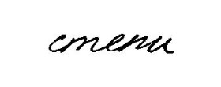
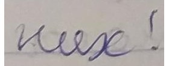
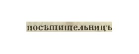
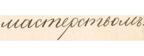

### Примеры предсказаний

| Модель | [**Handwritten Essay**](https://huggingface.co/datasets/sherstpasha/handwritten_essay)  **GT:** степи | [**School Notebooks RU**](https://huggingface.co/datasets/ai-forever/school_notebooks_RU)  **GT:** них! | [**Russian Old Orthography OCR**](https://huggingface.co/datasets/nevmenandr/russian-old-orthography-ocr)  **GT:** посѣтительницъ | [**YeniseiGovReports-HWR**](https://huggingface.co/datasets/sherstpasha/YeniseiGovReports-HWR)  **GT:** мастерствомъ. |
| --- | --- | --- | --- | --- |
| **trba_base_g1** | степи | них! | посѣшительницъ | мастерствомъ. |
| **trba_lite_g1** | степи | них! | посѣтишельницъ | мастерствомъ. |
| **trocr_ru_1700s** | степи | них! | посѣтительницъ | мастерствомъ. |
| **trocr_large_rukopys_hw** | степи | них! | посътипельниць | мастерствомъ. |
| **paddleocr_v6_medium_ru** | стерти | них! | посъпишельниць | мастерствомь |
| **kraken_ppocrv6_medium** | сmeu | них! | посѣтиіпельницы | мастерствомъ. |
| **cyrillic_large_handwritten** | степи | ниях. | посетительницъ | мастерствомъ. |
| **trocr_dialectic_stackmix** | степи | них: | ПОСБТИПЕЛЬНИЦБ | мастерствомъ. |
| **trocr_dialectic** | степи | них: | ПОСБЕПИТЕЛЬНИЦБ | мастерствомъ. |
| **trocr_base_ru** | степи | них! | посыпительницы | мастерствомъ. |
| **kraken_ppocrv6_small** | стeпи | тх! | посѣти пельниць | мастерствомъ. |
| **trocr_base_handwritten_ru** | степи | них! | посытиплавныч | мастерствомь. |
| **cyrillic_htr_model** | степи | них. | посетительницъ | мастерствомъ. |
| **trocr_handwritten_cyrillic** | степи | них! | посѣтительницъ | мастерствомъ. |
| **paddleocr_v6_tiny_ru** | стери | нех | посъпипельниць | мастеостволь |
| **trocr_rukopys** | степи | них! | посьпипельниць | мастерстьому. |
| **kraken_ppocrv6_tiny** | cmenu | нх! | посѣтиіпельииць | мастерствомъ. |
| **paddleocr_cyrillic_v5_mobile** | cmenu | vue! | посьпипельниць | шcmepсmвocil. |
| **parseq_s_rukopys** | степи | них! | посьмительниць | мастерствомъ. |
| **trocr_russian_18th_century_printed** | спеми | Иеле | посьтительницъ | ливсигерававовычъ. |
| **turkicocr_svtrv2_b** | стетии | кег і. | посьипельниць | аастерсттвоыиы |
| **paddleocr_eslav_v5_mobile** | cmenu | nue! | посьпипельниць | uастерсmвосиь. |
| **parseq_b_rukopys** | степи | них! | посьмительницт | мастерствомъ. |
| **cyrillic_g2** | €<л2& | Илу < | посъпишпельницъ | '09'0 042280 |
| **cyrillic_g1** | (ели | иуе ! | посъшилельниц | шопоииоми |
| **trocr_prereform_orthography** | Стева | ЛІЕСВА | посѣшишельницъ | ЧІОЯСДЕНТБІіЕ. Н |
| **crnn_ctc_church_slavonic** | за¬ | . | посьтительницъ | ммооомъ |
| **tesseract_cyrillic_best** | СУТТЕ | ГСТУ | посътиштельни ць | а 5 |
| **trocr_church_slavonic_handwritten** | ствиꙗ | имъ. | посьтительниць | ими ситерꙿствомъ. |
| **tesseract_rus_best** | Сидов | ∅ | посъпиищельниць | СОСОЕОООООРОСИЙ |
| **party_european_languages** | Evand | Шек | ineching to us in | мавіровомъ. |
